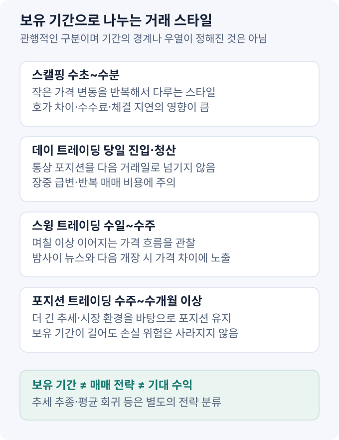
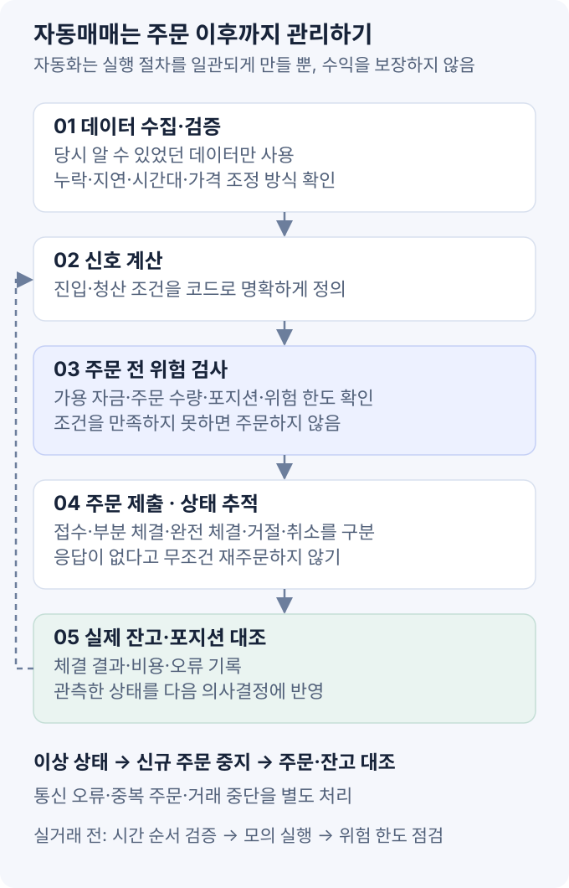

보유 기간·전략·지표·주문 방식과 검증 기준을 정리한다. 예시의 숫자와 매매 규칙은 설명용이며, 특정 자산·전략·자금 배분을 권하는 내용은 아니다.

## 1. 보유 기간별 분류

스캘핑·데이·스윙·포지션은 주로 보유 기간을, 추세 추종·평균 회귀는 거래 가설을 설명한다. 예를 들어 스윙에서도 추세 추종이나 평균 회귀를 사용할 수 있다.



| 스타일 | 통상적인 보유 기간 | 주의할 부담 |
| --- | --- | --- |
| 스캘핑 | 수초~수분 | 작은 가격 차이에 비해 수수료·스프레드·지연의 영향이 큼 |
| 데이 트레이딩 | 장중, 보통 당일 청산 | 장중 변동·집중력·잦은 거래비용 |
| 스윙 | 수일~수주 | 야간·휴장 중 뉴스와 가격 갭 |
| 포지션 | 수주~수개월 이상 | 큰 추세 가설의 실패와 장기간의 변동 |

기간의 경계는 시장과 운용 방식에 따라 달라진다. 짧게 보유한다고 손실이 작아지는 것은 아니며, 빈번한 매매는 거래비용과 운영 부담을 키울 수 있다. [FINRA의 장중 매매 위험 설명](https://www.finra.org/investors/insights/frequent-intraday-trading).

## 2. 전략별 가정·위험

| 전략 | 핵심 가설 | 실패할 수 있는 조건 |
| --- | --- | --- |
| 추세 추종 | 형성된 방향성이 일정 기간 이어짐 | 횡보 구간에서 반복적인 진입·청산 |
| 평균 회귀 | 기준에서 벗어난 가격이 되돌아옴 | 구조적 변화로 기준 자체가 이동 |
| 돌파 | 중요한 구간을 벗어난 뒤 움직임이 지속 | 일시적 돌파 후 범위 안으로 복귀 |
| 박스권 | 일정 범위가 당분간 유지 | 범위 이탈과 급격한 변동 |
| 차익거래 | 관련 시장·상품 사이의 가격 차이를 거래 | 체결 시차·전송 지연·수수료·상대방 위험 |
| 마켓 메이킹 | 매수·매도 호가를 제공하고 스프레드를 확보 | 재고 누적·역선택·급변동 |

전략별 가설은 시장과 비용 조건에 따라 검증해야 한다. 차익거래·마켓 메이킹에도 체결 시차·미체결·재고·거래상대방 위험이 남는다.

“20일 이동평균 위면 매수” 같은 문장은 검증할 수 있는 규칙의 예일 뿐이다. 수익성을 말하려면 청산 조건, 체결 시점, 비용, 거래 가능 수량과 검증 구간까지 정의해야 한다.

## 3. 기술 지표

| 지표 | 계산 대상 | 흔한 오해 |
| --- | --- | --- |
| MA·EMA | 일정 구간의 평균 가격, EMA는 최근 관측에 더 큰 가중 | 평균선 위라는 사실만으로 이후 상승을 보장 |
| MACD | 이동평균 간 차이와 그 변화 | 교차만으로 추세 전환을 확정 |
| RSI | 일정 기간 상승·하락 움직임의 상대 강도 | 높은 값이면 반드시 하락, 낮으면 반드시 반등 |
| ATR | 가격 범위와 갭을 반영한 변동성 | 값이 크면 상승한다는 방향 지표로 사용 |
| VWAP | 선택한 구간의 거래량가중평균 가격 | 기관의 실제 평균 매입단가나 지지선으로 단정 |

위 표의 마지막 열은 지표로 단정해서는 안 되는 해석이다. 특히 ATR은 변동성의 크기를 나타내며 상승·하락 방향을 나타내지 않는다. [Fidelity ATR 설명](https://www.fidelity.com/learning-center/trading-investing/technical-analysis/technical-indicator-guide/atr).

정의와 구현 인터페이스는 [TA-Lib 모멘텀 지표](https://ta-lib.github.io/ta-lib-python/func_groups/momentum_indicators.html), [변동성 지표](https://ta-lib.github.io/ta-lib-python/func_groups/volatility_indicators.html)를 참고한다. 같은 이름이라도 입력·기간·초기화 방식이 다르면 값이 달라질 수 있다.

VWAP의 기본 형태는 다음과 같다.

```text
VWAP = Σ(price × volume) / Σ(volume)
```

어떤 가격 표본과 구간을 썼는지에 따라 결과가 달라진다. 봉의 대표 가격으로 계산한 근사와 개별 체결 데이터로 계산한 값도 구분해야 한다.

지표는 대부분 같은 가격·거래량 데이터에서 계산된다. 유사 지표의 신호가 겹쳐도 독립적인 증거가 늘어나는 것은 아니다.

## 4. 주문 유형·체결 비용

| 주문 | 의도 | 남는 위험 |
| --- | --- | --- |
| 시장가 | 가격 확정보다 빠른 체결을 우선 | 예상과 다른 가격, 유동성 부족·급변동 |
| 지정가 | 지정 가격 또는 더 유리한 가격으로만 체결 | 체결되지 않거나 일부만 체결 |
| Stop-market | 조건 가격 도달 시 시장가 주문으로 전환 | stop 가격이 실제 체결 가격을 보장하지 않음 |
| Stop-limit | 조건 도달 후 지정가 주문으로 전환 | 급변 시 가격을 지키는 대신 미체결 가능 |

**손절 주문은 손실 상한을 보증하는 보험이 아니다.** 가격 갭·유동성 부족·거래 중단 등으로 예상보다 불리한 가격에 체결되거나 청산이 지연될 수 있다. 상품과 거래소에 따라 지원하는 주문·발동 기준도 다르다. [Investor.gov 주문 유형](https://www.investor.gov/introduction-investing/investing-basics/how-stock-markets-work/types-orders), [FINRA Stop 주문 주의점](https://www.finra.org/investors/insights/stop-orders-factors-consider-during-volatile-markets).

- **스프레드:** 최우선 매수·매도 호가의 차이.
- **슬리피지:** 기준으로 삼은 예상 가격과 실제 체결 가격의 차이.
- **거래비용:** 수수료 외에 세금·차입 비용·펀딩 비용 등이 상품에 따라 추가될 수 있다.

체결 시뮬레이션에서는 비용의 기준을 정해 같은 비용을 중복 반영하지 않는지도 확인한다.

## 5. 포지션 크기 계산

현물 매수의 단순한 계획식은 다음처럼 쓸 수 있다.

```text
계획 수량 = floor(허용 손실 예산 / 주당 계획 손실)
주당 계획 손실 = 진입 가격 - 손절 기준 가격
```

예를 들어 진입 가격 10,000원, 손절 기준 9,500원, 손실 예산 10,000원을 가정하면 계획 수량은 20주다. 이 계산에는 매수에 필요한 200,000원의 자금이 따로 필요하며, 수수료·세금·슬리피지와 가격 갭은 생략돼 있다.

손절 기준을 더 멀리 둔다면 같은 예산에서 수량은 줄어든다. 다만 이 예산은 **계획값**이지 실제 손실의 보장된 상한이 아니다. 비용·현금 한도·동시 보유 포지션 간 상관관계도 함께 고려해야 한다.

레버리지 상품은 현물의 계산만으로 판단할 수 없다. 증거금·청산·차입 조건이 추가되며 일부 거래는 처음 투입한 금액보다 큰 손실로 이어질 수 있다. [FINRA의 증거금·빈번한 거래 위험](https://www.finra.org/investors/insights/frequent-intraday-trading).

## 6. 기대값·낙폭

```text
거래당 기대값
= 승리 확률 × 평균 이익
- 패배 확률 × 평균 손실
- 평균 거래비용
```

설명용으로 승률 40%, 평균 이익 2R, 평균 손실 1R이면 비용 전 기대값은 `0.4 × 2R - 0.6 × 1R = 0.2R`다. 여기서 R은 정한 손실 기준 단위다.

하지만 과거 표본의 평균이 미래에도 유지된다는 보장은 없다. 기대값이 양수였더라도 긴 연속 손실이나 큰 낙폭이 발생할 수 있다. 승률만 보지 말고 거래 수, 손익 분포, 최대 낙폭, 비용 민감도와 구간별 일관성을 함께 기록한다.

## 7. 백테스트·자동매매



1. **미래 정보 사용:** 봉의 종가로 만든 신호를 그 종가가 확정되기 전에 거래한 것처럼 처리하지 않는다.
2. **데이터 선택 편향:** 살아남은 자산이나 잘 나온 기간만 선택하지 않는다.
3. **과최적화:** 같은 구간에서 규칙을 반복 수정한 뒤 그 구간을 최종 검증 결과처럼 쓰지 않는다.
4. **비용·체결 생략:** 수수료·스프레드·부분 체결·지연을 제외한 결과와 실제 운용을 구분한다.
5. **표본 부족:** 거래 몇 번의 결과를 안정적인 성과로 일반화하지 않는다.

개발 구간과 이후 검증 구간을 시간순으로 분리하고, 결과를 본 뒤 검증 구간에 맞춰 계속 규칙을 바꾸지 않는다. 미래 데이터 참조가 수익성을 부풀리는 구체적인 사례는 [Freqtrade의 lookahead 분석 문서](https://www.freqtrade.io/en/stable/lookahead-analysis/)에서도 확인할 수 있다.

자동화에서는 주문 요청 성공과 체결 완료도 다르다. 재시도에 따른 중복 주문, 주문 상태와 실제 보유 수량의 불일치, API 단절 시 중단·복구를 별도로 설계해야 한다.

## 8. 검증 기록

- 거래 가설과 그 가설이 깨졌다고 볼 조건.
- 데이터 출처·기간·시간대·가격 보정 방식.
- 신호를 계산할 수 있었던 시점과 주문·체결 시점.
- 수수료·세금·슬리피지·유동성 가정.
- 구간별 결과와 비용·파라미터 변경에 대한 민감도.
- 모의 운용에서 관측한 주문 상태·잔고·실패 이력.

## 참고 자료

- [Investor.gov — Types of Orders](https://www.investor.gov/introduction-investing/investing-basics/how-stock-markets-work/types-orders)
- [FINRA — Frequent Intraday Trading](https://www.finra.org/investors/insights/frequent-intraday-trading)
- [FINRA — Stop Orders](https://www.finra.org/investors/insights/stop-orders-factors-consider-during-volatile-markets)
- [TA-Lib 지표 문서](https://ta-lib.github.io/ta-lib-python/doc_index.html)
