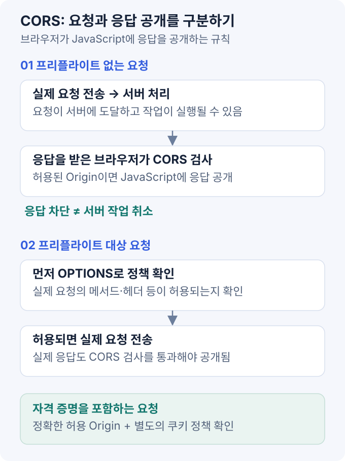

CORS는 서버의 응답 헤더를 기준으로 **브라우저가 다른 출처의 응답을 JavaScript에 공개할지 판단하는 규칙**이다. 응답 공개와 서버의 요청 처리는 별개이며, 인증·인가·CSRF 방어는 따로 구성한다. [Fetch 표준](https://fetch.spec.whatwg.org/#http-cors-protocol).

## 1. Origin 구성

일반적인 HTTP(S) URL의 Origin은 `scheme + host + port`로 결정된다. 경로는 포함하지 않으며 기본 포트는 정규화된다.

| 두 주소 | 관계 |
| --- | --- |
| `https://example.com/a` / `https://example.com/b` | 같은 출처 |
| `https://example.com` / `https://example.com:443` | 같은 출처 |
| `https://app.example.com` / `https://api.example.com` | host가 달라 교차 출처 |
| `http://localhost:5173` / `http://localhost:8080` | port가 달라 교차 출처 |

`localhost`와 `127.0.0.1`도 서로 다른 host다. 또한 쿠키의 **same-site와 CORS의 same-origin은 같은 판정이 아니다.** 서브도메인끼리 same-site일 수 있어도 CORS 관점에서는 교차 출처다. [MDN CORS](https://developer.mozilla.org/en-US/docs/Web/HTTP/Guides/CORS), [쿠키의 SameSite](https://developer.mozilla.org/en-US/docs/Web/HTTP/Reference/Headers/Set-Cookie).

## 2. SOP·CORS 적용 범위

SOP는 다른 출처의 데이터를 스크립트가 자유롭게 읽지 못하도록 제한한다. CORS는 서버가 허용한 출처에 그 응답을 공개하는 방법이다.

HTML 폼과 같은 방식으로 보낼 수 있는 요청은 CORS 허용 없이도 서버에 도착할 수 있다. 서버가 상태를 바꾼 뒤 브라우저가 응답 읽기만 차단할 수도 있으므로, **CORS 설정만으로 CSRF를 막았다고 판단하면 안 된다.** 인증·권한 확인과 CSRF 방어는 별도로 필요하다. [OWASP CSRF 방어](https://cheatsheetseries.owasp.org/cheatsheets/Cross-Site_Request_Forgery_Prevention_Cheat_Sheet.html).

## 3. Preflight 조건



Preflight를 생략하는 simple request는 다음 safelist 조건을 만족해야 한다.

- 메서드는 `GET`·`HEAD`·`POST` 중 하나여야 한다.
- 직접 설정한 헤더와 값도 CORS safelist 조건을 만족해야 한다.
- `Content-Type`은 대표적으로 `text/plain`·`multipart/form-data`·`application/x-www-form-urlencoded`가 해당한다.

`application/json`·`Authorization` 헤더나 `PUT`·`DELETE` 메서드 등을 사용하면 보통 `OPTIONS` preflight로 출처·메서드·헤더 허용 여부를 먼저 확인한다. 본요청의 인증·인가 검사는 별도로 수행한다. [MDN simple request 조건](https://developer.mozilla.org/en-US/docs/Web/HTTP/Guides/CORS#simple_requests).

Preflight 결과가 캐시되면 `OPTIONS` 없이 본요청이 전송될 수 있다.

## 4. 쿠키 인증 요청 예제

프런트 출처가 `https://app.example.com`, API가 `https://api.example.com`인 예시다.

```javascript
const response = await fetch('https://api.example.com/api/preferences', {
  method: 'POST',
  credentials: 'include',
  headers: { 'Content-Type': 'application/json' },
  body: JSON.stringify({ theme: 'dark' }),
})

if (!response.ok) {
  throw new Error('HTTP status: ' + response.status)
}

const preferences = await response.json()
```

브라우저가 보내는 사전 요청의 핵심 헤더는 다음과 같다. `Origin`과 `Access-Control-Request-*`는 브라우저가 작성한다.

```http
OPTIONS /api/preferences HTTP/1.1
Host: api.example.com
Origin: https://app.example.com
Access-Control-Request-Method: POST
Access-Control-Request-Headers: content-type
```

서버가 해당 출처를 허용 목록과 대조해 승인했다면, preflight 응답은 다음처럼 구성할 수 있다.

```http
HTTP/1.1 204 No Content
Access-Control-Allow-Origin: https://app.example.com
Access-Control-Allow-Methods: POST
Access-Control-Allow-Headers: Content-Type
Access-Control-Allow-Credentials: true
Access-Control-Max-Age: 600
Vary: Origin
```

**본요청의 응답에도** 필요한 CORS 헤더가 있어야 한다. 사전 요청만 성공시키고 실제 응답에서 빠뜨리면 JavaScript가 결과를 읽지 못한다.

```http
HTTP/1.1 200 OK
Content-Type: application/json
Access-Control-Allow-Origin: https://app.example.com
Access-Control-Allow-Credentials: true
Vary: Origin

{"theme":"dark"}
```

이는 헤더 교환 예시이며, 실제 서버의 인증·인가·CSRF 검사는 생략했다. Preflight 자체에는 일반적으로 쿠키를 보내지 않으므로 `OPTIONS`에 로그인 쿠키를 강제하는 필터 구성도 점검한다. [Fetch CORS 프로토콜](https://fetch.spec.whatwg.org/#http-cors-protocol).

## 5. 허용 헤더·쿠키 정책

- **Origin은 하나만:** `Access-Control-Allow-Origin`에 여러 출처를 쉼표로 나열하지 않는다. 요청 출처를 허용 목록과 대조하고 승인한 하나만 반환한다.
- **Credentials와 wildcard:** credentials mode가 `include`인 요청에는 `Access-Control-Allow-Origin: *`를 사용할 수 없다. 실제로 쿠키가 있었는지만으로 판단하지 않는다.
- **캐시 분리:** Origin에 따라 응답 헤더가 달라지면 `Vary: Origin`을 사용한다. 기존 `Vary` 항목도 유지한다.
- **임의 반사 금지:** 요청의 `Origin`을 검증 없이 그대로 응답하지 않는다. 인증 없는 공개 데이터에는 `*`가 적절할 수 있지만 민감 API와는 정책을 분리한다.

위 조건은 [Access-Control-Allow-Origin 문서](https://developer.mozilla.org/en-US/docs/Web/HTTP/Reference/Headers/Access-Control-Allow-Origin)와 [Fetch 표준](https://fetch.spec.whatwg.org/#http-cors-protocol)에 근거한다.

쿠키에는 별도의 전송 조건도 있다. `credentials: 'include'`만으로 `SameSite`, `Secure`, 도메인·경로, 브라우저의 서드파티 쿠키 제한을 무시할 수는 없다. 교차 사이트 전송에 `SameSite=None`이 필요하다면 `Secure`도 함께 요구되지만, 이것이 모든 브라우저에서의 전송을 보장하지는 않는다. [Set-Cookie 문서](https://developer.mozilla.org/en-US/docs/Web/HTTP/Reference/Headers/Set-Cookie).

응답의 사용자 정의 헤더를 JavaScript에서 읽으려면 `Access-Control-Expose-Headers`가 필요할 수 있다. 다만 `Set-Cookie`는 스크립트에 공개되지 않는 헤더이므로 여기에 추가해서 읽는 방식은 사용할 수 없다.

## 6. 오류 진단

| 증상 | 점검 항목 |
| --- | --- |
| `OPTIONS`가 401·403·404 | 인증 필터, 게이트웨이 라우팅, 메서드 허용 정책 |
| `OPTIONS` 성공 후 본요청 차단 | 실제 응답의 Origin·Credentials 헤더와 요청 헤더 허용 |
| API는 200인데 `fetch` 실패 | 응답 공개 조건. 서버에서 작업이 이미 수행됐을 가능성도 확인 |
| 에러 응답에서만 CORS 오류 | 401·403·500을 만드는 프록시·예외 처리 경로의 헤더 |
| 로컬에서만 성공 | 개발 프록시 사용 여부와 운영 Origin 차이 |
| 쿠키가 요청에 없음 | 쿠키 범위·SameSite·Secure·credentials·브라우저 정책 |

Postman·`curl`·서버 간 통신은 브라우저의 CORS 응답 공개 검사를 대신하지 않는다. 이 도구로 API 자체를 확인한 뒤 실제 브라우저의 Network·Console을 함께 본다.

`mode: 'no-cors'`는 API 응답을 읽기 위한 해결책이 아니다. 응답이 opaque가 되어 일반적인 JSON 조회에 사용할 수 없고, 서버 설정을 고치지도 않는다. 개발 프록시로 요청을 같은 출처로 만드는 경우에도 운영 환경의 라우팅·보안 정책은 따로 설계해야 한다.

## 참고 자료

- [WHATWG Fetch — CORS protocol](https://fetch.spec.whatwg.org/#http-cors-protocol)
- [MDN — CORS](https://developer.mozilla.org/en-US/docs/Web/HTTP/Guides/CORS)
- [OWASP — CSRF Prevention](https://cheatsheetseries.owasp.org/cheatsheets/Cross-Site_Request_Forgery_Prevention_Cheat_Sheet.html)
