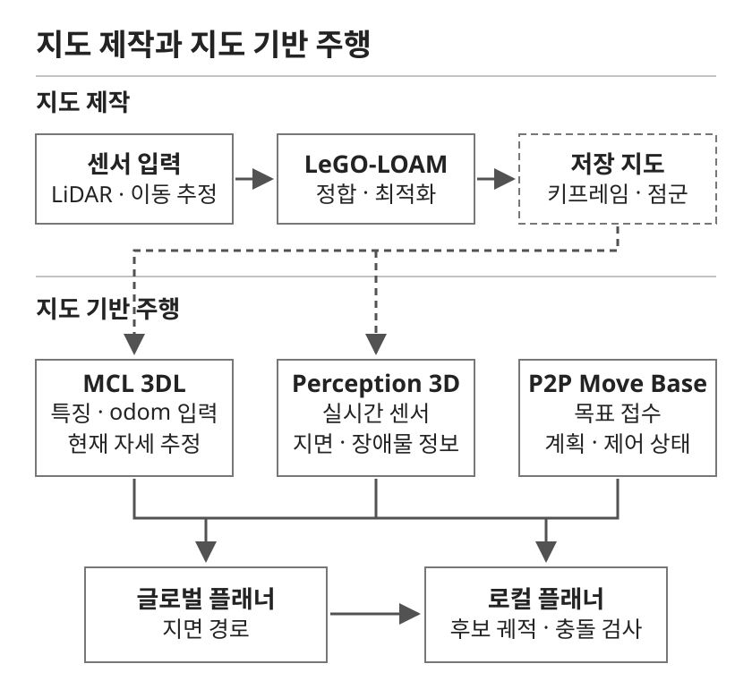
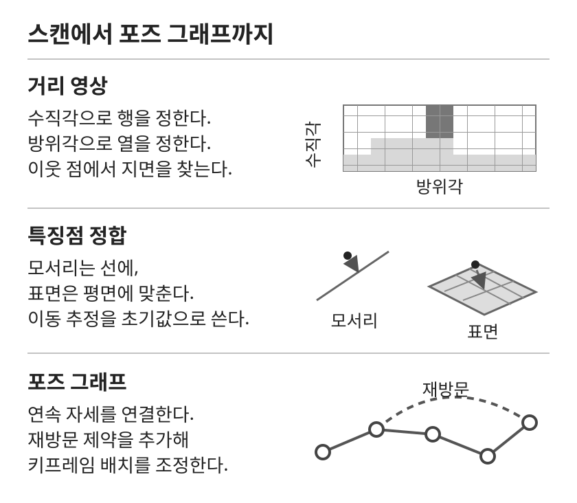
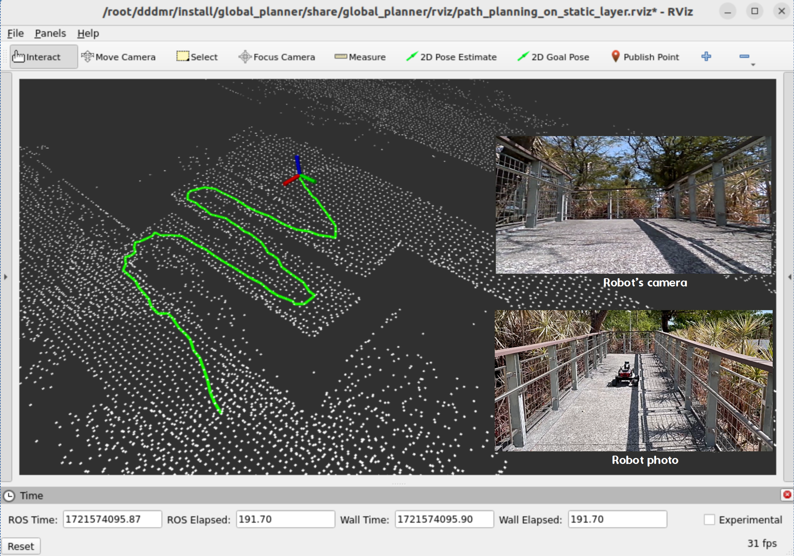
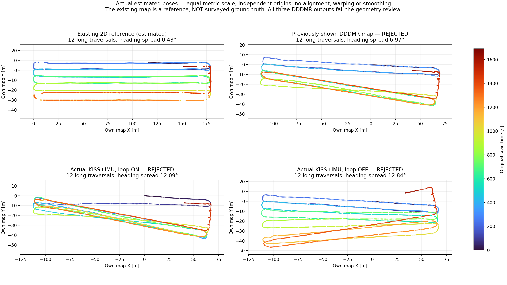
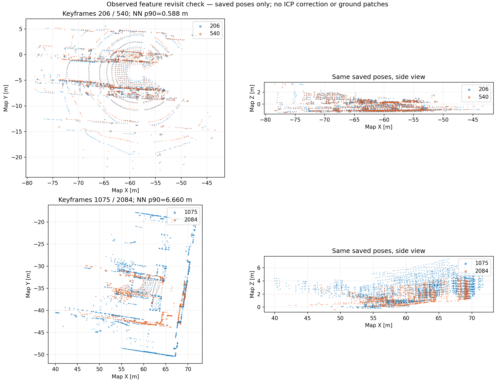
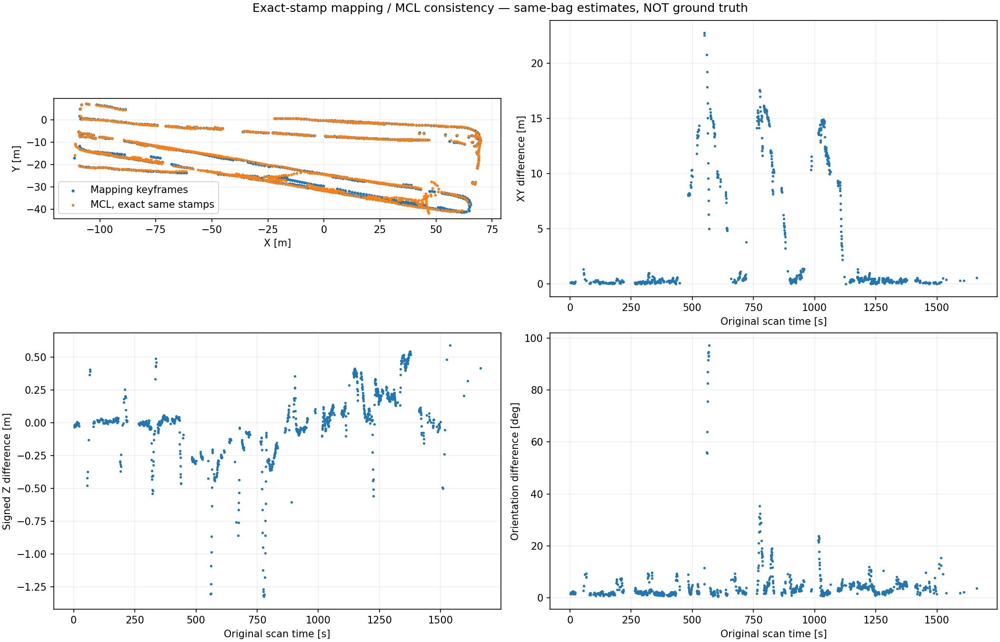
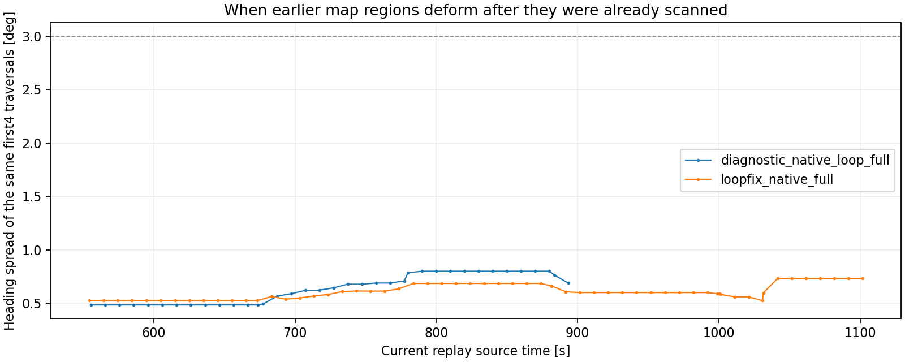

DDDMR Navigation은 3D LiDAR로 키프레임 지도를 만들고, 저장한 지도에서 위치를 추정해 지면을 따라 주행하는 ROS 2 스택이다. 지면 높이를 유지한 전역 경로와 주변 장애물을 피할 로컬 궤적을 계산한다.

XT32로 기록한 약 28분짜리 데이터를 끝까지 재생해 맵과 위치 추정 출력을 얻었다. 그러나 긴 통로들이 부채꼴로 벌어지고 서로 다른 주행 구간이 겹쳤다. 이 맵으로 실행한 위치 추정에서는 0.2초 사이에 약 17 m 이동하는 도약도 발생했다.

> **기준 소스는 `02f3bfe`다.** 코드는 2026년 11월 6~9일에 확인했고, XT32 결과는 11월 9일 중단 시점까지의 기록을 사용했다. [DDDMR Navigation 소스](https://github.com/dfl-rlab/dddmr_navigation/tree/02f3bfe56217ac4e99f3af1e273cc3cbcb2024e4)

<details class="post-toc" id="목차">
<summary>목차</summary>

1. [지도 제작과 주행 구조](#1-지도-제작과-주행-구조)
2. [LeGO-LOAM 지도 제작](#2-lego-loam-지도-제작)
3. [MCL 3DL 위치 추정](#3-mcl-3dl-위치-추정)
4. [장애물 인식과 경로 계획](#4-장애물-인식과-경로-계획)
5. [XT32 입력과 전체 지도 검사](#5-xt32-입력과-전체-지도-검사)
6. [전체 재생의 위치 도약](#6-전체-재생의-위치-도약)
7. [루프 제약 재현과 부분 재생](#7-루프-제약-재현과-부분-재생)
8. [확인한 범위와 출처](#8-확인한-범위와-출처)

</details>

## 1. 지도 제작과 주행 구조



*그림 1. 직접 그린 개념도. 점선은 지도 제작 단계에서 저장한 파일을 주행 단계에서 읽는 흐름이다. 두 플래너는 현재 자세와 장애물 정보를 사용하며 P2P가 계획·제어 상태를 관리한다.*

| 모듈 | 입력 | 기대 출력 |
| --- | --- | --- |
| `dddmr_lego_loam` | 3D LiDAR, 선택한 오도메트리 | 키프레임 자세, 포즈 그래프, 특징·지면 점군 |
| `dddmr_pg_map_server` | 저장 포즈 그래프와 키프레임 점군 | 자세 변환을 적용해 조립한 지도 점군 |
| `dddmr_mcl_3dl` | 초기 자세, 오도메트리, 실시간 특징, 저장 지도 | `mcl_pose`, 입자 분포, 설정에 따른 `map → odom` TF |
| `dddmr_perception_3d` | 지면·정적 지도, 실시간 센서 | 플래너가 조회할 정적 그래프와 동적 장애물 정보 |
| `dddmr_global_planner` | 현재 자세, 목표, 지면 그래프와 비용 | 목표까지 이어지는 3D 경로 |
| `dddmr_local_planner` | 전역 경로, 로봇 상태, 주변 장애물 | 충돌 검사를 거친 후보 궤적과 선택된 동작 |
| `dddmr_p2p_move_base` | 목표 자세, 계획·제어 결과 | 상태 전환, 액션 피드백, 구동계에 맞는 명령 |


*그림 2. 공식 문서의 구성 비교. 오른쪽에서 위치 추정, 장애물 인식, 두 플래너가 사용하는 3D 환경 표현을 볼 수 있다. 해당 그림은 두 스택의 대표 구성을 비교한다. [공식 개요](https://github.com/dfl-rlab/dddmr_navigation/blob/02f3bfe56217ac4e99f3af1e273cc3cbcb2024e4/README.md)*

Nav2에서도 위치 추정과 주행 계획은 독립적으로 구성할 수 있다. 외부 3D 위치 추정기를 연결하거나 Voxel Layer에 3D 장애물 관측을 입력할 수 있다. 표준 `Costmap2D`에서 Voxel Layer의 점유 정보는 2D 계획 격자로 투영된다. DDDMR의 전역 계획은 높이 좌표를 유지하는 지면 점들을 그래프의 노드로 사용한다. 경사로처럼 높이 변화와 실제 연결 관계가 둘 다 중요한 곳에서 이 표현 차이가 드러난다. [Nav2 위치 추정과 경로 계획](/blog/nav2-navigation-study/) · [Nav2 Jazzy Voxel Layer](https://docs.nav2.org/jazzy/configuration_and_development/configuration_guide/core_servers/costmap_2d/costmap_plugins/voxel/)

## 2. LeGO-LOAM 지도 제작

### 2.1 거리 영상에서 지면과 특징점 고르기

회전형 LiDAR가 내보내는 점군을 수직각과 방위각으로 배열하면, 각 칸에 센서에서 반사점까지의 거리를 담은 **거리 영상(range image)**을 만들 수 있다. 원본 점의 공간 좌표를 유지하면서 스캔 내 이웃을 찾기 위한 표현이다. 채널 각도, 수평 투영 해상도, LiDAR 장착 변환을 함께 맞춰야 서로 다른 점군에서도 이 이웃 관계가 성립한다.

투영 단계는 인접 스캔 행의 점 사이 기울기와 설정한 지면 관측 범위를 이용해 지면 후보를 찾는다. 특징 추출은 가까운 거리 값들의 변화량을 보고 모서리와 평탄한 표면에 해당하는 점을 고른다. 지면 관측은 표면 특징에 쓰일 수 있고, 별도로 저장하는 지면 모델에는 조건을 만족하는 관측 사이를 채운 패치도 들어간다. [LeGO-LOAM 패키지](https://github.com/dfl-rlab/dddmr_navigation/tree/02f3bfe56217ac4e99f3af1e273cc3cbcb2024e4/src/dddmr_lego_loam) · [LiDAR 지면 분리](/blog/lidar-ground-segmentation/)



*그림 3. 직접 그린 개념도. 실선은 연속 키프레임 간 연결, 점선은 시간상 떨어진 키프레임을 잇는 재방문 제약이다.*

### 2.2 이동 추정, 스캔 정합, 루프 제약

- `laser_odometry`는 연속 스캔의 특징을 대응시켜 움직임을 누적한다.
- `wheel_odometry`는 외부 오도메트리를 받는 경로다. 휠 기반 추정을 넣을 수 있고, 이 실험에서는 별도 LiDAR 추정기와 IMU에서 계산한 이동 정보를 넣었다.
- 두 경로 모두 지도 최적화에서 이동 추정을 초기값으로 삼는다. 현재 특징을 주변 키프레임으로 구성한 지역 지도에 맞추는 단계가 이어진다.
- 저장소의 `dddmr_odom_3d`는 2D odometry와 IMU 자세를 쓰는 별도 노드다. 어떤 추정기를 실행하고 어떤 토픽·시각·좌표계로 연결할지는 구성에 달려 있다. [Feature Association 구현](https://github.com/dfl-rlab/dddmr_navigation/blob/02f3bfe56217ac4e99f3af1e273cc3cbcb2024e4/src/dddmr_lego_loam/lego_loam_bor/src/featureAssociation.cpp) · [3D 오도메트리 예제](https://github.com/dfl-rlab/dddmr_navigation/tree/02f3bfe56217ac4e99f3af1e273cc3cbcb2024e4/src/dddmr_odom_3d)

스캔과 지도를 맞추는 원리를 단순화하면, 현재 스캔의 점 `p`에 자세 변환 `T`를 적용하고 지도 쪽 선 `L` 또는 평면 `Π`과의 거리를 줄인다. 아래 식은 정합 목적을 설명하기 위한 개념식이다.

```text
T* = arg min_T [Σ_edge d(Tp, L)² + Σ_surface d(Tp, Π)²]
```

평행한 벽만 길게 이어지면 벽에 가까운 방향의 오차와 벽을 따라 미끄러지는 방향의 오차에 대한 관측 민감도가 다르다. 스캔이 벽에 잘 붙어 보여도 통로를 따라 충분히 움직였는지, 옆 차로와 혼동했는지 구별하기 어려울 수 있다.

키프레임을 추가할 때는 추정 자세를 그래프에 기록한다. 재방문 후보가 생기면 과거 키프레임 근처 점군에 현재 점군을 ICP로 맞추고, 채택한 상대 변환을 제약으로 추가한다. 최적화가 이전 키프레임 자세까지 갱신하기 때문에 올바른 재방문은 드리프트를 줄이고 잘못된 제약은 이미 지나온 구간의 형상도 바꿀 수 있다. [지도 정합·루프 제약·내보내기 구현](https://github.com/dfl-rlab/dddmr_navigation/blob/02f3bfe56217ac4e99f3af1e273cc3cbcb2024e4/src/dddmr_lego_loam/lego_loam_bor/src/mapOptimization.cpp)

### 2.3 저장한 지도의 구성

| 파일 | 내용 |
| --- | --- |
| `poses.pcd` | 지도 좌표계에서의 키프레임 위치와 자세 |
| `edges.pcd` | 그래프에서 연결된 키프레임 인덱스 쌍 |
| `pcd/<id>_feature.pcd` | 키프레임 좌표계의 모서리 특징 |
| `pcd/<id>_ground.pcd` | 키프레임 좌표계의 지면 모델 |
| `pcd/<id>_surface.pcd` | 키프레임 좌표계의 표면 특징 |
| `map.pcd`, `ground.pcd` | 지도 좌표계로 합성한 특징 지도와 지면 모델 |

키프레임마다 자세와 지역 점군을 따로 갖고 있으면, 최적화한 자세로 지도를 다시 조립하거나 현재 위치 주변만 읽을 수 있다. 지면 모델의 채움 패치는 관측 사이를 보완한 추정이다. 바닥의 모든 점을 개별 센서 반사로 해석하면 실제 관측 범위를 과대평가하게 된다.

## 3. MCL 3DL 위치 추정

지도 제작이 끝나면 고정된 지도에서 실시간 센서 관측으로 로봇 자세를 추정한다. 공식 예제에서는 RViz에서 초기 자세를 제공한다. 로봇의 위치와 방향을 어느 정도 알고 시작해야 해당 구역의 특징과 지면을 이용해 입자 가설을 평가할 수 있다.


*그림 4. 직접 그린 개념도. 점은 가능한 로봇 자세를 뜻한다. 가운데의 큰 점은 관측에 더 잘 맞은 가설이고, 아래에서는 그 주변의 가설이 더 자주 선택된다.*

1. **예측.** 직전 자세 가설을 오도메트리의 상대 이동량으로 옮기고 운동 잡음을 더한다.
2. **관측 갱신.** 각 가설 자세에서 현재 특징점을 지도에 놓고 주변 특징과 비교한다. 특징 군집과 방향 정보를 이용해 관측 기여도를 조절하며, 지면 정보도 자세 가설의 평가에 쓴다.
3. **재표본화.** 가중치가 큰 가설을 더 자주 뽑아 다음 갱신에 사용할 입자를 만든다. 움직임이 일정 기준보다 작을 때는 관측 갱신을 건너뛸 수 있다.

일반적인 입자 필터의 가중치 갱신은 다음과 같다. `xᵢ`는 예측한 입자 자세, `z`는 현재 특징 관측, `M`은 지도, `L`은 그 자세에서의 관측 우도다. 각 입자의 이전 가중치 `wᵢ`에 우도를 곱한 뒤 전체 가중치 합이 1이 되도록 정규화한다.

```text
wᵢ(new) ∝ wᵢ(old) × L(z | xᵢ, M)
```


*그림 5. 공식 문서의 서브맵 개념도. 아래 원들은 지도 키프레임이다. 현재 창과 이후 사용할 창의 범위를 보여준다. 구현은 로봇이 일정 거리만큼 이동하면 최신 추정 자세를 중심으로 다음 창을 준비한다. [MCL 3DL 문서](https://github.com/dfl-rlab/dddmr_navigation/tree/02f3bfe56217ac4e99f3af1e273cc3cbcb2024e4/src/dddmr_mcl_3dl)*

전체 점군을 입자마다 탐색하는 대신 가까운 키프레임의 특징을 조립하면 최근접점 탐색 범위를 줄일 수 있다. 그만큼 초기 자세와 지도의 배치에 의존한다. 반복 구조에서는 여러 가설의 점수가 비슷해질 수 있고, 지도에서 실제로 떨어진 차로가 겹쳐 있으면 스캔을 지도의 엉뚱한 위치에 맞출 수도 있다. 지면 제약은 높이와 기울기 가설을 줄이는 데 도움이 되지만, 비슷하게 생긴 옆 차로까지 구분하려면 추가 공간 단서가 필요하다.

## 4. 장애물 인식과 경로 계획

### 4.1 지면 그래프와 장애물 관측

`dddmr_perception_3d`는 저장 지면의 연결과 정적 비용을 제공하고, 센서 관측으로 동적 장애물 상태를 갱신한다. 장애물이 관측되면 주변 지면 노드의 비용에 반영한다. 센서 시야에서 해당 공간이 비었다는 관측을 얻으면 플러그인의 규칙에 따라 이전 표시를 지운다. 지면 경계, 진입 금지 구역, 속도 제한 구역도 구성할 수 있다. 관측이 가려진 구역에서는 표시 해제 조건이 특히 중요하다. [Perception 3D 패키지](https://github.com/dfl-rlab/dddmr_navigation/tree/02f3bfe56217ac4e99f3af1e273cc3cbcb2024e4/src/dddmr_perception_3d)

### 4.2 글로벌 플래너

글로벌 플래너는 출발점과 목표에 대응하는 지면 노드를 찾아 A*로 연결한다. 노드 `n`까지 도달한 누적 비용 `g(n)`에는 이동 거리와 장애물 근접·방향 변화 등의 비용이 들어간다. `h(n)`은 남은 비용의 추정으로, 구현에서는 목표까지의 3D 직선 거리를 사용한다. 장애물에 너무 가까운 노드는 확장 대상에서 제외한다. [A* 구현](https://github.com/dfl-rlab/dddmr_navigation/blob/02f3bfe56217ac4e99f3af1e273cc3cbcb2024e4/src/dddmr_global_planner/src/a_star_on_pre_graph.cpp)

```text
f(n) = g(n) + h(n)
```



*그림 6. 공식 글로벌 계획 데모. 녹색 경로는 지그재그 통로의 지면을 따라 굽이친다. 오른쪽 사진에서 실제 통로 형상을 볼 수 있다. [글로벌 플래너 문서](https://github.com/dfl-rlab/dddmr_navigation/tree/02f3bfe56217ac4e99f3af1e273cc3cbcb2024e4/src/dddmr_global_planner)*

경사로 위에 3D 경로를 만들려면 지면 데이터에 경사로의 연속된 연결이 있어야 한다. 높이가 다른 점들이 평면상 가까이 보이는 곳에서는 생성한 노드와 간선이 실제 통행 가능 구간을 따르는지 확인해야 한다. 잘못 합쳐진 지도에서는 A*도 그 연결을 이용해 실제로 건널 수 없는 지점으로 경로를 낼 수 있다.

### 4.3 로컬 플래너와 P2P Move Base

로컬 플래너는 전역 경로의 가까운 구간을 참고해 운동 모델이 허용하는 후보를 생성한다. 후보 궤적의 여러 자세에서 로봇 외형을 3D 직육면체로 놓고 장애물 점군과 겹치는지 검사할 수 있다. 충돌 검사를 통과한 후보에는 경로 방향 및 추종 상태 등의 비용을 적용해 실행할 동작을 고른다. 생성기와 평가기는 플러그인이며, 사용할 운동 제약과 평가 방식은 구성에 따라 달라진다.


*그림 7. 공식 로컬 플래너 데모. 노란 궤적은 그림에서 충돌 검사를 통과한 후보, 빨간 궤적은 평가 결과 선택한 동작이다. 보라색 점은 장애물 관측이다. [로컬 플래너 문서](https://github.com/dfl-rlab/dddmr_navigation/tree/02f3bfe56217ac4e99f3af1e273cc3cbcb2024e4/src/dddmr_local_planner)*

P2P Move Base는 목표를 받아 전역 계획 요청, 방향 정렬, 경로 추종, 도착 확인, 재계획이나 복구를 상태 전이로 관리한다. 선택된 궤적의 명령은 구동계에 따라 Twist 또는 Ackermann 메시지로 전달한다. Nav2에서 이러한 작업 순서를 관리하는 구성은 [Behavior Tree와 주행 복구](/blog/nav2-behavior-tree/)에서 이어서 볼 수 있다. [P2P Move Base 패키지](https://github.com/dfl-rlab/dddmr_navigation/tree/02f3bfe56217ac4e99f3af1e273cc3cbcb2024e4/src/dddmr_p2p_move_base)

## 5. XT32 입력과 전체 지도 검사

### 5.1 입력 및 비교 조건

| 항목 | 실험 조건 |
| --- | --- |
| 기록 | `sensors_20261028_134010_782114`, 점군 16,638개, 첫·마지막 스캔 헤더 간 1,692.231초 |
| LiDAR | Hesai XT32, 32개 링, 이중 반사, 수평 2,000개 방향 |
| 환경 | 언덕을 포함한 반복 주행 구간. 층간 이동은 없었다. |
| 좌표계 | 입력 `pandar_xt32_forward`에 yaw 90° 보정이 이미 적용된 상태였다. |
| IMU와 오도메트리 | VN-100의 가속도·자이로 약 200 Hz를 사용했다. 원본 `orientation` 필드는 사용할 수 없었고 `nav_msgs/Odometry`는 기록되어 있지 않았다. |
| 비교 기준 | 같은 bag의 기존 2D 지도와 자세 기록을 참고했다. 독립 측량 궤적은 없었다. |

이전 전체 지도 V1은 자체 LiDAR 오도메트리와 거리 범위 100 m를 사용했다. 정합의 퇴화 방향과 PCA 선 방향 처리를 수정한 코드가 포함됐다.

추가 전체 재생 두 건은 거리 범위 25 m를 사용했다. 원본 LiDAR를 다시 처리한 KISS-ICP의 몸체 `X/Y/yaw`와 가속도·자이로로 추정한 중력 기준 `roll/pitch`를 외부 odometry로 전달했다. 높이 `Z`는 관측되지 않은 성분으로 두었다. IMU 기록 시각은 근사 복원했고 보정 폭은 최대 약 97 ms였다. 유효한 IMU·오도메트리가 나오기 전 최초 17개 스캔은 제외했다. 외부 odometry를 쓴 두 건끼리는 입력과 거리 범위를 고정한 채 루프 설정만 전환했다.

초기 링 진단은 철회했다. 처음 계산한 32.19% 불일치는 저장소 생성자의 0.1° 여유각을 검사 수식에서 빠뜨려 생긴 값이었다. 원본 수식으로 전체 16,638개 스캔의 유효점 1,779,279,052개를 다시 검사하니 행 배치 불일치는 0개였다.

### 5.2 전체 지도와 긴 통로의 방향


*그림 8. XT32 V1 전체 출력. 위는 전체 XY 범위, 아래는 측면도다. 지도에는 2,191개 키프레임과 추정 지면 패치가 포함됐다. EOF와 파일 생성을 확인했지만 통로 배치가 틀어져 지도 품질은 부적합으로 판정했다.*

각 지도의 원래 좌표계에서 X 범위 양 끝 20 m를 제외했다. 남은 영역에서 X 방향으로 80 m 이상 이어지고 자세 표본이 15개 이상인 주행 구간 12개를 골랐다. 구간별 진행 방향을 선형 적합으로 구한 다음, 한 지도 안에서 방향이 얼마나 벌어졌는지 비교했다.

| 같은 bag의 결과 | 12개 긴 주행의 방향 벌어짐 | 지도 판정 |
| --- | ---: | --- |
| 기존 2D 추정 지도 | 0.426° | 비교용 추정치 |
| 이전 DDDMR V1 · Eigen/PCA 수정 포함 | 6.969° | 부적합 |
| 외부 KISS-ICP·IMU · 루프 켬 | 12.085° | 부적합 |
| 외부 KISS-ICP·IMU · 루프 끔 | 12.836° | 부적합 |



*그림 9. 좌상단은 비교용 2D 추정 지도, 나머지 세 패널은 모두 부적합한 DDDMR 결과다. 지도별 좌표 원점을 유지하고 거리 척도만 맞췄다. 색은 원본 스캔의 경과 시간을 나타낸다.*

외부 odometry를 쓴 두 지도는 루프를 켰을 때도 구간 겹침이 남았고, 껐을 때도 통로 방향이 벌어졌다. 방향 벌어짐과 겹침은 서로 다른 형상 문제다. 두 지표 모두 실제 위치나 절대 방위 오차 대신, 저장된 추정 자세가 만든 구조를 검사하는 데 사용했다.

### 5.3 재방문 스캔의 겹침



*그림 10. 재방문 표본 중 두 예. 저장한 자세로 관측 특징점만 배치했다. 그림에 맞추기 위한 추가 ICP나 지면 패치는 적용하지 않았다. 아래 예의 최근접점 거리 90백분위는 6.660 m다.*

재방문의 점군이 잘 맞는지는 경로 선만으로 보기 어려운 구조물 배치를 확인하는 보조 검사다. 시야가 가려졌거나 접근 방향이 달라 서로 다른 표면을 본 경우에도 최근접점 거리가 커진다. 반대로 비슷한 구조물이 반복되면 다른 장소의 점이 우연히 가까울 수 있다. 이런 이유로 최근접점 거리와 긴 구간의 배치를 함께 보았다.

## 6. 전체 재생의 위치 도약

전체 MCL 시험에는 V1 지도와 별도로 계산한 KISS-ICP·IMU 오도메트리를 사용했다. 최초 자세는 맵의 대응 키프레임으로 한 번 지정했다. 초기 17개 스캔은 유효 odometry 이전이어서 제외했고, 이후 16,621개 스캔을 EOF까지 재생했다. 입자는 150개였다. 재표본화 잡음의 표준편차는 X/Y 0.05 m, yaw 0.01185 rad로 조정했다. 기존 시험 설정값은 각각 0.2 m와 0.2 rad였으며, MCL의 우도와 입자 갱신식은 그대로 사용했다. 총 7,372개의 MCL 측정 갱신에서 특징·오도메트리 타임스탬프 불일치는 0건이었다.

입력과 MCL의 상대 XY 이동이 0.5초 이내에 1 m 넘게 어긋난 급보정은 12회였다. 대표 사례는 원본 스캔 시각 기준 570.007초에 나타났다. 직전 관측 창에서 특징점 프레임 23개 모두 처리 확인을 받았다.


*그림 11. 같은 0.200265초 동안 입력 odometry의 3D 위치는 0.340 m, MCL의 3D 위치는 17.090 m 달라졌다. 왼쪽은 도약 전후의 성분별 이동, 오른쪽은 해당 한 구간의 3D 이동량이다.*



*그림 12. 같은 bag의 추정 두 종류를 정확히 일치하는 시각으로 연결했다. 오른쪽 위 XY 차이에는 수백 초 구간의 큰 편차가 드러난다. 1,092쌍의 XY 차이는 중앙값 0.356 m, 95백분위 14.979 m, 최댓값 22.751 m였다.*

그림 12는 같은 bag에서 생성한 지도와 MCL의 일치도다. 절대 위치 정확도를 구하려면 독립적인 기준이 필요하다. 이번 구성에서 실제 도약이 재현됐으므로 위치 추정 품질은 부적합으로 판정했다. 지도 자체가 왜곡되어 있어 이 결과에서 MCL 계산만의 영향을 분리하기는 어렵다.

## 7. 루프 제약 재현과 부분 재생

### 7.1 같은 관측에서 초기값만 바꾼 ICP

첫 문제 루프의 현재 점군과 과거 점군을 고정하고 같은 원본 ICP로 다시 계산했다. 두 점군은 이미 공통 지도 좌표에 배치되어 있었다. 그런데 원본 경로는 현재 자세와 과거 자세 사이의 이동량을 초기 보정값으로 한 번 더 적용했다. 이 초기값만 항등 변환으로 바꿔 동일한 판정 기준 `0.5`를 적용했다.

| ICP 초기 보정 | 결과 평행이동 크기 | 점수 | 판정 |
| --- | ---: | ---: | --- |
| 원본 상대 이동량 | 20.136 m | 0.2754896 | 채택 |
| 항등 변환 | 0.369 m | 0.7951161 | 기각 |


*그림 13. 실제 관측과 솔버를 고정한 비교. 가운데 패널의 약 20 m 보정은 점수 기준을 통과한다. 오른쪽에서는 같은 솔버가 항등 초기값으로 계산한 제약을 기각한다. 새 지도 생성 없이 해당 제약 하나를 재현했다.*

이 재현으로 특정 루프가 잘못 채택되는 경로를 확인했다. 별도 시험 코드에는 초기값 변경과 함께 회전의 좌표계 변환, 거리 제곱과 기준 거리 단위의 일치, 수렴 확인, 중복 제약 방지를 반영했다. 이후 남은 지도 왜곡을 살피기 위해 원본 대조군과 수정 시험의 스냅샷을 비교했다.

### 7.2 앞부분의 방향과 나중의 구간 겹침



*그림 14. 부분 재생 스냅샷만 비교했다. x축은 스냅샷을 저장할 때의 재생 시각이며, y축은 매번 같은 첫 네 주행 구간의 방향 벌어짐이다. 두 스냅샷의 600초 부근은 모두 약 0.5° 수준이었다. 별도 600초 제한 재생에서도 두 결과가 약 0.53°로 비슷했다.*


*그림 15. 별도의 구조 지표에서는 루프 수정군의 구간 겹침이 관찰됐다. 1,031.448초 스냅샷에서 비교 조건을 만족한 1,839쌍 중 39쌍이 서로 다른 구역을 같은 곳에 놓는 불일치로 집계됐다.*

구조 비교는 시각이 60초 이상 떨어져 있고 시험 지도에서 2 m 이내에 놓인 자세 쌍을 고른다. 두 끝점 각각을 시간 오차 0.15초 이내로 기존 2D 추정의 자세와 짝지어, 참고 지도에서 서로 5 m 넘게 떨어진 쌍을 불일치로 센다. 그림 14에서 초기 통로 방향이 유지되는 동안에도 그림 15처럼 다른 구역의 겹침이 생길 수 있다.

11월 9일 요청에 따라 추가 실행을 중단했다. 수정군은 1,264.263초·1,813개 키프레임, 원본 대조군은 1,089.452초·1,545개 키프레임까지 처리했다. 두 실행 모두 EOF 이전에 멈췄다. 추가 평면 KISS-ICP 실행도 429개 측정에서 중단되어 지도 품질 판정에 사용하지 않았다.

## 8. 확인한 범위와 출처

| 항목 | 확인된 결과 |
| --- | --- |
| V1 전체 지도 제작 | EOF와 2,191개 키프레임 저장 확인. 통로 방향 벌어짐과 구간 겹침으로 품질 부적합. |
| 외부 odometry 전체 지도 비교 | 루프를 켜고 끈 두 실행 모두 형상 부적합. |
| V1 지도 기반 MCL | 전체 재생에서 급보정과 큰 위치 도약 관측. 지도 품질의 영향까지 포함한 결과. |
| 루프 초기값 수정 | 잘못된 제약 하나의 채택·기각 차이 재현. 수정군에서도 구간 겹침이 생겼고 전체 재생은 중단 상태. |
| 경로 계획과 실주행 | XT32 bag에서는 글로벌·로컬 플래너 및 실기체 주행을 평가하지 않았다. |

그림 1·3·4는 설명용으로 직접 그렸다. 그림 2·5·6·7은 공식 문서 원본이며 저작권은 **Copyright (c) 2025, Robotics Lab - Dubai Future Labs**, 라이선스는 **BSD 3-Clause**다. 그림 8~15는 2026년 11월 9일자 XT32 재생 및 품질 검사 자료의 원본이다. [공식 문서 그림 저장소](https://github.com/dfl-rlab/dddmr_documentation_materials/tree/d681db90715905ba264f4cac9930dde0d95a426c) · [공식 그림 라이선스 전문](https://raw.githubusercontent.com/dfl-rlab/dddmr_documentation_materials/d681db90715905ba264f4cac9930dde0d95a426c/LICENSE)

<details>
<summary>공식 이미지 라이선스</summary>

```text
BSD 3-Clause License

Copyright (c) 2025, Robotics Lab - Dubai Future Labs

Redistribution and use in source and binary forms, with or without
modification, are permitted provided that the following conditions are met:

1. Redistributions of source code must retain the above copyright notice, this
   list of conditions and the following disclaimer.

2. Redistributions in binary form must reproduce the above copyright notice,
   this list of conditions and the following disclaimer in the documentation
   and/or other materials provided with the distribution.

3. Neither the name of the copyright holder nor the names of its
   contributors may be used to endorse or promote products derived from
   this software without specific prior written permission.

THIS SOFTWARE IS PROVIDED BY THE COPYRIGHT HOLDERS AND CONTRIBUTORS "AS IS"
AND ANY EXPRESS OR IMPLIED WARRANTIES, INCLUDING, BUT NOT LIMITED TO, THE
IMPLIED WARRANTIES OF MERCHANTABILITY AND FITNESS FOR A PARTICULAR PURPOSE ARE
DISCLAIMED. IN NO EVENT SHALL THE COPYRIGHT HOLDER OR CONTRIBUTORS BE LIABLE
FOR ANY DIRECT, INDIRECT, INCIDENTAL, SPECIAL, EXEMPLARY, OR CONSEQUENTIAL
DAMAGES (INCLUDING, BUT NOT LIMITED TO, PROCUREMENT OF SUBSTITUTE GOODS OR
SERVICES; LOSS OF USE, DATA, OR PROFITS; OR BUSINESS INTERRUPTION) HOWEVER
CAUSED AND ON ANY THEORY OF LIABILITY, WHETHER IN CONTRACT, STRICT LIABILITY,
OR TORT (INCLUDING NEGLIGENCE OR OTHERWISE) ARISING IN ANY WAY OUT OF THE USE
OF THIS SOFTWARE, EVEN IF ADVISED OF THE POSSIBILITY OF SUCH DAMAGE.
```

</details>
