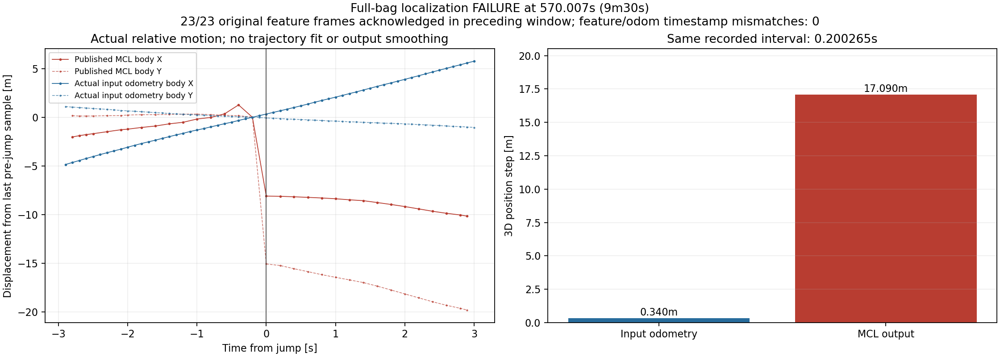
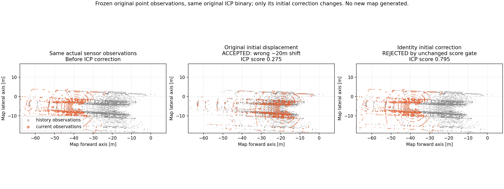

DDDMR Navigation은 3D LiDAR로 지도를 만들고, 저장한 지도에서 위치를 추정해 주행 경로를 계산하는 ROS 2 스택이다. 지면 높이를 유지하므로 경사로를 따라가는 경로를 표현할 수 있다. [기준 소스 `02f3bfe`](https://github.com/dfl-rlab/dddmr_navigation/tree/02f3bfe56217ac4e99f3af1e273cc3cbcb2024e4)


## 지도 제작

LeGO-LOAM 계열의 맵핑 노드는 스캔을 수직각과 방위각으로 배열해 지면, 모서리, 평면 특징을 고른다. LiDAR 오도메트리나 외부 오도메트리로 예측한 자세를 초기값으로 삼아 현재 특징을 주변 키프레임에 맞춘다. 재방문 후보를 찾으면 ICP로 현재 점군을 과거 점군에 맞추고, 채택한 상대 자세를 포즈 그래프에 추가해 키프레임 배치를 갱신한다. [맵핑 구현](https://github.com/dfl-rlab/dddmr_navigation/tree/02f3bfe56217ac4e99f3af1e273cc3cbcb2024e4/src/dddmr_lego_loam)

저장 결과에는 `poses.pcd`, 그래프 연결 정보, 키프레임별 특징·지면 점군이 들어간다. 지면 모델에는 관측 사이를 채운 패치도 포함된다.

## 위치 추정과 경로 계획

MCL 3DL은 초기 자세 주변에 입자를 뿌리고 오도메트리로 입자를 옮긴다. 각 자세에서 현재 스캔의 특징이 주변 지도와 얼마나 맞는지, 로봇 자세가 지면과 맞는지 평가한다. 점수가 높은 입자를 더 자주 뽑아 다음 추정에 쓴다. [MCL 3DL](https://github.com/dfl-rlab/dddmr_navigation/tree/02f3bfe56217ac4e99f3af1e273cc3cbcb2024e4/src/dddmr_mcl_3dl)


글로벌 플래너는 지면 점을 연결한 그래프에서 A*로 목표까지의 경로를 찾는다. 로컬 플래너는 그 경로를 따라갈 후보를 만들고 3D 장애물과 차체가 겹치는 후보를 걸러낸다. P2P Move Base는 계획과 제어 상태를 관리한다. [글로벌 플래너](https://github.com/dfl-rlab/dddmr_navigation/tree/02f3bfe56217ac4e99f3af1e273cc3cbcb2024e4/src/dddmr_global_planner) · [로컬 플래너](https://github.com/dfl-rlab/dddmr_navigation/tree/02f3bfe56217ac4e99f3af1e273cc3cbcb2024e4/src/dddmr_local_planner)


*공식 데모의 경사로 전역 경로.*


*공식 데모의 로컬 궤적. 노란색은 충돌 검사를 통과한 후보, 빨간색은 선택된 궤적이다.*

## XT32 재생 결과

언덕이 있는 구간에서 기록한 LiDAR 스캔 16,638개를 재생했다. 약 28분 분량이다. 이전 DDDMR 시험은 끝까지 처리해 키프레임 2,191개를 저장했지만, 통로 방향이 벌어지고 서로 다른 구간이 겹쳤다.


*실제 내보낸 지도의 상면도와 측면도.*

같은 기록에서 긴 주행 구간 12개의 방향 차이를 비교했다. 참고 2D 지도 역시 추정 결과다. 추가 시험 두 건은 LiDAR에서 다시 계산한 KISS-ICP 이동과 IMU 기울기를 외부 오도메트리로 사용했다. 두 건 사이에는 루프 설정만 바꿨다.

| 결과 | 구간 방향 벌어짐 |
| --- | ---: |
| 참고 2D 지도 | 0.43° |
| 이전 DDDMR 시험 | 6.97° |
| 외부 오도메트리 · 루프 켬 | 12.09° |
| 외부 오도메트리 · 루프 끔 | 12.84° |


같은 기록을 이전 DDDMR 지도에서 MCL로 재생했다. 570.007초 지점에서 0.200초 동안 입력 오도메트리는 0.34 m 움직였고, MCL 추정 위치는 17.09 m 뛰었다. 왜곡된 지도를 사용한 결과라 MCL만의 영향은 분리하기 어렵다.



## 루프 정합에서 확인한 문제

문제가 된 루프는 공통 지도 좌표에 놓인 스캔에 현재 위치와 과거 위치의 차이를 초기값으로 한 번 더 적용했다. 같은 점군과 ICP로 재현하니 약 20.14 m 이동이 점수 0.275로 채택됐다. 초기 보정을 항등 변환으로 바꾸자 점수는 0.795로, 기존 기준 0.5를 넘어 기각됐다.



초기값을 고친 뒤에도 약 1,031초부터 참고 지도에서 분리된 구간이 겹쳤다. 수정본 재생은 1,264초에서 중단했다. XT32 맵핑과 위치 추정은 이 구성에서 모두 품질 기준을 충족하지 못했다. 경로 계획과 실주행은 이 기록으로 평가하지 않았다.


공식 데모 이미지의 저작권은 Robotics Lab - Dubai Future Labs에 있다. [공식 이미지 출처](https://github.com/dfl-rlab/dddmr_documentation_materials/tree/d681db90715905ba264f4cac9930dde0d95a426c)

<details>
<summary>공식 이미지 라이선스</summary>

```text
BSD 3-Clause License

Copyright (c) 2025, Robotics Lab - Dubai Future Labs

Redistribution and use in source and binary forms, with or without
modification, are permitted provided that the following conditions are met:

1. Redistributions of source code must retain the above copyright notice, this
   list of conditions and the following disclaimer.

2. Redistributions in binary form must reproduce the above copyright notice,
   this list of conditions and the following disclaimer in the documentation
   and/or other materials provided with the distribution.

3. Neither the name of the copyright holder nor the names of its
   contributors may be used to endorse or promote products derived from
   this software without specific prior written permission.

THIS SOFTWARE IS PROVIDED BY THE COPYRIGHT HOLDERS AND CONTRIBUTORS "AS IS"
AND ANY EXPRESS OR IMPLIED WARRANTIES, INCLUDING, BUT NOT LIMITED TO, THE
IMPLIED WARRANTIES OF MERCHANTABILITY AND FITNESS FOR A PARTICULAR PURPOSE ARE
DISCLAIMED. IN NO EVENT SHALL THE COPYRIGHT HOLDER OR CONTRIBUTORS BE LIABLE
FOR ANY DIRECT, INDIRECT, INCIDENTAL, SPECIAL, EXEMPLARY, OR CONSEQUENTIAL
DAMAGES (INCLUDING, BUT NOT LIMITED TO, PROCUREMENT OF SUBSTITUTE GOODS OR
SERVICES; LOSS OF USE, DATA, OR PROFITS; OR BUSINESS INTERRUPTION) HOWEVER
CAUSED AND ON ANY THEORY OF LIABILITY, WHETHER IN CONTRACT, STRICT LIABILITY,
OR TORT (INCLUDING NEGLIGENCE OR OTHERWISE) ARISING IN ANY WAY OUT OF THE USE
OF THIS SOFTWARE, EVEN IF ADVISED OF THE POSSIBILITY OF SUCH DAMAGE.
```

</details>
