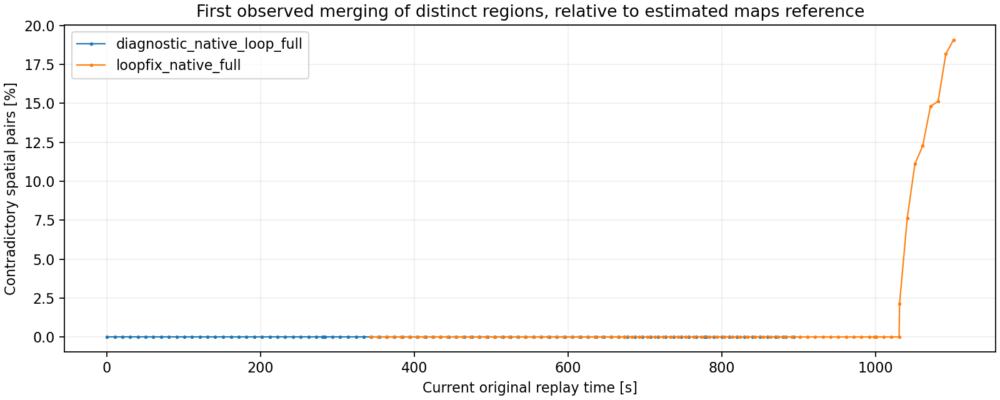

DDDMR Navigation은 3D LiDAR로 지도를 만들고, 저장한 지도에서 로봇의 자세를 추정해 주행 경로를 계산하는 ROS 2 스택이다. 경사로가 위아래 통로를 잇는 환경에서 지면의 높이와 연결 관계를 경로 계획에 사용한다. 구현은 소스 스냅샷 `02f3bfe`를 기준으로 설명한다. [DDDMR Navigation 소스](https://github.com/dfl-rlab/dddmr_navigation/tree/02f3bfe56217ac4e99f3af1e273cc3cbcb2024e4)


*DDDMR GitHub README의 공식 프레임워크 비교도. 하단의 `Cost map 2D`와 `Perception 3D`에서 각각 두 플래너로 이어지는 화살표를 보면 계획에 사용하는 환경 표현의 차이가 드러난다. [공식 README](https://github.com/dfl-rlab/dddmr_navigation/blob/02f3bfe56217ac4e99f3af1e273cc3cbcb2024e4/README.md)*

왼쪽은 SLAM Toolbox의 2D 지도에 AMCL을 쓰는 대표 Nav2 구성이다. Nav2의 Voxel Layer는 3D 센서 관측을 받아도 표준 `Costmap2D`에 전달할 때 이를 XY 격자로 투영한다. 오른쪽의 DDDMR은 높이 `z`가 있는 지면 점을 노드로 두고 인접 노드를 연결한다. 위아래 통로가 같은 XY 위치를 지나도 그래프에서 서로 다른 노드로 유지할 수 있다. Nav2도 위치 추정기와 플래너를 플러그인이나 외부 구성으로 바꿀 수 있으므로, 그림은 두 스택의 대표 조합을 비교한다. [Nav2 Voxel Layer 문서](https://docs.nav2.org/jazzy/configuration_and_development/configuration_guide/core_servers/costmap_2d/costmap_plugins/voxel/) · [Nav2 구성 요소](https://docs.nav2.org/jazzy/getting_started/navigation_concepts/)


*직접 그린 데이터 흐름. 위쪽에서 저장한 지도는 아래쪽에서 두 갈래로 쓰인다. 주변 키프레임의 특징은 MCL의 위치 추정에, 지면 모델은 MCL과 Perception 3D에 쓰인다.*

## LeGO-LOAM-BOR로 지도 만들기

### 스캔에서 키프레임까지

회전형 LiDAR 스캔을 수직각과 방위각으로 배열하고 각 칸에 반사점까지의 거리를 놓으면 거리 영상(range image)이 된다. DDDMR은 장착 자세와 지면 관측 범위를 반영해 인접 스캔 행의 점을 비교하고, 점 사이의 기울기가 완만한 곳을 지면 후보로 삼는다. 주변 거리 값의 변화가 큰 점에서는 모서리 특징을, 변화가 작은 점에서는 평탄한 표면 특징을 고른다. [거리 영상과 특징 추출 구현](https://github.com/dfl-rlab/dddmr_navigation/tree/02f3bfe56217ac4e99f3af1e273cc3cbcb2024e4/src/dddmr_lego_loam/lego_loam_bor/src)


*직접 그린 맵핑 과정. 포즈 그래프의 실선은 연속 자세를, 점선은 시간상 떨어진 키프레임을 잇는 재방문 제약을 나타낸다.*

자체 LiDAR 오도메트리(`laser_odometry`)는 연속 스캔의 특징 대응으로 이동량을 추정한다. `wheel_odometry` 모드는 외부 오도메트리를 받는다. 두 경우 모두 지도 정합에서는 예측한 자세를 초기값으로 사용해 현재 모서리 점을 주변 키프레임의 선에, 표면 점을 평면에 맞춘다. 평행한 벽만 길게 이어지면 벽을 따라 움직이는 방향의 오차는 이 거리들에 작게 반영된다. 통로를 가로지르는 구조나 끝점이 보일 때 그 방향의 이동을 더 잘 구분할 수 있다. [특징 대응 구현](https://github.com/dfl-rlab/dddmr_navigation/blob/02f3bfe56217ac4e99f3af1e273cc3cbcb2024e4/src/dddmr_lego_loam/lego_loam_bor/src/featureAssociation.cpp) · [스캔 지도 정합 구현](https://github.com/dfl-rlab/dddmr_navigation/blob/02f3bfe56217ac4e99f3af1e273cc3cbcb2024e4/src/dddmr_lego_loam/lego_loam_bor/src/mapOptimization.cpp)

### 루프 제약과 지도 파일

재방문 후보를 찾으면 현재 키프레임의 점군을 과거 키프레임 주변 점군에 ICP로 맞춘다. 채택한 상대 자세를 포즈 그래프에 넣으면 최적화가 이전 키프레임의 배치도 갱신한다. 맞는 제약은 누적 드리프트를 줄이고, 잘못된 제약은 서로 다른 장소를 가까이 끌어당길 수 있다. [포즈 그래프 최적화와 루프 구현](https://github.com/dfl-rlab/dddmr_navigation/blob/02f3bfe56217ac4e99f3af1e273cc3cbcb2024e4/src/dddmr_lego_loam/lego_loam_bor/src/mapOptimization.cpp)


*공식 LeGO-LOAM-BOR 지도 예시. 파란 점군에는 주변 구조가, 노란 선에는 키프레임 궤적과 연결이 보인다. 길게 나란히 진행한 구간과 양 끝에서 돌아나가는 지점을 함께 볼 수 있다. [공식 맵핑 문서](https://github.com/dfl-rlab/dddmr_navigation/blob/02f3bfe56217ac4e99f3af1e273cc3cbcb2024e4/src/dddmr_lego_loam/README.md)*

| 저장 결과 | 내용 |
| --- | --- |
| `poses.pcd`, `edges.pcd` | 지도 좌표계의 키프레임 자세와 그래프에서 연결된 키프레임 인덱스 쌍 |
| `pcd/<id>_feature.pcd`, `_surface.pcd`, `_ground.pcd` | 키프레임별 모서리·표면·지면 점군 |
| `map.pcd`, `ground.pcd` | 최적화된 자세로 지도 좌표계에 조립한 특징 지도와 지면 모델 |

키프레임 자세와 지역 점군을 따로 저장하므로 자세가 바뀌어도 지도를 다시 조립할 수 있고, 위치 추정에서는 가까운 키프레임만 모아 쓸 수 있다. 저장 지면에는 실제 반사점과 관측 사이를 채운 추정 패치가 함께 들어간다. [지도 내보내기 구현](https://github.com/dfl-rlab/dddmr_navigation/blob/02f3bfe56217ac4e99f3af1e273cc3cbcb2024e4/src/dddmr_lego_loam/lego_loam_bor/src/mapOptimization.cpp)

## MCL 3DL로 위치 추정하기

MCL 3DL은 RViz 등에서 받은 초기 자세 주변에 입자를 뿌린다. 각 입자는 로봇의 위치와 방향에 대한 하나의 가설이다. 이후 오도메트리의 상대 이동과 운동 잡음으로 입자를 옮기고, 현재 스캔을 각 가설의 자세에 놓아 주변 지도와 비교한다. 높은 점수를 받은 자세를 더 자주 뽑아 다음 갱신에 사용한다. 이동량과 회전량이 모두 설정 기준보다 작으면 갱신을 건너뛴다. [입자 필터 갱신 구현](https://github.com/dfl-rlab/dddmr_navigation/blob/02f3bfe56217ac4e99f3af1e273cc3cbcb2024e4/src/dddmr_mcl_3dl/src/mcl_3dl.cpp)


*직접 그린 위치 추정 과정. 큰 점은 가중치가 높은 입자다. 재표본화 뒤 그 주변에 입자가 더 많이 모인다.*

특징 점수는 스캔의 모서리·표면이 지도와 얼마나 맞는지 평가한다. 군집별로 가중치를 나누면 점이 많은 가까운 벽에 점수가 쏠리는 것을 줄일 수 있다. 특징의 법선 방향도 사용해 평행한 벽이 계속 나오는 통로에서 한 방향의 관측이 평가를 지배하는 것을 완화한다. 지면 점수는 주변 지면과의 거리와 면의 방향을 사용해 높이와 기울기 가설을 제한한다. 반복되는 옆 통로까지 구별하려면 두 장소를 구분할 특징과 정확히 배치된 지도가 필요하다. [MCL 3DL 문서](https://github.com/dfl-rlab/dddmr_navigation/blob/02f3bfe56217ac4e99f3af1e273cc3cbcb2024e4/src/dddmr_mcl_3dl/README.md) · [관측 우도 구현](https://github.com/dfl-rlab/dddmr_navigation/blob/02f3bfe56217ac4e99f3af1e273cc3cbcb2024e4/src/dddmr_mcl_3dl/src/lidar_measurement_model_likelihood.cpp)


*공식 서브맵 도식. 아래 원은 키프레임이다. 검색 반경은 한 창에 모을 키프레임의 범위를 정하고, 이동 거리 기준은 다음 창의 준비를 시작하는 시점을 정한다. [공식 서브맵 설명](https://github.com/dfl-rlab/dddmr_navigation/blob/02f3bfe56217ac4e99f3af1e273cc3cbcb2024e4/src/dddmr_mcl_3dl/README.md)*

입자별 최근접점 검색은 현재 서브맵의 특징·지면에 한정된다. 현재 서브맵 중심에서 일정 거리만큼 이동하면 최신 추정 자세 주변의 키프레임을 모아 다음 창의 KD 트리를 준비하고, 준비가 끝나면 다음 관측 갱신에서 교체한다. 큰 지도에서도 입자마다 검색하는 점군의 범위를 줄이는 방식이다. [서브맵 준비와 교체 구현](https://github.com/dfl-rlab/dddmr_navigation/blob/02f3bfe56217ac4e99f3af1e273cc3cbcb2024e4/src/dddmr_mcl_3dl/src/sub_maps.cpp)

## 지면 그래프의 A*와 3D 충돌 검사

Perception 3D는 저장 지면에서 정적 그래프를 만들고 센서가 관측한 장애물로 근처 노드의 통과 비용을 갱신한다. 플러그인은 새 장애물을 표시하고, 해당 공간이 비었다는 관측을 얻으면 이전 표시를 지운다. 전역 경로의 연결은 저장 지면에 달려 있고, 주행 중 피해야 하는 장애물은 실시간 관측으로 갱신된다. [Perception 3D](https://github.com/dfl-rlab/dddmr_navigation/tree/02f3bfe56217ac4e99f3af1e273cc3cbcb2024e4/src/dddmr_perception_3d)

글로벌 플래너는 현재 자세와 목표에 대응하는 지면 노드를 찾고, A*로 간선을 따라 후보를 확장한다. `f = g + h`에서 `g`는 지나온 간선의 길이에 장애물 근접 비용과 방향 전환 비용 등을 더한 값이고, `h`는 목표까지의 3D 직선 거리다. 장애물과의 여유가 차체 내접 반경보다 작은 노드는 건너뛴다. 경사로 위아래를 제대로 잇는 경로를 얻으려면 지도에도 그 경사로를 따라 이어지는 간선이 있어야 한다. [A* 구현](https://github.com/dfl-rlab/dddmr_navigation/blob/02f3bfe56217ac4e99f3af1e273cc3cbcb2024e4/src/dddmr_global_planner/src/a_star_on_pre_graph.cpp)


*공식 글로벌 플래너 데모. 초록색 경로가 경사로의 굽이를 따라 높이를 바꾸는 부분을 오른쪽 현장 사진과 비교할 수 있다. [글로벌 플래너 문서](https://github.com/dfl-rlab/dddmr_navigation/blob/02f3bfe56217ac4e99f3af1e273cc3cbcb2024e4/src/dddmr_global_planner/README.md)*

로컬 플래너는 전역 경로의 가까운 구간을 참고해 구동계가 실행할 수 있는 짧은 궤적들을 만든다. 후보의 여러 자세에 차체 외형을 3D 직육면체로 놓고 장애물 점이 그 안에 들어오는지 검사한다. 충돌하지 않는 후보는 전역 경로를 따라가는 정도와 진행 방향 등을 비용으로 비교한다. P2P Move Base는 목표 접수에서 전역 계획, 방향 정렬, 경로 추종, 도착 확인, 재계획과 복구까지의 상태를 관리한다. [3D 충돌 평가 구현](https://github.com/dfl-rlab/dddmr_navigation/blob/02f3bfe56217ac4e99f3af1e273cc3cbcb2024e4/src/dddmr_local_planner/mpc_critics/models/collision_model.cpp) · [P2P Move Base](https://github.com/dfl-rlab/dddmr_navigation/tree/02f3bfe56217ac4e99f3af1e273cc3cbcb2024e4/src/dddmr_p2p_move_base)


*공식 로컬 플래너 데모. 보라색 점은 장애물 관측이다. 노란색은 충돌 검사를 통과한 후보이고, 빨간색은 그중 선택된 궤적이다. [로컬 플래너 문서](https://github.com/dfl-rlab/dddmr_navigation/blob/02f3bfe56217ac4e99f3af1e273cc3cbcb2024e4/src/dddmr_local_planner/README.md)*

## XT32 재생에서 나타난 지도 왜곡

### 입력과 비교 조건

언덕이 있는 반복 주행 구간에서 Hesai XT32로 기록한 스캔 16,638개를 사용했다. 기록은 약 28분이며 휠 오도메트리를 포함한 `nav_msgs/Odometry` 메시지는 기록되지 않았다. V1은 자체 LiDAR 오도메트리와 100 m 거리 범위를 사용했다. 이 실행에는 정합의 퇴화 방향과 PCA 선 방향 처리 수정이 포함됐다. 원본 기록의 끝까지 진행해 키프레임 2,191개를 저장했다.

외부 오도메트리로 비교한 두 실행은 동일한 25 m 거리 범위를 사용했다. 원본 LiDAR에서 다시 계산한 KISS-ICP의 `X/Y/yaw`에 IMU 가속도와 자이로에서 얻은 `roll/pitch`를 결합했다. 높이는 입력에서 미관측 성분으로 두었다. 유효한 오도메트리가 나오기 전의 스캔 17개를 제외하고 나머지 16,621개를 모두 재생했다. 두 외부 오도메트리 실행 사이의 설정 차이는 루프 켜기·끄기뿐이다. V1과 비교할 때는 오도메트리와 거리 범위도 함께 달라진다.


*직접 내보낸 V1 지도. 상면도의 빨간 점을 따라가면 긴 통로들이 한쪽 끝으로 갈수록 벌어진다. 아래 측면도의 주황색은 관측 사이를 채운 패치를 포함한 지면 모델이다.*

### 통로 방향과 구간 겹침

각 지도의 원래 좌표계에서 X 범위 양 끝 20 m를 제외했다. 남은 범위에서 X 방향 길이가 80 m 이상이고 자세 표본이 15개 이상인 연속 주행 구간 12개를 골랐다. 구간마다 직선을 적합해 한 지도 안에서 진행 방향이 얼마나 벌어졌는지 비교했다. 참고 2D 지도도 같은 기록에서 만든 추정치다.

| 지도 | 저장 키프레임 | 12개 구간의 방향 벌어짐 |
| --- | ---: | ---: |
| 참고 2D 추정 지도 | — | 0.43° |
| DDDMR V1 · 자체 LiDAR 오도메트리 | 2,191 | 6.97° |
| 외부 KISS-ICP·IMU · 루프 켬 | 2,137 | 12.09° |
| 외부 KISS-ICP·IMU · 루프 끔 | 2,138 | 12.84° |


*각 지도의 좌표 원점은 그대로 두고 거리 척도만 맞췄다. 색은 기록의 경과 시간이다. 좌상단 참고 지도에서는 분리된 길들이 우상단 V1 및 아래 DDDMR 결과에서는 벌어지거나 교차한다.*

구간 겹침은 별도로 셌다. 기록 시각이 60초 이상 떨어졌고 시험 지도에서는 2 m 이내로 가까운 자세 쌍을 골랐다. 두 끝점의 시각을 각각 0.15초 이내에서 참고 지도와 대응시켜, 그곳에서 5 m 넘게 떨어져 있으면 구조 불일치로 집계했다. 외부 오도메트리에서 루프를 켰을 때 5,883/7,311쌍(80.5%), 껐을 때 409/2,216쌍(18.5%)이 해당했다. 루프를 끈 실행에서도 방향 벌어짐은 12.84°로 남았다. 두 지표는 각각 경로 방향과 서로 다른 구역의 겹침을 보여준다.

## V1 지도에서 관찰한 MCL 위치 도약

V1 지도에서 시작 자세를 대응 키프레임으로 한 번 지정했다. 이후 별도로 계산한 KISS-ICP·IMU 오도메트리로 16,621개 스캔을 재생했다. 입자는 150개를 사용했다. 재표본화 잡음의 표준편차는 X/Y 각각 0.05 m, yaw 0.01185 rad로 줄였다. 측정 갱신 7,372번에서 특징과 오도메트리의 시각 불일치는 0건이었다. 0.5초 이내 상대 XY 이동량이 입력과 1 m 넘게 어긋난 보정은 12번 발생했다.


*왼쪽은 도약 직전 표본을 기준으로 차체 좌표계에서 본 X/Y 변위다. 오른쪽은 같은 0.200초 구간의 3D 이동량이다. 입력은 0.34 m 움직였고 MCL 추정 위치는 17.09 m 이동했다.*

도약 직전 구간의 특징 프레임 23개는 모두 처리됐고, 대응하는 측정 시각도 일치했다. 지도 자체에 통로 왜곡과 겹침이 있으므로, 이 시험에서는 지도 형상과 MCL 계산의 영향을 분리하기 어렵다.

## 20 m 루프 제약과 수정 뒤의 부분 재생

기록의 141초 부근에서 처음 확인한 문제 루프는 현재 점군과 과거 점군을 이미 공통 지도 좌표에 놓고도, 두 키프레임의 위치 차이 약 20 m를 ICP 초기 보정값으로 다시 적용했다. 현재 관측을 과거 관측 쪽으로 미리 옮겨 놓은 뒤 정합한 셈이다. 두 점군과 ICP 솔버를 고정하고 초기 보정만 바꿔 그 제약을 재현했다. [루프 정합 구현](https://github.com/dfl-rlab/dddmr_navigation/blob/02f3bfe56217ac4e99f3af1e273cc3cbcb2024e4/src/dddmr_lego_loam/lego_loam_bor/src/mapOptimization.cpp)

| ICP 초기 보정 | 정합 결과 이동량 | 점수 | 기준 0.5 적용 |
| --- | ---: | ---: | --- |
| 키프레임 사이 원본 이동량 | 20.136 m | 0.275 | 채택 |
| 항등 변환 | 0.369 m | 0.795 | 기각 |


*주황색은 현재 관측, 회색은 과거 관측이다. 가운데에서는 주황색 점군이 약 20 m 이동해 점수 기준을 통과한다. 오른쪽에서는 초기 보정을 주지 않아 이동량이 작고 같은 기준에서 기각된다.*

별도 재생에서는 초기 보정을 바로잡고 회전 변환, 거리 기준의 단위, 수렴 검사, 중복 제약 처리도 수정했다. 600초까지만 재생한 비교에서는 원본 대조군과 수정군의 첫 네 주행 구간 방향이 모두 약 0.53° 벌어졌다. 더 긴 재생에서 저장한 수정군 스냅샷을 비교하니 1,031.448초 시점부터 참고 지도에서 분리된 구간이 겹쳤다. 이 시점에 비교한 1,839쌍 중 39쌍이 구조 불일치에 해당했다.



*가로축은 스냅샷을 저장한 재생 시각, 세로축은 앞서 정의한 구조 불일치 쌍의 비율이다. 주황색 수정군은 약 1,031초부터 불일치가 늘어난다.*

수정군은 1,264.263초까지 키프레임 1,813개를, 대조군은 1,089.452초까지 1,545개를 처리한 뒤 재생을 중단했다. 초기값 비교로 특정 루프가 잘못 채택된 원인은 확인했다. 수정한 부분 재생에서도 겹침이 나타났으므로 전체 지도 왜곡의 원인은 열려 있다. 이번 XT32 구성에서는 전체 지도의 형상과 지도 기반 위치 추정이 모두 품질 기준을 충족하지 못했다. 경로 계획과 실주행은 XT32 기록으로 평가하지 않았다.

공식 데모 이미지의 저작권은 Robotics Lab - Dubai Future Labs에 있다. [공식 이미지 출처](https://github.com/dfl-rlab/dddmr_documentation_materials/tree/d681db90715905ba264f4cac9930dde0d95a426c)

<details>
<summary>공식 이미지 라이선스</summary>

```text
BSD 3-Clause License

Copyright (c) 2025, Robotics Lab - Dubai Future Labs

Redistribution and use in source and binary forms, with or without
modification, are permitted provided that the following conditions are met:

1. Redistributions of source code must retain the above copyright notice, this
   list of conditions and the following disclaimer.

2. Redistributions in binary form must reproduce the above copyright notice,
   this list of conditions and the following disclaimer in the documentation
   and/or other materials provided with the distribution.

3. Neither the name of the copyright holder nor the names of its
   contributors may be used to endorse or promote products derived from
   this software without specific prior written permission.

THIS SOFTWARE IS PROVIDED BY THE COPYRIGHT HOLDERS AND CONTRIBUTORS "AS IS"
AND ANY EXPRESS OR IMPLIED WARRANTIES, INCLUDING, BUT NOT LIMITED TO, THE
IMPLIED WARRANTIES OF MERCHANTABILITY AND FITNESS FOR A PARTICULAR PURPOSE ARE
DISCLAIMED. IN NO EVENT SHALL THE COPYRIGHT HOLDER OR CONTRIBUTORS BE LIABLE
FOR ANY DIRECT, INDIRECT, INCIDENTAL, SPECIAL, EXEMPLARY, OR CONSEQUENTIAL
DAMAGES (INCLUDING, BUT NOT LIMITED TO, PROCUREMENT OF SUBSTITUTE GOODS OR
SERVICES; LOSS OF USE, DATA, OR PROFITS; OR BUSINESS INTERRUPTION) HOWEVER
CAUSED AND ON ANY THEORY OF LIABILITY, WHETHER IN CONTRACT, STRICT LIABILITY,
OR TORT (INCLUDING NEGLIGENCE OR OTHERWISE) ARISING IN ANY WAY OUT OF THE USE
OF THIS SOFTWARE, EVEN IF ADVISED OF THE POSSIBILITY OF SUCH DAMAGE.
```

</details>
