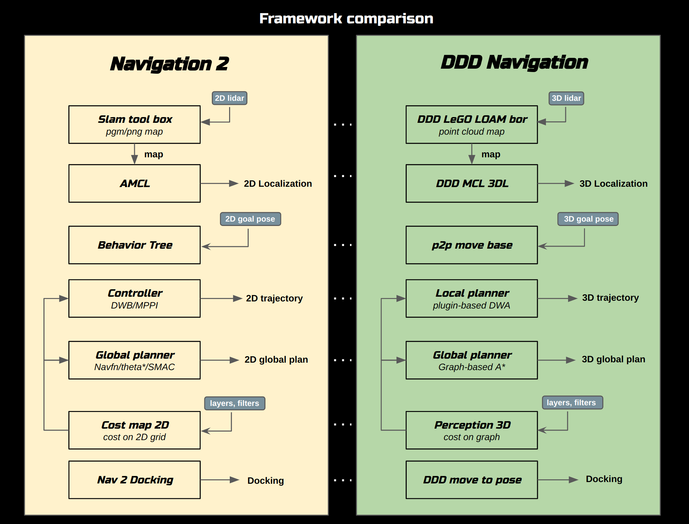
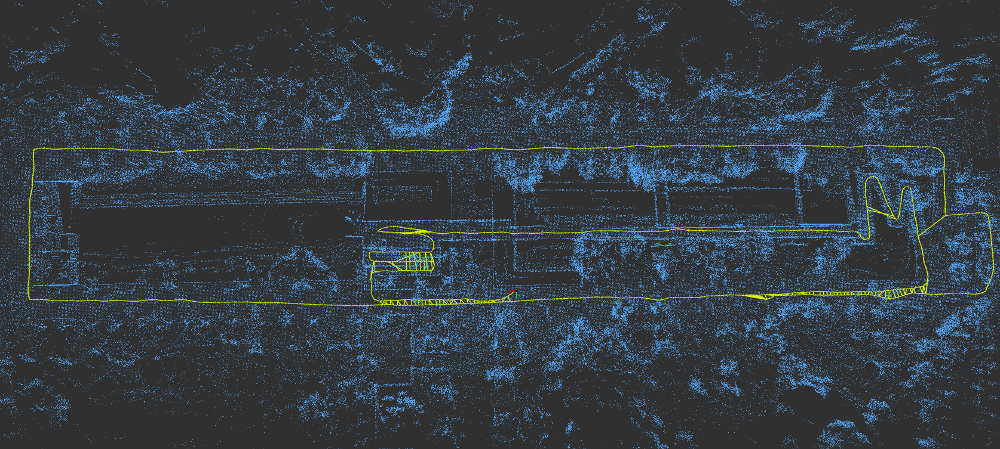
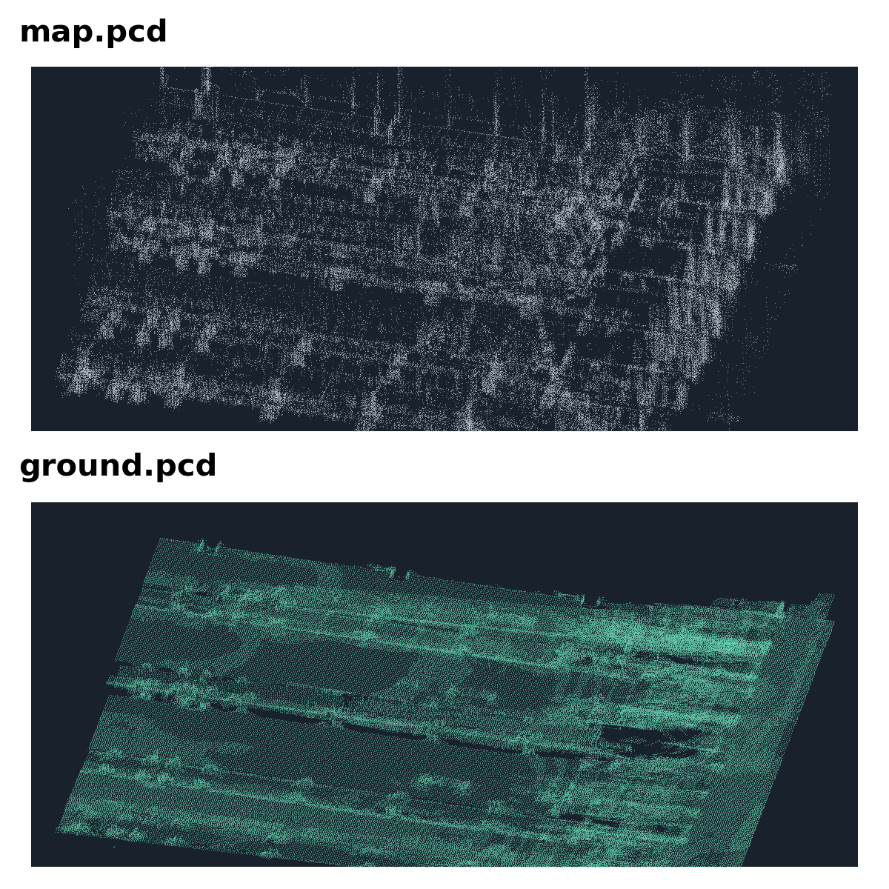
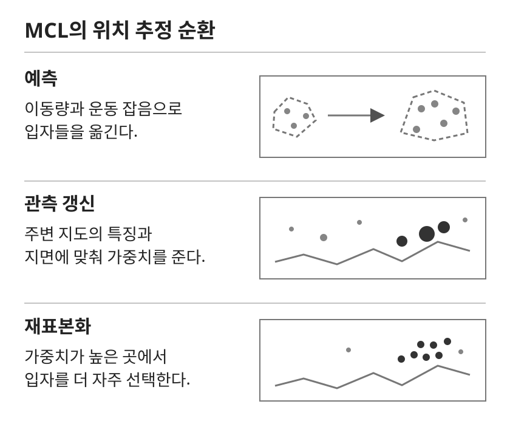
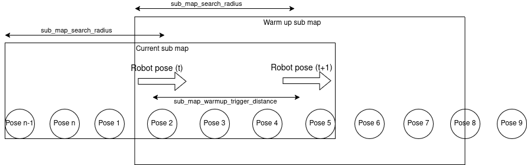
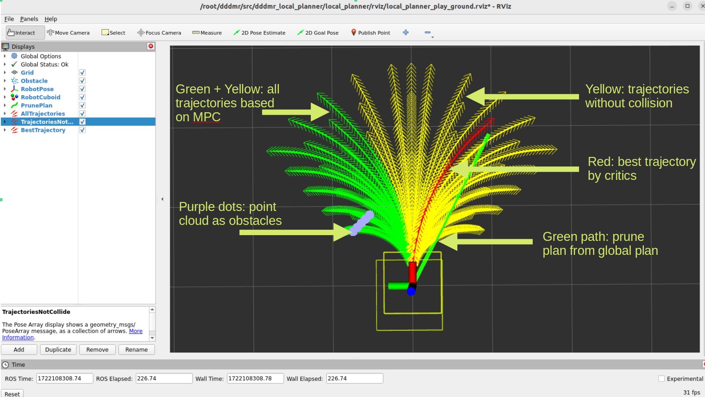
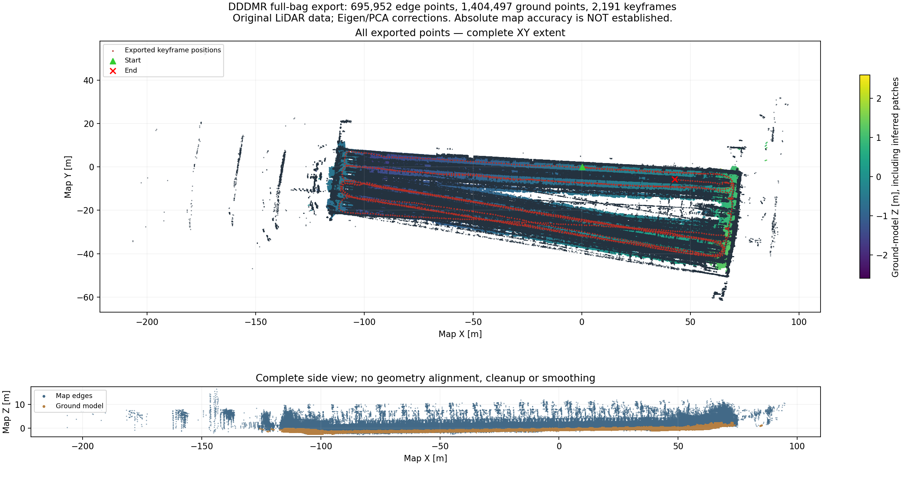

DDDMR Navigation은 3D LiDAR 지도 제작·위치 추정·경로 계획을 묶은 ROS 2 스택이다.

## 파이프라인

**지도 제작.** LeGO-LOAM-BOR가 LiDAR 스캔에서 모서리·평면 특징과 Ground Points를 추출한다. 정합과 포즈 그래프 최적화로 키프레임 자세를 구해 키프레임 점군, `map.pcd`, `ground.pcd`를 저장한다.

**지도 기반 주행.**

- **MCL 3DL → 현재 자세.** 오도메트리로 자세를 예측하고, 새 스캔을 주변 키프레임의 특징·지면과 비교해 갱신한다.
- **Perception 3D → 지면 그래프·통과 비용.** 저장된 지면점을 연결하고, 실시간 장애물 관측으로 비용을 갱신한다.
- **전역 경로 → 주행 명령.** 전역 플래너는 지면 그래프에서 현재 자세부터 목표까지 경로를 찾고, 로컬 플래너는 충돌 없는 추종 궤적을 고른다. P2P Move Base가 목표를 받아 선택된 궤적의 주행 명령을 발행한다.


## Nav2–DDDMR 구성 비교



*공식 Nav2–DDDMR 구성 비교도. [공식 README](https://github.com/dfl-rlab/dddmr_navigation/blob/02f3bfe56217ac4e99f3af1e273cc3cbcb2024e4/README.md)*

왼쪽 Nav2 구성은 SLAM Toolbox와 AMCL을 쓴다. Voxel Layer의 3D 관측은 `Costmap2D`에 XY 격자로 전달된다. 오른쪽 DDDMR의 지면 그래프에는 높이 `z`가 있어 같은 XY에서도 높이가 다른 통로를 구분할 수 있다. [Nav2 Voxel Layer 문서](https://docs.nav2.org/jazzy/configuration_and_development/configuration_guide/core_servers/costmap_2d/costmap_plugins/voxel/) · [Nav2 구성 요소](https://docs.nav2.org/jazzy/getting_started/navigation_concepts/)

## LeGO-LOAM-BOR 지도 제작

### 거리 영상 투영·특징 추출

거리 영상(range image)은 수직각을 행, 방위각을 열로 두고 반사점까지의 거리를 담는다. 센서 장착 자세와 관측 범위를 반영해 인접 행의 점 사이 기울기로 지면 후보를 찾는다. 거리 변화가 큰 곳에서 모서리, 작은 곳에서 평면 특징을 고른다. [거리 영상과 특징 추출 구현](https://github.com/dfl-rlab/dddmr_navigation/tree/02f3bfe56217ac4e99f3af1e273cc3cbcb2024e4/src/dddmr_lego_loam/lego_loam_bor/src)


*포즈 그래프의 실선은 연속 자세 제약, 점선은 재방문 제약.*

### 오도메트리와 지도 정합

`laser_odometry`는 연속 스캔에서 이동량을 구하고, `wheel_odometry`는 외부 오도메트리를 받는다. 예측 자세를 초기값으로 모서리점은 주변 키프레임의 선에, 평면점은 면에 맞춘다. 평행한 벽을 따라 움직이면 정합 오차가 거의 변하지 않아 그 방향의 이동량을 추정하기 어렵다. [특징 대응 구현](https://github.com/dfl-rlab/dddmr_navigation/blob/02f3bfe56217ac4e99f3af1e273cc3cbcb2024e4/src/dddmr_lego_loam/lego_loam_bor/src/featureAssociation.cpp) · [스캔 지도 정합 구현](https://github.com/dfl-rlab/dddmr_navigation/blob/02f3bfe56217ac4e99f3af1e273cc3cbcb2024e4/src/dddmr_lego_loam/lego_loam_bor/src/mapOptimization.cpp)

### Loop Closing

현재 키프레임을 과거 후보 주변의 점군과 ICP로 정합한다. 채택한 상대 자세는 포즈 그래프에 추가해 이전 키프레임도 다시 배치한다. 잘못된 제약은 떨어진 구간을 겹치게 할 수 있다. [포즈 그래프·loop closing 코드](https://github.com/dfl-rlab/dddmr_navigation/blob/02f3bfe56217ac4e99f3af1e273cc3cbcb2024e4/src/dddmr_lego_loam/lego_loam_bor/src/mapOptimization.cpp)



*공식 지도 예시. 파란색은 주변 구조, 노란색은 키프레임과 연결선. [공식 맵핑 문서](https://github.com/dfl-rlab/dddmr_navigation/blob/02f3bfe56217ac4e99f3af1e273cc3cbcb2024e4/src/dddmr_lego_loam/README.md)*

### 지도 파일

| 파일 | 내용 |
| --- | --- |
| `poses.pcd`, `edges.pcd` | 지도 좌표계의 키프레임 자세와 그래프에서 연결된 키프레임 인덱스 쌍 |
| `pcd/<id>_feature.pcd`, `_surface.pcd`, `_ground.pcd` | 키프레임별 모서리·표면·지면 점군 |
| `map.pcd` | 키프레임의 모서리 특징을 지도 좌표계에 모은 점군 |
| `ground.pcd` | 키프레임의 ground patch를 지도 좌표계에 모은 점군 |

키프레임 자세가 바뀌면 점군을 다시 배치해 지도를 조립한다.

### Map Points / Ground Points

**Map Points.** `map.pcd`에는 벽 모서리나 기둥에서 뽑은 모서리 특징을 담는다. 평면 특징은 키프레임별 `_surface.pcd`에 저장한다. MCL은 주변 키프레임의 두 특징을 현재 스캔과 비교한다. [지도 저장 코드](https://github.com/dfl-rlab/dddmr_navigation/blob/02f3bfe56217ac4e99f3af1e273cc3cbcb2024e4/src/dddmr_lego_loam/lego_loam_bor/src/mapOptimization.cpp) · [MCL 서브맵 구현](https://github.com/dfl-rlab/dddmr_navigation/blob/02f3bfe56217ac4e99f3af1e273cc3cbcb2024e4/src/dddmr_mcl_3dl/src/sub_maps.cpp)

**Ground Points.** 지면으로 판정한 인접 LiDAR 채널의 반사점과 그 사이의 보간점이다. MCL은 높이·법선을 위치 추정에, Perception 3D는 지면점을 그래프 노드로 쓴다. RViz는 `Tiles`로 지면점을 사각형으로 표시한다. [Ground patch 코드](https://github.com/dfl-rlab/dddmr_navigation/blob/02f3bfe56217ac4e99f3af1e273cc3cbcb2024e4/src/dddmr_lego_loam/lego_loam_bor/src/imageProjection.cpp) · [지면 그래프 구현](https://github.com/dfl-rlab/dddmr_navigation/blob/02f3bfe56217ac4e99f3af1e273cc3cbcb2024e4/src/dddmr_perception_3d/plugins/static_layer.cpp)



*11월 21일 XT32 점군. 같은 구간을 같은 각도로 본 모습. 오른쪽에서 평면상 겹친 10 cm RViz 타일 두 개의 높이 차는 2.93 m.*

## MCL 3DL 위치 추정

초기 자세 주변에 자세 후보(입자)를 뿌리고, 오도메트리의 상대 이동과 운동 잡음으로 옮긴다. 현재 스캔이 지도에 잘 맞는 입자를 다음 갱신에 더 자주 뽑는다. 이동량·회전량이 모두 기준 미만이면 갱신을 건너뛴다. [입자 필터 갱신 구현](https://github.com/dfl-rlab/dddmr_navigation/blob/02f3bfe56217ac4e99f3af1e273cc3cbcb2024e4/src/dddmr_mcl_3dl/src/mcl_3dl.cpp)



*재표본화 뒤에는 가중치가 높은 입자(큰 점) 주변에 후보가 모인다.*

관측 우도는 모서리·평면 특징의 일치도와 지면 점수를 반영한다. 군집 가중치와 특징 법선으로 점이 많은 벽의 영향을 줄인다. 지면까지의 거리와 법선은 높이·기울기 추정에 쓴다. [MCL 3DL 문서](https://github.com/dfl-rlab/dddmr_navigation/blob/02f3bfe56217ac4e99f3af1e273cc3cbcb2024e4/src/dddmr_mcl_3dl/README.md) · [관측 우도 구현](https://github.com/dfl-rlab/dddmr_navigation/blob/02f3bfe56217ac4e99f3af1e273cc3cbcb2024e4/src/dddmr_mcl_3dl/src/lidar_measurement_model_likelihood.cpp)



*아래 원은 키프레임. 검색 반경은 서브맵 범위, 이동 거리 기준은 교체 준비 시점. [공식 서브맵 설명](https://github.com/dfl-rlab/dddmr_navigation/blob/02f3bfe56217ac4e99f3af1e273cc3cbcb2024e4/src/dddmr_mcl_3dl/README.md)*

최근접점은 현재 서브맵에서 찾는다. 로봇이 서브맵 중심에서 일정 거리 이동하면 추정 자세 주변의 키프레임으로 다음 KD 트리를 만든다. 준비가 끝나면 관측 갱신 때 교체한다. [서브맵 준비와 교체 구현](https://github.com/dfl-rlab/dddmr_navigation/blob/02f3bfe56217ac4e99f3af1e273cc3cbcb2024e4/src/dddmr_mcl_3dl/src/sub_maps.cpp)

## 3D 경로 계획

저장한 지면점의 연결이 전역 경로의 범위를 정한다. Perception 3D는 주변 센서로 장애물을 표시하고, 빈 공간이 관측되면 표시를 지워 노드의 통과 비용을 갱신한다. [Perception 3D](https://github.com/dfl-rlab/dddmr_navigation/tree/02f3bfe56217ac4e99f3af1e273cc3cbcb2024e4/src/dddmr_perception_3d)

### 지면 그래프 A*

현재 자세와 목표에 대응하는 노드 사이를 A*로 탐색한다. `f = g + h`에서 `g`는 거리·장애물 근접·방향 전환 등의 누적 비용, `h`는 목표까지의 3D 직선 거리다. 장애물 여유가 차체 내접 반경보다 작은 노드는 제외한다. [A* 구현](https://github.com/dfl-rlab/dddmr_navigation/blob/02f3bfe56217ac4e99f3af1e273cc3cbcb2024e4/src/dddmr_global_planner/src/a_star_on_pre_graph.cpp)


*초록색 전역 경로는 오른쪽 사진의 지그재그 경사로를 따라 높이가 바뀐다. [글로벌 플래너 문서](https://github.com/dfl-rlab/dddmr_navigation/blob/02f3bfe56217ac4e99f3af1e273cc3cbcb2024e4/src/dddmr_global_planner/README.md)*

### 로컬 궤적과 충돌 검사

로컬 플래너는 실행 가능한 짧은 궤적을 만들고, 후보의 각 자세에 차체를 3D 직육면체로 놓아 장애물 점과 충돌을 검사한다. 남은 후보는 전역 경로 추종 오차·진행 방향 등으로 평가한다. P2P Move Base는 방향 정렬, 경로 추종, 도착 확인, 재계획·복구를 맡는다. [3D 충돌 평가 구현](https://github.com/dfl-rlab/dddmr_navigation/blob/02f3bfe56217ac4e99f3af1e273cc3cbcb2024e4/src/dddmr_local_planner/mpc_critics/models/collision_model.cpp) · [P2P Move Base](https://github.com/dfl-rlab/dddmr_navigation/tree/02f3bfe56217ac4e99f3af1e273cc3cbcb2024e4/src/dddmr_p2p_move_base)



*보라색은 장애물, 노란색은 충돌 검사를 통과한 후보, 빨간색은 선택한 궤적. [로컬 플래너 문서](https://github.com/dfl-rlab/dddmr_navigation/blob/02f3bfe56217ac4e99f3af1e273cc3cbcb2024e4/src/dddmr_local_planner/README.md)*

## XT32 지도 왜곡

### 입력·재생 조건

언덕이 있는 반복 주행 구간에서 약 28분간 Hesai XT32 스캔 16,638개를 기록했다. 휠 오도메트리 등 `nav_msgs/Odometry` 입력은 없었다. V1은 자체 LiDAR 오도메트리와 100 m 감지 범위를 쓰고, 퇴화 방향 처리와 PCA 선 방향 선택을 수정했다. 전체 재생에서 키프레임 2,191개를 저장했다.

외부 오도메트리는 KISS-ICP의 `X/Y/yaw`와 IMU에서 계산한 `roll/pitch`를 썼고, 입력 높이는 미관측으로 뒀다. 감지 범위 25 m에서 초반 17개를 빼고 16,621개를 재생했다. 두 실행은 Loop Closing 설정만 다르며, V1과는 오도메트리와 감지 범위도 다르다.



*V1 지도. 상면의 빨간 점은 키프레임, 측면의 주황색은 보간을 포함한 지면 모델.*

### 통로 방향·구간 겹침

지도별 X 범위 양 끝 20 m를 빼고, X 방향 길이 80 m 이상·자세 표본 15개 이상인 연속 주행 12개를 골랐다. 각 궤적에 직선을 맞춰 방향 벌어짐을 구했다. 2D 참고 지도는 같은 기록의 추정치다.

| 지도 | 저장 키프레임 | 12개 구간의 방향 벌어짐 |
| --- | ---: | ---: |
| 참고 2D 추정 지도 | — | 0.43° |
| DDDMR V1 · 자체 LiDAR 오도메트리 | 2,191 | 6.97° |
| 외부 KISS-ICP·IMU · Loop Closing ON | 2,137 | 12.09° |
| 외부 KISS-ICP·IMU · Loop Closing OFF | 2,138 | 12.84° |


*지도별 자체 좌표계와 공통 거리 척도. 색은 녹화 경과 시간.*

시험 지도에서 2 m 이내이고 시각 차가 60초 이상인 자세 쌍을 골랐다. 각 자세를 0.15초 이내에서 2D 참고 궤적에 대응시켜 간격이 5 m를 넘으면 구조 불일치로 셌다. 외부 오도메트리에서 Loop Closing ON은 5,883/7,311쌍(80.5%), OFF는 409/2,216쌍(18.5%)이었다.

## MCL 위치 도약

V1 지도에서 키프레임 하나를 초기 자세로 잡고 KISS-ICP·IMU 오도메트리로 스캔 16,621개를 재생했다. 입자 150개, 재표본화 잡음 표준편차 X/Y 각 0.05 m, yaw 0.01185 rad를 사용했다. 측정 갱신 7,372회에서 스캔·오도메트리 시각이 일치했다. 0.5초 이내 XY 이동량이 입력과 1 m 넘게 달랐던 보정은 12회였다.


*왼쪽은 도약 직전 대비 차체 좌표계 XY 변위. 오른쪽은 0.200초 동안의 3D 이동량(입력 0.34 m, MCL 17.09 m).*

도약 직전 특징 프레임 23개의 시각도 일치했다. V1의 통로 왜곡 때문에 지도와 MCL의 영향을 구분하기 어렵다.

## Loop Closing 오류

### ICP 초기값 비교

141초 부근, 현재·과거 점군을 같은 지도 좌표계에 놓은 상태에서 두 키프레임의 위치 차이 약 20 m를 ICP 초기값에 다시 넣었다. 점군과 솔버를 고정하고 초기값만 바꿨다. [loop closing 정합 코드](https://github.com/dfl-rlab/dddmr_navigation/blob/02f3bfe56217ac4e99f3af1e273cc3cbcb2024e4/src/dddmr_lego_loam/lego_loam_bor/src/mapOptimization.cpp)

| ICP 초기 보정 | 정합 결과 이동량 | 점수 | 기준 0.5 적용 |
| --- | ---: | ---: | --- |
| 키프레임 사이 원본 이동량 | 20.136 m | 0.275 | 채택 |
| 항등 변환 | 0.369 m | 0.795 | 기각 |


*주황색은 현재 관측, 회색은 과거 관측. 가운데는 원본 초기값, 오른쪽은 항등 변환.*

### 수정 후 통로 겹침

ICP 초기값·회전 변환·거리 단위·수렴 검사·중복 제약 처리를 수정했다. 600초 부분 재생에서 대조군과 수정군 모두 첫 네 주행 구간의 방향이 약 0.53° 벌어졌다. 더 긴 수정군 재생의 1,031.448초 스냅샷에서는 39/1,839쌍이 구조 불일치였다.


*시간별 구조 불일치 비율. 주황색은 수정군.*

부분 재생 종료 시점은 수정군 1,264.263초(키프레임 1,813개), 대조군 1,089.452초(1,545개)다. XT32 전체 지도에는 통로 왜곡이 남았고 V1 지도의 MCL 재생에서 위치 도약이 발생했다. 경로 계획·실주행은 평가 범위 밖이다.

공식 데모 이미지의 저작권은 Robotics Lab - Dubai Future Labs에 있다. [공식 이미지 출처](https://github.com/dfl-rlab/dddmr_documentation_materials/tree/d681db90715905ba264f4cac9930dde0d95a426c)

<details>
<summary>공식 이미지 라이선스</summary>

```text
BSD 3-Clause License

Copyright (c) 2025, Robotics Lab - Dubai Future Labs

Redistribution and use in source and binary forms, with or without
modification, are permitted provided that the following conditions are met:

1. Redistributions of source code must retain the above copyright notice, this
   list of conditions and the following disclaimer.

2. Redistributions in binary form must reproduce the above copyright notice,
   this list of conditions and the following disclaimer in the documentation
   and/or other materials provided with the distribution.

3. Neither the name of the copyright holder nor the names of its
   contributors may be used to endorse or promote products derived from
   this software without specific prior written permission.

THIS SOFTWARE IS PROVIDED BY THE COPYRIGHT HOLDERS AND CONTRIBUTORS "AS IS"
AND ANY EXPRESS OR IMPLIED WARRANTIES, INCLUDING, BUT NOT LIMITED TO, THE
IMPLIED WARRANTIES OF MERCHANTABILITY AND FITNESS FOR A PARTICULAR PURPOSE ARE
DISCLAIMED. IN NO EVENT SHALL THE COPYRIGHT HOLDER OR CONTRIBUTORS BE LIABLE
FOR ANY DIRECT, INDIRECT, INCIDENTAL, SPECIAL, EXEMPLARY, OR CONSEQUENTIAL
DAMAGES (INCLUDING, BUT NOT LIMITED TO, PROCUREMENT OF SUBSTITUTE GOODS OR
SERVICES; LOSS OF USE, DATA, OR PROFITS; OR BUSINESS INTERRUPTION) HOWEVER
CAUSED AND ON ANY THEORY OF LIABILITY, WHETHER IN CONTRACT, STRICT LIABILITY,
OR TORT (INCLUDING NEGLIGENCE OR OTHERWISE) ARISING IN ANY WAY OUT OF THE USE
OF THIS SOFTWARE, EVEN IF ADVISED OF THE POSSIBILITY OF SUCH DAMAGE.
```

</details>
