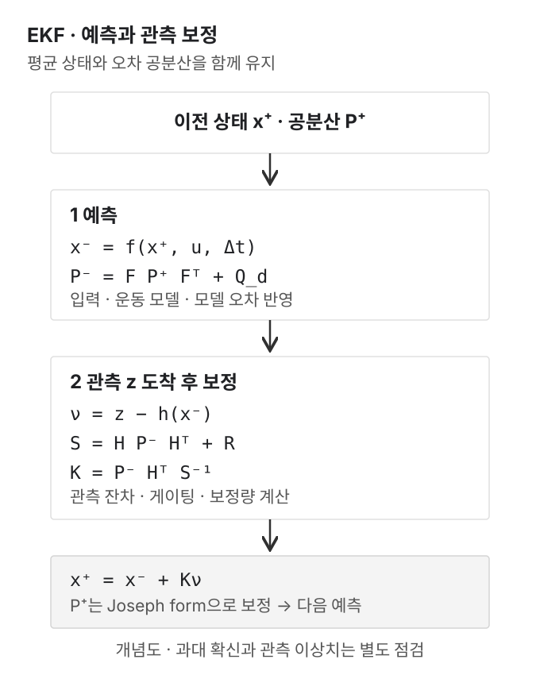
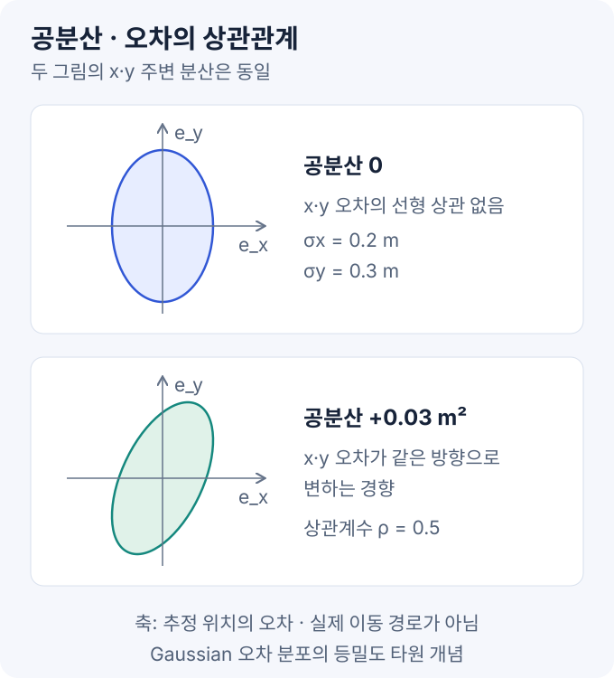
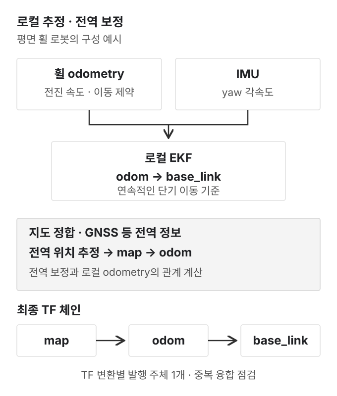

EKF(Extended Kalman Filter)는 **운동 모델로 예측한 상태를 센서 관측으로 보정하는 추정기**다. 위치 숫자만 평균 내는 대신, 상태 사이의 관계와 각 정보의 불확실성까지 함께 계산한다.

목표는 휠·IMU·위치 센서를 연결할 때 **어떤 값을 융합하고, 오차를 어떻게 설정하며, 결과를 무엇으로 검증할지** 이해하는 것이다. 수식은 2D 로봇으로 유도하고, 실제 적용은 `robot_localization`의 ROS 2 Jazzy 구현을 기준으로 설명한다. 사족보행에 필요한 3D 추정은 별도로 구분한다.

### 목차

1. [기준 논문](#1-기준-논문)
2. [센서 퓨전의 기본 개념](#2-센서-퓨전의-기본-개념)
3. [1차원 계산 예제](#3-1차원-계산-예제)
4. [2D 로봇의 예측 모델](#4-2d-로봇의-예측-모델)
5. [관측 보정과 이상치 처리](#5-관측-보정과-이상치-처리)
6. [NumPy 실습](#6-numpy-실습)
7. [ROS 2 적용](#7-ros-2-적용)
8. [튜닝과 검증](#8-튜닝과-검증)
9. [ESKF·InEKF와 사족보행](#9-eskfinekf와-사족보행)
10. [참고 자료](#10-참고-자료)

그림은 직접 작성한 개념도다. NumPy 결과는 합성 데이터 실험이며 실제 로봇의 성능 측정값이 아니다.

## 1. 기준 논문

### 1.1 Moore·Stouch, IAS-13, 2014

**A Generalized Extended Kalman Filter Implementation for the Robot Operating System**은 EKF를 ROS의 범용 센서 융합기로 구성한 논문이다. 핵심 기여는 센서별 입력과 융합 항목을 선택할 수 있는 소프트웨어 구조다. [원문 PDF](https://github.com/cra-ros-pkg/robot_localization/blob/fea7fc3dcad81c533121e4aa2fb1087a0565d8cc/doc/robot_localization_ias13_revised.pdf)

| 논문의 설계 | 읽어둘 부분 |
| --- | --- |
| 여러 센서·메시지 입력 | 센서를 추가할 때 전체 추정기를 다시 구현하는 부담을 줄임 |
| 상태 성분별 선택적 보정 | 센서가 제공하는 항목 중 신뢰할 수 있는 값만 사용 |
| 직접 관측을 가정한 관측 행렬 | 위치·자세·속도 등 공통 상태 표현으로 변환한 입력을 처리 |
| Joseph form 공분산 보정 | 수치적으로 공분산을 안정적으로 유지하기 위한 구현 선택 |

실험은 Pioneer 3의 휠 오도메트리와 IMU·GPS 조합을 다룬다. 센서 하나의 데이터 중단 사례도 포함한다. 다만 이 결과만으로 다른 로봇의 정확도, 모든 센서 고장에 대한 내성, 최적의 잡음 설정이 보장되지는 않는다.

### 1.2 논문과 현재 구현의 차이

**원논문은 12차원 상태를 설명한다.** 위치·자세 6개와 각각의 속도 6개다. 현재 확인한 Jazzy 구현은 선형 가속도까지 포함한 **15차원 상태**를 사용한다. 논문 수식과 현재 YAML의 항목 수를 그대로 맞추면 혼동하기 쉽다. [상태 정의](https://github.com/cra-ros-pkg/robot_localization/blob/fea7fc3dcad81c533121e4aa2fb1087a0565d8cc/include/robot_localization/filter_common.hpp)

또한 `robot_localization`에 임의의 센서 함수를 넣으면 관측 모델이 자동으로 생성되는 것은 아니다. 예를 들어 거리·방위각 센서는 그 관측 기하를 모델링하거나, 적절한 상태 관측과 공분산으로 변환하는 별도 처리가 필요하다.

이 글의 3차원 상태 예제도 실제 패키지와 다른 **학습용 모델**이다. 아래 수식을 패키지 내부 모델의 축약 코드로 해석하지 않는다.

## 2. 센서 퓨전의 기본 개념



### 2.1 기본 용어

| 기호 | 의미 | 2D 로봇 예시 |
| --- | --- | --- |
| `x` | 추정할 상태 벡터 | `[위치 x, 위치 y, yaw]ᵀ` |
| `u` | 예측에 사용하는 입력 | 전진 속도·yaw 각속도 |
| `z` | 센서 관측 | 같은 기준 좌표계의 위치 측정 |
| `f` | 상태 전이 함수 | 속도·회전으로 다음 위치 예측 |
| `h` | 관측 함수 | 상태에서 센서가 측정하는 값 계산 |
| `P` | 상태 추정 오차 공분산 | 위치·방향 오차의 크기와 상관관계 |
| `Q_d` | 한 예측 구간의 과정 잡음 공분산 | 입력 잡음·모델 오차의 상태 영향 |
| `R` | 관측 잡음 공분산 | 위치 측정 오차의 분산 |

같은 센서도 설계에 따라 입력이나 관측으로 사용할 수 있다. 이 글의 작은 예제는 휠 속도와 자이로 각속도를 `u`로 사용한다. 반면 뒤의 ROS 설정에서는 속도·각속도가 패키지의 상태 성분을 보정하는 **관측**으로 들어간다.

### 2.2 확률 모델

```text
x_k = f(x_(k-1), u_k, Δt) + w_k
z_k = h(x_k) + v_k

w_k ~ N(0, Q_d)
v_k ~ N(0, R)
```

`N(0, Q_d)`는 평균이 0이고 공분산이 `Q_d`인 정규분포를 뜻한다. 이 표기는 가산 잡음 모델이다. 잡음이 상태나 센서 함수 안에 들어가는 일반적인 모델에서는 잡음에 대한 Jacobian도 필요하다.

EKF는 비선형 분포 전체를 그대로 추적하기보다 **평균과 공분산을 유지하고, 현재 추정점 주변의 1차 근사**를 사용한다. 잡음 모델, 초기 추정, 선형화가 실제 조건과 크게 어긋나면 결과가 부정확하거나 발산할 수 있다.

### 2.3 표준편차·분산·공분산

**표준편차는 값이 평균 주변에 퍼지는 규모, 분산은 그 표준편차의 제곱**이다. 센서 퓨전에서는 주로 측정 오차나 추정 오차의 퍼짐을 다룬다.

예를 들어 x 위치 오차의 표준편차가 `0.2 m`라면 분산은 `0.04 m²`다. 이 값은 “오차가 최대 20 cm”라는 상한이 아니라 분포의 퍼짐을 나타낸다.

공분산은 두 변수의 변동이 어떤 관계를 갖는지 표현한다. 두 오차 `e_x`, `e_y`에 대해 다음과 같다.

```text
var(e_x)       = E[(e_x - 평균 e_x)²]
cov(e_x, e_y)  = E[(e_x - 평균 e_x)(e_y - 평균 e_y)]
```

`E[·]`는 기댓값, 즉 여러 번의 관측이나 실험에서 얻는 확률적 평균을 뜻한다. 로봇이 한 번 이동한 궤적의 x·y 분포와, 같은 상태를 추정했을 때의 x·y **오차 분포**는 구분해야 한다.

두 항목이 같은 변수이면 공분산은 분산이 된다. 따라서 여러 변수의 공분산을 모은 행렬에서는 **대각에 분산, 비대각에 변수 사이의 공분산**이 들어간다.

```text
P_position = [ 0.04  0.03 ] m²
             [ 0.03  0.09 ]

σx = sqrt(0.04) = 0.2 m
σy = sqrt(0.09) = 0.3 m
상관계수 ρ = 0.03 / (0.2 × 0.3) = 0.5
```

위 행렬의 `0.03`은 x·y 추정 오차가 같은 방향으로 변하는 경향을 표현한다. `0.03 m`의 고정 위치 오차를 뜻하지 않는다.

| 비대각 공분산 | 오차의 관계 |
| --- | --- |
| 양수 | x 오차가 평균보다 클 때 y 오차도 큰 쪽으로 변하는 경향 |
| 음수 | x 오차가 큰 쪽일 때 y 오차는 작은 쪽으로 변하는 경향 |
| 0 | 선형 상관이 없음. 일반적으로 독립성까지 보장하는 것은 아님 |



그림의 축은 로봇의 실제 경로가 아니라 **추정 오차**다. 공분산이 큰 방향은 불확실성이 큰 방향을 나타낸다. 3차원 상태에서는 위치와 yaw 사이에도 이런 관계가 생긴다. 예측 중 yaw 오차가 횡방향 위치 오차로 연결되면, 나중의 위치 관측을 통해 yaw도 보정할 수 있다.

주의할 점은 다음과 같다.

- 비대각 공분산은 음수일 수 있지만, 대각 분산은 음수가 될 수 없다. 어떤 방향의 오차를 계산해도 분산이 음수가 되지 않는 **양의 준정부호** 조건도 만족해야 한다.
- 위치·각도·속도의 공분산은 단위가 다르다. 예를 들어 위치·yaw 교차 성분은 `m·rad` 단위다.
- 작은 공분산은 **필터가 자신 있다고 표현한 값**이다. 오차 모델이 잘못됐거나 bias를 놓치면 실제 정확도와 다를 수 있다.
- 정지 센서가 계속 같은 값으로 치우쳐 있으면 퍼짐은 작아도 bias는 클 수 있다. 공분산만으로 모든 오차를 설명하지 못한다.

### 2.4 P·Q·R의 차이

| 행렬 | 의미 | 실무에서 정하는 근거 |
| --- | --- | --- |
| `P` | 현재 상태 추정 오차의 공분산 | 초기 `P0` 이후 예측·보정으로 갱신 |
| `Q_d` | 이번 예측 구간에 추가할 모델·과정 불확실성 | 운동 모델, 미끄럼, 입력 잡음과 시간 간격 |
| `R` | 이번 센서 관측 오차의 공분산 | 센서 잡음·품질 상태·관측 모델 |

세 행렬은 모두 공분산이지만 대상이 다르다. `R`은 필터 출력 오차가 아니고, `Q_d`는 단순히 센서 데이터시트의 분산을 복사한 값도 아니다.

또한 움직이는 로봇의 x·y 측정값 전체에 분산 함수를 적용하면 **실제 이동량**까지 포함된다. `R`을 추정하려면 정지 조건이나 독립적인 기준값에 대한 잔차처럼 측정 오차를 구분할 수 있는 데이터가 필요하다.

### 2.5 중복 정보와 상관된 입력

**같은 물리량을 두 센서로 측정하는 것과, 같은 정보를 두 번 사용하는 것은 다르다.** 독립적인 두 위치 관측은 서로 보완할 수 있다. 반면 같은 관측을 복사해 다른 토픽 이름으로 보내면 새 정보는 생기지 않는다.

다음은 같은 관측을 두 번 독립적으로 사용했을 때의 계산이다.

```text
초기 위치 0 m, 초기 분산 1 m²
위치 관측 1 m, 관측 분산 1 m²

한 번 사용:          추정 위치 0.5 m,    분산 0.5 m²
같은 값을 다시 사용: 추정 위치 0.6667 m, 분산 0.3333 m²
```

두 번째 입력은 첫 번째와 **측정 오차까지 동일한 복사본**이다. 그런데 필터가 두 입력을 독립적이라고 가정하면 같은 관측의 가중치만 커지고, 불확실성은 근거 없이 줄어든다. 서로 독립적인 두 관측이 우연히 같은 값을 보고한 상황과는 다르다.

실제 시스템에서는 완전한 복사본뿐 아니라 **같은 원자료에서 만들어져 오차가 상관된 입력**을 주의해야 한다.

| 조합 | 정보의 관계 | 먼저 확인할 내용 |
| --- | --- | --- |
| 휠 pose + 휠 twist | 같은 엔코더를 적분·차분해 생성할 수 있음 | pose의 누적 정보와 현재 속도를 독립적으로 세는지 |
| LIO pose + 원래 IMU | LIO 내부에서 같은 IMU를 이미 사용했을 수 있음 | 내부 융합 구조·입출력 covariance·외부 융합 목적 |
| 로봇 SDK odometry + raw 센서 | SDK 내부 추정기에 포함된 데이터일 수 있음 | SDK odometry의 실제 센서 출처 |
| EKF 출력 → 같은 EKF 입력 | 자신의 추정값이 다시 관측으로 들어옴 | 피드백 루프 제거 |

상관관계를 적절히 모델링한 추정기에서는 여러 관련 입력을 사용할 수 있다. 문제는 **상관을 무시하고 독립 관측처럼 처리하는 경우**다. `robot_localization`의 서로 다른 센서 메시지 사이에는 이런 교차 공분산을 전달하는 일반 인터페이스가 없으므로, 융합할 성분과 데이터 경로를 선별해야 한다. [센서 구성 가이드](https://github.com/cra-ros-pkg/robot_localization/blob/fea7fc3dcad81c533121e4aa2fb1087a0565d8cc/doc/configuring_robot_localization.rst)

이미 IMU를 사용한 LIO에 IMU를 추가한다고 항상 더 나빠진다는 뜻도 아니다. 추가 센서가 제공하는 새 정보와 기존 추정치와의 의존성을 먼저 분석하자는 의미다.

### 2.6 센서별 융합 항목

| 입력 | 대표적인 정보 | 주의할 오차·가정 |
| --- | --- | --- |
| 휠 엔코더 | 몸체 전진 속도·회전 정보 | 미끄럼·바퀴 반경·적분 오차 |
| IMU | 각속도·가속도, 장치에 따라 자세 | bias·중력·진동·장착 축 |
| GNSS | 전역 위치, 장치에 따라 속도 | 좌표 변환·안테나 위치·가림·multipath |
| LiDAR 정합·LIO | 상대 이동·지도 기준 pose 등 | 퇴화 방향·정합 실패·내부 IMU 사용 |
| 카메라 VO·VIO | 시각적 상대 이동 등 | 스케일·추적 실패·내부 IMU 사용 |

점군 자체를 `robot_localization`에 넣어 pose가 되는 것은 아니다. LiDAR·카메라는 해당 추정기가 만든 상태 관측과 공분산을 연결해야 한다. GNSS 위도·경도도 미터 단위 x·y에 그대로 대입하지 않는다.

좌표계 변환은 `frame_id` 문자열 변경과 다르다. 측정값뿐 아니라 covariance도 해당 변환·Jacobian에 맞춰 처리해야 한다. 센서 장착 위치의 차이는 회전 중 위치·속도 관계에도 영향을 준다.

### 2.7 서로 다른 주기와 지연

예를 들어 IMU 200 Hz, 휠 50 Hz, GNSS 5 Hz를 사용할 수 있다. 세 데이터를 하나의 주기로 복제하는 대신, 각 측정의 시각에 맞춰 상태를 예측하고 도착한 정보로 보정하는 구성을 검토한다.

- 관측이 없는 성분은 그대로 두는 것이 아니라, 운동 모델과 다른 상태의 상관관계를 통해 간접적으로 변할 수 있다.
- 같은 측정을 새 timestamp만 붙여 재전송하면 새로운 독립 관측이 되지 않는다.
- 같은 시각의 독립 관측은 고정된 선형화 등 조건이 맞으면 순차 보정으로 함께 처리할 수 있다.
- 늦게 도착한 과거 관측은 현재 관측처럼 쓰지 않는다. 큐 정렬·과거 상태 보정 등 해당 추정기의 지원 정책을 확인한다.

필터 출력이 50 Hz라는 이유로 5 Hz GNSS가 50개의 독립 관측이 되는 것은 아니다. `frequency`, 센서 주기, timestamp, 처리 지연은 각각 다른 항목이다.

## 3. 1차원 계산 예제

현재 위치를 `1.00 m`, 그 추정 오차 분산을 `0.04 m²`라고 하자. 독립적인 위치 센서는 `1.30 m`, 관측 분산은 `0.01 m²`를 보고했다.

```text
예측 위치       x⁻ = 1.00 m
예측 분산       P⁻ = 0.04 m²
관측 위치        z = 1.30 m
관측 분산        R = 0.01 m²

Kalman gain      K = P⁻ / (P⁻ + R) = 0.8
잔차             ν = z - x⁻ = 0.30 m
보정 위치       x⁺ = x⁻ + Kν = 1.24 m
보정 분산       P⁺ = (1 - K)P⁻ = 0.008 m²
```

관측의 분산이 더 작아 관측 쪽으로 많이 이동한다. 다음에는 `R`을 `0.16 m²`로 바꾸면 `K=0.2`, 보정 위치는 `1.06 m`가 된다.

이 계산에서 `K`는 고정된 신뢰 비율이 아니다. 예측 오차와 관측 오차에 따라 매번 달라진다. 다차원에서는 각 축과 상태 간 관계를 다루는 **행렬**이다.

두 정보가 독립적이라는 가정도 중요하다. 같은 엔코더에서 나온 위치와 속도를 서로 독립적인 센서처럼 반복 사용하면, 실제보다 공분산이 작아지는 문제가 생길 수 있다.

## 4. 2D 로봇의 예측 모델

### 4.1 상태와 운동학

상태는 `[p_x, p_y, ψ]ᵀ`, 입력은 `[v, ω]ᵀ`로 둔다. `ψ`는 yaw, `v`는 몸체 전진 속도, `ω`는 yaw 각속도다. 짧은 구간에서 입력이 일정하다고 두고 Euler 방식으로 적분한다.

```text
p_x⁻ = p_x⁺ + v Δt cos(ψ⁺)
p_y⁻ = p_y⁺ + v Δt sin(ψ⁺)
  ψ⁻ = wrap(ψ⁺ + ω Δt)
```

`⁺`는 직전 보정값, `⁻`는 다음 관측을 반영하기 전의 예측값이다. `wrap`은 각도를 `[-π, π]` 범위로 정규화하는 처리다.

방향이 0이면 전진이 x 증가로, 90°이면 y 증가로 나타난다. 같은 속도라도 방향에 따라 결과가 바뀌므로 상태 전이가 비선형이다. 회전량이 큰 구간에서는 적분 간격을 줄이거나 더 적합한 적분 모델을 사용한다.

### 4.2 Jacobian

상태에 작은 오차가 있을 때 예측 결과가 얼마나 변하는지 미분한다.

```text
F = ∂f/∂x = [ 1  0  -v Δt sin(ψ) ]
            [ 0  1   v Δt cos(ψ) ]
            [ 0  0       1       ]
```

방향이 0이면 `F[1,2]=vΔt`다. 작은 yaw 오차가 다음 y 위치 오차로 전달된다. **평균 상태는 비선형 함수 `f`로 이동시키고, 오차는 그 주변의 Jacobian `F`로 전파한다**는 구분이 핵심이다.

### 4.3 과정 잡음과 시간 간격

입력 속도·각속도의 오차 공분산을 `M`이라고 하면, 이 예제의 입력 잡음은 다음처럼 상태 공간으로 전달된다.

```text
G = ∂f/∂u = [ Δt cos(ψ)   0  ]
            [ Δt sin(ψ)   0  ]
            [     0       Δt ]

Q_d = G M Gᵀ
P⁻  = F P⁺ Fᵀ + Q_d
```

여기서는 **매 갱신 구간에 일정하게 적용되는 입력 오차의 분산**을 `M`으로 둔다. 연속시간 백색 잡음의 spectral density를 사용하는 관성 항법 모델은 이산화 방식이 다르다. 위 식만 보고 모든 `Q`에 `Δt²`를 곱하지 않는다.

실제 미끄럼·관절 유격·자이로 bias 같은 오차가 이 모델에 없으면, 입력 잡음만으로는 설명이 부족하다. 모델에 상태를 추가할지, 과정 잡음으로 근사할지 구분해야 한다.

## 5. 관측 보정과 이상치 처리

### 5.1 Innovation과 Kalman gain

예측 상태가 관측 공간에서 어떤 값을 만들지 `h`로 계산한다.

```text
ν = z - h(x⁻)              innovation: 예상 관측과 실제 관측의 차이
H = ∂h/∂x                 관측 함수의 Jacobian
S = H P⁻ Hᵀ + R           innovation 공분산
K = P⁻ Hᵀ S⁻¹             Kalman gain
x⁺ = x⁻ + Kν               상태 보정
```

같은 좌표계의 x·y 위치를 직접 측정한다면 다음과 같다.

```text
h(x) = [p_x, p_y]ᵀ
H    = [ 1  0  0 ]
       [ 0  1  0 ]
```

위치를 직접 관측해도 `P`의 위치·yaw 상관관계가 있으면 `K`의 yaw 행이 0이 아닐 수 있다. 반대로 정지 상태에서 절대 방향 정보 없이 x·y 위치만 반복 관측한다고 모든 방향 오차가 해소되는 것은 아니다. 상태의 **관측 가능성**은 센서와 운동 조건에 달려 있다.

### 5.2 각도 잔차

관측 yaw가 `-179°`, 예측 yaw가 `179°`이면 단순 차이는 `-358°`다. 실제 최단 각도 차이는 `2°`다.

```text
ν_yaw = atan2(sin(yaw_measured - yaw_predicted),
              cos(yaw_measured - yaw_predicted))
```

yaw를 관측에 포함하는 구현에서는 잔차를 정규화해야 한다. 보정된 상태의 yaw를 정규화하는 처리와 별개다. 아래 NumPy 예제는 위치만 관측하므로 각도 **관측 잔차**는 없고, 상태 yaw만 정규화한다.

### 5.3 Joseph form

```text
P⁺ = (I - KH) P⁻ (I - KH)ᵀ + K R Kᵀ
```

이는 공분산의 대칭성과 양의 준정부호 특성을 수치적으로 유지하는 데 유리한 형태다. 구현에서는 역행렬을 직접 만들기보다 선형 시스템을 풀고, 작은 부동소수점 비대칭을 정리할 수 있다. 다만 Joseph form도 잘못된 잡음 모델이나 센서 좌표계를 해결하지는 않는다. [Jazzy EKF 구현](https://github.com/cra-ros-pkg/robot_localization/blob/fea7fc3dcad81c533121e4aa2fb1087a0565d8cc/src/ekf.cpp)

### 5.4 이상치 게이팅

잔차 크기를 관측 불확실성으로 정규화한 값이 NIS(Normalized Innovation Squared)다.

```text
NIS = νᵀ S⁻¹ ν
```

올바른 모델과 Gaussian 가정하에서, 관측 차원이 `m`이면 NIS를 자유도 `m`의 카이제곱 분포와 비교할 수 있다. 2차원 위치 관측의 99% 기준값은 약 `9.21`이다. 이는 무조건적인 이상치 판정법이 아니라 **모델에 대한 통계적 점검 기준**이다.

- `R`을 너무 작게 주면 정상 관측도 거부될 수 있다.
- `R`을 지나치게 키우면 잘못된 관측을 통과시키기 쉬워진다.
- 초기 위치가 크게 틀리면 관측을 계속 거부해 회복하지 못할 수 있다. 초기화·재초기화 정책이 별도로 필요하다.
- timestamp 지연이나 좌표계 오류도 큰 NIS를 만든다. 이를 센서 잡음으로만 처리하면 원인을 놓친다.

`robot_localization`의 `*_rejection_threshold`는 구현상 **거리 임계값을 제곱해** 이 값과 비교한다. 이 글의 NumPy 함수에 넣는 NIS 임계값 `9.21`과 같은 숫자 설정이 아니다. [게이팅 구현](https://github.com/cra-ros-pkg/robot_localization/blob/fea7fc3dcad81c533121e4aa2fb1087a0565d8cc/src/filter_base.cpp)

## 6. NumPy 실습

### 6.1 실험 구성

[전체 예제 코드](https://github.com/YooJuno/YooJuno.github.io/blob/main/src/content/blog/ekf-sensor-fusion/ekf_demo.py)는 이 글과 같은 폴더의 `ekf_demo.py`다. NumPy가 있는 환경에서 실행한다.

```bash
python3 src/content/blog/ekf-sensor-fusion/ekf_demo.py
```

| 항목 | 설정 |
| --- | --- |
| 참값 운동 | 60초 동안 `v=1 m/s`, `ω=0.15 rad/s` |
| 예측 주기 | `0.1 s` |
| 속도·각속도 잡음 표준편차 | `0.08 m/s`, `0.02 rad/s` |
| 외부 x·y 위치 관측 | 1초마다, 각 축 표준편차 `0.30 m` |
| 추가 이상치 | 30초 시점의 관측에 `[5, -5] m` 추가 |
| 게이팅 | 위치 2차원 NIS `9.21` |

위치 관측은 참값에 합성 잡음을 더한 것이다. 실제 GNSS 드라이버나 지도 정합기를 구현한 예제는 아니다. 모든 값은 같은 world 좌표계·같은 시각을 사용한다.

보정 함수의 핵심 부분은 다음과 같다. 이 코드는 전체 예제에서 발췌했으며, 변수 생성과 게이팅을 포함한 완전한 실행 코드는 위 링크에서 확인한다.

```python
innovation = measurement - observation_jacobian @ state
innovation_covariance = (
    observation_jacobian @ covariance @ observation_jacobian.T
    + measurement_covariance
)
cross_covariance = covariance @ observation_jacobian.T
kalman_gain = np.linalg.solve(
    innovation_covariance, cross_covariance.T
).T
corrected_state = state + kalman_gain @ innovation
residual_map = np.eye(3) - kalman_gain @ observation_jacobian
corrected_covariance = (
    residual_map @ covariance @ residual_map.T
    + kalman_gain @ measurement_covariance @ kalman_gain.T
)
```

`seed=7`, NumPy 2.0.2로 실행한 결과는 다음과 같다. RMSE는 **각 시점의 2D 위치 오차 제곱합을 시간 평균한 값의 제곱근**이다.

| 결과 | 값 |
| --- | --- |
| 속도·각속도 적분만 수행한 위치 RMSE | `0.7859 m` |
| 위치 관측을 보정한 EKF 위치 RMSE | `0.2176 m` |
| 사용한 위치 관측 | 58개 |
| 거부한 위치 관측 | 2개 |

인위적으로 넣은 이상치는 한 번이다. 거부된 두 관측이 모두 인위적 이상치라는 뜻은 아니다. 통계적 게이트는 정상적인 잡음 관측도 제외할 수 있다.

### 6.2 바꿔볼 항목

1. 실제 위치 관측 잡음은 그대로 두고, 필터에 전달하는 `R`만 100배 줄여 NIS와 거부 횟수를 확인한다.
2. 위치 관측을 1초에서 5초 간격으로 줄여, 관측 사이의 위치 오차와 공분산을 비교한다.
3. 측정 각속도에 일정한 bias를 더한다. 이 예제에는 bias 상태가 없으므로 직접 추정하지 못한다.
4. 게이팅을 끄거나 임계값을 크게 바꿔, 30초 시점의 잘못된 관측이 경로에 미치는 영향을 확인한다.

같은 코드로 참값을 만드는 시뮬레이션은 모델 오차에 유리한 조건이다. 실제 적용 검증에는 독립적인 기준 궤적과 센서 지연·미끄럼·외부 파라미터 오차가 필요하다.

## 7. ROS 2 적용

### 7.1 로컬 추정과 전역 보정



먼저 **연속적인 로컬 오도메트리**가 필요한지, **지도 기준 전역 위치**가 필요한지 구분한다.

| 변환 | 역할 | 구성 예시 |
| --- | --- | --- |
| `odom → base_link` | 단기적으로 연속적인 움직임 | 휠·IMU 융합, VO, LIO 중 정한 발행 주체 |
| `map → odom` | 전역 위치 보정과 로컬 기준 연결 | AMCL·지도 정합·전역 융합기 |
| `base_link → imu_link` 등 | 센서 외부 파라미터 | 보통 URDF·정적 TF |

각 TF는 발행 주체를 하나로 둔다. LIO가 이미 IMU를 사용해 `odom → base_link`를 제공한다면, 다른 EKF를 무조건 추가하기보다 중복 TF·상관된 정보·융합 목적부터 확인한다. [REP-105](https://github.com/ros-infrastructure/rep/blob/master/rep-0105.rst)

### 7.2 평면 차동 구동 로봇 예시

다음은 **평평한 바닥에서 횡미끄럼이 작고, 휠 메시지가 몸체 기준 `v_y=0`과 타당한 covariance를 제공하는 로봇**을 위한 부분 설정이다. 휠의 전진 속도·횡방향 제약과 IMU의 z 각속도를 사용한다.

```yaml
ekf_filter_node:
  ros__parameters:
    frequency: 50.0
    sensor_timeout: 0.1
    two_d_mode: true
    publish_tf: true
    print_diagnostics: true
    map_frame: map
    odom_frame: odom
    base_link_frame: base_link
    world_frame: odom
    odom0: /wheel/odometry
    odom0_config: [false, false, false,
                   false, false, false,
                   true,  true,  false,
                   false, false, false,
                   false, false, false]
    imu0: /imu/data
    imu0_config: [false, false, false,
                  false, false, false,
                  false, false, false,
                  false, false, true,
                  false, false, false]
```

15개 값의 순서는 다음과 같다.

```text
x, y, z, roll, pitch, yaw,
v_x, v_y, v_z, ω_x, ω_y, ω_z,
a_x, a_y, a_z
```

이 설정의 의미는 다음과 같다.

- 엔코더를 적분한 pose와 같은 엔코더의 twist를 중복 사용하지 않는다.
- IMU의 yaw 자세와 각속도를 구분하고, 이 예제에서는 각속도만 사용한다.
- 지도·GNSS 등의 절대 정보가 없으므로 전역 위치·yaw 드리프트는 남는다.
- `v_y=0`은 이동 제약을 관측으로 주는 설정이다. 횡이동하는 로봇·오므니 로봇·사족보행에는 그대로 적용할 수 없다.

[센서별 선택 가이드](https://github.com/cra-ros-pkg/robot_localization/blob/fea7fc3dcad81c533121e4aa2fb1087a0565d8cc/doc/configuring_robot_localization.rst)에서 입력 좌표계와 선택 벡터의 관계도 확인한다.

### 7.3 센서 입력 점검

| 항목 | 확인 내용 |
| --- | --- |
| 시각 | 센서 측정 시각으로 timestamp를 기록하고 clock 기준을 일치 |
| 좌표계 | 몸체·센서 축, 정적 TF, ENU/NED 기준 확인 |
| 단위 | 거리 m, 각도 rad, 각속도 rad/s, 가속도 m/s² |
| IMU 유효 항목 | orientation 미제공이면 해당 covariance의 첫 원소 `-1` 등 메시지 규약 준수 |
| 관측 공분산 | 표준편차가 아닌 분산 입력, 0·고정값을 의미 없이 채우지 않기 |
| 데이터 출처 | 로봇 SDK의 odometry에 이미 IMU가 융합됐는지 확인 |

예를 들어 z 각속도의 표준편차가 `0.02 rad/s`라면 분산은 `0.0004 (rad/s)²`다. 이는 잡음 수준을 가정한 계산 예시이며, 실제 IMU의 권장 입력값은 아니다.

IMU의 중력 제거는 장착 자세·orientation 유효성·드라이버 출력 정의와 함께 판단한다. 이미 중력이 제거된 데이터를 다시 보정하면 잘못된 가속도가 생긴다. 위 설정은 가속도를 융합하지 않는다. [IMU 규약](https://github.com/ros-infrastructure/rep/blob/master/rep-0145.rst)

## 8. 튜닝과 검증

### 8.1 권장 순서

1. **단일 센서 검증:** 정지, 직진, 좌회전·우회전에서 단위·부호·시각 확인.
2. **모델 선택:** 평면 제약, 미끄럼, bias, 사용 가능한 절대 관측 정리.
3. **R 추정:** 정지 데이터와 독립적인 기준 측정을 사용하고, 이동 중 변하는 오차도 구분.
4. **Q 조정:** 관측 사이에 생기는 모델 오차와 실제 시간 간격을 고려.
5. **초기화:** `P0`와 초기 위치·방향이 첫 관측 수용에 미치는 영향 확인.
6. **잔차 분석:** innovation의 평균·추세·시간 상관과 NIS 분포 확인.
7. **실패 조건:** 센서 중단·지연·재연결·관측 점프에서 동작 확인.

정지 분산은 움직일 때의 진동·미끄럼·GNSS multipath를 충분히 설명하지 못한다. 반대로 주행 데이터의 분산 전체를 센서 백색 잡음으로 취급하면 실제 운동까지 잡음에 섞을 수 있다.

### 8.2 증상별 진단

| 증상 | 먼저 볼 항목 |
| --- | --- |
| 회전 후 위치가 옆으로 밀림 | yaw 부호·단위, 속도 좌표계, 센서 장착 TF |
| 경로는 매끈하지만 기준 궤적과 어긋남 | bias·외부 파라미터·관측 가능성, 과소 공분산 |
| 위치 관측이 계속 거부됨 | 초기 오차, 시간 지연, R·게이트 설정 |
| 추정값이 센서 사이를 왕복 | 서로 다른 기준의 절대 pose, 잘못된 covariance |
| IMU를 추가한 뒤 더 나빠짐 | NED/ENU·중력·진동·중복 융합 |
| 센서 중단 중 오차가 커짐 | 남은 입력으로 관측 가능한 상태와 예측 모델의 한계 |

평가는 같은 rosbag·같은 초기화로 비교한다. 독립적인 기준 궤적이 있으면 위치·방향 오차와 실패율을 함께 보고, 없으면 재현성·잔차·프레임 정합을 우선 점검한다. RViz에서 부드럽게 보이는 것만으로 정확도를 판단하지 않는다.

## 9. ESKF·InEKF와 사족보행

### 9.1 ESKF

IMU 중심의 3D 추정에서는 위치·속도·회전·자이로 bias·가속도 bias를 함께 다루는 구성이 자주 사용된다. 회전은 3개의 독립적인 실수처럼 덧셈만으로 갱신하기 어려우므로, 기준 추정값인 nominal quaternion과 작은 회전 오차를 분리하는 **ESKF(Error-State Kalman Filter)**가 유용하다.

**Quaternion의 성분 4개와 작은 회전 오차의 차원 3개를 구분**해야 한다. 오차 보정 후 nominal 상태로 주입하고 오차 상태·공분산을 재설정하는 과정도 필요하다. 이는 2D yaw를 wrap하는 작업보다 넓은 문제다. [Solà, Quaternion kinematics for the error-state Kalman filter](https://arxiv.org/abs/1711.02508)

### 9.2 Contact-aided InEKF

Hartley 등의 RSS 2018 논문은 IMU와 발 접촉·기구학 정보를 사용하는 **InEKF(Invariant Extended Kalman Filter)**를 다룬다. 접촉 중인 발이 지면에 고정돼 있다는 모델이 몸체 운동을 제한하는 관측을 제공한다. [논문](https://arxiv.org/abs/1805.10410)

실제 사족보행에서는 접촉 전환·미끄럼·관절 오차에 따라 이 관측의 신뢰도가 달라진다. 접촉을 잘못 판정한 발을 강한 제약으로 사용하면 추정이 틀어질 수 있다. 이 구성에서도 IMU와 접촉 정보만으로 **절대 위치와 중력축 방향의 절대 yaw**가 모두 관측되지는 않는다.

| 상황 | 검토할 구성 |
| --- | --- |
| 평면 휠 로봇의 로컬 odometry | `robot_localization` EKF와 검증한 이동 제약 |
| 3D IMU·카메라·LiDAR 융합 | 해당 센서 모델과 회전 오차를 갖춘 추정기 |
| 발 접촉·관절 기구학 활용 | contact-aided EKF·InEKF 등 |
| 지도 기준 장기 드리프트 보정 | 지도 정합·GNSS 등 독립적인 전역 정보 |

알고리즘 이름보다 **상태·관측·가정의 일치**가 먼저다. 특히 `robot_localization`의 15차원 상태에는 IMU bias 상태가 따로 없으므로, 전용 관성 항법 ESKF나 접촉 추정기를 그대로 대체한다고 가정하지 않는다.

## 10. 참고 자료

- [Moore·Stouch, IAS-13, 2014 — robot_localization 원논문](https://github.com/cra-ros-pkg/robot_localization/blob/fea7fc3dcad81c533121e4aa2fb1087a0565d8cc/doc/robot_localization_ias13_revised.pdf): 센서 선택·공통 상태 표현·Joseph form.
- [robot_localization, Jazzy 소스 기준점](https://github.com/cra-ros-pkg/robot_localization/tree/fea7fc3dcad81c533121e4aa2fb1087a0565d8cc): `filter_common.hpp`, `ekf.cpp`, `filter_base.cpp`, 센서 구성 문서.
- [Solà, 2017 — Quaternion kinematics for the error-state Kalman filter](https://arxiv.org/abs/1711.02508): quaternion·회전 오차·오차 상태 주입.
- [Hartley 외, RSS 2018 — Contact-Aided Invariant Extended Kalman Filtering](https://arxiv.org/abs/1805.10410): 접촉 기반 추정과 관측 가능성.
- [REP-105](https://github.com/ros-infrastructure/rep/blob/master/rep-0105.rst), [REP-145](https://github.com/ros-infrastructure/rep/blob/master/rep-0145.rst): 좌표계와 IMU 인터페이스.
- [지면 분리: GSeg3D와 FugSeg](/blog/lidar-ground-segmentation/): 추정 자세·센서 좌표계가 지면 분리에 미치는 영향.
