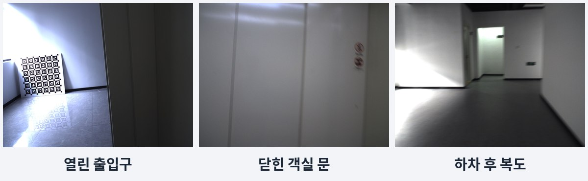
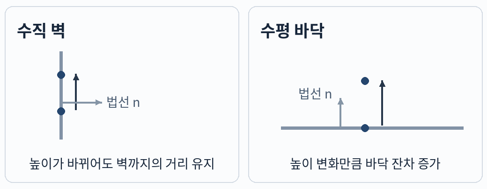
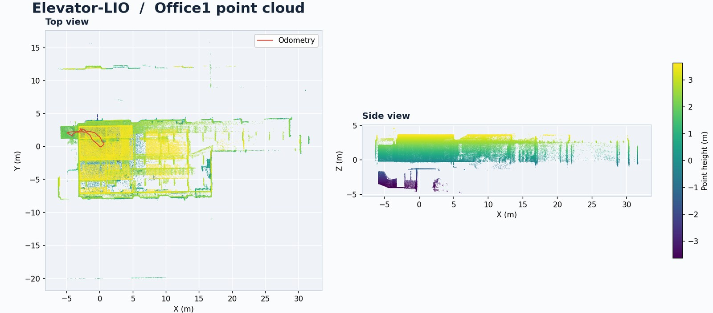
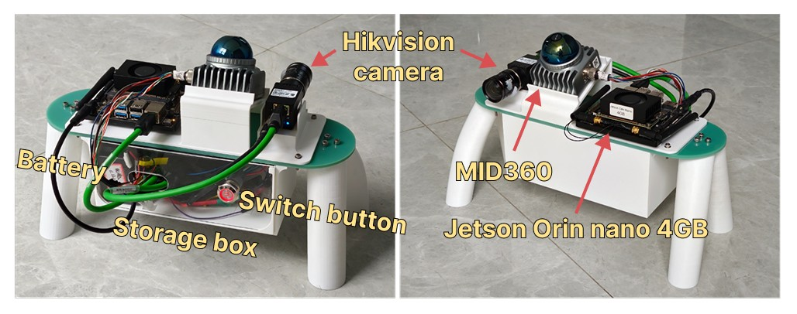

**Yifan Zhang 외 · arXiv:2605.24495 · 2026년 5월** [논문](https://arxiv.org/abs/2605.24495) · [공개 구현](https://github.com/xiaofan4122/Elevator-LIO/tree/4868796)

## 문제 설정

- 객실에 로봇이 정지해 있으면 LiDAR에서 벽과 바닥의 위치는 거의 일정하다. IMU에는 객실의 출발과 제동에 따른 수직 가속도가 들어온다.
- 객실 구조를 건물에 고정된 점군으로 간주하면 LiDAR 정합과 IMU 예측의 기준이 달라진다. 논문은 **객실 기준 로봇 운동**과 **건물 기준 객실 운동**을 분리해 추정한다.

*Office3의 카메라 프레임. 왼쪽부터 열린 출입구, 닫힌 객실 문, 하차 후 복도. 원본을 자르고 축소했다. 추정에는 LiDAR와 IMU를 사용한다.* [Zhang 외, Elevator-LIO Dataset, CC BY 4.0](https://huggingface.co/datasets/xiaofan0100/Elevator-LIO-Dataset)

## 상태 모델과 IMU 전파

- 반복 오차 상태 칼만 필터(IESKF)의 21차원 오차 상태에 로봇 자세·위치·속도, IMU 바이어스, 중력 벡터, 객실의 수직 변위·속도·가속도가 포함된다. [상태 정의](https://github.com/xiaofan4122/Elevator-LIO/blob/4868796/include/support/type.h#L31-L44)
- 객실은 중력에 정렬된 수직축을 따라 평행 이동한다고 가정한다. 아래 식의 <code>R</code>은 IMU 좌표를 건물에 정렬된 축으로 회전시키고, <code>e_z</code>는 위쪽 단위벡터다. [IMU 전파 코드](https://github.com/xiaofan4122/Elevator-LIO/blob/4868796/src/estimator/IMUProcess.cpp#L288-L319)

~~~text
a_world = R · (f_imu − b_a) + g
a_rel   = a_world − a_e · e_z

v_rel⁺  = v_rel + a_rel · Δt
p_rel⁺  = p_rel + v_rel · Δt + ½ a_rel · Δt²

v_e⁺    = v_e + a_e · Δt
z_e⁺    = z_e + v_e · Δt + ½ a_e · Δt²

건물 기준 높이 = p_rel,z + z_e
~~~

- <code>f_imu</code>는 IMU 비력, <code>b_a</code>는 가속도 바이어스다. 회전과 중력 보정 후 객실 가속도 <code>a_e</code>를 빼면 로봇의 상대 가속도 <code>a_rel</code>이 된다.
- 객실 바닥에 정지한 로봇은 <code>a_rel</code>이 0에 가깝다. 객실이 등속으로 이동할 때는 <code>a_e</code>가 거의 0이어도 앞서 추정한 속도 <code>v_e</code>를 적분해 객실 변위 <code>z_e</code>를 갱신한다.

## LiDAR 점–평면 정합

- 스캔의 점 <code>p</code>를 지도 좌표로 옮기고, ikd-tree에서 찾은 이웃 점으로 국소 평면을 맞춘다. 평면 위의 점을 <code>q</code>, 단위 법선을 <code>n</code>이라 하면 잔차는 <code>r = nᵀ(p − q)</code>다. IESKF는 이 잔차로 자세와 위치를 반복 갱신한다. [잔차와 야코비안](https://github.com/xiaofan4122/Elevator-LIO/blob/4868796/src/estimator/ESEKF.cpp#L1359-L1377)
- 수직 벽 가까이에서 스캔을 위아래로 이동시켜도 벽까지의 거리는 거의 같다. 바닥과 천장은 법선에 수직 성분이 크므로 높이 오차가 잔차에 반영된다.

- LiDAR 잔차는 로봇 자세와 위치에 직접 의존한다. 객실 가속도가 상대 위치·속도 예측에 들어가 생긴 교차 공분산을 통해 객실 상태도 간접 보정한다. 기본 <code>pose6</code> 경로는 6차원 자세 야코비안으로 전체 상태를 갱신한다. [공분산 전파](https://github.com/xiaofan4122/Elevator-LIO/blob/4868796/src/estimator/IMUProcess.cpp#L356-L372) · [pose6 갱신](https://github.com/xiaofan4122/Elevator-LIO/blob/4868796/src/estimator/ESEKF.cpp#L597-L645)
- 복셀 크기는 0.05–0.8 m 범위에서 조절한다. 기준은 초당 2만 점이다. 스캔 간격이 달라지면 프레임당 목표 점 수도 함께 바뀐다. [복셀 설정](https://github.com/xiaofan4122/Elevator-LIO/blob/4868796/yaml/runtime/mapping.yaml#L9-L16) · [프레임당 목표 점 수](https://github.com/xiaofan4122/Elevator-LIO/blob/4868796/src/node/LidarPipeline.cpp#L66-L95)

## 탑승 감지와 정차 보정

| 단계 | 기본 매핑 설정 |
| --- | --- |
| 진입 | 먼 점 상위 6%를 제외한 최대 거리가 3 m 미만인 상태가 2초간 지속되면 탑승 모드로 전환 |
| 이동 | 추정 객실 속도와 최근 300개 추정값의 분산으로 가속 → 등속 → 감속 → 정차 판별 |
| 정차 | 안정 조건을 1.5초간 만족하면 객실 수직 속도와 가속도를 0으로 제약 |
| 종료 | 객실 변위를 로봇 위치의 z 값에 더하고, 공분산을 변환한 뒤 객실 상태 초기화 |

[기본 설정](https://github.com/xiaofan4122/Elevator-LIO/blob/4868796/yaml/runtime/mapping.yaml#L49-L66) · [정차 상태 머신](https://github.com/xiaofan4122/Elevator-LIO/blob/4868796/src/elevator/ElevatorSelfExit.cpp#L89-L151) · [종료 시 상태 반영](https://github.com/xiaofan4122/Elevator-LIO/blob/4868796/src/node/LidarPipeline.cpp#L338-L387)

- 정차 시 속도와 가속도가 0으로 제약되는 대상은 객실이다. 속도와 변위 오차 사이의 교차 공분산을 통해 누적 높이 오차도 보정한다. [정차 측정 갱신](https://github.com/xiaofan4122/Elevator-LIO/blob/4868796/src/elevator/ElevatorProcess.cpp#L170-L200)

## 논문 실험과 한계

- **종료 높이 오차** · 실제 환경 20개 시퀀스 중 17개에서 1 cm 미만. 같은 층 재방문이나 계단 경로를 기준으로 종점의 높이를 비교했다. 전 구간의 절대 정확도를 계산할 기준 궤적은 제공되지 않는다.
- **자동 감지** · 엘리베이터 탑승 79회 중 76회 성공. 진입 감지에 실패한 구간에서는 모드를 수동 전환해 추정기를 평가했다. [논문 실험 및 표 III](https://arxiv.org/html/2605.24495v1#S6)
- **감지 조건** · 좁은 복도는 진입 오탐, 거울은 반사로 인한 진입 누락을 일으킬 수 있다. 등속 구간이 짧으면 자동 정차 판별도 실패할 수 있다. 외부 전환 신호는 <code>/LIO/set_elevator_flag</code>로 입력한다. [구현 안내](https://github.com/xiaofan4122/Elevator-LIO/blob/4868796/README_en.md#L199-L233)
- **스캔 왜곡** · 분석한 커밋은 탑승 중 스캔 모션 보정(deskew)을 생략한다. 센서가 빠르게 회전하면 스캔 내부의 왜곡이 정합에 남을 수 있다. [LiDAR 처리 경로](https://github.com/xiaofan4122/Elevator-LIO/blob/4868796/src/node/LidarPipeline.cpp#L522-L545)

## Office1 재현

- ROS 2 Jazzy에서 94초 시퀀스를 재생했다. 두 탑승 모두 자동 진입과 종료를 확인했다.
- 첫 이동 후 추정 높이는 약 −3.8 m에서 유지됐고, 두 번째 이동 후 출발 높이 부근으로 돌아왔다. 탑승 모드 종료 시점에 높이 추정값이 한 번씩 바뀐다.

*음영은 <code>/LIO/in_elevator</code>가 켜진 구간. 그래프는 <code>/LIO/odom_imu</code>의 z 값.*

*273,857점 ikd-tree 맵. 빨간 선은 평면에 투영한 오도메트리 궤적.*

- <code>/LIO/odom_imu</code>의 pose에는 객실 변위가 더해진다. <code>twist.linear.z</code>는 객실 속도를 포함하지 않으므로, 두 필드를 함께 쓰는 후단에서 기준 좌표를 확인해야 한다. [odometry 발행 코드](https://github.com/xiaofan4122/Elevator-LIO/blob/4868796/src/node/publish.cpp#L17-L46)

## 데이터와 재생

*논문 저자의 휴대형 수집 장비. Fig. 6을 JPEG로 변환했다.* [Zhang 외, Fig. 6, CC BY 4.0](https://arxiv.org/html/2605.24495v1#S6.F6)

- **데이터** · 실제 환경 20개 시퀀스. <code>Office1</code>은 1분 34초, <code>Campus2</code>는 11분 46초. [데이터셋](https://huggingface.co/datasets/xiaofan0100/Elevator-LIO-Dataset) · [Office1 다운로드](https://huggingface.co/datasets/xiaofan0100/Elevator-LIO-Dataset/blob/main/Office1.bag)
- **재생 환경** · 원본 ROS 1 bag을 제공 스크립트로 SQLite3 rosbag2로 변환. ROS 2 재생 시 <code>livox_ros_driver2/msg/CustomMsg</code> 타입 필요. [변환 안내](https://github.com/xiaofan4122/Elevator-LIO/blob/4868796/scripts/README.md#convert_rosbag1_to_rosbag2py)
