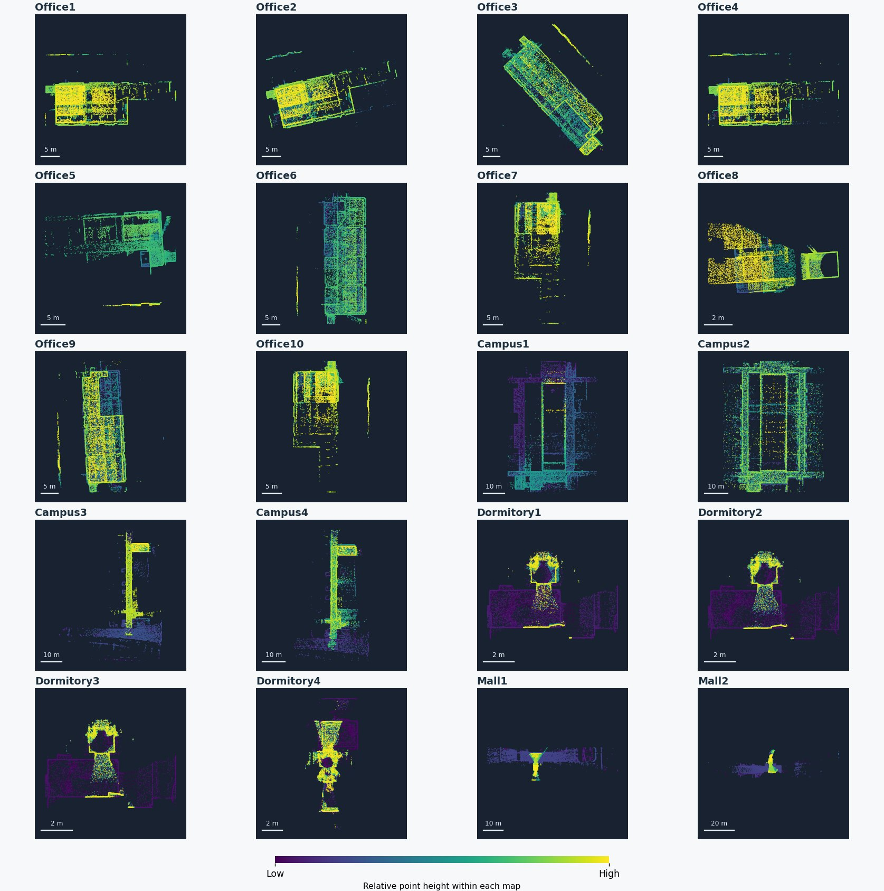

**Yifan Zhang 외 · arXiv:2605.24495 · 2026년 5월** [논문](https://arxiv.org/abs/2605.24495) · [공개 구현](https://github.com/xiaofan4122/Elevator-LIO/tree/4868796)

## 문제 설정

- 로봇이 엘리베이터 안에서 정지해 있으면 LiDAR로 관측한 벽과 바닥의 위치는 거의 일정하다. IMU는 엘리베이터가 출발하거나 제동할 때 수직 가속도를 감지한다.
- 엘리베이터 내부 구조를 건물에 고정된 점군으로 간주하면 LiDAR 정합과 IMU 예측의 기준이 달라진다. 논문은 **엘리베이터 기준 로봇 운동**과 **건물 기준 엘리베이터 운동**을 분리해 추정한다.

## Campus2 층간 매핑

<small>[Zhang 외, Elevator-LIO Dataset](https://huggingface.co/datasets/xiaofan0100/Elevator-LIO-Dataset)으로 재현 · [CC BY 4.0](https://creativecommons.org/licenses/by/4.0/)</small>

### 8층 복도 위치 추정

- Campus2 기록의 260–346초 구간을 같은 기록으로 만든 8층 PGM 지도에서 재생했다. AMCL이 추정한 이동 거리는 약 150 m다.
- MID-360 점군을 수평 스캔으로 변환하고, Elevator-LIO에서 초기 자세와 상대 오도메트리를 얻었다. AMCL은 이동량으로 입자 위치를 예측하고, 스캔 끝점과 지도의 점유 셀 사이 거리를 이용해 입자 가중치를 갱신했다. [Nav2 AMCL](https://docs.nav2.org/jazzy/configuration_and_development/configuration_guide/others/configuring_amcl/)

## Office3 상승 재생

*159–183초 구간. 정차 후 추정 높이는 출발 높이보다 약 4.0 m 높았다.* [Zhang 외, Elevator-LIO Dataset](https://huggingface.co/datasets/xiaofan0100/Elevator-LIO-Dataset) · [CC BY 4.0](https://creativecommons.org/licenses/by/4.0/)

## 상태 모델과 IMU 전파

- 공개 구현의 반복 오차 상태 칼만 필터(IESKF)는 21차원 오차 상태를 사용한다. 여기에는 로봇의 자세·위치·속도, IMU 바이어스, 중력 벡터, 엘리베이터의 수직 변위·속도·가속도가 포함된다. [상태 정의](https://github.com/xiaofan4122/Elevator-LIO/blob/4868796/include/support/type.h#L31-L44)
- 엘리베이터는 수직축을 따라 평행 이동한다고 가정한다. 아래 식에서 <code>R</code>은 IMU 좌표계의 벡터를 건물 기준 좌표계로 회전시키는 행렬이고, <code>e_z</code>는 위쪽 방향의 단위벡터다. [IMU 전파 코드](https://github.com/xiaofan4122/Elevator-LIO/blob/4868796/src/estimator/IMUProcess.cpp#L288-L319)

~~~text
a_world = R · (f_imu − b_a) + g
a_rel   = a_world − a_e · e_z

v_rel⁺  = v_rel + a_rel · Δt
p_rel⁺  = p_rel + v_rel · Δt + ½ a_rel · Δt²

v_e⁺    = v_e + a_e · Δt
z_e⁺    = z_e + v_e · Δt + ½ a_e · Δt²
~~~

- <code>p_z</code>는 엘리베이터 기준 로봇 위치 <code>p_rel</code>의 높이 성분이다. <code>z_e</code>는 건물 기준 엘리베이터의 수직 변위다. 탑승 모드에 들어갈 때 <code>z_e</code>를 0으로 두고 이후 상승·하강 변위를 누적한다. [탑승 상태 초기화](https://github.com/xiaofan4122/Elevator-LIO/blob/4868796/src/elevator/ElevatorProcess.cpp#L85-L91)

- <code>f_imu</code>는 IMU 비력, <code>b_a</code>는 가속도 바이어스다. 회전과 중력 보정 후 엘리베이터 가속도 <code>a_e</code>를 빼면 로봇의 상대 가속도 <code>a_rel</code>이 된다.
- 엘리베이터 내부에서 정지한 로봇의 <code>a_rel</code>은 0에 가깝다. 엘리베이터가 등속으로 이동하는 동안에는 가속도 <code>a_e</code>가 거의 0이다. 앞서 추정한 속도 <code>v_e</code>를 적분해 변위 <code>z_e</code>를 갱신한다.

## LiDAR 점–평면 정합

- 스캔의 점 <code>p</code>를 지도 좌표로 옮기고, ikd-tree에서 찾은 이웃 점으로 국소 평면을 맞춘다. 평면 위의 점을 <code>q</code>, 단위 법선을 <code>n</code>이라 하면 잔차는 <code>r = nᵀ(p − q)</code>다. IESKF는 이 잔차로 자세와 위치를 반복 갱신한다. [잔차와 야코비안](https://github.com/xiaofan4122/Elevator-LIO/blob/4868796/src/estimator/ESEKF.cpp#L1359-L1377)
- 수직 벽 가까이에서 스캔을 위아래로 이동시켜도 벽까지의 거리는 거의 같다. 바닥과 천장의 법선은 수직 방향이어서 높이 오차가 잔차에 반영된다.

- LiDAR 잔차는 로봇 자세와 위치에 직접 의존한다. 로봇의 상대 위치와 속도를 예측할 때 엘리베이터 가속도가 반영되므로 두 상태 사이에 교차 공분산이 생긴다. 필터는 이 값을 이용해 엘리베이터 상태도 간접 보정한다. 기본 <code>pose6</code> 경로는 6차원 자세 야코비안으로 전체 상태를 갱신한다. [공분산 전파](https://github.com/xiaofan4122/Elevator-LIO/blob/4868796/src/estimator/IMUProcess.cpp#L356-L372) · [pose6 갱신](https://github.com/xiaofan4122/Elevator-LIO/blob/4868796/src/estimator/ESEKF.cpp#L597-L645)
- 복셀 크기는 0.05–0.8 m 범위에서 조절한다. 기준은 초당 2만 점이다. 스캔 간격이 달라지면 프레임당 목표 점 수도 함께 바뀐다. [복셀 설정](https://github.com/xiaofan4122/Elevator-LIO/blob/4868796/yaml/runtime/mapping.yaml#L9-L16) · [프레임당 목표 점 수](https://github.com/xiaofan4122/Elevator-LIO/blob/4868796/src/node/LidarPipeline.cpp#L66-L95)

## 탑승 감지와 정차 보정

| 단계 | 기본 매핑 설정 |
| --- | --- |
| 진입 | 거리 순으로 가장 먼 6%의 점을 제외한 뒤, 남은 점의 최대 거리가 3 m 미만인 상태가 2초간 지속되면 탑승 모드로 전환 |
| 이동 | 엘리베이터의 추정 속도와 최근 속도 추정값 300개의 분산으로 가속 → 등속 → 감속 → 정차 판별 |
| 정차 | 안정 조건을 1.5초간 만족하면 엘리베이터의 수직 속도와 가속도를 0으로 제약 |
| 종료 | 엘리베이터 변위를 로봇 위치의 z 값에 더하고, 공분산을 변환한 뒤 엘리베이터 상태 초기화 |

[기본 설정](https://github.com/xiaofan4122/Elevator-LIO/blob/4868796/yaml/runtime/mapping.yaml#L49-L66) · [정차 상태 머신](https://github.com/xiaofan4122/Elevator-LIO/blob/4868796/src/elevator/ElevatorSelfExit.cpp#L89-L151) · [종료 시 상태 반영](https://github.com/xiaofan4122/Elevator-LIO/blob/4868796/src/node/LidarPipeline.cpp#L338-L387)

- 정차 시 속도와 변위 오차의 교차 공분산으로 누적 높이 오차를 보정한다. [정차 측정 갱신](https://github.com/xiaofan4122/Elevator-LIO/blob/4868796/src/elevator/ElevatorProcess.cpp#L170-L200)

## 건물 기준 오도메트리 계산

1. **IMU 예측** · 보정한 IMU 가속도에서 필터가 추정한 엘리베이터 가속도를 빼고 적분해 로봇의 상대 위치 <code>p_rel</code>을 예측한다. 엘리베이터 가속도는 별도로 적분해 수직 변위 <code>z_e</code>를 예측한다.
2. **LiDAR 보정** · 엘리베이터 내부의 점–평면 잔차로 <code>p_rel</code>과 자세를 갱신한다. 이 갱신은 교차 공분산을 통해 <code>z_e</code>에도 반영된다.
3. **위치 합성** · 건물 기준 위치는 <code>p_world = p_rel + z_e · e_z</code>다. 수직 평행 이동 모델이므로 x·y 위치와 자세는 그대로 쓰고, <code>/LIO/odom_imu</code>의 <code>pose.pose.position.z</code>에 <code>p_z + z_e</code>를 발행한다. [논문 식 (31)](https://arxiv.org/html/2605.24495v1#S5.E31) · [발행 코드](https://github.com/xiaofan4122/Elevator-LIO/blob/4868796/src/node/publish.cpp#L17-L46)
4. **정차 후 전환** · 엘리베이터의 수직 속도와 가속도가 0인 조건으로 변위를 보정한다. 보정한 <code>z_e</code>를 <code>p_z</code>에 더하고 엘리베이터 상태를 초기화해 도착 층 높이에서 일반 LIO를 이어간다.

- 로봇이 제자리에 서 있는 동안 엘리베이터가 4 m 올라가면 <code>p_z</code>는 거의 일정하고 <code>z_e</code>와 건물 기준 로봇 높이는 약 4 m 증가한다.
- 같은 메시지의 <code>twist.twist.linear.z</code>에는 탑승 중 로봇의 상대 수직 속도 <code>v_rel.z</code>가 들어간다.

## 논문 실험과 한계

- **종료 높이 오차** · 실제 환경 20개 시퀀스 중 17개에서 1 cm 미만. 같은 층 재방문이나 계단 경로를 기준으로 종점의 높이를 비교했다. 전체 주행 구간의 절대 오차를 계산할 기준 궤적은 제공되지 않는다.
- **자동 감지** · 엘리베이터 탑승 79회 중 76회 성공. 진입 감지에 실패한 구간에서는 모드를 수동 전환해 추정기를 평가했다. [논문 실험 및 표 III](https://arxiv.org/html/2605.24495v1#S6)
- **감지 조건** · 좁은 복도에서는 진입 오탐이 생길 수 있고, 거울 반사는 진입 감지를 방해할 수 있다. 등속 구간이 짧으면 자동 정차 판별도 실패할 수 있다. 외부 전환 신호는 <code>/LIO/set_elevator_flag</code>로 입력한다. [구현 안내](https://github.com/xiaofan4122/Elevator-LIO/blob/4868796/README_en.md#L199-L233)
- **스캔 왜곡** · 공개 구현은 탑승 중 스캔의 모션 왜곡 보정(deskew)을 생략한다. 센서가 빠르게 회전하면 스캔 내부의 왜곡이 정합에 남을 수 있다. [LiDAR 처리 경로](https://github.com/xiaofan4122/Elevator-LIO/blob/4868796/src/node/LidarPipeline.cpp#L522-L545)

## 공개 데이터셋

| 환경 | 시퀀스 | 녹화 시간 합계 |
| --- | ---: | ---: |
| 사무실 · Office | 10 | 26분 35초 |
| 캠퍼스 · Campus | 4 | 24분 18초 |
| 기숙사 · Dormitory | 4 | 12분 59초 |
| 쇼핑몰 · Mall | 2 | 5분 53초 |
| 전체 | 20 | 69분 45초 |

- 모든 시퀀스에는 Livox MID-360의 점군과 내장 IMU 데이터가 기록돼 있다. 산업용 카메라 영상은 <code>Office3</code>와 <code>Mall2</code>에만 포함된다. [데이터셋과 센서 구성](https://huggingface.co/datasets/xiaofan0100/Elevator-LIO-Dataset)
- 네 시퀀스(<code>Campus1</code>, <code>Campus3</code>, <code>Campus4</code>, <code>Mall1</code>)에는 외부 모드 전환 신호도 기록돼 있다. 반사와 다중 경로로 자동 진입 감지가 어려웠던 구간이 포함된다. [전환 신호가 포함된 시퀀스](https://github.com/xiaofan4122/Elevator-LIO/blob/4868796/DATASET.md#L79-L85)

*Mall2 · L1 하차.* [Zhang 외, 데이터셋 영상 일부](https://huggingface.co/datasets/xiaofan0100/Elevator-LIO-Dataset) · [CC BY 4.0](https://creativecommons.org/licenses/by/4.0/)

## 전체 시퀀스 매핑

- 원본 ROS 1 bag을 rosbag2로 변환했다. ROS 2 Jazzy에서 LiDAR·IMU와 기록된 모드 전환 신호를 재생해 20개 시퀀스를 매핑했다. [변환 안내](https://github.com/xiaofan4122/Elevator-LIO/blob/4868796/scripts/README.md#convert_rosbag1_to_rosbag2py)
- LiDAR 스캔 153,823개 중 153,035개에서 자세 추정값을 얻었다. 자세 로그는 각 시퀀스의 녹화 시간 중 최소 약 97.6%를 포함한다.
- LiDAR 기록률이 약 10 Hz인 시퀀스는 8개, 약 50 Hz인 시퀀스는 12개다.

### Campus2 엘리베이터 이동

*탑승 모드 6회 · 마지막 구간의 추정 높이 약 24 m 감소*

*논문 결과. 흰 선은 전체 주행 궤적.* [Zhang 외, 그림 8 일부 확대](https://arxiv.org/html/2605.24495v1#S6.F8) · [CC BY 4.0](https://creativecommons.org/licenses/by/4.0/)

전체 시퀀스 평면도와 매핑 결과

| 시퀀스 | LiDAR 스캔 | 자세 출력 | ikd-tree 맵 점 수 |
| --- | ---: | ---: | ---: |
| Office1 | 4,706 | 4,651 | 273,857 |
| Office2 | 1,095 | 1,080 | 380,525 |
| Office3 | 11,458 | 11,403 | 1,103,226 |
| Office4 | 4,805 | 4,755 | 367,205 |
| Office5 | 955 | 940 | 168,592 |
| Office6 | 2,746 | 2,731 | 1,230,765 |
| Office7 | 1,392 | 1,377 | 298,888 |
| Office8 | 1,081 | 1,066 | 49,965 |
| Office9 | 2,981 | 2,966 | 1,211,404 |
| Office10 | 1,502 | 1,487 | 278,670 |
| Campus1 | 14,038 | 13,988 | 1,826,576 |
| Campus2 | 35,281 | 35,209 | 5,622,381 |
| Campus3 | 6,894 | 6,838 | 968,384 |
| Campus4 | 16,673 | 16,618 | 1,630,165 |
| Dormitory1 | 4,944 | 4,889 | 109,259 |
| Dormitory2 | 8,468 | 8,413 | 140,065 |
| Dormitory3 | 8,368 | 8,313 | 138,777 |
| Dormitory4 | 17,174 | 17,119 | 348,612 |
| Mall1 | 2,066 | 2,051 | 502,110 |
| Mall2 | 7,196 | 7,141 | 332,884 |

### Campus1 재진입 오탐

- 기본 설정으로 2.5배속 재생했을 때 두 번째 탑승 모드가 종료된 직후 다시 켜졌다. 이후 추정 위치가 1초 사이 최대 25.2 m 이동했다.
- 최종 맵은 자동 진입 감지를 끄고 bag에 기록된 진입 신호를 포함해 2.2배속으로 재생한 결과다. 탑승 모드는 두 번 켜졌고, LiDAR 스캔 14,038개 중 13,988개에서 자세가 출력됐다.

*음영은 탑승 모드 구간.*

## Office1 높이 추정

- 94초 시퀀스에서 두 번의 탑승 모두 모드가 자동으로 시작되고 종료됐다.
- <code>/LIO/odom_imu</code>의 추정 높이는 첫 이동 후 약 −3.8 m에서 유지됐고, 두 번째 이동 후 출발 높이 부근으로 돌아왔다. 각 탑승 모드가 종료될 때 높이 보정이 반영됐다.

