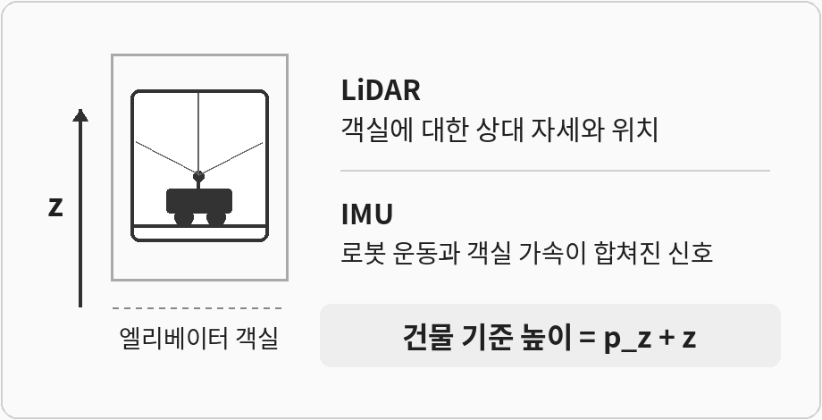

엘리베이터 안에서 로봇이 멈춰 있어도, 출발과 제동 때 IMU에는 수직 가속이 들어온다. 같은 순간 LiDAR가 보는 벽과 바닥은 로봇과 함께 움직인다. 일반적인 LiDAR–IMU 오도메트리(LIO)가 이 점군을 건물에 고정된 구조물로 취급하면, 센서 융합 과정에서 층간 높이 변화가 누락되거나 궤적이 틀어질 수 있다.

## 로봇 운동과 엘리베이터 운동의 분리

Elevator-LIO는 반복 오차 상태 칼만 필터(IESKF)에 엘리베이터의 수직 **변위·속도·가속도**를 추가한다. 탑승 중에는 IMU에서 얻은 선가속도에서 추정한 엘리베이터 가속도를 빼 로봇의 상대 운동을 예측한다. LiDAR의 점–평면 정합은 객실 내부의 상대 자세와 위치를 보정한다. 외부로 발행하는 로봇 높이는 상대 높이와 엘리베이터 변위의 합이다. [IMU 전파 코드](https://github.com/xiaofan4122/Elevator-LIO/blob/48687967aaf20d5fa5f66195dd4e9b85849bc1/src/estimator/IMUProcess.cpp#L288-L319)

## 모드 전환과 높이 보정

- **진입.** 기본 매핑 설정은 LiDAR 거리의 94백분위수가 3 m 미만인 상태가 2초간 지속되면 탑승 모드를 켠다. 좁은 복도에서도 이 조건을 만족할 수 있어, 외부 시스템에서 `/LIO/set_elevator_flag`로 전환을 제어할 수 있다. [기본 설정](https://github.com/xiaofan4122/Elevator-LIO/blob/48687967aaf20d5fa5f66195dd4e9b85849bc1/yaml/runtime/mapping.yaml#L49-L66)
- **이동.** 점군 밀도에 따라 복셀 크기를 조절해, 넓은 층과 좁은 객실을 오갈 때 다운샘플링된 점 수를 초당 2만 개에 가깝게 맞춘다. 바닥이나 천장 관측이 부족하면 높이 방향의 정합 제약이 약해진다. [센서 장착 안내](https://github.com/xiaofan4122/Elevator-LIO/blob/48687967aaf20d5fa5f66195dd4e9b85849bc1/README_en.md#L20-L22)
- **정차.** 추정 수직 속도와 최근 속도 분산으로 움직임 단계를 판별한다. 기본 매핑 설정에서는 정차 확인 후 속도와 가속도를 0으로 제약해 누적 드리프트를 줄이고, 추정한 엘리베이터 변위를 로봇의 건물 기준 높이에 합산한다. 자동 정차 판정은 등속 단계 통과를 요구하므로, 등속 구간이 짧은 한 층 이동도 따로 검증할 필요가 있다. [정차 상태 머신](https://github.com/xiaofan4122/Elevator-LIO/blob/48687967aaf20d5fa5f66195dd4e9b85849bc1/src/elevator/ElevatorSelfExit.cpp#L89-L143) · [높이 반영 코드](https://github.com/xiaofan4122/Elevator-LIO/blob/48687967aaf20d5fa5f66195dd4e9b85849bc1/src/node/LidarPipeline.cpp#L338-L387)

## 논문 결과와 통합 시 확인할 점

저자 실험에서는 Livox MID-360으로 기록한 20개 시퀀스 중 17개에서 **종료 시점의 높이 오차가 1 cm 미만**이었다. 이 수치는 같은 층에 돌아오거나 계단 경로와 교차 검증했을 때의 최종 높이 일관성을 보여준다. 자동 감지는 79회 중 76회 성공했으며, 거울 반사 등으로 감지에 실패한 구간은 수동으로 모드를 전환해 추정기를 평가했다. [논문 평가 및 표 III](https://arxiv.org/html/2605.24495v1#S6)

ROS 2에서 연결할 때는 **pose와 twist를 함께 확인해야 한다.** 현재 `/LIO/odom_imu`의 위치에는 엘리베이터 변위가 더해지지만, `twist.linear.z`에는 엘리베이터 속도가 더해지지 않는다. 건물 기준 속도를 쓰는 후단에서는 객실에 정지한 로봇의 높이가 변하는 동안 수직 속도가 0에 가깝게 들어올 수 있다. [odometry 발행 코드](https://github.com/xiaofan4122/Elevator-LIO/blob/48687967aaf20d5fa5f66195dd4e9b85849bc1/src/node/publish.cpp#L17-L46)

## 공개 데이터로 재현하기

공개 데이터는 Livox MID-360의 LiDAR와 IMU를 담은 ROS 1 bag이다. 처음에는 엘리베이터 탑승 2회가 들어 있는 `Office1.bag`(1분 34초, 348 MiB) 한 개로 시작할 수 있다. ROS 2 Humble에서는 제공된 변환 스크립트로 rosbag2를 만든 뒤, `/LIO/in_elevator`의 전환 시점과 `/LIO/odom_imu`의 높이 궤적을 함께 확인한다. [Office1.bag](https://huggingface.co/datasets/xiaofan0100/Elevator-LIO-Dataset/blob/main/Office1.bag) · [데이터셋과 변환 방법](https://huggingface.co/datasets/xiaofan0100/Elevator-LIO-Dataset)

*분석 기준은 Elevator-LIO 커밋 `4868796`의 소스와 논문이다.* [원본 저장소](https://github.com/xiaofan4122/Elevator-LIO)
