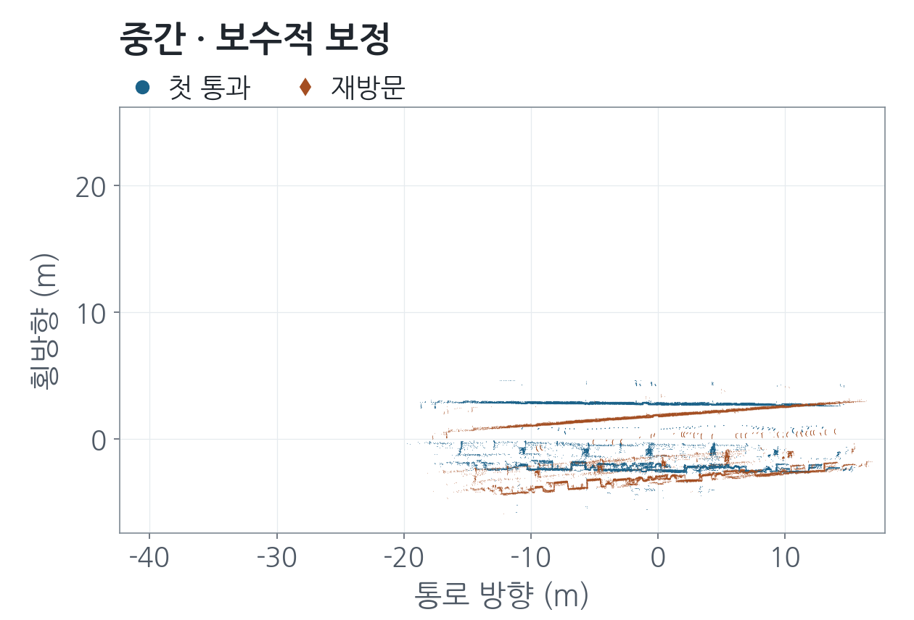
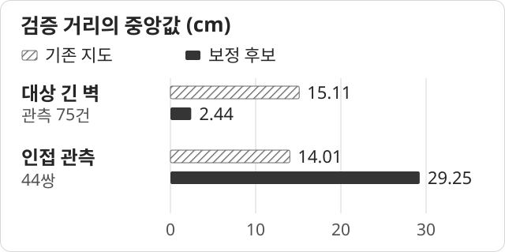

추가 주행 없이 기존 LiDAR·IMU 기록으로 2D 지도를 보정했다. 스캔 수는 SLAM에 저장된 키프레임 기준이다.

## 점군 전처리

LiDAR 장착 각도를 반영하고, 추정한 IMU 표본 시각을 LiDAR에 맞췄다. IMU의 중력 방향으로 점군을 수평화했다. KISS-ICP로 이동을 추정하고 GSeg3D로 지면을 분리했다. 주변 지면에서 일정 높이 범위에 든 비지면점을 2D 스캔으로 투영해 오도메트리와 함께 SLAM Toolbox에 넣었다.

## 벽 휨

긴 통로의 두 경계가 휘어 교차했다. 같은 스캔 1,414개로 인접 자세 간 KISS-ICP 상대 이동 제약을 강화했다. 두 경계가 분리됐고 벽 방향의 P10–P90 범위는 **1.936° → 0.466°**로 줄었다.

*동일 구간 45 m, 동일 축척.*

## 재방문 통로 중복

같은 통로가 첫 통과와 재방문에서 따로 찍혔다. 벽 방향으로 진행 각도를 보정하고 시간축에서 평활화했다. 동일 통로임을 확인한 구간을 루프 폐쇄 제약 13개로 연결했다.

| 보정 단계 | 양방향 최근접 거리 중앙값 | 20 cm 이내 평균 비율 |
| --- | ---: | ---: |
| 초기 | 11.407 m | 0.0104% |
| 중간 | 1.738 m | 6.705% |
| 최종 | 0.0437 m | 87.280% |

*세 단계 모두 스캔 3,087개 사용. 그림은 같은 중앙 구간, 표는 더 넓은 재방문 구역 기준.*

## 측면 간격

자세 각도를 보정하면서 이동 벡터까지 회전하자 일부 측면 간격이 좁아졌다. 회전 보정은 스캔 방향에 적용하고, 기존 횡이동을 기준으로 횡방향 보정량과 측면 10개의 위치를 함께 추정했다. 같은 스캔 3,732개에서 가장 좁았던 LiDAR 표면 간격은 **0.636 m → 1.861 m**로 바뀌었다.

## 지도 병합과 노이즈 처리

0.10 m 복셀로 줄인 점군에서 먼 대응점을 제거한 뒤 SVD로 평면 변환을 구했다. 스캔을 교대로 나눠 정합과 검증에 썼다. 병합 시 기존 지도 자세를 고정하고, 검증된 제약으로 새 기록의 자세만 Ceres에서 최적화했다. 큰 잔차의 영향은 Huber 손실로 줄였다.

확인된 벽은 보호했다. 보호 영역 밖에서 점유 관측이 2회 미만이고 자유 공간 관측이 6회 이상인 셀은 점유 상태에서 미확인으로 바꿨다.

## 정합 검증

벽에 수직인 제약을 추가하자 대상 벽의 거리 중앙값은 **15.11 → 2.44 cm**로 줄었지만 인접 구역은 **14.01 → 29.25 cm**로 늘었다. 이 후보는 제외했다.

## 스캔 수 비교

같은 기록의 앞부분을 스캔 1,901·2,590·3,087개에서 끊어 재생했다. 공통 구간(390–430초)에서 각 빔 끝점부터 고정된 기준 지도 점군까지 최근접 거리를 비교했다.

| 입력 | 스캔 수 | 중앙값 | P90 |
| --- | ---: | ---: | ---: |
| 기본 오도메트리 | 1,901 | 0.2695 m | 0.8292 m |
| 벽 방향 보정 | 1,901 | 0.0433 m | 0.2838 m |
| 벽 방향 보정 | 3,087 | 0.0432 m | 0.2836 m |

벽 방향 보정 후 공통 구간에서는 **1,901개(38.4% 감소)**와 전체 3,087개의 결과가 비슷했다. 더 긴 기록은 공통 구간 밖까지 포함한다.

[KISS-ICP](https://github.com/PRBonn/kiss-icp) · [GSeg3D](https://github.com/dfki-ric/ground_segmentation) · [SLAM Toolbox](https://github.com/SteveMacenski/slam_toolbox)
