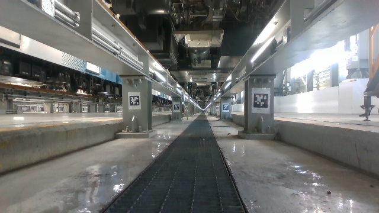
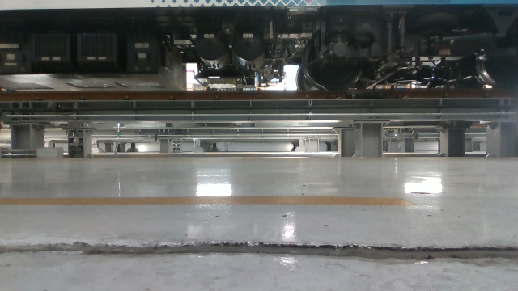
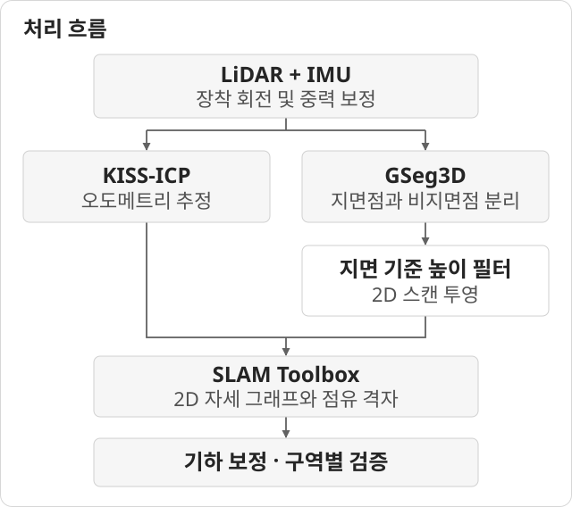
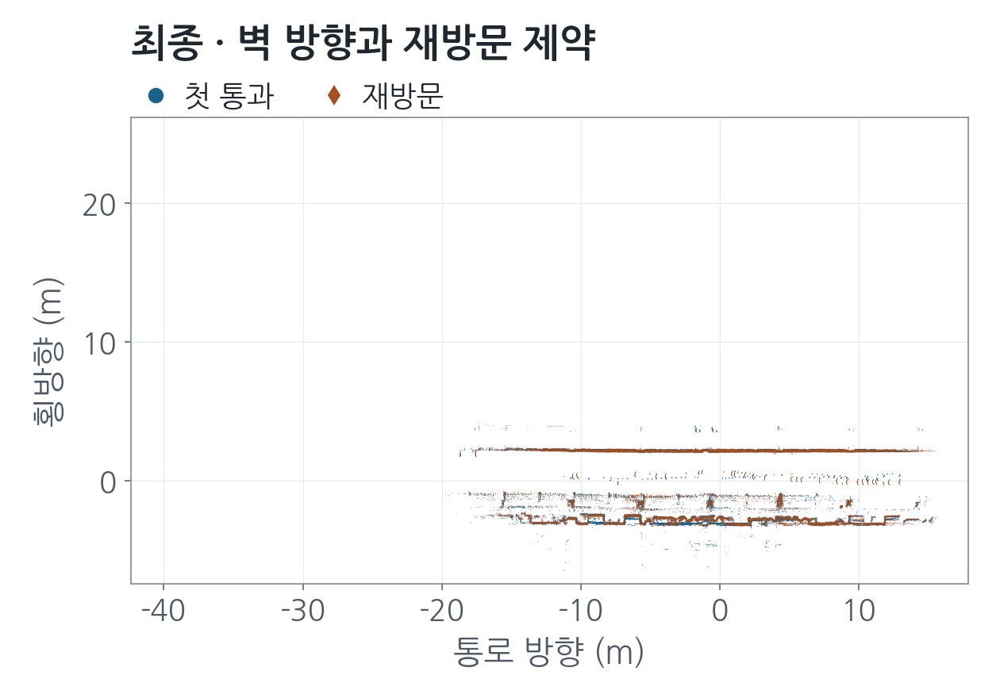
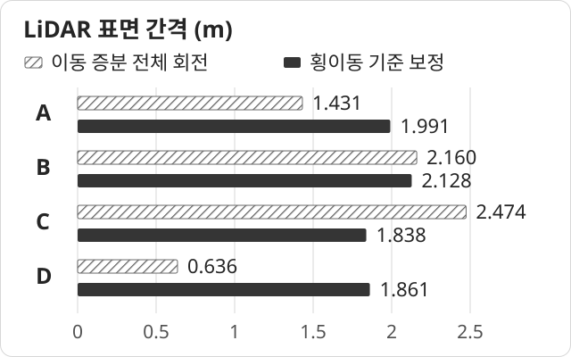
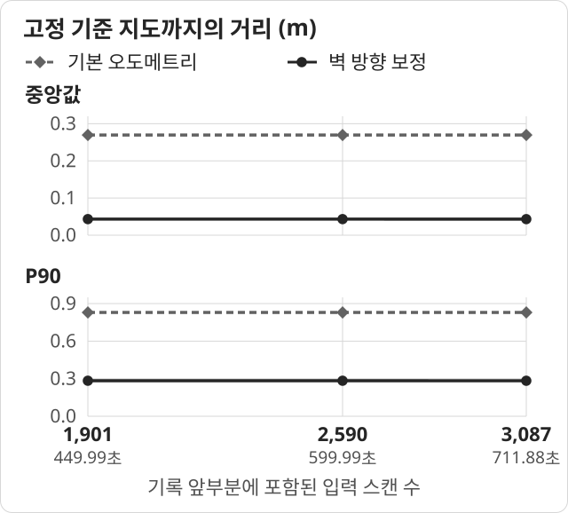

긴 평행 벽만 보이는 구간에서는 벽을 따라 얼마나 움직였는지 추정하기 어렵다. 비슷한 통로가 반복되면 재방문 위치도 혼동하기 쉽다. 추가 주행 없이 기존 LiDAR·IMU 기록으로 포즈 그래프를 다시 계산했다. 스캔 수는 SLAM에 저장된 키프레임 기준이다.

*별도 RGB 카메라 기록의 통로 전경.*

## 점군 전처리

묶음으로 기록된 IMU 표본의 시각은 200 Hz 샘플링을 가정해 추정했다. LiDAR와 50 ms 이내로 대응시키고, 장착 회전과 IMU에서 추정한 중력 방향을 반영해 점군을 수평화했다. KISS-ICP로 이동량을 추정하고 GSeg3D로 지면을 분리했다.

지면점은 0.35 m 셀별로 평균 높이를 구했다. 비지면점마다 수평 거리 1 m 이내의 가장 가까운 지면 셀을 찾아 높이 차를 계산했다. 이 차가 설정 범위에 드는 점을 2D로 투영했다. 바닥에 단차가 있어도 주변 바닥을 기준으로 장애물 높이를 계산할 수 있다. 2D 스캔과 오도메트리는 SLAM Toolbox에 입력했다.

*별도 RGB 카메라 기록에서 본 바닥 단차.*

## 벽 휨

초기 지도에서는 긴 통로의 두 경계가 휘어 교차했다. 스캔 1,414개를 그대로 사용하고, 인접 자세 사이의 KISS-ICP 상대 이동 제약을 강화해 포즈 그래프를 다시 계산했다. 두 경계가 분리됐고, 벽 방향의 10~90백분위 범위는 **1.936° → 0.466°**로 줄었다.

*동일 구간 45 m, 동일 축척.*

## 재방문 통로 중복

같은 통로가 첫 통과와 재방문에서 따로 찍혔다. 2D 스캔에서 2 m가 넘는 직선을 추출해 벽의 대표 방향을 구했다. 오도메트리 자세로 환산한 벽 방향을 초반 스캔의 기준축과 비교했다. 신뢰도가 낮은 관측은 제외하고, 각도 보정량은 인접 스캔 사이에서 급격히 바뀌지 않도록 평활화했다.

주행 경로와 구조를 확인해 같은 통로를 찾았다. 첫 통과와 재방문의 대응 스캔 사이에 상대 자세 제약 13개를 추가했다. 각 연결은 두 자세 사이의 이동과 회전을 제약한다.

| 보정 단계 | 양방향 최근접 거리 중앙값 | 20 cm 이내 평균 비율 |
| --- | ---: | ---: |
| 초기 | 11.407 m | 0.0104% |
| 중간 | 1.738 m | 6.705% |
| 최종 | 0.0437 m | 87.280% |

*세 단계 모두 스캔 3,087개 사용. 그림은 같은 중앙 구간, 표는 더 넓은 재방문 구역 기준.*

## 측면 간격

각도 보정값으로 이동 벡터까지 돌려 궤적을 다시 적분하자 일부 측면 간격이 좁아졌다. 스캔 방향은 보정하되 횡좌표에는 원래 오도메트리 값과 별도로 추정한 보정량을 합했다. 같은 면에서 관측한 점들이 한 기준선에 모이도록 보정량과 측면 10개의 위치를 함께 맞췄다. 연속 자세 간 보정량의 변화와 굴곡에 벌점을 줘 국소 관측에 맞춰 궤적이 급격히 꺾이는 것을 줄였다.

같은 스캔 3,732개에서 가장 좁았던 LiDAR 표면 간격은 **0.636 m → 1.861 m**로 바뀌었다. 간격은 두 기준선의 위치 차이로 구했다. 보정에 쓰지 않은 측면 관측 881개에서 기준선까지의 수직 거리 중앙값은 4.68 cm였다.

## 지도 병합과 노이즈 처리

겹치는 구간의 점군을 0.10 m 복셀로 줄였다. 초기 위치에서 최근접 대응점을 찾고, 거리가 큰 대응을 걸러낸 뒤 SVD로 평면 회전과 이동을 다시 계산했다. 스캔을 교대로 나눠 한쪽은 변환 추정에, 다른 쪽은 검증에 썼다.

세션 간 정합 후보는 초기값 대비 이동 **0.75 m 이내**, 회전 **3° 이내**, 검증 점의 **80% 이상이 20 cm 이내**일 때 통과했다. 거리 중앙값은 20% 이상 감소하고, 90백분위수(P90)는 30 cm 이내이면서 증가하지 않아야 했다. 통과한 연결은 통로와 랜드마크의 대응을 확인한 뒤 병합에 사용했다.

기준 지도 자세는 고정하고 새 기록의 자세만 Ceres에서 최적화했다. 각 연결에서 측정한 상대 자세와 최적화된 상대 자세의 차이를 줄였다. 공분산으로 잔차의 크기를 조정하고 Huber 손실로 큰 잔차의 영향을 줄였다.

확인된 벽은 보호했다. 보호 영역 밖에서 점유 관측이 2회 미만이고 자유 공간 관측이 6회 이상인 셀은 점유 상태에서 미확인으로 바꿨다.

## 정합 검증

벽에 수직인 제약을 추가한 뒤 대상 벽과 주변 구역을 따로 평가했다. 대상 벽 관측 75건의 거리 중앙값은 **15.11 → 2.44 cm**로 줄었고, 인접 관측 44쌍에서는 **14.01 → 29.25 cm**로 늘었다. 주변 구조의 불일치가 커져 이 보정안은 제외했다.

## 스캔 수 비교

첫 저장 스캔을 기준으로 약 450·600·712초 분량을 잘랐다. 각 분량을 기본 오도메트리와 벽 방향 보정으로 한 번씩 재생했다. 매퍼 설정은 여섯 번 모두 같았으며, 각도 보정량은 해당 분량의 데이터로만 계산했다.

공통 구간(390–430초)의 스캔 179개에서 같은 빔 100,462개를 골랐다. 정렬은 고정한 채 각 빔 끝점에서 별도 기록으로 만든 기준 지도의 최근접 점까지 거리를 구했다. 표는 거리의 중앙값과 P90이다.

| 스캔 수 | 기본 오도메트리 (m) | 벽 방향 보정 (m) |
| ---: | ---: | ---: |
| 1,901 | 0.2695 / 0.8292 | 0.0433 / 0.2838 |
| 2,590 | 0.2695 / 0.8292 | 0.0433 / 0.2838 |
| 3,087 | 0.2695 / 0.8292 | 0.0432 / 0.2836 |

벽 방향 보정 후 공통 구간에서는 **1,901개(38.4% 감소)**와 전체 3,087개의 기준 지도 일치도가 비슷했다. 더 긴 기록은 이 구간 밖의 영역까지 포함한다.

[KISS-ICP](https://github.com/PRBonn/kiss-icp) · [GSeg3D](https://github.com/dfki-ric/ground_segmentation) · [SLAM Toolbox](https://github.com/SteveMacenski/slam_toolbox)
