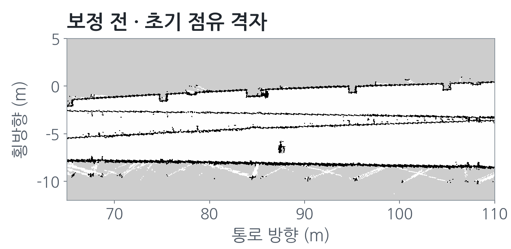
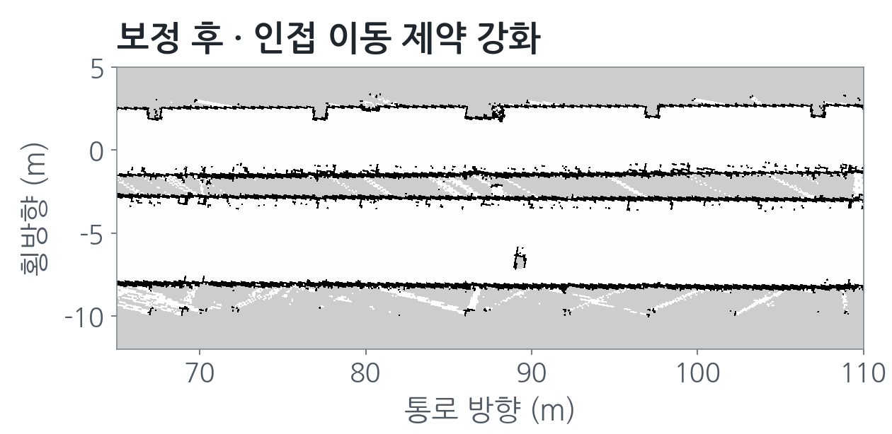
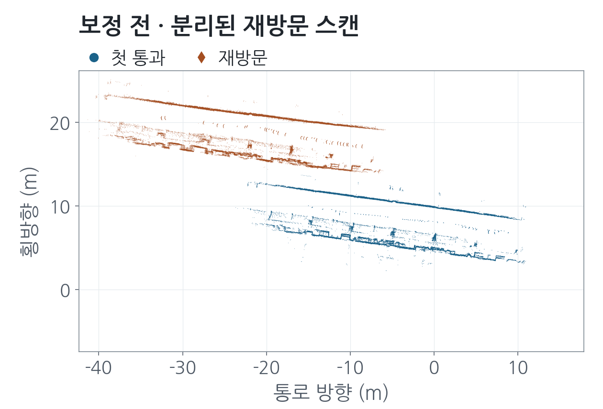

철도 차량기지의 LiDAR 지도에는 긴 벽이 서로 교차하거나 다시 지난 통로가 두 곳에 나타나는 문제가 있었다. 추가 주행 없이 기존 스캔으로 불일치를 줄이고, 이미 관측한 한 통로에서 입력량과 기준 지도 일치도의 관계를 살폈다. 이 글에서 스캔 수는 매퍼에 저장된 키프레임을 기준으로 센다.

## 3D 점군에서 2D 스캔 만들기

LiDAR의 장착 회전을 반영하고, IMU 표본 시각을 추정해 LiDAR와 맞춘 뒤 중력 방향을 기준으로 점군을 수평화했다. KISS-ICP로 오도메트리를 추정하고 GSeg3D로 지면점과 비지면점을 분리했다. 같은 시각의 주변 지면 높이를 기준으로 비지면점을 걸러 2D 스캔으로 투영하고, 오도메트리와 함께 SLAM Toolbox에 입력했다. [KISS-ICP](https://github.com/PRBonn/kiss-icp) · [GSeg3D](https://github.com/dfki-ric/ground_segmentation) · [SLAM Toolbox](https://github.com/SteveMacenski/slam_toolbox)

## 긴 벽의 교차와 휨

102818 기록의 초기 격자에서는 나란히 이어져야 할 통로 경계가 중간에서 휘어 서로 교차했다. 저장된 스캔 **1,414개**를 그대로 두고 인접 자세 사이에 KISS-ICP의 상대 이동량을 더 강하게 반영해 그래프를 다시 계산했다. 통로의 두 경계가 분리됐고, 벽 방향 분포의 가중 10–90백분위 범위(P10–P90)는 **1.936° → 0.466°**로 75.9% 줄었다.

*같은 45 m 구간을 한 번의 공통 회전과 같은 축척으로 표시했다.*

## 재방문 통로의 중복

120204 기록에서는 첫 통과와 재방문에서 관측한 같은 통로가 서로 떨어져 찍혔다. 최종안은 관측된 벽의 주 방향으로 진행 각도를 보정해 시간축에서 평활화하고, 작업자가 같은 통로임을 확인한 두 통과 구간을 검증된 루프 폐쇄 제약 13개로 연결했다. 세 그래프는 스캔 **3,087개**를 공유하며, 두 통과의 점에서 상대 점군까지 구한 양방향 최근접 거리는 다음과 같이 줄었다.

| 그래프 | 거리 중앙값 / 20 cm 이내 평균 비율 |
| --- | --- |
| 초기 | 11.407 m / 0.0104% |
| 보수적 보정 | 1.738 m / 6.705% |
| 벽 방향·재방문 보정 | 0.0437 m / 87.280% |

*그림은 세 단계에 공통으로 사용한 중앙부의 첫 통과 64개·재방문 66개 스캔에서 0.4–8 m 범위의 같은 빔을 보여 준다. 표는 별도로 저장한 더 넓은 재방문 평가 구역의 결과다.*

## 횡이동을 반영한 표면 간격

진행 방향 보정에서 이동 증분을 전부 회전해 궤적을 다시 적분하자 일부 간격이 좁아졌다. 보정 각도를 스캔 방향에 반영하고, 원래 오도메트리의 횡이동 증분을 기준으로 횡방향 보정량과 서로 다른 측면 10개의 위치를 함께 추정했다. 두 기록의 **같은 스캔 3,732개**를 사용해 차량 폭을 지정하지 않고 맞춘 LiDAR 표면 간격 중, 가장 많이 좁아졌던 D는 **0.636 m → 1.861 m**로 바뀌었다.

*간격 A–D는 지도 하단부터 상단까지의 순서다.*

## 정합과 지도 갱신

겹치는 구조에서 상대 위치와 방향을 먼저 추정하고, 작업자가 통로와 랜드마크의 대응을 확인한 연결을 그래프 갱신에 사용했다.

| 단계 | 적용 방법 |
| --- | --- |
| 스캔 정합 | 점군을 0.10 m 복셀로 줄이고, 먼 최근접 대응을 걸러낸 뒤 SVD로 평면 강체 변환(SE(2))을 맞췄다. 스캔을 교대로 나눠 정합과 검증에 따로 썼다. |
| 보완 기록 병합 | 채택한 기준 지도의 자세를 고정했다. 검증된 연결을 사용해 Ceres의 Huber 손실로 새 기록의 자세만 최적화했다. |
| 점유 격자 검토 | 확인된 벽은 보호하고, 보호 영역 밖에서 점유 관측이 2회 미만이면서 자유 공간 관측이 6회 이상인 점유 셀은 미확인으로 바꿨다. |

## 인접 구역까지 검증

긴 벽에 수직인 제약을 추가한 후보는 대상 벽 관측 75건의 거리 중앙값을 **15.11 cm → 2.44 cm**로 줄였다. 같은 후보에서 인접 관측 44쌍의 중앙값은 **14.01 cm → 29.25 cm**로 늘어 해당 후보는 채택하지 않았다. 벽에 수직인 제약은 인접 관측의 위치도 바꿀 수 있어, 대상 벽과 그 밖의 구역에서 같은 관측을 기준으로 보정 전후의 거리를 확인했다.

## 기록 앞부분만 쓴 재생 실험

120204의 앞부분을 스캔 **1,901개·2,590개·3,087개**에서 각각 끊어, 같은 매퍼 설정으로 기본 오도메트리와 벽 방향 보정 입력을 총 여섯 번 새로 재생했다. 공통 주행 390–430초의 스캔 179개에서 같은 빔 100,462개를 골라, 각 빔 끝점에서 별도 기록으로 만들어 채택한 102818 기준 지도의 최근접 점까지 거리를 고정 정렬에서 계산했다. 1,901개 입력의 중앙값/P90은 기본 입력에서 **0.2695 / 0.8292 m**, 벽 방향 보정에서 **0.0433 / 0.2838 m**였다.

벽 방향을 보정한 3,087개 입력의 중앙값/P90은 **0.0432 / 0.2836 m**였다. **이미 관측한 이 공통 구간**에서는 스캔이 38.4% 적어도 기준 지도와의 일치도가 비슷했고, 더 긴 입력은 평가 구간을 지나 계속 주행한 기록이어서 공통 구간 밖의 영역까지 담았다.

이 글의 수치는 지도 내부의 기하 일관성과 고정 기준 지도와의 일치도를 나타낸다. 기지 전체를 담는 데 필요한 최소 조사량과 독립 측량 기준의 절대 정확도는 평가 범위 밖이다.

비교 그림은 작업 원고 Improving Railway Depot Maps from Limited Field LiDAR Recordings의 보관 관측과 실험 기록을 바탕으로 만들었다.
