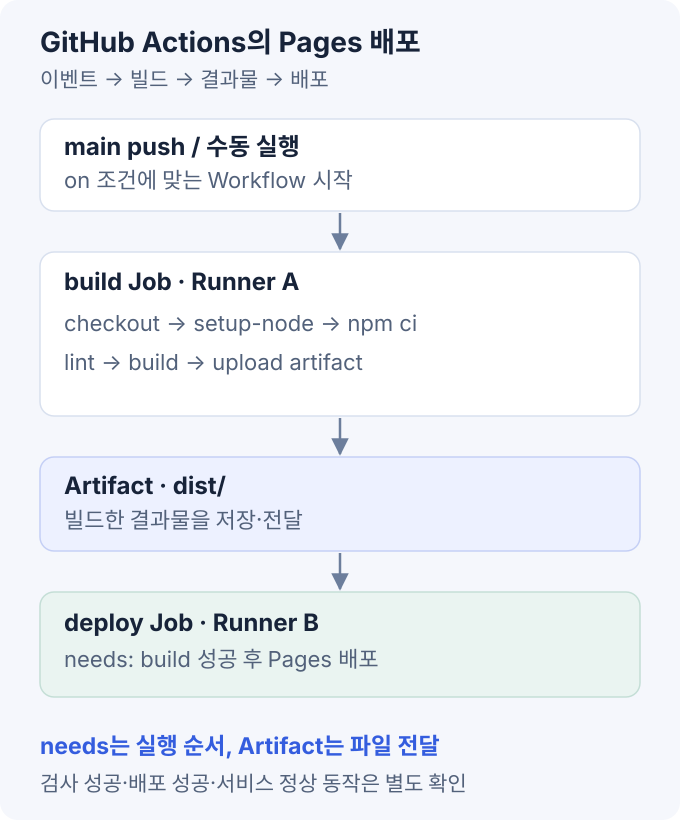

GitHub Actions는 저장소의 이벤트를 받아 빌드·검사·배포 등을 실행하는 자동화 플랫폼이다. Git은 변경 이력을 관리하고, GitHub Actions는 그 변경에 연결된 작업을 실행한다.

자동화 절차는 `.github/workflows/`의 YAML 파일로 관리한다. 검사와 배포의 실행 조건·권한을 나누고, 검증한 결과물을 배포 단계로 전달하는 구조가 기본이다. [GitHub Workflow 개요](https://docs.github.com/en/actions/concepts/workflows-and-actions/workflows).

## 1. 실행 구조

| 구성 | 역할 | 예시 |
| --- | --- | --- |
| Event | 실행 계기 | `push`, `pull_request`, 수동 실행 |
| Workflow | 자동화 절차 전체 | `ci.yml`, `deploy.yml` |
| Job | Runner에 할당하는 작업 단위 | 검사, 빌드, 배포 |
| Step | Job 안의 개별 작업 | 소스 가져오기, `npm ci` |
| Runner | Job을 실행하는 환경 | GitHub-hosted VM, 자체 서버 |
| Action | Step에서 호출하는 재사용 기능 | `actions/checkout`, `actions/setup-node` |

`uses`는 Action을 호출하고, `run`은 셸 명령을 실행한다. 아래 CI 예제의 Step은 순서대로 진행하지만, 의존성이 없는 Job들은 병렬 실행할 수 있다. Job 사이의 선후 관계는 `needs`로 지정한다. [Workflow 문법](https://docs.github.com/en/actions/reference/workflows-and-actions/workflow-syntax).

GitHub-hosted Runner는 실행 환경을 GitHub가 제공한다. Self-hosted Runner는 직접 등록한 장비이므로 OS·도구·보안·작업 후 정리도 운영자가 관리한다. GPU, 사내망, 실제 로봇 장비가 필요할 때 선택할 수 있지만, 외부 PR 코드를 실행할 장비와 운영 장비는 분리해야 한다. [Runner 개요](https://docs.github.com/en/actions/concepts/runners).

## 2. 이벤트와 실행 조건

| 이벤트 | 용도 | 확인 사항 |
| --- | --- | --- |
| `push` | 브랜치·태그 변경 후 검사·배포 | `branches`는 push 대상 브랜치 |
| `pull_request` | 병합 전 변경 검증 | `branches`는 PR의 대상 브랜치 |
| `workflow_dispatch` | 수동 실행 | Workflow 파일이 기본 브랜치에 있어야 실행 가능 |
| `schedule` | 정기 점검·배치 | 기본 브랜치의 Workflow 실행, 지정 시각보다 지연 가능 |
| `workflow_call` | 공통 Workflow 호출 | 입력·비밀·출력의 계약 정의 |

기본 `pull_request` 실행은 PR 생성·재개·소스 브랜치 갱신 등을 감지한다. 열린 상태의 병합 가능한 PR에서 기본 checkout 대상은 소스 브랜치 자체가 아니라 **대상 브랜치와 합친 임시 merge ref**다. PR의 head commit만 시험하려면 checkout ref를 별도로 지정해야 한다. [이벤트별 실행 기준](https://docs.github.com/en/actions/reference/workflows-and-actions/events-that-trigger-workflows).

브랜치 필터와 경로 필터를 함께 쓰면 두 조건을 모두 만족해야 한다. 필수 상태 검사를 경로 필터로 통째로 건너뛰면 검사가 Pending으로 남아 병합이 막힐 수 있다. 필수 검사는 실행을 보장하고 내부 작업의 수행 여부를 나누는 방식을 검토한다. [필터와 필수 검사](https://docs.github.com/en/actions/reference/workflows-and-actions/workflow-syntax#onpull_requestpull_request_targetbranchesbranches-ignore).

## 3. React/Vite CI 예제

다음은 이 저장소의 npm 스크립트에 맞춘 **별도 `ci.yml` 구성 예제**다. 현재 사이트에 등록된 `deploy.yml`과는 구분한다. 이 프로젝트에는 `lint`·`build`가 있고 별도의 `test` 스크립트는 없어, 예제에도 테스트 명령을 넣지 않았다.

```yaml
name: CI

on:
  pull_request:
    branches: [dev, main]
  push:
    branches: [dev]
  workflow_dispatch:

permissions:
  contents: read

concurrency:
  group: ci-${{ github.workflow }}-${{ github.event.pull_request.number || github.ref }}
  cancel-in-progress: true

jobs:
  check:
    name: Check Node ${{ matrix.node }}
    runs-on: ubuntu-latest
    timeout-minutes: 15
    strategy:
      fail-fast: false
      matrix:
        node: [22, 24]
    steps:
      - name: Checkout
        uses: actions/checkout@v7
        with:
          persist-credentials: false

      - name: Setup Node
        uses: actions/setup-node@v7
        with:
          node-version: ${{ matrix.node }}
          cache: npm
          cache-dependency-path: package-lock.json

      - name: Environment
        run: |
          node --version
          npm --version

      - name: Install
        run: npm ci

      - name: Lint
        run: npm run lint

      - name: Build
        run: npm run build
```

이 예제는 `dev`·`main` 대상 PR, `dev` push, 수동 실행에서 검사한다. 배포 권한과 배포 Step은 포함하지 않는다. CI 파일 추가만으로 병합이 차단되는 것은 아니며, 강제하려면 브랜치 보호나 Ruleset에서 해당 검사를 필수로 지정해야 한다.

`checkout`은 소스를 Runner에 가져오며, 이 예제는 Git 쓰기 작업이 없어 자격증명 유지를 끈다. `setup-node`는 지정한 Node를 `PATH`에 준비한다. Action 자체의 내부 런타임과 `node-version`으로 선택한 애플리케이션 런타임은 별개다. Self-hosted Runner에서는 Action 릴리스의 Runner 요구 버전도 확인한다. [checkout](https://github.com/actions/checkout/tree/v7), [setup-node](https://github.com/actions/setup-node/tree/v7).

`npm ci`는 lockfile과 `package.json`이 불일치하면 실패한다. CI에서 lockfile을 다시 생성해 오류를 덮기보다 의존성 변경을 소스와 함께 검토한다. [npm ci](https://docs.npmjs.com/cli/v11/commands/npm-ci/).

## 4. Matrix와 실행 상태

### 환경 조합

`matrix.node: [22, 24]`는 Node 22·24 환경의 Job 두 개를 만든다. 프로젝트의 `engines`는 Node 22.12 이상을 허용하며, 예제의 `22`·`24`는 각 메이저 계열에서 버전을 선택하는 설정이다. 정확한 패치 버전이나 Runner 이미지까지 고정한 구성은 아니다.

`fail-fast: false`는 한 조합이 실패해도 나머지 Matrix Job을 취소하지 않는 설정이다. 실패를 성공으로 처리하지는 않는다. OS·아키텍처까지 조합하면 Job 수가 곱으로 늘어나므로, 지원 환경을 기준으로 검사 범위를 정한다. [Matrix와 fail-fast](https://docs.github.com/en/actions/how-tos/write-workflows/choose-what-workflows-do/run-job-variations).

### 실패와 데이터 전달

기본 성공 조건에서는 앞선 Step이 실패하면 뒤의 정상 Step을 건너뛴다. `needs: build`도 기본적으로 build Job의 성공을 요구한다. 실패 로그 수집에는 별도 조건을 두되, 배포를 위해 실패를 숨기는 `continue-on-error` 사용은 피한다.

같은 Job의 Step은 workspace를 공유하지만 각 `run`은 별도 셸 프로세스다. 한 Step의 `cd`·`export`가 다음 Step에도 유지된다고 가정하면 안 된다. 작업 경로는 `working-directory`, 후속 Step에 전달할 환경변수는 `$GITHUB_ENV` 등 용도에 맞는 기능을 사용한다. [Step 실행과 조건](https://docs.github.com/en/actions/reference/workflows-and-actions/workflow-syntax#jobsjob_idstepsrun).

Job 사이에는 파일이 자동 공유되지 않는다. 작은 값은 Step 출력에서 Job 출력으로 노출한 뒤 `needs.<job>.outputs.<name>`으로 전달하고, 파일은 Artifact 등 별도 수단을 사용한다. `needs`는 실행 순서와 의존성을 연결하는 설정이다. [Job 출력 전달](https://docs.github.com/en/actions/how-tos/write-workflows/choose-what-workflows-do/pass-job-outputs).

### 중복 실행 제어

예제의 concurrency 그룹은 같은 Workflow·PR 또는 ref를 묶는다. `cancel-in-progress: true`는 같은 그룹의 이전 실행을 취소해 오래된 변경의 CI가 계속 실행되는 것을 줄인다.

배포는 대상 환경 기준으로 그룹을 정해야 여러 Workflow의 동시 접근을 제어할 수 있다. 실행 취소는 이미 발생한 외부 변경을 되돌리는 롤백이 아니다. 특히 DB 변경·장비 업데이트처럼 중간 취소가 위험한 작업은 중단·복구 정책을 따로 둔다. [Concurrency 설정](https://docs.github.com/en/actions/how-tos/write-workflows/choose-when-workflows-run/control-workflow-concurrency).

## 5. 캐시와 Artifact

| 구분 | 목적 | 이 프로젝트의 예 |
| --- | --- | --- |
| Cache | 다시 만들 수 있는 파일을 재사용해 실행 시간 단축 | npm 다운로드 캐시 |
| Artifact | 특정 실행의 결과물 보관·전달 | 빌드된 `dist/`, 검사 보고서 |

`setup-node`의 `cache: npm`은 **npm 패키지 캐시를 재사용**한다. `node_modules` 복원은 포함하지 않으며, lockfile의 해시가 캐시 키 구성에 사용된다. 캐시가 있어도 `npm ci`는 실행하고, 캐시가 사라져도 설치·빌드가 가능해야 한다. [setup-node 캐시 동작](https://github.com/actions/setup-node/tree/v7#caching-global-packages-data), [의존성 캐시](https://docs.github.com/en/actions/concepts/workflows-and-actions/dependency-caching).

Artifact는 빌드 Job에서 만든 파일을 배포 Job에 전달하거나 실행 후 내려받을 때 사용한다. 보관 기간·용량·접근 권한을 정하고 commit·실행 ID와 연결한다. 검증 후 다시 빌드한 파일은 입력·환경에 따라 달라질 수 있으므로, 배포 단계에는 검증한 결과물을 전달한다. [Workflow Artifact](https://docs.github.com/en/actions/concepts/workflows-and-actions/workflow-artifacts).

캐시·Artifact에 자격증명이나 불필요한 환경 파일을 포함하지 않는다. 외부 PR이 접근할 수 있는 캐시와 신뢰한 배포 결과물의 경계도 구분해야 한다.

## 6. 이 사이트의 GitHub Pages 배포

현재 `.github/workflows/deploy.yml`은 `main` push와 수동 실행을 받아 빌드·배포 Job을 순서대로 수행한다.



이 사이트의 배포 흐름을 정리한 개념도다. 앞의 CI 예제와 달리, 실제 배포 Workflow를 기준으로 한다.

1. **build Job:** checkout → Node 설정 → `npm ci` → lint → build
2. **결과물 업로드:** `upload-pages-artifact`로 `dist/`를 Pages용 Artifact로 저장
3. **deploy Job:** `needs: build`로 빌드 성공 후 실행
4. **배포:** `github-pages` Environment에서 `deploy-pages`가 Artifact를 배포

GitHub Pages의 배포 소스는 GitHub Actions로 설정되어 있어야 한다. Pages 전용 업로드 Action은 배포에 필요한 형식으로 결과물을 묶는다. 일반 Artifact를 업로드했다는 사실만으로 사이트가 배포되지는 않는다. [GitHub Pages 사용자 지정 Workflow](https://docs.github.com/en/pages/getting-started-with-github-pages/using-custom-workflows-with-github-pages).

배포 Job에는 `pages: write`와 `id-token: write`가 필요하다. `id-token: write`는 OIDC 토큰 발급을 허용하는 권한이며, 모든 저장소·클라우드 자원에 대한 쓰기 권한을 뜻하지 않는다. 외부 클라우드와 연결할 때는 제공자 측 신뢰 조건도 저장소·ref·Environment에 맞춰 제한한다. [GitHub OIDC](https://docs.github.com/en/actions/concepts/security/openid-connect).

현재 파일은 권한을 Workflow 수준에서 공유한다. 빌드에는 `contents: read`, 배포에는 Pages·OIDC 권한을 Job별로 분리하면 각 작업의 권한 범위를 줄일 수 있다. `github-pages`라는 Environment 이름만으로 사람의 승인이 생기지는 않으며, 필요한 보호 규칙은 별도 설정이다.

배포 성공과 브라우저 정상 동작도 구분한다. Pages가 파일을 받아도 잘못된 asset 경로, 누락된 페이지, 클라이언트 실행 오류가 남을 수 있다. 실패 시에는 정상 commit으로 되돌려 재배포하거나, 보관된 검증 결과물의 재배포 절차를 사용한다.

## 7. 권한과 PR 보안

### 토큰과 비밀

`GITHUB_TOKEN`은 GitHub가 Job마다 제공하는 토큰이다. 별도의 PAT를 넣기 전에 필요한 API 작업을 이 토큰과 최소 권한으로 수행할 수 있는지 확인한다. `permissions`에서 일부 권한을 명시하면 나머지는 `none`이 되므로 필요한 범위를 분명히 적는다. [GITHUB_TOKEN](https://docs.github.com/en/actions/concepts/security/github_token), [권한 설정](https://docs.github.com/en/actions/reference/workflows-and-actions/workflow-syntax#permissions).

일반 설정은 Variables·`env`, 민감한 값은 Secrets로 구분한다. Secrets의 로그 마스킹은 모든 변형·유출을 막는 보안 경계가 아니다. 비밀은 필요한 Job·Step에만 전달하고, 노출되면 로그 정리와 자격증명 폐기를 함께 진행한다. Fork PR에는 기본적으로 일반 Secrets가 전달되지 않고 토큰 쓰기 권한도 제한되지만, 저장소 정책과 이벤트에 따른 예외를 확인해야 한다. [Secrets 제한](https://docs.github.com/en/actions/reference/security/secrets), [Workflow 보안](https://docs.github.com/en/actions/reference/security/secure-use).

### 외부 코드와 공급망

- `pull_request_target`·`workflow_run`의 높은 권한으로 신뢰하지 않는 PR 코드를 checkout·실행하지 않는다. 다른 Workflow에서 받은 Artifact도 신뢰 경계를 확인한다.
- PR 제목·브랜치명·입력을 `run` 스크립트에 직접 보간하지 않는다. 환경변수로 전달한 뒤 셸에서 인용해 데이터로 처리하고, `eval` 같은 재해석을 피한다.
- Action 태그는 변경될 수 있다. 운영에서는 검토한 전체 commit SHA로 고정하고, 업데이트도 코드 변경처럼 심사한다.
- Self-hosted Runner의 디스크·네트워크·장치 접근은 토큰 권한과 별도다. 공개 PR 검사에 운영 서버나 실제 로봇 제어 환경을 제공하지 않는다.

[외부 코드·Action 사용 보안 기준](https://docs.github.com/en/actions/reference/security/secure-use).

## 8. 재사용과 Jenkins 비교

반복되는 Step 묶음은 **Composite Action**, Runner·권한·여러 Job을 포함한 절차는 **Reusable Workflow**로 분리할 수 있다. 전자는 Step의 `uses`로, 후자는 `workflow_call`을 정의한 Workflow를 Job 수준에서 호출한다. 입력·비밀·출력·버전 규칙을 함께 관리한다. [Workflow 재사용](https://docs.github.com/en/actions/concepts/workflows-and-actions/reusing-workflow-configurations).

Jenkins와 GitHub Actions 모두 CI/CD를 구성할 수 있다. Jenkins는 Controller·Agent·플러그인 운영이 주요 관리 대상이고, GitHub Actions는 저장소 이벤트·Workflow와 GitHub-hosted Runner를 바로 연결할 수 있다. 사내망·특수 장비에 접근하려고 Self-hosted Runner를 쓰면 장비 운영·격리 책임이 다시 생긴다. 도구 이름보다 실행 환경·접근 권한·배포 대상의 조건으로 선택한다. [Jenkins 구조 정리](/blog/jenkins-ci-cd-guide).

## 9. 오류 진단

실행의 commit·이벤트·ref·Runner·도구 버전을 먼저 확인하고, 처음 실패한 Step의 로그와 종료 코드를 본다.

| 증상 | 점검 항목 |
| --- | --- |
| Workflow가 실행되지 않음 | 파일 위치·YAML, 이벤트·브랜치·경로 필터, Actions 정책 |
| 수동 실행 버튼이 없음 | 기본 브랜치의 파일과 `workflow_dispatch` 설정 |
| PR 검사 결과가 로컬과 다름 | merge ref 여부, checkout SHA, Node·OS·환경변수·lockfile |
| `npm ci` 실패 | lockfile 불일치, 설치 옵션, 레지스트리·인증·네트워크 |
| 다음 Job에서 결과물 누락 | 업로드·다운로드 이름·경로, 실제 Artifact, 앞선 Job 성공 여부 |
| 캐시 적중 후에도 설치 실행 | npm 캐시와 `node_modules` 구분, 정상적인 `npm ci` 동작 |
| 권한 오류·Secrets 공백 | 이벤트·Fork 여부, Job 권한, Secret 범위, Environment 보호 규칙 |
| Runner 할당 대기 | labels·group, Runner 연결·가용량, 승인·동시 실행 제한 |
| Pages 배포 후 빈 화면·404 | 실제 배포 파일, asset·라우트 경로, 브라우저 실행 오류 |

## 참고 자료

- [GitHub Actions 공식 문서](https://docs.github.com/en/actions)
- [Workflow 문법](https://docs.github.com/en/actions/reference/workflows-and-actions/workflow-syntax)
- [이벤트별 실행 조건](https://docs.github.com/en/actions/reference/workflows-and-actions/events-that-trigger-workflows)
- [GitHub Pages 배포](https://docs.github.com/en/pages/getting-started-with-github-pages/using-custom-workflows-with-github-pages)
- [Workflow 보안 기준](https://docs.github.com/en/actions/reference/security/secure-use)
