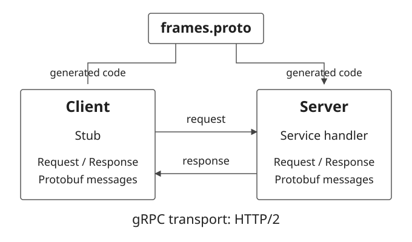

Protobuf는 메시지 구조와 직렬화를, gRPC는 원격 함수 호출과 스트리밍을 담당한다. `.proto`에 타입과 RPC 계약을 정의하고 생성된 코드를 양쪽에서 사용한다.



## 1. 메시지와 서비스

아래는 프레임 데이터를 여러 청크로 업로드하는 간단한 계약 예시다. `frames.proto`에 저장한다.

```protobuf
syntax = "proto3";
package study;

message FrameChunk {
  uint64 frame_id = 1;
  uint32 chunk_index = 2;
  bytes payload = 3;
  bool last_chunk = 4;
}

message UploadReply {
  uint64 received_bytes = 1;
}

service FrameService {
  rpc Upload(stream FrameChunk) returns (UploadReply);
}
```

`message`는 데이터, `service`의 `rpc`는 호출 계약이다. 필드 뒤의 숫자는 직렬화에 사용하는 **필드 번호**이므로 배포 후 다른 의미로 재사용하지 않는다. 삭제한 번호는 `reserved`로 관리한다. [Proto3 언어 가이드](https://protobuf.dev/programming-guides/proto3/).

C++ 생성 코드에서 단일 필드 설정에는 `set_...()`, `repeated` 원소 추가에는 `add_...()` 계열 API를 사용한다. `SerializeToString()`은 직렬화이며 네트워크 전송이나 수신자의 처리 완료를 의미하지 않는다.

## 2. RPC 종류

| 종류 | 요청 → 응답 | 예시 |
| --- | --- | --- |
| Unary | 하나 → 하나 | 상태 조회 |
| Server streaming | 하나 → 여러 개 | 결과 스트림 |
| Client streaming | 여러 개 → 하나 | 파일·프레임 업로드 |
| Bidirectional streaming | 양방향 스트림 | 지속적인 입출력 |

일반적인 gRPC 통신은 HTTP/2 기반이다. 스트리밍이나 청크 전송이 UDP 전송을 의미하지 않는다. 스트림 안의 메시지 순서는 유지되지만 서로 다른 RPC 스트림 사이의 전역 순서는 별도로 설계한다. [gRPC 핵심 개념](https://grpc.io/docs/what-is-grpc/core-concepts/).

## 3. C++ 코드 생성과 빌드

`protoc`와 gRPC C++ 플러그인, 런타임 라이브러리가 준비된 Linux 환경의 예시다.

```bash
mkdir -p generated
protoc --proto_path=. --cpp_out=generated --grpc_out=generated \
  --plugin=protoc-gen-grpc="$(command -v grpc_cpp_plugin)" frames.proto
```

Protobuf 메시지용 `.pb.*`와 gRPC 서비스용 `.grpc.pb.*`를 구분한다. 생성 파일만 복사하고 런타임 버전을 임의로 섞으면 빌드·실행 호환성이 깨질 수 있다. [C++ 빠른 시작](https://grpc.io/docs/languages/cpp/quickstart/).

Windows 네이티브 빌드는 vcpkg 등을 사용하되 triplet·컴파일러·CMake toolchain을 맞춘다. WSL 빌드는 Linux 의존성을 사용한다. [Windows C++ 개발 환경](/blog/windows-wsl-cpp).

## 4. 메시지 크기와 청크

흔히 보는 4 MiB 제한은 gRPC의 기본 수신 메시지 제한과 관련 있다. **Protobuf 메시지의 보편적인 4 MiB 한계가 아니다.** 송신·수신 제한은 사용하는 언어·라이브러리 설정을 각각 확인한다. C++에서는 `SetMaxReceiveMessageSize()` 등의 설정을 제공한다. [기본 크기 제한](https://grpc.github.io/grpc/core/grpc__types_8h.html), [C++ 채널 설정](https://grpc.github.io/grpc/cpp/classgrpc_1_1_channel_arguments.html).

제한을 무작정 크게 올리면 동시 접속 시 메모리 사용량도 커질 수 있다. 청크 전송을 사용하면 프레임 ID·순번·전체 크기 상한·완료 조건·중도 취소 처리를 계약으로 정한다. 청크가 작아져도 수신 측에서 전체 파일을 무한히 메모리에 쌓으면 문제가 남는다.

## 5. 적용 시 점검

- **deadline:** 클라이언트가 무한 대기하지 않도록 요청별 시간 제한을 지정한다.
- **상태 코드:** RPC 실패와 애플리케이션 처리 실패를 구분한다.
- **취소·backpressure:** 느린 소비자 때문에 큐가 계속 증가하지 않도록 제한한다.
- **재시도:** 중복 처리 가능한 요청인지, 요청 ID가 필요한지 확인한다.
- **보안:** 외부 통신은 TLS·인증·인가를 별도로 구성한다.

영상 전송에서는 코덱·해상도·프레임률·손실 허용 여부까지 정해야 한다. gRPC를 쓴다는 이유만으로 실시간 영상 지연이 자동으로 해결되지는 않는다.
