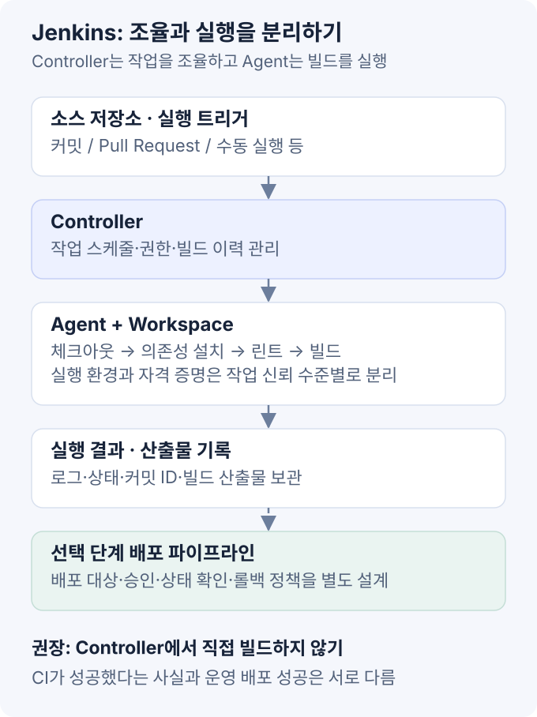
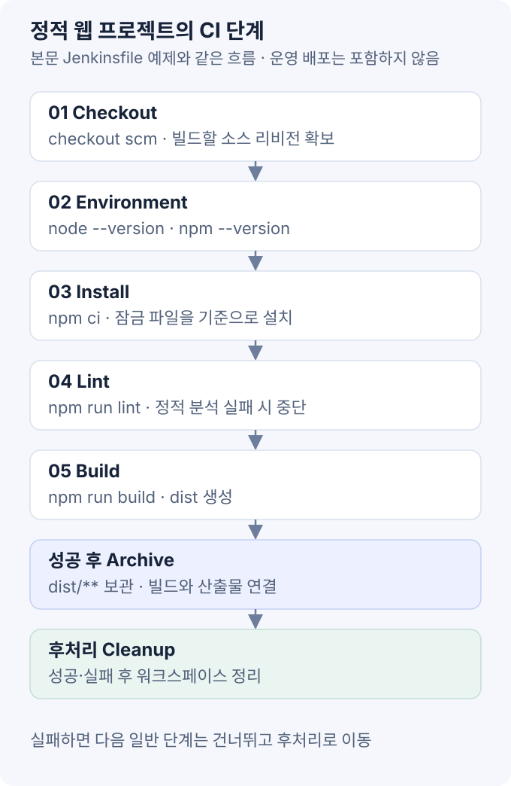

Jenkins는 빌드·검사·배포 작업을 연결하고 실행 결과를 기록하는 자동화 서버다.

Controller·Agent 구조, Jenkinsfile, 배포·권한 관리를 정리한다. CI 예제는 이 React/Vite 저장소의 npm 스크립트를 사용한 학습용 구성이다.

## 1. CI·Delivery·Deployment

- **Continuous Integration:** 변경을 자주 통합하고 자동 빌드·검사로 문제를 빠르게 발견한다.
- **Continuous Delivery:** 검증된 변경을 배포 가능한 상태로 유지한다. 운영 배포에는 사람의 승인 등이 남을 수 있다.
- **Continuous Deployment:** 정해진 검증을 통과한 변경을 운영 환경까지 자동으로 배포한다.

CI가 성공했다고 운영 배포가 끝난 것은 아니다. Jenkins도 애플리케이션을 대신 서비스하는 웹 서버가 아니라, 필요한 작업을 실행·조정하는 도구다. [Jenkins 용어집](https://www.jenkins.io/doc/book/glossary/), [Pipeline 개요](https://www.jenkins.io/doc/book/pipeline/).

## 2. Controller·Agent



| 구성 | 역할 |
| --- | --- |
| Controller | 작업 설정·큐·실행 조정·권한·이력 관리 |
| Agent | 할당받은 workspace에서 실제 명령 실행 |
| Executor | Agent가 동시에 수행할 수 있는 작업 슬롯 |
| Pipeline | 전체 자동화 절차 |
| Stage / Step | 논리적 단계 / 실제 실행할 개별 작업 |
| Jenkinsfile | 저장소에서 버전 관리하는 Pipeline 정의 |
| Credentials | 키·토큰 등 비밀 정보의 보관과 사용 범위 관리 |

빌드를 Controller에서 직접 실행하면 저장소의 코드가 Jenkins의 관리 영역에 영향을 줄 수 있다. 일반적인 운영에서는 Controller의 built-in node executor를 0으로 두고 별도 Agent에서 실행하는 구성을 고려한다. 서로 신뢰 수준이 다른 빌드도 같은 실행 환경을 공유하지 않도록 설계한다. [Controller 격리](https://www.jenkins.io/doc/book/security/controller-isolation/).

## 3. 빌드 환경·재현성

빌드 재현성을 위해 다음 입력을 관리한다.

1. **소스:** 이번 실행의 commit과 실제 checkout한 revision을 기록한다.
2. **도구:** Node·npm 등 실행 버전과 Agent 이미지·도구 설정을 관리한다.
3. **의존성:** lockfile을 저장소에 포함하고 같은 설치 옵션을 사용한다.
4. **입력:** 환경변수·설정 파일·빌드 모드를 구분한다.
5. **결과물:** 어떤 실행에서 나온 파일인지 식별 가능하게 보관한다.

이 저장소에는 `lint`·`build` 스크립트가 있고, 별도의 `test` 스크립트는 없다. 따라서 아래 예제도 존재하지 않는 테스트를 호출하지 않는다. Node 요구 범위는 `package.json`의 `engines`를 따른다.

`npm ci`는 lockfile을 바탕으로 설치하며 `package.json`과 불일치하면 실패한다. 의존성 오류를 숨기려고 CI에서 lockfile을 다시 생성하기보다, 변경을 로컬에서 검토해 함께 커밋한다. [npm ci 공식 문서](https://docs.npmjs.com/cli/v11/commands/npm-ci/).

## 4. 작업 연결 설정

- **Agent:** 아래 예시의 `linux-node22`는 예시 label이다. 실제 등록된 Agent와 일치시킨다. 해당 Agent에는 Git과 이 저장소 요구 범위를 만족하는 Node·npm이 준비돼 있어야 한다.
- **Pipeline 종류:** Multibranch Pipeline 또는 Pipeline from SCM으로 저장소와 `Jenkinsfile`을 연결한다.
- **변경 감지:** 사용하는 SCM 연동에 맞춰 webhook이나 polling을 설정한다. Jenkinsfile을 저장한 것만으로 webhook이 등록되지는 않는다.
- **플러그인:** Pipeline과 SCM 연동 등 사용하는 기능만 준비한다. Node가 이미 Agent에 있다면 NodeJS 플러그인을 반드시 추가할 필요는 없다.

Multibranch Pipeline은 브랜치별 Pipeline을 관리하는 방식이지, 모든 브랜치에 운영 자격을 주는 설정이 아니다. [브랜치와 Pull Request](https://www.jenkins.io/doc/book/pipeline/multibranch/).

## 5. Jenkinsfile 예제



Linux Agent와 Pipeline·SCM 플러그인을 전제로 한 Declarative Jenkinsfile이다.

```groovy
pipeline {
  agent { label 'linux-node22' }

  options {
    skipDefaultCheckout(true)
    timestamps()
    timeout(time: 15, unit: 'MINUTES')
    disableConcurrentBuilds()
    buildDiscarder(logRotator(numToKeepStr: '20'))
  }

  stages {
    stage('Checkout') {
      steps {
        checkout scm
      }
    }

    stage('Environment') {
      steps {
        sh 'node --version'
        sh 'npm --version'
      }
    }

    stage('Install') {
      steps {
        sh 'npm ci'
      }
    }

    stage('Lint') {
      steps {
        sh 'npm run lint'
      }
    }

    stage('Build') {
      steps {
        sh 'npm run build'
      }
    }
  }

  post {
    success {
      archiveArtifacts artifacts: 'dist/**', fingerprint: true
    }
    cleanup {
      deleteDir()
    }
  }
}
```

이 Agent를 Node 22 계열로 준비한다면 현재 저장소의 요구에 맞는 **22.12 이상**을 사용한다. label 이름만으로 버전이 고정되는 것은 아니므로 실제 이미지·설치 버전을 관리한다.

`skipDefaultCheckout(true)`로 자동 checkout을 끄고 명시적인 단계를 둔다. `checkout scm`은 연결된 SCM의 revision을 사용하며, `post`에서 결과물을 보관한 뒤 workspace를 정리한다. `fingerprint`는 추적을 위한 기능이지 배포물의 보안 서명을 대신하지 않는다. [Jenkinsfile 사용법](https://www.jenkins.io/doc/book/pipeline/jenkinsfile/), [Declarative 문법](https://www.jenkins.io/doc/book/pipeline/syntax/).

단계의 `sh` 명령이 0이 아닌 종료 코드를 반환하면 기본적으로 이후 정상 단계를 진행하지 않는다. 테스트를 추가했다면 별도 Stage와 결과 수집을 함께 설계한다. 빌드 성공만으로 화면·기능·보안 검증이 모두 끝났다고 판단하지 않는다.

## 6. 배포·롤백

배포는 **검증했던 결과물을 그대로 승격하는 과정**으로 설계한다.

```text
CI 성공 → 결과물 식별·보관 → 스테이징 검증
→ 운영 승인·조건 확인 → 동일 결과물 배포 → 상태 확인
→ 실패 시 이전 검증 결과물로 복구
```

- 운영 브랜치, 배포 대상과 승인자를 명확히 정한다.
- `DEPLOY` 같은 파라미터를 사용한다면 기본값은 비활성화하고 대상 값을 검증한다.
- commit·build 번호·이미지 digest 등으로 배포물을 식별한다.
- 배포 뒤 HTTP 응답이나 애플리케이션 health check를 확인한다.
- 이전 버전으로 되돌리는 방법과 데이터 변경의 호환성도 준비한다.

`when { branch 'main' }` 같은 조건은 실행 흐름을 제한하는 도구이지 보안 경계가 아니다. Pipeline을 수정할 수 있는 사용자의 신뢰 수준과 운영 자격 접근 권한을 별도로 통제해야 한다.

또한 `disableConcurrentBuilds()`는 같은 Pipeline의 동시 실행을 막는다. 여러 Job이 같은 서버에 배포한다면 공유 자원 잠금이나 전용 배포 Job 등으로 **배포 대상 기준의 직렬화**를 추가해야 한다. [Pipeline 조건·동시 실행 설정](https://www.jenkins.io/doc/book/pipeline/syntax/).

## 7. Credentials·권한 관리

- 비밀은 저장소나 Jenkinsfile에 직접 적지 않고 필요한 범위에만 바인딩한다.
- 마스킹은 실수로 로그에 노출되는 것을 줄이는 기능이지, 악성 빌드 코드로부터 비밀을 격리하는 보안 경계가 아니다.
- 비밀을 Groovy 문자열에 보간하거나 명령 인자로 노출하지 않도록 공식 사용 방식을 따른다.
- 신뢰하지 않는 PR 빌드에는 운영 Credentials와 운영 네트워크 접근을 제공하지 않는다.
- 배포 권한을 위해 광범위한 root 권한이나 무제한 `sudo`를 부여하지 않는다.

Agent는 저장소의 빌드 스크립트와 의존성 설치 스크립트까지 실행할 수 있다. 코드 실행 권한과 비밀 접근 권한을 함께 설계해야 한다. [Credentials Binding](https://www.jenkins.io/doc/pipeline/steps/credentials-binding/), [빌드 격리와 PR 보안](https://www.jenkins.io/doc/book/security/securing-builds/).

## 8. 오류 진단

| 증상 | 점검 항목 |
| --- | --- |
| Agent 할당 대기 | label 일치, Agent 연결, executor·자원 상태 |
| 로컬과 CI 결과가 다름 | commit·Node/npm 버전·lockfile·환경변수·작업 경로 |
| `npm ci` 실패 | lockfile 불일치, 설치 옵션, 레지스트리 접근·자격 |
| 결과물이 보관되지 않음 | 실제 출력 경로, 앞선 Stage 실패 여부, archive 패턴 |
| Git 접근 실패 | SCM URL과 Credentials 종류·ID·권한 |
| 배포 성공 로그 후 서비스 장애 | 실제 배포된 버전, 라우팅·환경 설정·health check |
| 같은 대상의 배포가 겹침 | Job 간 잠금 범위와 배포 대상 직렬화 |
