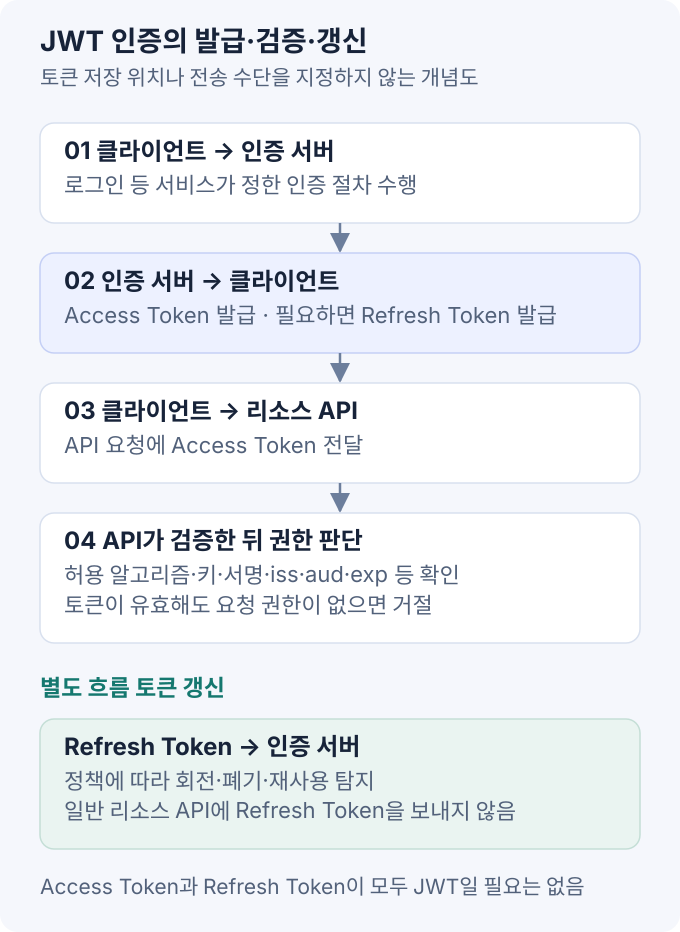

JWT(JSON Web Token)는 **클레임을 전달하는 토큰 형식**이다. 인증 시스템에서는 발급자·사용 대상·유효 기간을 검증하고, 저장·갱신·폐기 정책을 별도로 관리한다. [RFC 7519](https://datatracker.ietf.org/doc/html/rfc7519).

## 1. JWT·JWS·JWE

웹 API에서 흔히 보는 JWT는 JWS Compact 형식으로 서명한 형태다.

```text
base64url(header).base64url(payload).base64url(signature)
```

- **Header:** 알고리즘 식별자 `alg`, 키 식별자 `kid`, 토큰 타입 등의 메타데이터.
- **Payload:** 사용자 식별자·대상·만료 시각 등의 클레임.
- **Signature:** 앞의 두 부분을 결합한 데이터의 위변조를 검증하기 위한 값.

이때 Base64URL은 암호화가 아니다. 토큰을 가진 사람은 payload를 읽을 수 있으므로 비밀번호·비밀키·불필요한 개인정보를 넣지 않는다.

JWT는 암호화된 JWE 형태로도 표현할 수 있다. 이 글은 서명된 JWS 형태를 다룬다. 서명은 발급 주체와 무결성을 확인하며, 내용을 숨기지는 않는다. [JWT 표현 방식](https://datatracker.ietf.org/doc/html/rfc7519#section-3).

## 2. 클레임 검증

| 클레임 | 의미 | 검증 관점 |
| --- | --- | --- |
| `iss` | 발급자 | 신뢰하는 발급자인가 |
| `sub` | 주체 식별자 | 해당 발급자 안에서 어떤 사용자인가 |
| `aud` | 토큰의 사용 대상 | 이 API에 쓰도록 발급됐는가 |
| `exp` | 만료 시각 | 만료되지 않았는가 |
| `nbf` | 사용 가능 시각 | 아직 사용하면 안 되는 토큰인가 |
| `iat` | 발급 시각 | 서비스가 요구하는 발급 시점 정책과 맞는가 |
| `jti` | 토큰 식별자 | 중복 사용·폐기 추적 등에 어떻게 활용할 것인가 |

시간 클레임의 NumericDate는 일반적으로 Unix epoch 기준 **초** 단위다. JavaScript의 `Date.now()`가 반환하는 밀리초와 혼동하지 않는다. 표준의 registered claim이 모두 모든 JWT에서 필수라는 뜻은 아니므로, 애플리케이션의 토큰 프로파일에서 필수 항목을 정한다. [RFC 7519 클레임](https://datatracker.ietf.org/doc/html/rfc7519#section-4).

`role`·`scope` 같은 정보가 있어도 API는 요청 대상 리소스에 대한 권한을 별도로 검사해야 한다. “로그인한 사용자”와 “이 주문을 수정할 수 있는 사용자”는 다른 조건이다.

## 3. 서버 검증 절차

검증 라이브러리에 알고리즘·키·클레임 정책을 명시한다. Payload 디코딩만으로는 서명과 유효성을 검증할 수 없다.

1. 토큰의 크기·형식과 이 용도에서 허용하는 토큰 타입을 확인한다.
2. 서버 설정의 알고리즘 허용 목록을 적용한다. 토큰의 `alg`를 그대로 신뢰하지 않는다.
3. 신뢰한 발급자의 키로 서명을 검증한다.
4. 요구한 `iss`·`aud`·`exp`·`nbf` 등의 존재와 값을 검사한다.
5. 폐기·계정 상태·권한 정책을 적용하고, 그 후 요청을 처리한다.

`kid`는 신뢰한 키 집합에서 키를 고르는 식별자로 취급한다. 토큰이 제시한 임의의 키 URL을 무조건 조회하거나, 대칭키·비대칭키 알고리즘을 혼용하도록 두지 않는다. 만료 검사를 끄거나 `none`을 허용하는 우회도 금한다. [JWT Best Current Practices](https://datatracker.ietf.org/doc/html/rfc8725).

## 4. Access Token·Refresh Token



- **Access Token:** API 접근에 사용한다. 탈취된 bearer token은 유효한 동안 다른 사람이 사용할 수 있으므로 노출을 줄인다.
- **Refresh Token:** 발급 서버에 새 Access Token을 요청하는 자격이다. 일반 리소스 API에 보내지 않으며, 반드시 JWT일 필요도 없다.

토큰 저장 위치와 전송 방식은 서비스 정책에 따라 정한다.

Refresh Token을 사용하는 구성에서는 Access Token 만료 후 갱신 절차를 거친다. 토큰 수명은 사용성·자산 민감도·폐기 요구에 따라 정한다.

OAuth 2.0에서 공개 클라이언트의 Refresh Token 재사용을 탐지·제한하려면 rotation이나 sender-constrained 방식 등의 보호가 필요하다. Rotation은 사용한 Refresh Token을 새것으로 교체하고, 이전 토큰 재사용 시 연관된 자격을 폐기하는 정책과 연결한다. 재발급 요청이 동시에 발생하는 경우와 네트워크 재시도도 설계해야 한다. [OAuth 2.0 Security BCP](https://datatracker.ietf.org/doc/html/rfc9700#section-4.14).

## 5. 토큰 저장·브라우저 보안

| 위치 | 장점 | 남는 문제 |
| --- | --- | --- |
| JavaScript 메모리 | 영구 저장소에 남기지 않음 | 실행 중 XSS로 악용될 수 있고 새로고침 시 유지되지 않음 |
| `localStorage`·`sessionStorage` | 구현과 접근이 간단 | 같은 출처의 악성 스크립트가 읽을 수 있음 |
| `HttpOnly` 쿠키 | JavaScript의 직접 읽기를 제한 | 브라우저가 요청에 자동으로 포함하므로 CSRF와 전송 범위를 고려 |

`HttpOnly`가 있어도 XSS가 인증된 요청을 대신 실행하는 문제까지 없어지지는 않는다. 장기 자격을 스크립트 접근 가능한 저장소에 두는 위험과, 쿠키의 자동 전송 위험을 구분한다. [OWASP 브라우저 저장소 보안](https://cheatsheetseries.owasp.org/cheatsheets/HTML5_Security_Cheat_Sheet.html).

쿠키를 사용한다면 `Secure`, 적절한 `SameSite`, 좁은 전송 범위와 CSRF 방어를 함께 구성한다. 특히 쿠키로 Refresh Token을 보내는 재발급 endpoint도 보호 대상이다. CORS 허용 목록만으로 이 검사를 대신하지 않는다. [OWASP CSRF 방어](https://cheatsheetseries.owasp.org/cheatsheets/Cross-Site_Request_Forgery_Prevention_Cheat_Sheet.html), [CORS 정리](/blog/cors).

## 6. 로그아웃·키 교체

JWT의 서명은 서버 세션 저장소 조회 없이 검증할 수 있다. 하지만 이것이 운영에 필요한 모든 상태를 없앤다는 뜻은 아니다.

- **로그아웃:** 클라이언트에서 토큰을 지워도 이미 복사된 Access Token은 만료 전까지 유효할 수 있다.
- **강제 폐기:** 짧은 수명, 토큰·세션 버전, denylist 등의 방식을 요구에 맞게 조합한다.
- **Refresh 관리:** 발급·회전·폐기 이력을 저장하고 재사용 탐지와 계정 잠금 정책을 연결한다.
- **키 교체:** 새 키 배포, 기존 토큰의 남은 유효 기간, 검증 서버의 키 캐시 갱신을 함께 관리한다.

즉시 무효화를 위해 매 요청 중앙 상태를 확인한다면 “완전히 무상태라서 조회 비용이 없다”는 장점은 줄어든다. 토큰과 쿠키 원문을 로그·분석 도구·URL에 남기지 않는 것도 기본적인 노출 방지다. [JWT 운영 시 검증 원칙](https://datatracker.ietf.org/doc/html/rfc8725), [Refresh Token 보호](https://datatracker.ietf.org/doc/html/rfc9700#section-4.14).

## 7. 세션·OAuth·OIDC

서버 세션도 저장소를 공유하면 수평 확장이 가능하다. 반대로 JWT를 선택하면 키 배포·토큰 폐기·클레임 최신성 관리가 추가된다. 단일 서비스이고 즉시 세션 종료가 중요하다면 불투명한 세션 ID가 더 단순할 수 있다.

OAuth 2.0은 위임 인가에 관한 프레임워크이고, OIDC는 그 위에 인증 계층을 정의한다. OIDC의 **ID Token은 클라이언트가 로그인 결과를 확인하는 용도**이므로, 이를 그대로 API용 Access Token처럼 사용하지 않는다. OAuth Access Token이 항상 JWT인 것도 아니다. [OIDC ID Token](https://openid.net/specs/openid-connect-core-1_0.html#IDToken).

## 참고 자료

- [RFC 7519 — JSON Web Token](https://datatracker.ietf.org/doc/html/rfc7519)
- [RFC 8725 — JWT Best Current Practices](https://datatracker.ietf.org/doc/html/rfc8725)
- [RFC 9700 — OAuth 2.0 Security Best Current Practice](https://datatracker.ietf.org/doc/html/rfc9700)
- [OWASP Cheat Sheet Series](https://cheatsheetseries.owasp.org/)
