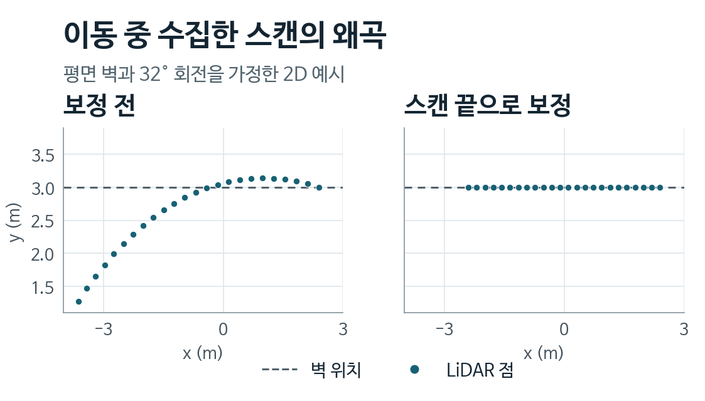
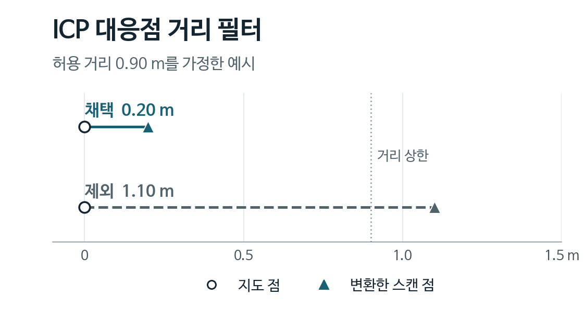
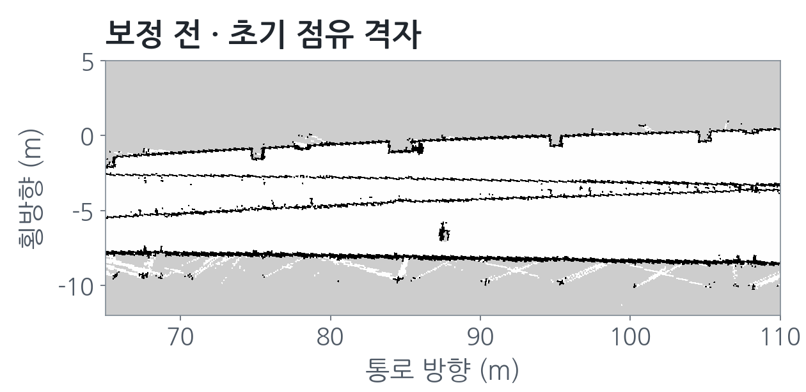
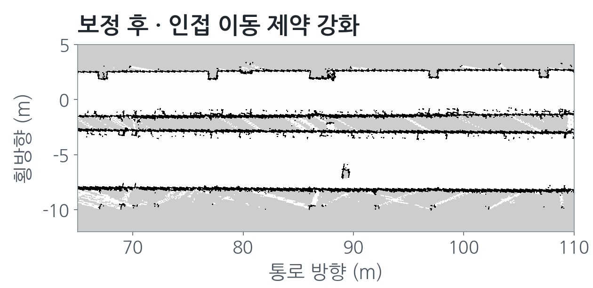

KISS-ICP는 연속된 3D LiDAR 스캔으로 센서의 **6자유도 오도메트리**를 구한다. 직전 이동량으로 현재 자세를 예측하고, 그 자세에서 스캔을 지역 지도에 맞춰 보정한다. 같은 기둥을 두 스캔에서 함께 봤다면 정합 뒤에 두 관측의 좌표가 가까워져야 한다. KISS-ICP는 이런 점 쌍을 찾아 이동과 회전을 추정한다. 기본 입력은 XYZ 점군이고, 점별 시각이 있으면 스캔 왜곡도 보정한다. [Vizzo 외, IEEE RA-L 2023][paper]

| 단계 | 처리 | 다음 단계로 넘기는 값 |
| --- | --- | --- |
| 전처리 | 점별 시각으로 스캔 왜곡을 보정하고 거리 범위를 적용 | 같은 시각을 기준으로 한 점군 |
| 복셀 샘플링 | 지도용과 정합용 점군을 서로 다른 해상도로 구성 | 지도용 점군과 정합용 점군 |
| 스캔–지도 정합 | 직전 이동량으로 예측한 자세에서 point-to-point ICP 반복 | 보정된 센서 자세 |
| 갱신 | 보정된 자세로 점군을 지도에 추가하고 예측 오차를 누적 | 다음 스캔의 지역 지도와 대응 거리 |

## 자세 예측과 스캔 왜곡 보정

스캔 `k`의 센서 좌표를 오도메트리 좌표로 옮기는 변환을 `T[k]`로 두자. 직전 두 자세에서 구한 상대 변환 `Δ = inv(T[k−2]) · T[k−1]`를 한 번 더 적용해 현재 자세의 초기값 `T_pred = T[k−1] · Δ`를 만든다. 이전 두 스캔 사이에 센서가 전진하며 오른쪽으로 돌았다면, 이번에도 비슷한 이동과 회전을 했다고 보고 ICP를 시작한다. 스캔 간격이나 움직임이 급하게 바뀌면 이 초기값이 실제 자세에서 멀어질 수 있다. [파이프라인 코드][pipeline]

LiDAR 점은 한 스캔 안에서도 서로 다른 시각에 찍힌다. 센서가 회전하는 동안 측정한 벽의 좌표를 같은 자세에서 얻은 것처럼 합치면 벽이 휘어 보인다. C++ v1.3.0에서는 점의 시각을 스캔 내부의 상대 시각 `u = 0…1`로 정규화한다. 앞서 구한 이동 `Δ`를 SE(3)에서 보간해 각 점에 `exp((u−1) · log(Δ))`를 적용한다. 가장 늦은 시각의 점은 `u = 1`이라 그대로 두고, 앞서 측정한 점들을 **스캔 끝 시점**에 맞춘다. [전처리 코드][preprocessing]



*평면 벽을 센서가 32° 회전하면서 관측한다고 가정한 합성 예시. 두 그림의 좌표 축척은 같다.*

ROS 2 bag에서는 `PointCloud2`의 `time`, `t`, `timestamp`, `time_stamp` 같은 점별 시각 필드를 확인한다. `header.stamp`는 메시지 전체의 시각이다. 점별 시각이 없거나 deskew 옵션을 끄면 v1.3.0은 왜곡 보정을 건너뛴다. 드라이버가 이미 보정한 점군을 공급하는지도 함께 확인한다. [전처리 코드][preprocessing] · [ROS 2 시각 필드][ros-timing]

## 복셀 지역 지도

복셀은 공간을 일정한 크기의 정육면체로 나눈 셀이다. 기본 지도 복셀 크기를 `v`라고 하면, v1.3.0은 전처리한 점군에 두 번 샘플링을 적용한다. 첫 번째 `0.5v` 결과는 지도에 추가할 점군이다. 이 결과를 `1.5v`에서 다시 줄인 점군은 ICP에 넣는다. 예를 들어 `v = 1 m`로 설정하면 지도 갱신용은 0.5 m, 정합용은 1.5 m 복셀을 사용한다. 지도 쪽에는 더 많은 점을 남겨 구조를 보존하고, 반복 계산에 쓰는 소스 점은 줄인다. [파이프라인 코드][pipeline]

지도는 복셀 좌표를 키로 쓰는 해시 테이블이다. 센서에서 멀어진 복셀은 제거해 주변 영역을 유지한다. 정합할 점이 들어간 셀과 인접 셀에서 후보를 찾으므로, 현재 스캔의 점마다 지나온 전체 경로를 탐색할 필요가 없다. 반대로 복셀을 지나치게 크게 잡으면 좁은 통로의 경계나 작은 구조가 뭉개질 수 있다. [논문 III-B·C][paper] · [복셀 지도 코드][voxel-map]

## Point-to-point ICP

1. **대응점 탐색.** 현재 자세 `T`로 스캔 점 `p`를 옮긴다. 해당 복셀과 이웃 복셀에서 가장 가까운 지도 점 `q`를 찾는다. 두 점 사이 거리가 허용 범위를 넘으면 이 쌍은 제외한다.
2. **자세 갱신.** 남은 점 쌍의 잔차 `T·p − q`가 작아지도록 이동과 회전을 함께 보정한다. 큰 잔차를 가진 쌍은 강건 커널로 가중치를 낮춘다. 갱신한 자세에서 대응점을 다시 찾고, 수렴 조건이나 최대 반복 횟수에 도달할 때까지 반복한다.

잔차는 점과 점 사이의 3차원 차이다. 벽의 법선이나 모서리 방향을 따로 추출하는 단계 없이 점 좌표로 정합한다. 센서의 자세가 정해지면 지도 갱신용 점군을 그 자세로 변환해 누적한다. [논문 III-C·E][paper] · [정합 코드][registration]



*개념도. 상한이 0.90 m라면 0.20 m 쌍은 채택하고 1.10 m 쌍은 제외한다. 상한을 통과한 쌍에는 잔차에 따라 가중치를 준다.*

## 적응형 대응 거리

대응 거리를 너무 작게 잡으면 예측 자세가 조금만 빗나가도 쓸 만한 점 쌍이 사라진다. 너무 크게 잡으면 서로 다른 기둥이나 벽에도 대응이 붙는다. KISS-ICP는 스캔마다 **예측 자세와 ICP 결과가 얼마나 달랐는지** 기록하고, 그 차이로 다음 스캔의 거리 상한을 계산한다. [논문 III-D][paper]

예측에서 정합 결과로 바뀔 때 이동량이 `‖Δt‖`, 회전각이 `θ`, 센서의 설정 최대 거리가 `R`이면 점이 움직일 수 있는 거리의 상한을 다음과 같이 잡는다.

```text
e = ‖Δt‖ + 2R·sin(θ/2)
σ = RMS(e)  (최소 기준을 넘은 과거 오차)
대응 거리 상한 = 3σ
```

예를 들어 회전 오차가 1°, `R = 20 m`라면 회전 항은 약 0.35 m다. 같은 회전이라도 거리가 먼 점이 더 크게 움직인다는 뜻이다. 예측 오차를 바탕으로 한 상한으로 후보를 먼저 거르고, 통과한 후보 중 큰 잔차의 영향은 강건 커널이 줄인다. [임계값 코드][threshold] · [파이프라인 코드][pipeline]

## 논문의 KITTI 비교

저자들은 KITTI raw의 대응 시퀀스에서 동일 계열 파이프라인에 스캔 왜곡 보정 방식을 달리 적용했다. 오차는 경로의 여러 구간에서 구한 **상대 오차의 평균**이다. [논문 표 V][paper]

| 스캔 왜곡 보정 | 평균 상대 이동 오차 | 평균 처리율 |
| --- | ---: | ---: |
| 보정 없음 | 0.91% | 51 Hz |
| IMU에서 추정한 운동으로 보정 | 0.51% | 38 Hz |
| 직전 이동 기반 등속 모델로 보정 | 0.49% | 38 Hz |

저자들의 실험 환경에서는 등속 모델로 스캔을 보정했을 때 평균 상대 이동 오차가 줄었고, 처리율은 51 Hz에서 38 Hz로 낮아졌다. 급회전이 많거나 스캔 간격이 불규칙한 기록을 쓸 때는 같은 bag에서 보정 켜기와 끄기를 비교하고, 급회전 직후 벽 모양과 자세 변화가 함께 개선되는지 본다.

## 적용 사례 · 긴 통로 지도

긴 평행 벽만 보이면 벽과 수직인 이동은 잘 드러나지만, 벽과 평행한 이동은 점군에서 구분하기 어렵다. 벽을 따라 이동한 거리에 오차가 쌓이면 같은 지점을 다시 지날 때 전후 위치가 어긋난다. 주행 방향이나 횡이동의 오차까지 누적되면 벽이 휘거나 같은 통로가 두 줄로 찍힐 수 있다. KISS-ICP의 지역 지도는 가까운 스캔의 정합에 쓰인다. 재방문을 찾아 과거 전체 자세를 다시 맞추는 **Loop Closing**과 포즈 그래프 최적화는 별도의 단계다. [논문 III][paper]

[LiDAR 지도 보정](/blog/field-lidar-map-refinement/)에서는 같은 스캔 1,414개를 사용하면서 인접 자세 사이의 KISS-ICP 상대 이동 제약을 강화하고 포즈 그래프를 다시 계산했다. 아래 두 점유 격자는 **통로 45 m를 같은 축척**으로 보여준다. 보정 전에는 가운데 두 경계가 오른쪽에서 만난다. 보정 후에는 두 경계가 분리되고, 벽 방향의 10~90백분위 범위는 1.936°에서 0.466°로 줄었다.





*출처 [LiDAR 지도 보정의 벽 휨 사례](/blog/field-lidar-map-refinement/#벽-휨). 비교 대상은 초기 점유 격자와 상대 이동 제약을 강화해 포즈 그래프를 다시 계산한 점유 격자다.*

[DDDMR Navigation](/blog/dddmr-navigation/)의 XT32 재생 실험에서는 KISS-ICP의 `X/Y/yaw`와 IMU에서 얻은 `roll/pitch`를 결합해 외부 오도메트리로 넣었다. 이 사례에서는 입력 오도메트리의 움직임과 후단 지도의 Loop Closing 결과를 따로 기록했고, 통로 방향이 벌어진 정도와 재방문 구간이 겹친 정도를 각각 비교했다.

[논문][paper] · [DOI][doi] · [공식 구현 및 시연 영상][repository]

[paper]: https://arxiv.org/html/2209.15397v2
[doi]: https://doi.org/10.1109/LRA.2023.3236571
[repository]: https://github.com/PRBonn/kiss-icp/tree/v1.3.0
[pipeline]: https://github.com/PRBonn/kiss-icp/blob/v1.3.0/cpp/kiss_icp/pipeline/KissICP.cpp
[preprocessing]: https://github.com/PRBonn/kiss-icp/blob/v1.3.0/cpp/kiss_icp/core/Preprocessing.cpp
[registration]: https://github.com/PRBonn/kiss-icp/blob/v1.3.0/cpp/kiss_icp/core/Registration.cpp
[threshold]: https://github.com/PRBonn/kiss-icp/blob/v1.3.0/cpp/kiss_icp/core/Threshold.cpp
[voxel-map]: https://github.com/PRBonn/kiss-icp/blob/v1.3.0/cpp/kiss_icp/core/VoxelHashMap.cpp
[ros-timing]: https://github.com/PRBonn/kiss-icp/blob/v1.3.0/ros/src/Utils.hpp
