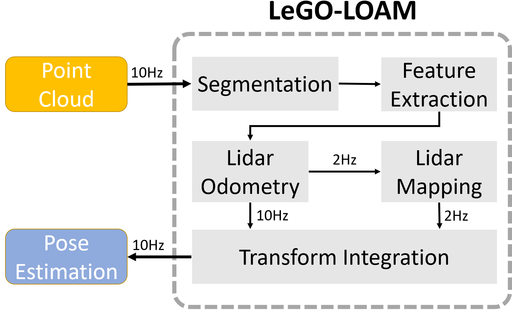
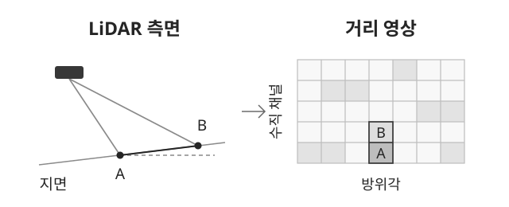
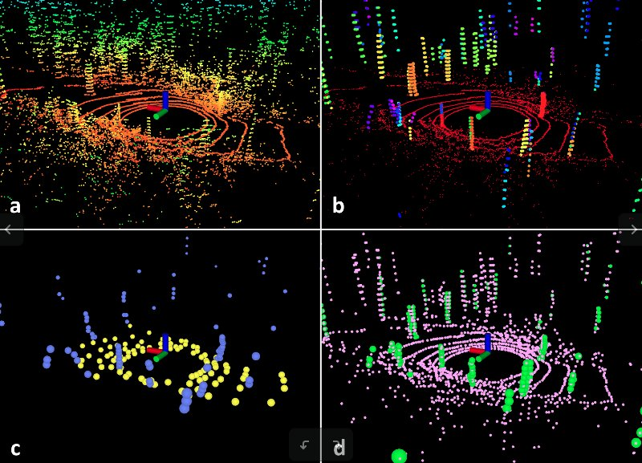
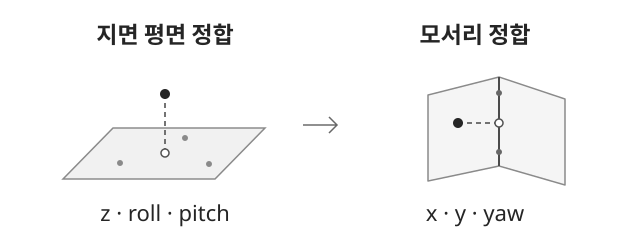
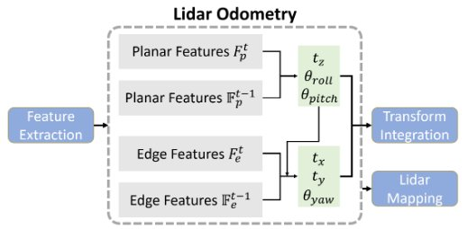
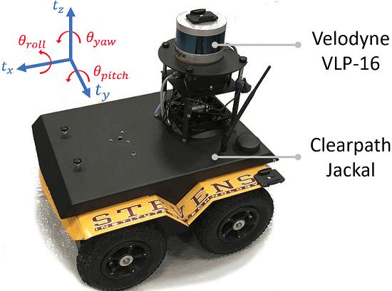

LeGO-LOAM(Lightweight and Ground-Optimized LiDAR Odometry and Mapping)은 지상 로봇의 3D LiDAR 스캔으로 6자유도 자세와 점군 지도를 추정한다. 지면과 주변 구조가 움직임에 대해 서로 다른 정보를 준다는 점을 이용한다. 지면에서 높이와 기울기를 구하고, 벽 모서리나 기둥에서 수평 이동과 방향 변화를 구한다. [Shan·Englot, IROS 2018][paper]



*원저자 흐름도에 표시된 주기. 오도메트리 10 Hz, 지도 정합 2 Hz.* [원본 `block.png`][block] · [논문 그림 1(b)][paper]

## 점군 전처리

### 거리 영상 투영

입력은 LiDAR 한 바퀴의 3D 점군이다. 이를 행은 수직 채널(ring), 열은 방위각인 **거리 영상(range image)**으로 펼친다. 각 칸에는 센서에서 반사점까지의 직선거리 `r = √(x² + y² + z²)`가 들어간다. 원본 VLP-16 설정은 수직 채널 16개와 수평 간격 0.2°를 사용하므로 16행 × 1,800열이다. 회전식 센서의 이웃 빔이 영상에서도 이웃 칸에 놓여, 각 점의 주변을 빠르게 찾을 수 있다. [센서 설정][settings] · [투영 코드][projection]



*같은 방위각의 반사점 A와 B를 연결한 지면 기울기. 수평선은 LiDAR 좌표계 기준.*

### 지면 판별

같은 열의 하단 채널에서 유효한 반사점 두 개를 잇는다. 높이 차와 수평 거리를 이용해 잰 기울기가 센서 장착각 설정에서 ±10° 이내면 두 점에 지면 표시를 붙인다. 열마다 인접한 점 쌍의 기울기를 따로 비교하므로 완만한 경사도 지면에 포함될 수 있다. 표시한 점은 비지면 군집 탐색에서 제외하고, 일부를 다음 단계의 평면 특징 후보로 넘긴다. [지면 판별 코드][projection]

### 비지면 분할

나머지 칸은 위·아래·좌·우 이웃으로 탐색한다. 두 빔 사이의 각도와 반사점까지의 거리로 연결 여부를 판정한다. 거리 차가 큰 깊이 경계, 예를 들어 기둥 바로 뒤로 멀리 보이는 벽에는 서로 다른 군집이 생길 수 있다. 공개 코드는 점이 30개 이상이면 군집을 남기고, 점이 5~29개인 경우에는 탐색 중 3개 이상의 행에서 이웃점이 연결되면 남긴다. 다음 단계에는 정리된 점군과 각 점의 지면 여부·열 번호·거리, 그리고 행별 인덱스 범위가 전달된다. [분할 코드][projection] · [분할 임계값][settings]

## 모서리·평면 특징 추출

같은 행에서 점 하나를 중심으로 앞뒤의 반사점 다섯 개씩을 본다. 이웃 거리의 합과 중심 거리의 10배가 비슷하면 거칠기 점수가 낮고, 깊이가 급하게 달라지는 곳은 점수가 높다. 논문은 이 차이의 크기를 이웃 수와 중심 거리로 정규화하며, 공개 코드는 거리 차 합의 제곱을 쓴다. 가려짐 경계에 걸친 점과 양옆에 비해 거리 차가 큰 고립점은 엄격한 특징점 선발에서 제외한다. [논문 III-C][paper] · [거칠기·가려짐 처리 코드][features]

각 스캔 행을 방위각 방향으로 여섯 구간으로 나눠 특징이 한쪽에 몰리는 것을 줄인다. 구간마다 거칠기가 높은 비지면 점에서 강한 모서리를 최대 2개, 거칠기가 낮은 지면 점에서 평면 특징을 최대 4개 고른다. 현재 스캔의 이 작은 집합은 빠른 스캔 간 정합에 쓴다. 더 많은 모서리와 복셀로 줄인 평면 후보는 다음 스캔의 대응점 탐색과 지도 정합에 남겨 둔다. [특징 선택·발행 코드][features]



*(a) 원본 스캔. (b) 분할 결과에서 빨간색은 지면이다. (c) 오도메트리용 모서리와 평면은 파란색과 노란색이다. (d) 지도 정합용 모서리와 평면은 초록색과 분홍색이다.* [원본 `seg-total.jpg`][segmentation] · [논문 그림 2][paper]

## 두 단계 스캔 간 정합

현재 특징점을 직전 스캔의 좌표계로 옮겼을 때, 대응하는 평면이나 직선까지의 거리가 작아지는 상대 변환을 구한다. 공개 코드에서는 직전 스캔의 특징에서 KD 트리로 가장 가까운 점을 찾고, 같은 행과 인접 행의 후보를 더해 평면이나 직선을 만든다. [대응점 탐색 코드][features]

| 단계 | 거리 잔차 | 추정 변수 |
| --- | --- | --- |
| 지면 평면 정합 | 현재 지면 특징점에서 이전 스캔의 세 점이 만드는 평면까지의 수직 거리 | 높이 변화 `z`, 기울기 `roll`·`pitch` |
| 모서리 정합 | 현재 모서리 특징점에서 이전 스캔의 두 점을 잇는 직선까지의 최단 거리 | 수평 이동 `x`·`y`, 방향 변화 `yaw` |



평평한 바닥을 생각하면 센서가 높아지거나 기울 때 여러 지면점의 평면까지의 거리가 변한다. 바닥과 평행하게 이동하거나 수직축 주위로 회전하면 그 거리는 그대로다. 이때 벽 모서리나 기둥이 여러 방향에 보이면 수평 이동과 회전을 구속할 수 있다. 두 번째 단계는 첫 번째 단계의 높이와 기울기를 고정하고 나머지 세 값을 갱신한다. 논문은 이 절차를 두 단계 Levenberg–Marquardt 최적화로 설명한다. 공개 코드에서는 각 단계가 3변수 정규방정식을 QR로 풀어 자세를 갱신한다. [논문 III-D][paper] · [두 단계 갱신 코드][features]



*평면 정합의 결과가 모서리 정합의 제약으로 들어간다.* [원본 `odometry.jpg`][odometry] · [논문 그림 3][paper]

## 지도 정합·루프 폐쇄

### 스캔–지도 정합

스캔 간 오도메트리에서 얻은 자세를 초기값으로 사용한다. 저장한 키프레임을 각자의 추정 자세로 지도 좌표계에 옮겨 지역 지도로 합친다. 기준 코드에서는 루프 폐쇄가 꺼졌을 때 현재 위치에서 50 m 안의 키프레임, 켜졌을 때 최근 최대 50개를 사용한다. 지도 정합은 현재 특징을 지역 지도의 선과 평면에 맞춰 여섯 자유도를 함께 보정한다. [지도 정합 코드][mapping] · [지역 지도 설정][settings]

### 키프레임·포즈 그래프

키프레임별 자세와 특징점군을 보관한다. 그래프의 노드는 키프레임 자세이며, 연속 키프레임 사이의 상대 변환은 제약으로 추가된다. 재방문 제약으로 과거 자세가 바뀌면, 보관한 점군을 새 자세로 옮겨 지도를 다시 조립할 수 있다. [논문 III-E][paper] · [키프레임 저장 코드][mapping]

### 루프 폐쇄

원본 코드의 기본값은 꺼짐이다. 켜면 현재 추정 위치에서 7 m 안에 있고 시간상 30초 넘게 떨어진 과거 키프레임을 탐색한다. 최신 키프레임의 특징점군을 과거 후보 주변에서 합친 점군에 ICP로 맞춘다. ICP가 수렴하고 정합 점수가 기준을 통과하면 두 키프레임 사이에 상대 자세 제약을 추가하고 iSAM2로 그래프를 갱신한다. 누적 오차가 크면 같은 장소가 검색 반경을 벗어나며, 반복되는 구조에서는 ICP가 다른 부분을 대응시킬 수 있다. [루프 폐쇄 코드][mapping] · [원본 README][readme]

### ROS 토픽·PCD 출력

ROS 1 구현은 스캔 간 오도메트리를 `/laser_odom_to_init`, 지도 정합 결과를 `/aft_mapped_to_init`에 발행한다. 자세 통합 노드는 최근 지도 보정 이후의 오도메트리 이동을 합쳐 `/integrated_to_init`에 발행한다. 지도 노드가 정상 종료될 때 기본 경로 `/tmp/`에 `finalCloud.pcd`, `cornerMap.pcd`, `surfaceMap.pcd`, 키프레임 위치를 담은 `trajectory.pcd`를 저장한다. [오도메트리 코드][features] · [자세 통합 코드][fusion] · [PCD 저장 코드][mapping]

## LOAM 처리 시간 비교



*원저자 실험 플랫폼. Clearpath Jackal 상단의 Velodyne VLP-16과 좌표축.* [원본 `jackal-label.jpg`][jackal] · [논문 그림 1(a)][paper]

논문은 Stevens 캠퍼스 1.09 km 구간의 데이터를 NVIDIA Jetson TX2에서 10회 실시간 재생했다. 표는 실험 1의 **스캔 한 건을 처리하는 모듈별 시간**이다. [논문 표 I·IV][paper]

| 모듈 | LOAM | LeGO-LOAM |
| --- | ---: | ---: |
| 분할 | — | 29.3 ms |
| 특징 추출 | 105.1 ms | 9.1 ms |
| 오도메트리 | 133.4 ms | 19.3 ms |
| 지도 정합 | 702.3 ms | 266.7 ms |

같은 실험에서 LeGO-LOAM 내부의 최적화만 바꿔 비교하면, 한 번에 푼 오도메트리는 34.5 ms, 두 단계는 19.3 ms였다. 두 단계에서도 모서리 정합의 반복 횟수는 비슷했지만 각 단계가 처리하는 특징점과 변수가 줄었다. 논문 그림 4·5는 별도의 식생 구간에서 추출한 특징과 60초 주행으로 만든 지도를 나란히 보여 준다. 그림 5(a)의 화살표 세 개는 LOAM 지도에 중복으로 남은 동일한 나무를 가리킨다. [논문 표 III·IV와 그림 4·5][paper]

## 센서 설정·환경 제약

지면이 드물게 보이거나 경사가 장착각 기준에서 크게 벗어나면 높이와 기울기를 제약하는 지면 특징이 줄어든다. 평평하고 비어 있는 곳에서는 수평 이동과 방향을 구속할 모서리가 부족하다. 다른 LiDAR를 적용할 때는 채널 순서와 수직각, 방위각 간격으로 거리 영상이 제대로 채워지는지, 하단 채널에서 지면이 충분히 검출되는지 확인해야 한다. 선택 입력인 IMU는 스캔 도중 움직임으로 생긴 왜곡을 보정하는 데 쓰이며, LiDAR와 IMU의 축 정렬이 어긋나면 보정 결과가 나빠질 수 있다. [원본 README의 센서 적용 조건][readme]

ROS 2의 LeGO-LOAM-BOR 계열 지도 제작과 Hesai XT32 재생에서는 지도 정합과 루프 폐쇄가 실제 기록에서 어떻게 동작하는지 살펴볼 수 있다. [DDDMR Navigation](/blog/dddmr-navigation/)

<details>
<summary>원저자 저장소 이미지 라이선스</summary>

```text
BSD 3-Clause License

Copyright (c) 2018, Robust Field Autonomy Lab
All rights reserved.

Redistribution and use in source and binary forms, with or without
modification, are permitted provided that the following conditions are met:

* Redistributions of source code must retain the above copyright notice, this
  list of conditions and the following disclaimer.

* Redistributions in binary form must reproduce the above copyright notice,
  this list of conditions and the following disclaimer in the documentation
  and/or other materials provided with the distribution.

* Neither the name of the copyright holder nor the names of its
  contributors may be used to endorse or promote products derived from
  this software without specific prior written permission.

THIS SOFTWARE IS PROVIDED BY THE COPYRIGHT HOLDERS AND CONTRIBUTORS "AS IS"
AND ANY EXPRESS OR IMPLIED WARRANTIES, INCLUDING, BUT NOT LIMITED TO, THE
IMPLIED WARRANTIES OF MERCHANTABILITY AND FITNESS FOR A PARTICULAR PURPOSE ARE
DISCLAIMED. IN NO EVENT SHALL THE COPYRIGHT HOLDER OR CONTRIBUTORS BE LIABLE
FOR ANY DIRECT, INDIRECT, INCIDENTAL, SPECIAL, EXEMPLARY, OR CONSEQUENTIAL
DAMAGES (INCLUDING, BUT NOT LIMITED TO, PROCUREMENT OF SUBSTITUTE GOODS OR
SERVICES; LOSS OF USE, DATA, OR PROFITS; OR BUSINESS INTERRUPTION) HOWEVER
CAUSED AND ON ANY THEORY OF LIABILITY, WHETHER IN CONTRACT, STRICT LIABILITY,
OR TORT (INCLUDING NEGLIGENCE OR OTHERWISE) ARISING IN ANY WAY OUT OF THE USE
OF THIS SOFTWARE, EVEN IF ADVISED OF THE POSSIBILITY OF SUCH DAMAGE.
```

</details>

[paper]: https://personal.stevens.edu/~benglot/Shan_Englot_IROS_2018_Preprint.pdf
[readme]: https://github.com/RobustFieldAutonomyLab/LeGO-LOAM/blob/896a7a95a8bc510b76819d4cc48707e344bad621/README.md
[block]: https://github.com/RobustFieldAutonomyLab/LeGO-LOAM/blob/896a7a95a8bc510b76819d4cc48707e344bad621/LeGO-LOAM/launch/block.png
[segmentation]: https://github.com/RobustFieldAutonomyLab/LeGO-LOAM/blob/896a7a95a8bc510b76819d4cc48707e344bad621/LeGO-LOAM/launch/seg-total.jpg
[odometry]: https://github.com/RobustFieldAutonomyLab/LeGO-LOAM/blob/896a7a95a8bc510b76819d4cc48707e344bad621/LeGO-LOAM/launch/odometry.jpg
[jackal]: https://github.com/RobustFieldAutonomyLab/LeGO-LOAM/blob/896a7a95a8bc510b76819d4cc48707e344bad621/LeGO-LOAM/launch/jackal-label.jpg
[settings]: https://github.com/RobustFieldAutonomyLab/LeGO-LOAM/blob/896a7a95a8bc510b76819d4cc48707e344bad621/LeGO-LOAM/include/utility.h
[projection]: https://github.com/RobustFieldAutonomyLab/LeGO-LOAM/blob/896a7a95a8bc510b76819d4cc48707e344bad621/LeGO-LOAM/src/imageProjection.cpp
[features]: https://github.com/RobustFieldAutonomyLab/LeGO-LOAM/blob/896a7a95a8bc510b76819d4cc48707e344bad621/LeGO-LOAM/src/featureAssociation.cpp
[mapping]: https://github.com/RobustFieldAutonomyLab/LeGO-LOAM/blob/896a7a95a8bc510b76819d4cc48707e344bad621/LeGO-LOAM/src/mapOptmization.cpp
[fusion]: https://github.com/RobustFieldAutonomyLab/LeGO-LOAM/blob/896a7a95a8bc510b76819d4cc48707e344bad621/LeGO-LOAM/src/transformFusion.cpp
