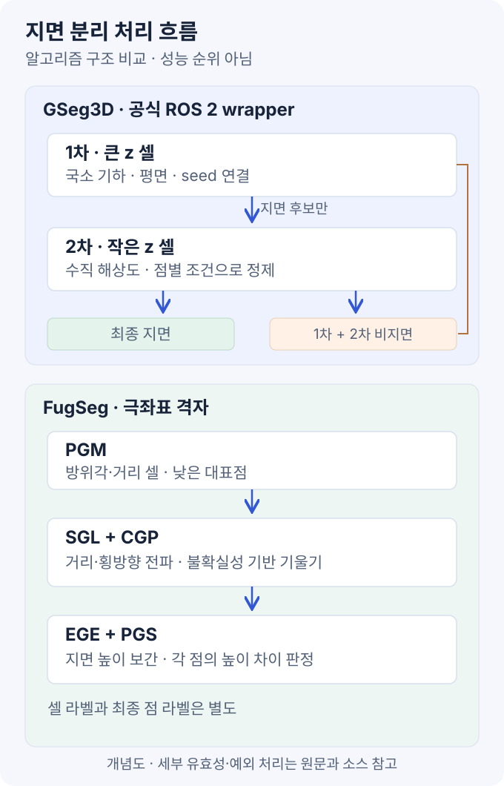
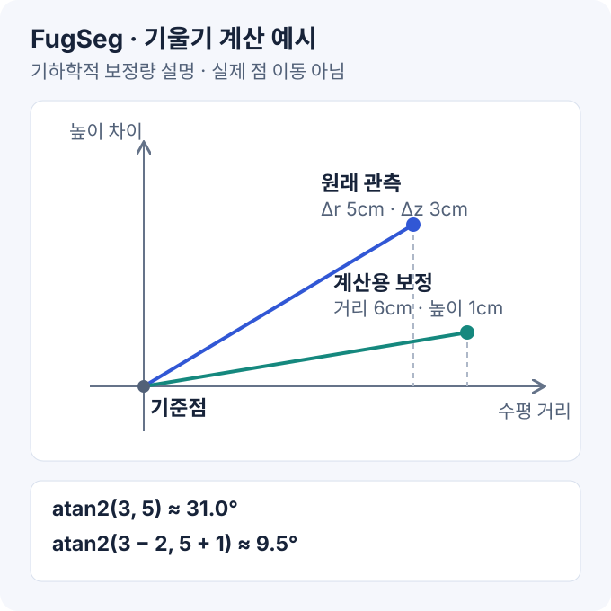
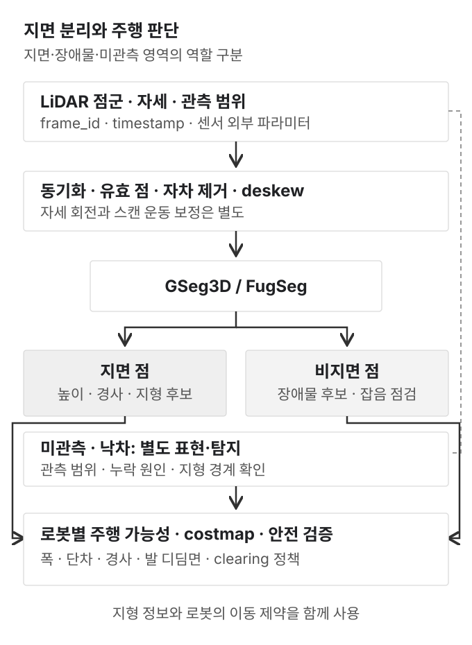

LiDAR 지면 분리(ground segmentation)는 포인트 클라우드에서 **지면에 해당하는 점과 그 외의 점을 구분하는 작업**이다. 평평한 실내에서는 높이 기준만으로 시작할 수 있지만, 경사로·연석·잔디·반사체가 있는 환경에서는 지면의 국소 형상과 연결 관계가 필요하다.

이 글은 **GSeg3D와 FugSeg의 원논문·공개 코드를 중심으로 한 학습 노트**다. 두 알고리즘을 같은 장비에서 재현해 비교한 실험 보고서는 아니다. 아래 실험 절차는 실제 로봇에 적용하기 위한 검증 계획이다.

### 목차

1. [지면과 주행 가능 영역](#1-지면과-주행-가능-영역)
2. [기본 분리 방식](#2-기본-분리-방식)
3. [GSeg3D 논문과 구현](#3-gseg3d-논문과-구현)
4. [FugSeg 논문과 구현](#4-fugseg-논문과-구현)
5. [비교와 선택 기준](#5-비교와-선택-기준)
6. [ROS 2 적용](#6-ros-2-적용)
7. [센서별 튜닝](#7-센서별-튜닝)
8. [평가 지표와 실험](#8-평가-지표와-실험)
9. [실패 사례](#9-실패-사례)
10. [참고 자료](#10-참고-자료)

그림은 직접 작성한 개념도다. 논문 수치와 이 글의 계산 예시를 구분해 표시했다.

## 1. 지면과 주행 가능 영역

### 1.1 서로 다른 판단

| 판단 | 필요한 정보 | 예시 |
| --- | --- | --- |
| Ground segmentation | 점의 기하·지면 연결성·높이 | 지면 위의 상자와 바닥 분리 |
| Traversability | 경사·단차·거칠기·로봇 크기와 운동 능력 | 같은 연석을 바퀴와 다리가 넘을 수 있는지 |
| Terrain semantics | 표면 종류·재질 등 | 잔디·아스팔트·자갈·물 구분 |
| Negative obstacle detection | 관측 누락·경계·거리와 낙차 증거 | 배수로·절벽·구덩이 탐지 |

분리기가 지면이라고 판단한 점도 로봇에 안전한 접촉면이라는 보장은 없다. 젖은 경사면, 부드러운 흙, 계단 위의 작은 평면은 추가 판단이 필요하다.

**점이 없는 영역은 지면 여부를 알 수 없다.** 가림·시야 밖·흡수·낙차 중 무엇 때문인지 구분되지 않은 공간은 별도의 미관측 영역으로 관리한다.

### 1.2 오분류 방향

이 글에서는 **지면을 positive**로 정의한다.

- **FP_ground:** 실제 비지면을 지면으로 분류. 작은 장애물이 사라질 수 있다.
- **FN_ground:** 실제 지면을 비지면으로 분류. 가짜 장애물·통행 불가 영역이 늘 수 있다.

문헌에 따라 positive를 장애물로 두기도 하므로, precision·recall을 비교하기 전에 정의부터 맞춘다. 또한 비지면 출력에는 실제 장애물뿐 아니라 반사 잡음 등이 섞일 수 있다.

## 2. 기본 분리 방식

| 방식 | 핵심 가정 | 장점 | 주요 한계 |
| --- | --- | --- | --- |
| 높이 임계값 | 지면 높이가 거의 일정 | 단순한 기준선·디버깅에 유용 | 경사·차체 기울기에 취약 |
| 전역 평면·RANSAC | 하나의 평면이 지면을 대표 | 평평한 장면에서 이해·구현이 쉬움 | 곡면·여러 높이·지붕 같은 큰 평면 |
| 국소 평면·PCA | 작은 영역은 평면에 가까움 | 완만한 경사·국소 형상 처리 | 셀 크기·포인트 밀도·seed 영향 |
| 스캔·격자 간 기울기 | 주변 지면의 변화가 연속적 | 근방 관계를 비교적 빠르게 사용 | 짧은 기준선·가림·반사 잡음 |

Patchwork 계열은 극좌표 기반 영역 분할과 국소 평면 추정의 대표적인 비교 기준이다. 논문의 Concentric Zone Model과 FugSeg의 극좌표 격자를 모두 “polar grid”라는 이름만으로 같은 구조로 취급하지 않는다. [Patchwork 논문](https://arxiv.org/abs/2108.05560)

또한 **PCA와 RANSAC은 역할이 다르다.** PCA는 점 분포의 주축·법선을 추정하고, RANSAC은 이상치를 포함한 데이터에서 모델과 inlier를 찾는 방식이다. 평면 법선이 수직에 가깝다는 사실만으로 도로와 차량 지붕을 구분할 수는 없다.

## 3. GSeg3D 논문과 구현

### 3.1 연구 목적

Lodhi·Hertzberg의 **GSeg3D**는 3D 격자와 국소 기하, 지면 영역 확장을 결합한다. 지면으로 잘못 포함되는 비지면을 줄이는 precision 중심 설계가 특징이다. 학회판은 ICRCV 2025, 확인한 arXiv 원고는 2026년 공개본이다. [논문](https://arxiv.org/abs/2603.04208), [학회 DOI](https://doi.org/10.1109/ICRCV67407.2025.11349133)



### 3.2 3D 격자와 국소 기하

점을 x·y·z 셀로 묶고, 셀 안의 좌표 공분산을 분석한다.

```text
cell_x = floor(point_x / cell_size_x)
cell_y = floor(point_y / cell_size_y)
cell_z = floor(point_z / cell_size_z)

C = Σ (point - centroid)(point - centroid)ᵀ / N
```

고유값을 큰 순서로 `λ₁ ≥ λ₂ ≥ λ₃`라고 두면 다음처럼 해석할 수 있다.

| 분포 | 기하학적 해석 | 추가 확인 |
| --- | --- | --- |
| `λ₁`만 큼 | 선 형태 | 주축이 중력 방향인지, 지면을 따른 선인지 |
| `λ₁`, `λ₂`가 크고 `λ₃`가 작음 | 평면 형태 | 법선·기울기·inlier·주변 지면과의 연결 |
| 세 값이 비슷함 | 분산된 구조 | 거친 물체·잡음 등 가능성 |

구현은 Eigen이 반환하는 오름차순 고유값에서 가장 큰 값의 인덱스를 사용한다. 위 수학 표기의 고유값 순서와 배열 순서를 혼동하지 않는다. [핵심 구현](https://github.com/dfki-ric/ground_segmentation/blob/e5aa4c2c47a961eae491056cf616fd415ff3d602/include/ground_detection.hpp)

평면 후보에는 RANSAC 기반 평면 추정과 지면 기울기 검사가 이어진다. 법선은 부호가 반대여도 같은 평면을 표현하므로, 법선 방향과 중력축 비교 규칙도 일관돼야 한다.

### 3.3 지면 연결성

로봇 아래의 seed에서 지면 후보 영역을 확장한다. 후보 셀의 중심점을 KD-tree로 검색하므로, 격자에서 바로 붙어 있지 않아도 검색 반경 안의 후보를 연결할 수 있다.

이 방식은 먼 거리의 성긴 스캔에서 셀 사이 간격을 넘는 데 유리하다. 반면 검색 반경을 크게 잡으면 독립적인 평면까지 연결될 위험이 있다. 법선 방향뿐 아니라 높이·하부 구조·주변 관계를 함께 확인하는 이유다.

로봇 아래의 seed는 센서 사각지대를 보완하기 위한 **기하학적 가정**이다. 센서 높이나 로봇 자세가 틀리면 그 가정부터 잘못될 수 있다. 원문에서 seed 주변을 어떻게 구성하는지와 실제 장착 조건을 함께 봐야 한다.

### 3.4 두 단계 처리

확인한 공식 ROS 2 wrapper의 흐름은 다음과 같다.

```text
입력 점군
  └─ Phase I: 큰 z 셀 → 지면 후보 / 비지면
       └─ 지면 후보만 Phase II로 전달
            └─ 작은 z 셀 → 최종 지면 / 추가 비지면

최종 비지면 = Phase I 비지면 + Phase II 비지면
```

즉, 현재 wrapper의 2차 처리는 **1차에서 남긴 지면 후보를 정제하는 구조**다. 1차에서 비지면으로 빠진 모든 지면을 2차가 다시 찾아주는 전체 재탐색은 아니다. [ROS 2 처리 코드](https://github.com/dfki-ric/ground_segmentation_ros2/blob/c0d60fd8ddcf561d006a907e04c84f9a8847372a/src/ground_segmentation_ros2_node.cpp)

이 차이는 튜닝에도 중요하다. 1차에서 지나치게 많은 실제 지면을 버린 뒤 2차 임계값만 바꾸면 원인을 해결하기 어렵다. 두 단계 출력을 따로 기록해 손실 위치를 찾는다.

### 3.5 논문 해석과 성능 수치

arXiv v1의 식 (4)는 주축과 z축의 각도를 설명하면서, 큰 각도를 obstacle로 표시한다. 반면 확인한 코드의 선 형태 분기는 `angle > 90° - slopeThreshold`를 지면 후보로 처리한다. 수평선의 주축이 z축과 약 90°를 이룬다는 점에서도 **각도 정의·판정 방향을 원문과 코드에서 대조할 필요**가 있다. 이 글의 구현 설명은 고정한 소스 기준이다.

논문 Table III의 SemanticKITTI 보고값은 다음과 같다.

| 지표 | GSeg3D 보고값 |
| --- | --- |
| Precision | `96.6%` |
| Recall | `89.4%` |
| F1 | `92.8%` |
| 평균 처리 시간 | `48.1 ms` |

이 수치는 원논문의 설정·집계 조건에 대한 보고값이다. 현재 ROS 2 노드의 실행 시간이나 다른 논문의 장비에서 측정한 수치로 해석하지 않는다. 높은 precision도 모든 작은 장애물의 검출 보장은 아니다.

## 4. FugSeg 논문과 구현

### 4.1 연구 목적

Li·Schwieger의 **FugSeg**는 반사 잡음과 가려지거나 분리된 지면을 주요 문제로 다룬다. 극좌표 격자, 불확실성을 고려한 기울기, 지면 높이 보간을 결합한다. 공식 표기는 `FugSeg`이며 IEEE TITS 2026 논문이다. [논문](https://arxiv.org/abs/2605.08952), [공식 코드](https://github.com/Leo-YuLi/FugSeg)

여기서 uncertainty-aware는 **LiDAR 측정 오차를 기하 계산에 반영한다는 의미**다. 셀마다 학습된 정답 확률을 출력하거나 EKF로 지면을 추적한다는 뜻은 아니다.

### 4.2 극좌표 격자와 대표점

수평면을 방위각 segment와 거리 bin으로 나눈다. 각 셀의 낮은 점을 대표점으로 선택해 지면 후보 관계를 계산한다.

```text
수평 거리 r = sqrt(x² + y²)
방위각       = atan2(y, x)
점 → segment·bin → 셀 대표점
```

이 식은 표현을 이해하기 위한 일반 표기다. 실제 인덱스의 방향·시작 각도는 구현에 맞춘다. 대표점이 가장 낮다는 이유만으로 참 지면인 것은 아니다. 유리·금속·물체 반사로 생긴 비정상적인 낮은 점이 대표점이 될 수 있다.

또한 고정된 각도 폭은 거리와 함께 실제 폭이 커진다. `Δα=2°`이면 20 m 거리에서 횡방향 폭은 대략 `20 × 2π/180 ≈ 0.70 m`다. “각도 해상도”와 “미터 단위 셀 폭”을 같은 값으로 생각하지 않는다.

### 4.3 불확실성 기반 기울기

기존 기울기는 두 대표점의 높이 차이를 수평 거리로 나눈 값이다.

```text
Δr = sqrt((x₂ - x₁)² + (y₂ - y₁)²)
일반 기울기 = Δz / Δr
```

두 점이 가까우면 작은 높이 오차가 큰 기울기로 나타난다. FugSeg는 거리·수직각·수평각의 측정 오차를 좌표 오차로 전파하고, 그 결과를 높이 차이와 수평 거리의 불확실성으로 계산한다.

```text
Σ_xyz ≈ J_spherical Σ_spherical J_sphericalᵀ
```

이는 오차 전파의 기본 형태다. 실제 논문의 좌표별 식은 거리·각도 오차의 독립성 등을 가정하므로, 센서의 오차 성격과 단위도 함께 확인해야 한다.

측정 오차를 반영한 기울기는 다음처럼 이해할 수 있다.

```text
보정 높이차 = sign(Δz) × max(|Δz| - σ_Δz, 0)
보정 수평거리 = Δr + σ_Δr
보정 기울기 = 보정 높이차 / 보정 수평거리
```

공개 구현의 `getSlopeAngleExt`는 이 두 성분에 `atan2`를 적용한 **라디안 각도**를 반환한다. 생성자의 `maxDslopeDeg`는 degree로 받아 내부에서 radian으로 변환한다. 비율·degree·radian을 혼합하면 임계값이 달라진다. [불확실성·기울기 구현](https://github.com/Leo-YuLi/FugSeg/blob/623f860cce70ffe0e3f673cd246254938ce8babe/src/fugseg/src/fugseg.cpp)



그림은 `Δz=0.03 m`, `Δr=0.05 m`, `σ_Δz=0.02 m`, `σ_Δr=0.01 m`인 계산 예시다. 원래 각도는 약 `31.0°`, 보정 각도는 약 `9.5°`다. 포인트 클라우드의 점을 실제로 그 위치로 옮기는 처리라는 뜻은 아니다.

이 보정은 센서 오차 규모의 작은 높이 변화를 완화한다. 대신 불확실성을 과도하게 설정하면 실제 낮은 장애물까지 완만한 변화처럼 보일 위험이 있다.

### 4.4 SGL·CGP

| 단계 | 처리 | 목적 |
| --- | --- | --- |
| SGL: Segment-wise Ground Labeling | 각 segment에서 거리 방향으로 seed와 기울기 변화를 확인 | 직접 관측되는 지면 연결 |
| CGP: Cross-segment Ground Propagation | 인접 segment의 지면과 횡방향·거리 방향 관계를 비교 | 가림 뒤·분리된 지면의 추가 식별 |

SGL은 가까운 곳에서 먼 곳으로만 한 번 훑는 처리보다 넓은 구성을 갖는다. 논문은 전방·역방향 라벨링을 설명하며, CGP도 인접한 지면의 기울기 기준선을 사용한다. 단순히 빈칸을 모두 지면으로 메우는 dilation과 다르다.

중요한 기준은 절대 경사뿐 아니라 **이전 지면과의 기울기 변화**다. 동일한 경사로가 이어지는 경우와 갑자기 나타난 연석을 구분할 단서를 제공하지만, 이 역시 형상 가정에 의존한다.

### 4.5 지면 높이 추정과 점 단위 분리

셀에 바닥과 상자 점이 함께 있어도 셀 전체를 지면으로 출력해서는 안 된다. FugSeg는 지면 셀의 정보를 이용해 **셀 경계 노드의 높이**를 추정하고, 내부 점 위치의 지면 높이를 보간한다.

반사 잡음이 의심되는 noisy ground 셀은 낮은 대표점을 그대로 실제 지면 높이로 쓰지 않는다. 주변의 유효한 지면 높이를 여러 방향으로 전달해 높이 추정에 사용한다. 마지막에는 각 점과 추정 지면 높이의 차이를 비교한다.

```text
점 높이 오차 = point_z - estimated_ground_height(point_x, point_y)
지면 판정: 추정 높이가 유효하고 |점 높이 오차| < 높이 임계값
```

따라서 **ground/noisy ground 셀 라벨과 최종 점 라벨은 다르다.** 추정된 표면 아래로 크게 벗어난 반사 점을 지면에서 제외할 여지가 생긴다. 이 식은 최종 판정의 개념이며 전체 알고리즘의 seed·가림·유효성 처리를 생략한 표현이다.

### 4.6 보고 성능과 적용 범위

논문의 네 공개 평가 데이터셋은 SemanticKITTI·nuScenes·KITTI-360·LiDARDustX다. Table VIII에서 단일 CPU 스레드의 합계 시간은 SemanticKITTI `7.385 ms`, nuScenes `2.053 ms`로 보고하며, 각각 약 `135 Hz`, `487 Hz`에 해당한다.

실험 PC에는 i7-9700K와 GPU가 있지만, 해당 비학습 알고리즘의 보고 시간은 CPU 단일 스레드 실행 기준이다. **ROS 통신·점군 변환·deskew·costmap까지 포함한 시간은 아니다.** GSeg3D의 다른 논문 수치와 나란히 두고 동일 조건의 배수 비교를 하지 않는다.

공개 저장소는 현재 KITTI/SemanticKITTI 설정 중심이다. 논문의 여러 LiDAR 평가가 곧바로 센서별 완성된 ROS 2 드라이버·설정 제공을 뜻하지는 않는다. [적용 범위 안내](https://github.com/Leo-YuLi/FugSeg/blob/623f860cce70ffe0e3f673cd246254938ce8babe/README.md)

## 5. 비교와 선택 기준

| 항목 | GSeg3D | FugSeg |
| --- | --- | --- |
| 주 표현 | x·y·z의 3D 격자 | 방위각·거리의 극좌표 격자와 높이 정보 |
| 주요 근거 | PCA·평면·기울기·seed 연결성 | 불확실성 기반 기울기 변화·영역 전파·높이 보간 |
| 정제 방식 | 두 단계의 서로 다른 z 해상도 | 셀 라벨 후 점 단위 높이 판정 |
| 센서 자세 | 공식 ROS 2 wrapper에서 IMU 자세 사용 가능 | 자체 wrapper에서 좌표계·수평 기준 처리 검토 |
| 공개 ROS 연결 | 공식 ROS 2 wrapper 제공 | C++ 코어와 ROS 1 시각화 코드, ROS 2 연결은 별도 작업 |
| 먼저 확인할 위험 | seed·셀 크기·평면 연결·낮은 장애물 | 높이·측정 오차·반사·전파 오류 |

선택은 다음 순서가 실용적이다.

1. **통합 기준선:** GSeg3D 공식 ROS 2 노드로 입력·TF·분리 결과를 먼저 점검한다.
2. **비교 실험:** 같은 rosbag·ROI·좌표계·평가 라벨로 FugSeg wrapper를 연결한다.
3. **실패 장면 우선:** 연석·작은 물체·경사 전환·반사체·가림 영역에서 FP_ground를 비교한다.
4. **최종 판단:** 분리 정확도뿐 아니라 지연·설정 복잡도·센서 변경 비용까지 포함한다.

이는 이 글의 통합 제안이다. 실제 데이터 검증 전의 “어느 알고리즘이 더 안전하다”는 순위가 아니다.

## 6. ROS 2 적용



### 6.1 입력 계약

| 항목 | 공통 점검 |
| --- | --- |
| PointCloud2 | 유효한 xyz·미터 단위·frame_id·측정 시각 |
| 시간 정합 | LiDAR·IMU clock 기준과 외부 파라미터 시각 |
| 움직임 보정 | 필요하면 per-point 시간과 자세를 이용한 deskew |
| 자차 제거 | 차체·다리·케이블의 반사와 근거리 이상점 |
| 범위 | NaN·Inf·작업 범위 밖 점 제거 |
| 출력 | 시각·좌표계 유지, 사용한 입력과 연계 가능한 지면·비지면 |

스캔 하나를 찍는 동안 로봇이 움직였다면 한 장의 점군 안에도 운동 왜곡이 있다. **IMU 자세 하나로 좌표계만 회전하는 것과 스캔 deskew는 다른 처리**다.

### 6.2 GSeg3D의 실제 토픽과 높이 부호

확인한 공식 노드의 기본 토픽은 다음과 같다. 실제 센서 토픽에는 launch remapping으로 연결한다.

| 방향 | 토픽 |
| --- | --- |
| 입력 점군 | `/ground_segmentation/input_pointcloud` |
| 선택적 IMU | `/ground_segmentation/input_imu` |
| 출력 지면 | `/ground_segmentation/ground_points` |
| 출력 비지면 | `/ground_segmentation/obstacle_points` |

`use_imu_orientation=true`이면 IMU 메시지와 점군을 동기화하고 센서 TF를 이용해 로봇 자세를 계산한다. orientation을 제공하지 않는 자이로 메시지만 연결해서는 이 기능을 사용할 수 없다.

현재 wrapper는 점군을 `robot_frame`으로 변환하고, 높이를 다음처럼 구성한다.

```text
robot_frame의 지면 z
  = T(robot_frame ← lidar_frame)의 z 이동량 + lidar_to_ground
```

여기서 `lidar_to_ground`는 코드 정의상 **robot_frame의 z축 방향으로 본 LiDAR 원점에서 지면까지의 부호 있는 거리**다. 일반적인 위쪽 z축에서 지면은 센서 아래에 있으므로 음수다.

예를 들어 평지에서 base 원점이 지면 위 `0.40 m`, LiDAR가 base 위 `0.60 m`에 있다면, `lidar_to_ground=-1.00 m`이고 base 기준 지면 z는 `-0.40 m`다. 기준 프레임과 측정 조건을 바꾸면 같은 숫자를 그대로 쓰지 않는다.

### 6.3 GSeg3D 부분 설정 예시

다음은 위 장착 높이 예시를 가정한 **학습용 시작값**이다. 실제 로봇으로 검증한 권장값이나 논문의 benchmark 설정이 아니다.

```yaml
ground_segmentation:
  ros__parameters:
    robot_frame: base_link
    lidar_to_ground: -1.0
    use_imu_orientation: true
    downsample: false
    cellSizeX: 0.4
    cellSizeY: 0.4
    cellSizeZ: 4.0
    cellSizeZPhase2: 0.12
    slopeThresholdDegrees: 20.0
    groundInlierThreshold: 0.04
    centroidSearchRadius: 1.2
    maxGroundHeightDeviation: 0.1
```

`groundInlierThreshold`는 m, 기울기 설정은 degree다. 이 wrapper의 공개 기본 YAML은 SemanticKITTI 관련 설정이라고 명시한다. 실제 저상 로봇에 맞추려면 특히 높이·수직 해상도·낮은 장애물 조건부터 바꿔야 한다. [파라미터 정의와 튜닝 안내](https://github.com/dfki-ric/ground_segmentation_ros2/blob/c0d60fd8ddcf561d006a907e04c84f9a8847372a/config/parameters.yaml)

점군을 별도로 중력 정렬한 뒤 같은 자세 보정을 다시 적용하는 중복 처리도 피한다. 공식 wrapper의 프레임 처리 경로를 사용할지, 별도 leveled frame을 만드는 구성인지 먼저 정한다.

### 6.4 FugSeg wrapper 설계

공개 소스의 처리 순서는 다음과 같다.

```text
ExtractGround
  → projectPoints                 PGM
  → LabelGroundVertical           SGL
  → LabelGroundHorizontalJoint    CGP
  → SegmentGroundFine             EGE + PGS
```

ROS 2에 연결할 때는 최소한 다음 작업이 필요하다.

- `PointCloud2`를 코어가 받는 점군 자료형으로 변환하고 유효 점·원래 인덱스 관계를 관리한다.
- 입력 프레임과 높이 기준을 정한다. 수평 기준을 맞추는 wrapper라면 코어의 sensor height·자차 영역도 그 기준과 일치시킨다.
- 생성자의 KITTI 고정값을 센서별 설정으로 분리한다. 거리·수직각·수평각 오차, 장착 높이, 자차 영역이 대상이다.
- 고정된 내부 포인트 버퍼와 실제 프레임당 포인트 수를 점검한다.
- 지면·비지면 점을 원래 header와 일관된 좌표계로 다시 발행한다.

`_lidarHeight=1.73`, KITTI 차체 영역, 특정 각도 오차를 XT32·VLP16·다른 설치 높이에 그대로 사용하지 않는다. 범용적인 표현 방식과 **코드의 센서별 초기값**은 다른 문제다.

### 6.5 Nav2·사족보행 연결

비지면 점군은 obstacle/voxel layer의 marking 입력 후보가 된다. 다만 ground 제거 후 남은 점만 clearing에도 사용하면, 원래 지면을 맞고 끝나던 ray가 사라져 이전 장애물의 제거 동작이 바뀔 수 있다. marking·clearing·관측 범위를 별도로 검증한다.

지면 정보까지 사용하는 [Nav2 Ground Terrain 튜토리얼](https://docs.nav2.org/rolling/tutorials/general_tutorials/navigation2_with_ground_consistency_layer/navigation2_with_ground_consistency_layer/)도 참고할 수 있다. 링크는 rolling 문서이므로 사용하는 ROS 배포판에서 플러그인 제공 여부와 인터페이스를 따로 확인한다.

사족보행에서는 경사·발 디딤면·단차·복부 여유·접촉 안정성을 추가로 고려한다. 계단의 윗면이 지면으로 분리돼도, 해당 지점을 기존 2D costmap에서 바로 free로 만드는 판단은 별개다.

SLAM용 점군과 장애물 분리용 점군도 목적이 다르다. 모든 지면을 SLAM에서 제거하면 유효한 평면 제약을 잃거나 장면에 따라 정합이 더 불안정해질 수 있으므로 입력 경로를 분리해 검증한다.

## 7. 센서별 튜닝

### 7.1 조정 순서

1. **높이·축·자세:** 평지 정지 데이터에서 센서 높이·TF·IMU 방향 확인.
2. **동일 전처리:** ROI·자차 제거·deskew를 고정해 알고리즘 차이와 분리.
3. **공간 해상도:** 근거리 작은 장애물과 원거리 희소성의 균형 확인.
4. **높이 임계값:** 보존해야 할 최소 장애물 높이보다 충분히 작은지 검토.
5. **연결 조건:** 검색 반경·허용 gap·기울기 변화 조건 조정.
6. **불확실성:** FugSeg의 측정 오차 설정을 실제 센서 데이터와 비교.
7. **부하:** 전처리·ROS 변환까지 포함해 지연과 메모리 측정.

### 7.2 주요 조절 항목

| 항목 | 크게 설정했을 때의 경향 | 확인할 장면 |
| --- | --- | --- |
| x·y 셀 크기 / 거리·각도 bin 폭 | 더 많은 점을 모으지만 작은 구조가 섞임 | 연석·얇은 장애물·원거리 |
| 지면 높이 임계값 | 거친 지면을 수용하지만 낮은 장애물을 포함할 위험 | 작은 블록·케이블 |
| 지면 연결 반경·허용 gap | 끊긴 지면 연결에 유리하지만 다른 면으로 전파 가능 | 차량 하부·경계·가림 |
| 허용 기울기 / 기울기 변화 | 급한 변화에 관대해짐 | 경사로 시작·계단·연석 |
| 측정 오차 크기 | 작은 높이 차이를 더 강하게 완화 | 반사체와 실제 낮은 물체 |

이 표는 다른 조건을 고정했을 때의 해석 방향이다. 알고리즘의 여러 단계가 상호작용하므로 모든 데이터에서 단조롭게 같은 결과가 나온다고 보장하지 않는다.

### 7.3 제조사 정확도와 표준편차

FugSeg의 `σ_R`, `σ_φ`, `σ_θ`는 오차 전파에 사용하는 표준편차다. 데이터시트의 “정확도 ±수 cm”, 각도 해상도, beam divergence가 모두 같은 값은 아니다.

정확도 상한을 근거 없이 1σ로 넣거나 degree 값을 radian 자리에 넣지 않는다. 장착 상태의 평면 관측, 거리별 잔차, 반복 측정과 제조사 정의를 이용해 값의 의미를 확인한다. 자세·시간 동기화 오류가 큰 경우 센서 단품의 거리 잡음만으로는 설명이 부족하다.

## 8. 평가 지표와 실험

### 8.1 공통 평가 조건

```text
같은 원시 rosbag
  → 같은 좌표계·ROI·deskew
  → GSeg3D / FugSeg
  → 같은 평가 포인트·지면 정의·거리 구간
```

downsample을 다르게 쓰면 출력 포인트 수와 평가 대상 자체가 달라진다. 원본 인덱스로 되돌리는 규칙을 정하거나, 공통 샘플에서 비교한다. 제외한 영역·포인트도 기록해 정확도와 coverage를 함께 해석한다.

### 8.2 지표

```text
Precision_ground = TP / (TP + FP)
Recall_ground    = TP / (TP + FN)
IoU_ground       = TP / (TP + FP + FN)
```

지면이 화면 대부분을 차지하면 전체 accuracy만 높게 나올 수 있다. 지면·비지면 class별 지표와 오류 위치를 같이 본다.

| 평가 항목 | 기록 내용 |
| --- | --- |
| 분리 품질 | Ground precision·recall·IoU, non-ground recall |
| 작은 장애물 | 높이·거리별 잔존 포인트, 물체 단위 누락 여부 |
| 장면별 오류 | 경사·연석·계단·잔디·반사·가림을 별도로 집계 |
| 시간 | 전처리·분리·출력 변환의 평균·p95·최대 지연 |
| 데이터 나이 | 소비 시점과 센서 측정 timestamp의 차이 |
| 자원·안정성 | CPU·메모리·드롭·NaN·빈 점군·TF 실패 처리 |

### 8.3 최소 실험 세트

1. 평지 정지 상태에서 바닥·자차 반사 확인.
2. 평지에 크기를 아는 낮은 블록을 놓고 거리별 관측.
3. 경사로 시작·끝과 횡경사를 천천히 통과.
4. 연석·계단·잔디·낮은 식생을 별도 수집.
5. 유리·금속 주변에서 낮은 반사 점과 실제 지면 비교.
6. 가려진 지면과 관측이 끊기는 구간 확인.
7. IMU·TF 지연, 점군 중단, 포인트 수 증가 조건 재생.

구덩이·낙차 시험은 가드·정지 수단·사전 측정이 있는 통제 환경에서 진행한다. 분리기 하나의 결과만 믿고 실제 로봇을 미지의 단차로 접근시키지 않는다.

## 9. 실패 사례

| 현상 | 가능한 원인 | 점검 순서 |
| --- | --- | --- |
| 경사로 전체가 장애물 | 중력축·높이·기울기 조건 오류 | TF·자세 → 단위 → 임계값 |
| 작은 장애물이 바닥으로 사라짐 | 높이 허용 폭·격자 크기·과한 평활화 | 최소 장애물 재생 → 중간 결과 확인 |
| 원거리 지면이 끊김 | 스캔 희소성·작은 셀·gap 조건 | 거리별 점 수 → 셀 크기 → 연결 |
| 지붕·차량 하부가 지면 | 평면·기울기·연결성 가정의 한계 | seed·높이 문맥·주변 연결 |
| 반사체 아래로 지면이 내려감 | 낮은 잡음 점이 대표점·높이 추정에 영향 | noisy ground 처리·오차 설정 |
| 장애물이 오래 남음 | marking·clearing 입력과 ray 변경 | costmap 갱신·timestamp·관측 범위 |
| 지면 분리 후 SLAM 악화 | 필요한 평면 제약 제거·점 수 감소 | SLAM 입력 분리·정합 비교 |

FugSeg 논문도 혼잡한 장면의 트램 하부를 지면으로 오분류하는 사례를 제시한다. 기울기와 연결성이 비슷한 표면은 알고리즘 가정의 한계가 될 수 있다. 센서·표현을 추가할 문제와 임계값으로 해결할 문제를 구분한다.

## 10. 참고 자료

- [GSeg3D 원논문, arXiv v1](https://arxiv.org/abs/2603.04208v1): 두 단계 격자·국소 기하·영역 확장·SemanticKITTI 평가.
- [GSeg3D C++ 기준점 `e5aa4c2`](https://github.com/dfki-ric/ground_segmentation/tree/e5aa4c2c47a961eae491056cf616fd415ff3d602): `include/ground_detection.hpp`의 분류·경사·영역 확장.
- [GSeg3D ROS 2 기준점 `c0d60fd`](https://github.com/dfki-ric/ground_segmentation_ros2/tree/c0d60fd8ddcf561d006a907e04c84f9a8847372a): 실제 토픽·높이 부호·IMU·1차/2차 입출력.
- [FugSeg 원논문, arXiv v1](https://arxiv.org/abs/2605.08952v1), [IEEE DOI](https://doi.org/10.1109/TITS.2026.3682176): 불확실성 기반 기울기·SGL·CGP·지면 높이 추정.
- [FugSeg C++ 기준점 `623f860`](https://github.com/Leo-YuLi/FugSeg/tree/623f860cce70ffe0e3f673cd246254938ce8babe): `src/fugseg/src/fugseg.cpp`의 처리 순서·센서 초기값·기울기 함수.
- [Patchwork](https://arxiv.org/abs/2108.05560): 극좌표 영역 분할·국소 평면 기반의 비교 기준.
- [EKF 센서 융합](/blog/ekf-sensor-fusion/), [Nav2 주행 파이프라인](/blog/nav2-navigation-study/): 자세·좌표계·costmap 연결에 관한 별도 글.
