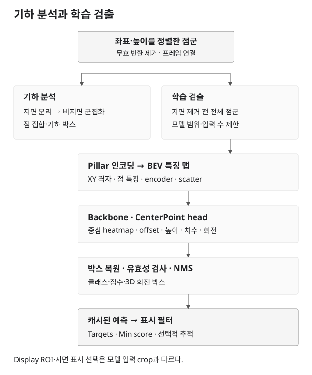
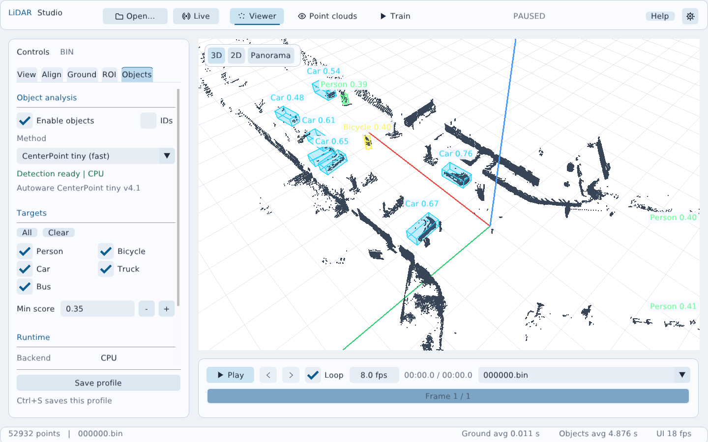
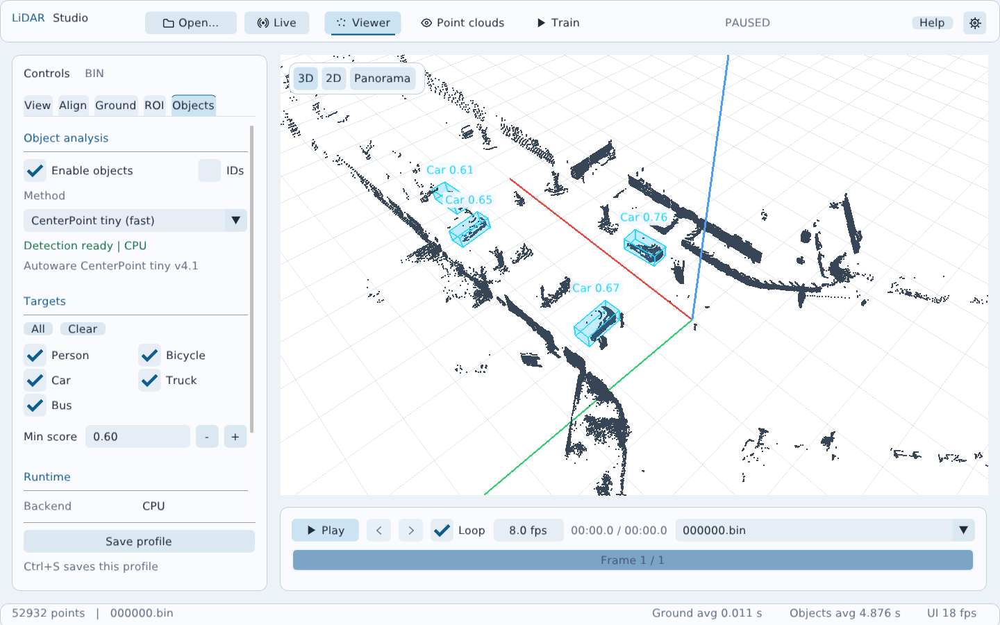

3D 객체 검출은 **점군에서 물체의 클래스와 위치·크기·방향을 예측하는 작업**이다. LiDAR Studio는 CenterPoint 계열의 사전 학습 모델을 ONNX Runtime으로 실행한다. 기하 군집화와는 별도 경로다.

기준은 LiDAR Studio [`4107c96`](https://github.com/YooJuno/lidar_studio/tree/4107c96b558ec73ccb3b418c1d66f57c43472769)의 모델 정의·전후처리·화면 연결 코드다. 원논문의 일반 구조와 앱에서 사용하는 모델 구성을 구분한다.

**LiDAR 시리즈**

- [지면 분리 — GSeg3D·FugSeg](/blog/lidar-ground-segmentation/)
- [포인트 클라우드 클러스터링](/blog/lidar-point-cloud-clustering/)
- **3D 객체 검출 — CenterPoint** — 현재 글

<details class="post-toc" id="목차">
<summary>목차</summary>

1. [검출 결과의 의미](#1-검출-결과의-의미)
2. [Pillar와 CenterPoint](#2-pillar와-centerpoint)
3. [모델 입력과 좌표계](#3-모델-입력과-좌표계)
4. [앱의 두 모델](#4-앱의-두-모델)
5. [복호화와 중복 억제](#5-복호화와-중복-억제)
6. [실제 화면과 점수 필터](#6-실제-화면과-점수-필터)
7. [검출과 추적](#7-검출과-추적)
8. [적용·평가 기준](#8-적용평가-기준)
9. [참고 자료](#9-참고-자료)

</details>

## 1. 검출 결과의 의미

| 작업 | 출력 | 예시 |
| --- | --- | --- |
| 지면 분리 | 점별 지면·비지면 판정 | 바닥과 바닥 위의 점 분리 |
| 클러스터링 | 인접 점 집합·기하 박스 | 서로 떨어진 점 묶음 구분 |
| 객체 검출 | 클래스·점수·3D 박스 | Car로 예측한 위치·치수·방향 |
| 객체 추적 | 시간에 걸친 ID·상태 추정 | 이전 프레임의 차량과 현재 검출 연결 |

앱의 검출 어댑터는 다음 형식의 박스를 읽는다.

```text
[center_x, center_y, center_z, length, width, height, yaw, score, class]
```

좌표·치수는 m, yaw는 radian이다. 회전 박스의 `center_z`는 중심 높이이며 바닥 높이가 아니다. 학습 모델이 예측한 치수는 클러스터의 관측 점만 감싼 박스와 다를 수 있다.

**박스가 있다는 사실은 정답이라는 뜻이 아니다.** 부분 관측·학습 데이터의 편향·센서 차이로 위치·크기·클래스가 모두 틀릴 수 있다. [검출 박스 복호화](https://github.com/YooJuno/lidar_studio/blob/4107c96b558ec73ccb3b418c1d66f57c43472769/src/algorithms/detection.cpp).

## 2. Pillar와 CenterPoint

### 2.1 점군에서 BEV 특징으로

점군은 프레임마다 점 수와 배치가 다르다. Pillar 방식은 XY 평면을 격자로 나누고, 각 수직 기둥 안의 점을 특징 벡터로 바꾼 뒤 평면에 배치한다. 이 **BEV(Bird's-Eye View) 특징 맵**에 2D 합성곱을 적용할 수 있다.

PointPillars 논문의 핵심은 이러한 **점군 인코딩**이다. 반면 CenterPoint는 BEV에서 **물체 중심을 찾고 박스 속성을 회귀하는 검출 방식**이다. 서로 다른 단계의 개념이며, 앱의 두 모델도 pillar 인코더와 CenterPoint 계열 head를 함께 사용한다. [PointPillars, CVPR 2019](https://arxiv.org/abs/1812.05784), [앱 모델 구성](https://github.com/YooJuno/lidar_studio/blob/4107c96b558ec73ccb3b418c1d66f57c43472769/python/lidar_detection/centerpoint.py).



그림의 학습 경로는 앱의 실제 입력 분기를 요약한 것이다. 지면 분리·군집화는 검출 모델의 필수 전처리 단계가 아니다.

### 2.2 중심과 박스 속성

CenterPoint는 클래스별 중심 heatmap과 중심 보정량·높이·크기·회전 등의 속성을 예측한다. 격자의 중심 후보를 실제 좌표로 복원하면 회전된 3D 박스를 얻는다. 원논문은 2단계 정제와 속도 기반 추적도 다루지만, **이 앱의 단일 스캔 검출·별도 추적기에 그 구성을 전부 적용했다고 볼 수는 없다.** [CenterPoint, CVPR 2021](https://arxiv.org/abs/2006.11275).

즉, 논문 이름만 같다고 입력 특징·backbone·학습 데이터·추적 방법까지 같아지는 것은 아니다. 적용할 때는 실제 모델 카드와 전후처리를 함께 확인한다.

## 3. 모델 입력과 좌표계

### 3.1 전체 정렬 점군

앱은 지면·Display ROI 필터보다 먼저 검출용 점군을 준비한다. 따라서 화면에서 **Obstacles only**를 선택해도 모델에는 지면을 포함한 전체 정렬 점군이 들어간다. ROI를 좁혔다고 모델이 그 부분만 추론하는 것도 아니다.

단, ‘전체’는 원시 파일의 모든 값을 무조건 사용한다는 뜻은 아니다. 무효 반환 제거와 모델의 xyz 범위 제한, pillar당 점 수·최대 pillar 수 제한이 적용된다. [입력 준비·비동기 호출](https://github.com/YooJuno/lidar_studio/blob/4107c96b558ec73ccb3b418c1d66f57c43472769/src/viewer_app.cpp), [추론 프로세스 연결](https://github.com/YooJuno/lidar_studio/blob/4107c96b558ec73ccb3b418c1d66f57c43472769/src/learned_detector.cpp).

| 확인 항목 | 이유 |
| --- | --- |
| 축과 단위 | 센서 축을 모델이 기대하는 전방·좌측·위쪽 축과 m 단위로 맞춤 |
| roll·pitch | 중력 정렬이 틀리면 수평 도로·물체 높이 분포가 달라짐 |
| 지면 높이 | 모델 학습 좌표와 맞지 않으면 z 범위·높이 특징이 달라짐 |
| yaw 변환 | 표시 정렬 yaw를 추론 전 되돌리고, 출력 박스에 다시 적용하는 앱 규칙 확인 |
| 시각·프레임 | 다른 프레임의 박스를 현재 점군 위에 그리지 않도록 연결 |

이 정렬은 자동 deskew와 같지 않다. 움직이는 동안 수집한 점들의 시간 차이와 운동 왜곡은 별도 문제다.

### 3.2 네 번째 특징: intensity와 time lag

원본 파일은 `XYZI`를 저장할 수 있지만, 현재 어댑터의 모델 입력은 **XYZ와 시간 지연(time lag)**을 따른다. 단일 스캔이므로 시간 특징은 0이다. 네 번째 값을 intensity로 채워 넣으면 의미가 바뀐다.

이후 pillar 안의 점 평균·셀 중심에 대한 상대 위치를 추가한다. tiny는 점당 9개, ShortRange는 10개 특징을 구성한다. 한 pillar는 최대 32개 점을 사용하며, 점을 제한할 때는 고정 seed의 순열을 사용한다.

다른 체크포인트를 쓸 때는 이 규칙을 그대로 복사하지 않는다. 입력 채널 의미·z 기준·voxel 크기·격자 크기·head stride·클래스 순서가 맞아야 한다. **ONNX 파일의 이름만 교체하는 방식으로 모델 호환성을 보장할 수 없다.** [특징 생성 `pillarize`](https://github.com/YooJuno/lidar_studio/blob/4107c96b558ec73ccb3b418c1d66f57c43472769/python/lidar_detection/centerpoint.py).

## 4. 앱의 두 모델

아래는 실행 시간이나 정확도 순위가 아니라 **고정한 소스의 입력 구성**이다.

| 항목 | CenterPoint tiny / Autoware v4.1 | AWML ShortRange / ConvNeXt 2.0 |
| --- | --- | --- |
| 모델 ID | `tiny` | `short_range` |
| XY 범위 | 각 축 `[-76.8, 76.8)` m | 각 축 `[-51.2, 51.2)` m |
| z 범위 | `[-4, 6)` m | `[-3, 5)` m |
| pillar XY 폭 | 0.32 m | 0.16 m |
| 입력 XY 격자 | 480 × 480 | 640 × 640 |
| 최대 pillar 수 | 40,000 | 64,000 |
| head downsample | 2 | 4 |
| 앱 기본 표시 점수 | 0.35 | 0.50 |

지원 클래스는 두 모델 모두 Car·Truck·Bus·Bicycle·Person이다. 모델의 클래스 인덱스와 앱 내부 enum·UI 비트마스크는 순서가 다를 수 있어 명시적인 매핑을 거친다.

원본 encoder와 head의 가중치를 유지하고, 앱 어댑터가 zero-fill·scatter를 연결한 실행 그래프를 만든다. 그 사이의 텐서 배치도 모델 계약의 일부다. [모델 범위·해시 정의](https://github.com/YooJuno/lidar_studio/blob/4107c96b558ec73ccb3b418c1d66f57c43472769/python/lidar_detection/models.py), [AWML 모델 카드](https://github.com/tier4/AWML/blob/9e44a974aae03a196003950898dc909cd0c680ad/projects/CenterPoint/docs/CenterPoint-ShortRange/v2/base.md).

ShortRange의 촘촘한 입력 격자가 모든 센서·거리에서 더 높은 정확도를 보장하지는 않는다. 학습 센서, 도로 환경, 물체 크기·밀도와 실행 장비가 달라지므로 같은 데이터에서 확인한다.

## 5. 복호화와 중복 억제

현재 Python 어댑터의 `decode`는 다음 흐름이다.

```text
heatmap logits → sigmoid 점수 → 중심 후보
  → 격자 위치 + offset → 실제 XY
  → 높이·치수·회전 복원
  → 유효성 검사 → 중복 억제(NMS) → 클래스·점수·박스
```

| 출력 | 복원 방식 |
| --- | --- |
| 중심 XY | `(격자 인덱스 + offset) × voxel 폭 × head stride + 범위 시작점` |
| 크기 | log-space 치수에 지수 적용, 모델 축 순서를 앱의 length·width·height에 맞춤 |
| 회전 | 모델의 두 회전 성분에서 각도를 구하고 앱 yaw 규칙으로 변환 |
| 클래스·점수 | 현재 구현은 셀별 최대 클래스와 그 logit의 sigmoid 점수 사용 |

NMS(Non-Maximum Suppression)는 같은 물체 주변의 중복 후보를 줄이는 후처리다. 앱은 중심 거리와 **회전 BEV 박스의 IoU**를 이용하며 클래스별 예외도 포함한다. 이 IoU는 높이까지 포함하는 3D IoU와 다르다. 세부 상수·판정 순서는 고정한 `suppress` 구현을 기준으로 확인한다.

모델의 후보 생성, NMS, UI 점수 필터는 서로 다른 단계다. 결과가 없을 때 UI 임계값만 내려도 후보 생성이나 NMS에서 이미 제외된 박스를 복구할 수는 없다. [복호화·중복 억제 원문](https://github.com/YooJuno/lidar_studio/blob/4107c96b558ec73ccb3b418c1d66f57c43472769/python/lidar_detection/centerpoint.py).

## 6. 실제 화면과 점수 필터



**최소 표시 점수 0.35.** 공개 Patchwork++ 예제 `000000.bin`을 tiny 모델로 추론한 화면이다. 지면은 FugSeg로 분리해 표시에서 숨겼고, 클러스터 박스·추적 ID는 껐다. 화면의 박스는 학습 모델의 예측이다.



**최소 표시 점수 0.60.** 모델·입력·시점은 그대로 두고 캐시된 예측의 표시 조건만 바꿨다. 남은 박스가 전부 정답이거나, 사라진 박스가 모두 오검출이라는 뜻은 아니다.

### 6.1 화면에서 확인할 항목

1. Align에서 바닥이 수평이고 높이 기준이 맞는지 확인한다.
2. Objects → Enable objects → CenterPoint tiny 또는 AWML ShortRange를 선택한다.
3. Detection ready와 실제 CPU·CUDA backend를 확인한다.
4. Targets와 Min score를 조절하고 박스의 중심·방향·크기를 점군과 비교한다.
5. 여러 프레임에서 가림·원거리·작은 물체의 검출 누락과 오검출을 확인한다.

**점수 0.60은 정답 확률 60%가 아니다.** 모델·클래스·환경에 따라 점수 분포가 다르며 확률 보정은 별도 검증이다. 현재 앱은 후보를 낮은 문턱으로 한 번 추론·캐시하고, Targets·Min score 변경은 재추론 없이 필터링한다.

화면은 ROS 없는 CPU 빌드의 실제 추론 결과다. 공개 예제의 정답 박스를 대조한 정확도 실험이나 GPU·실시간 성능 측정은 아니다. [앱 사용 안내](/utilities/lidar-studio/), [화면·모델 출처와 데이터 이용 조건](/content/images/blog/lidar-study/SOURCE.md).

## 7. 검출과 추적


**KITTI Raw 82–153번 연속 스캔.** 노란 `Bicycle #4`를 보면 7.2초 동안 같은 ID와 최근 궤적이 이어진다. 청록색 박스는 승용차다. AWML ShortRange의 최소 점수는 0.60으로 두고 FugSeg로 분리한 지면은 화면에서 숨겼다. [촬영 설정과 데이터 출처](https://github.com/YooJuno/lidar_studio/blob/c8cd339b164f28636bb4be98e250e7d1de5bf252/docs/media/SOURCE.md).

검출은 한 프레임에서 물체를 찾고, 추적은 여러 프레임의 검출을 연결한다. 같은 `#번호`는 이어지는 추적 ID를 뜻한다. 추적기는 Kalman 필터로 상태를 예측·보정하고 Hungarian 할당으로 관측을 연결한다. `weak`는 낮은 점수의 관측으로 기존 ID를 이은 박스이며, `est.`는 해당 프레임에서 예측으로 유지한 박스다. [앱 추적기](https://github.com/YooJuno/lidar_studio/blob/23f4a09599c2ce8200fffbe89ba9825bb587c08b/src/object_tracker.cpp).

궤적과 속도는 센서 기준 상대 운동이다. 자차가 전진하면 정지한 차량의 박스도 화면에서 움직일 수 있다. 세계 좌표 속도에는 시간에 맞춘 자차 자세와 좌표 변환이 필요하다. 추정기의 공분산·관측 보정 개념은 별도 글에서 다룬다. [EKF 센서 융합](/blog/ekf-sensor-fusion/).

## 8. 적용·평가 기준

### 8.1 오류 진단

| 현상 | 우선 점검 |
| --- | --- |
| 박스가 거의 없음 | 모델 로드·실제 backend → Targets → xyz 범위·높이 정렬 → 점수 |
| 박스가 기울거나 위치가 어긋남 | 센서 축·단위·yaw 변환·z 중심/바닥 기준 |
| 센서를 바꾸자 오검출 증가 | 학습 데이터와의 차이·점 밀도·시야·반사 특성 |
| ROI를 줄여도 추론 부하가 비슷함 | Display ROI와 전체 모델 입력의 분리 |
| 점군과 박스 시점이 다름 | 측정 시각·추론 지연·프레임 revision 연결 |
| 정지 물체의 추적 속도가 큼 | 자차 운동 미보상·불규칙한 프레임 간격·연결 오류 |

### 8.2 정답 데이터와 지표

검출 품질에는 **정답 클래스·3D 박스**가 필요하다. ROI 이름·클래스 힌트·모델 예측을 검토 없이 정답으로 사용하지 않는다. LiDAR Studio에서 추출한 미라벨 점군과 검출 학습용 주석도 구분한다.

```text
IoU_3D = 두 박스의 교집합 부피 / 합집합 부피
Precision = TP / (TP + FP)
Recall    = TP / (TP + FN)
```

TP 판정에는 클래스·거리 또는 IoU 기준과 일대일 매칭 규칙이 필요하다. AP는 여러 점수 문턱의 precision–recall 관계를 요약하며, 박스 개수나 단일 점수 설정의 정확도와 같지 않다. KITTI처럼 클래스별 IoU 기준을 쓰는 평가와 중심 거리 기반 평가는 동일 숫자로 직접 비교하지 않는다. [KITTI 3D 평가 기준](https://www.cvlibs.net/datasets/kitti/eval_object.php?obj_benchmark=3d).

| 비교 축 | 기록 |
| --- | --- |
| 검출 | 클래스별 precision·recall·AP와 박스 위치·크기·방향 오차 |
| 장면 | 거리·가림·소형 물체·낯선 구조·센서별 누락과 오검출 |
| 추적 | ID 전환·단절·재연결·예측 유지 오류; 검출 평가와 분리 |
| 처리 | 전처리·추론·후처리·통신 지연과 결과가 사용되는 시점의 데이터 나이 |

학습·튜닝·최종 평가 데이터는 시퀀스·장소 단위로 분리해 인접 프레임이 섞이는 누수를 줄인다. 모델 준비 직후의 초기화 시간과 충분히 실행한 뒤의 처리 시간도 나눠 측정한다. 이 절은 적용 시 검증 기준이며, 본문 화면만으로 산출한 성능 수치는 없다.

## 9. 참고 자료

- [Lang 외, PointPillars, CVPR 2019](https://arxiv.org/abs/1812.05784): pillar 인코딩과 BEV 특징.
- [Yin 외, CenterPoint, CVPR 2021](https://arxiv.org/abs/2006.11275): 중심 기반 검출과 원논문의 추적 구성.
- [LiDAR Studio 모델 정의](https://github.com/YooJuno/lidar_studio/blob/4107c96b558ec73ccb3b418c1d66f57c43472769/python/lidar_detection/models.py), [전처리·ONNX 연결·복호화](https://github.com/YooJuno/lidar_studio/blob/4107c96b558ec73ccb3b418c1d66f57c43472769/python/lidar_detection/centerpoint.py).
- [Autoware tiny 모델 카드](https://huggingface.co/AutowareFoundation/lidar_centerpoint/blob/494c8171def40bd36cc2feb323e0a5acbfab132b/README.md), [AWML ShortRange 모델 카드](https://github.com/tier4/AWML/blob/9e44a974aae03a196003950898dc909cd0c680ad/projects/CenterPoint/docs/CenterPoint-ShortRange/v2/base.md): 논문과 구분해야 할 실제 배포 모델의 조건.
- [LiDAR Studio 검출 연결](https://github.com/YooJuno/lidar_studio/blob/4107c96b558ec73ccb3b418c1d66f57c43472769/src/learned_detector.cpp), [박스 변환](https://github.com/YooJuno/lidar_studio/blob/4107c96b558ec73ccb3b418c1d66f57c43472769/src/algorithms/detection.cpp), [시연에 사용한 추적기](https://github.com/YooJuno/lidar_studio/blob/23f4a09599c2ce8200fffbe89ba9825bb587c08b/src/object_tracker.cpp).
- [화면·모델 출처와 데이터 이용 조건](/content/images/blog/lidar-study/SOURCE.md).

**이전 글:** [포인트 클라우드 클러스터링](/blog/lidar-point-cloud-clustering/)
