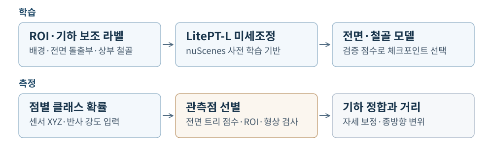
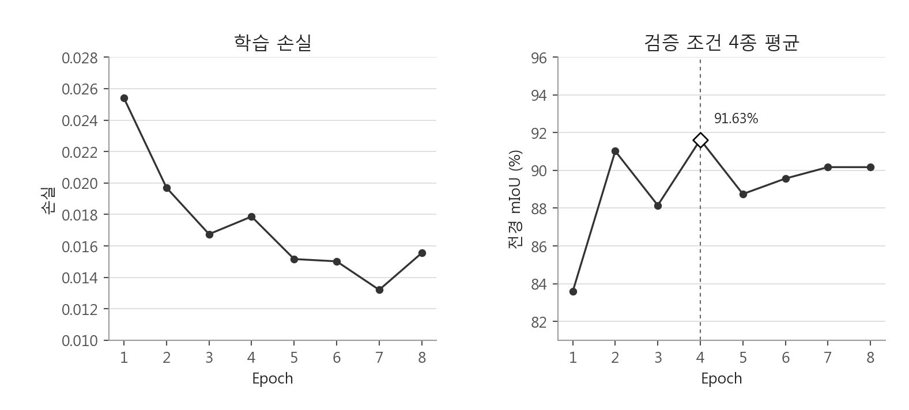
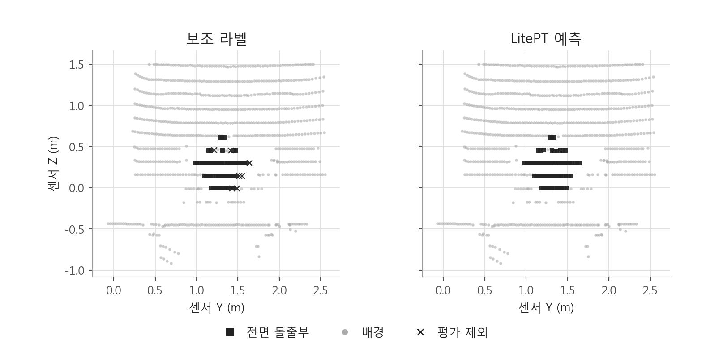
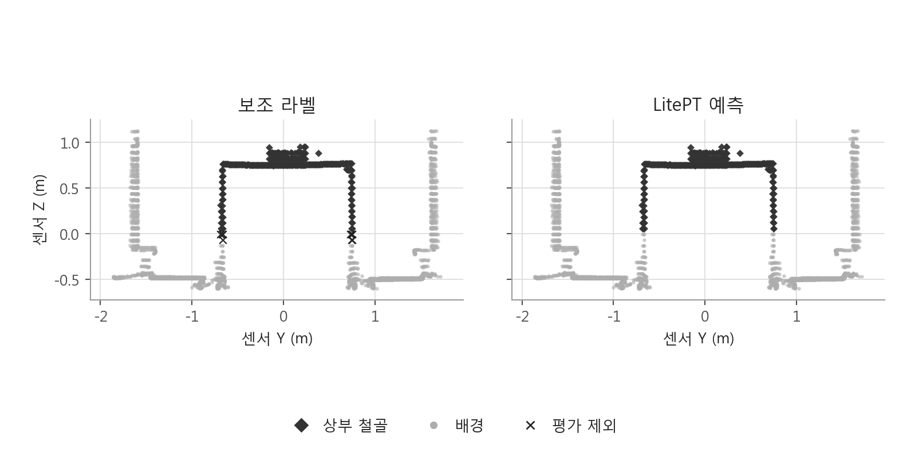
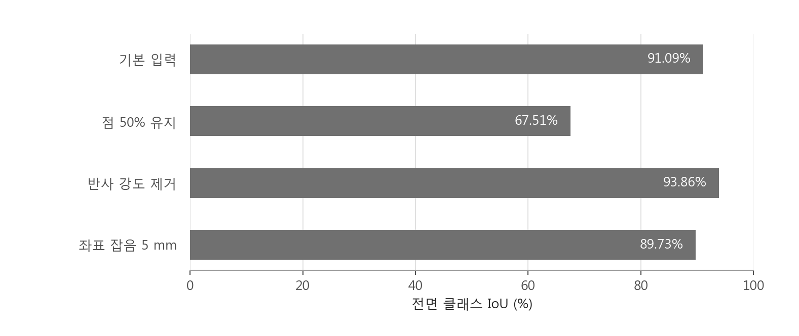
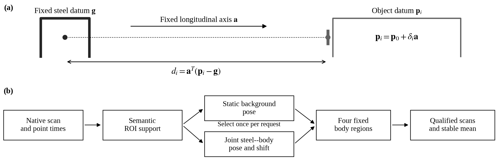
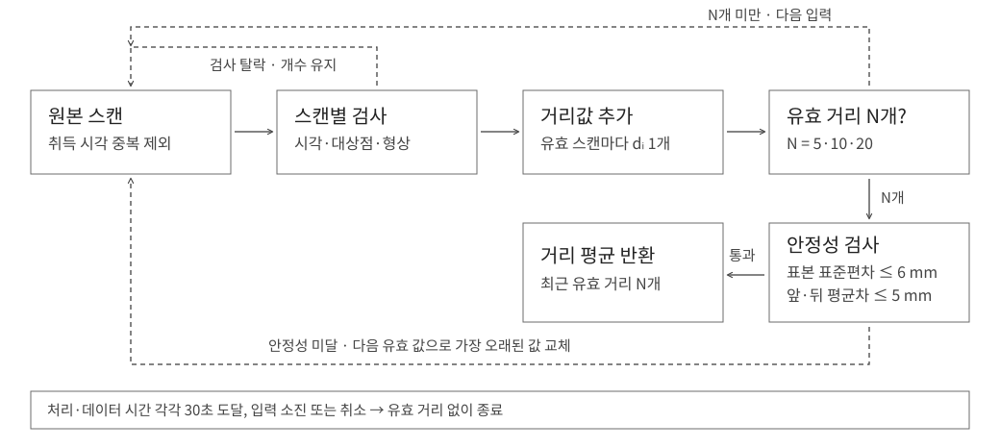
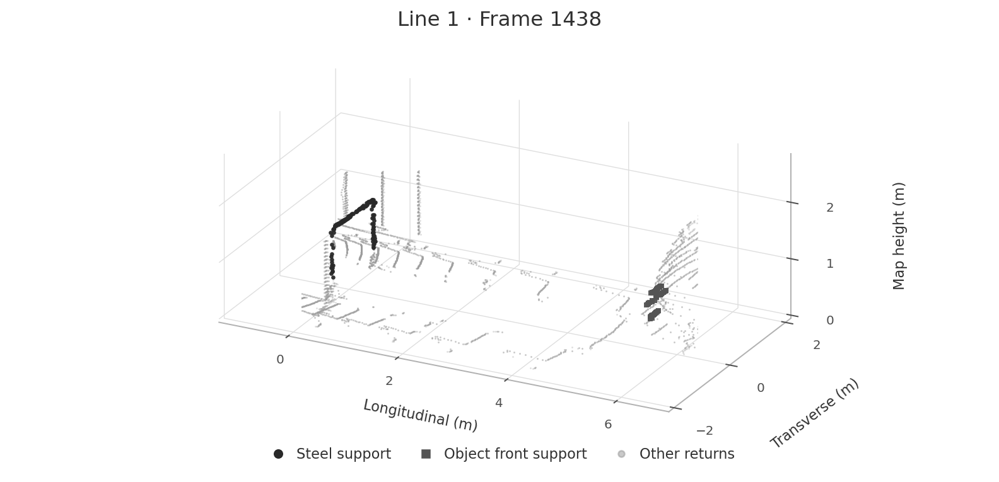

## 점 단위 분할

LitePT-L은 점군에서 전면 돌출부와 상부 철골의 관측점을 찾고, 기하 정합은 그 점들로 종방향 거리를 계산한다. 모델의 출력은 점마다 배경·전면 돌출부·상부 철골에 속할 확률이다.

*학습은 점별 분할 모델을 만들고, 측정은 선별한 관측점을 기준 형상에 정합한다.*

## 학습 라벨

LiDAR Studio에서 지정한 관심 영역(ROI)을 원본 점군에 대응시켰다. 전면은 돌출면의 깊이, 철골은 가로재와 기둥 형상으로 마스크를 만들었다. AI 보조 검토를 거친 라벨이라 독립 수작업 정답은 확보하지 않았다. [LiDAR Studio 소스](https://github.com/YooJuno/lidar_studio)

*원본 학습 라벨에서 전면 돌출부 84점을 사각형으로 표시했다.*

*원본 학습 라벨에서 상부 철골 218점을 마름모로 표시했다.*

## LitePT-L 미세조정

앞단의 희소 합성곱으로 국소 형상을 처리하고, 깊은 단계의 어텐션과 PointROPE로 점 사이 공간 관계를 반영한다. 두 체크포인트는 nuScenes 사전 학습 LitePT-L과 세 클래스 출력 구조를 사용해 각각 미세조정했다. [LitePT 논문](https://arxiv.org/abs/2512.13689v3)

| 항목 | 학습 설정 |
| --- | --- |
| 입력 | 중심화한 센서 XYZ, 반사 강도 ÷ 255, 최대 4,096점, 2.5 cm 격자 |
| 전면 관측용 | 학습 263개(기하 보조 마스크 228, 약한 ROI 라벨 35), 검증 53개, 평가 50개 |
| 철골 관측용 | 정제한 ROI 라벨 입력 239개로 별도 학습 |
| 손실·최적화 | 가중 교차 엔트로피 + 0.5 × Dice, AdamW, 백본 10⁻⁵·출력층 10⁻⁴, 코사인 스케줄·혼합 정밀도 |
| 증강 | 회전·크기 변화·좌표 잡음·점 제거·반사 강도 변경 및 제거 |

기본 입력, 점 절반, 강도 제거, 5 mm 좌표 잡음의 네 검증 조건에서 전경 mIoU를 평균해 모델을 골랐다. 전경 mIoU는 전면과 철골의 IoU 평균이다. 전면 모델은 8개 epoch 중 4번째, 철골 모델은 30개 중 23번째를 선택했다.

*전면 모델의 실제 학습 기록. 마름모는 선택된 4번째 epoch다.*

## 추론과 분할 평가

실행 시 ROI 주변 점군을 모델에 넣고 아래 조건으로 관측점을 고른다. 트리 모델은 상대 위치·이웃 구조·법선·반사 강도를 쓴다. 분할에서 배경에 속하는 대상체의 넓은 표면은 정합할 때 따로 고른다.

| 관측점 | 주요 선별 조건 |
| --- | --- |
| 전면 돌출부 | 0.25 × LitePT 확률 + 0.75 × 트리 확률 ≥ 0.65인 후보에 ROI·표면 형상 검사 |
| 상부 철골 | 별도 철골 모델의 해당 클래스 확률 ≥ 0.50 |

아래 그림은 **전면 관측용 체크포인트**의 저장 예측이다. 철골 그림도 이 체크포인트의 철골 클래스 출력이다. 두 그림과 IoU는 트리 점수 결합과 형상 검사 전 결과다.

*전면 예제 796점에서 보조 라벨(왼쪽)과 저장 예측(오른쪽)을 비교했다.*

*철골 예제 2,263점의 보조 라벨과 동일 모델 예측.*

IoU는 한 클래스에서 예측과 보조 라벨이 겹치는 점의 수를 두 집합의 합집합 크기로 나눈 값이다. 같은 개발 기록에서 학습과 모델 선택에 쓰지 않은 입력 50개를 평가했다. 점을 절반 남겼을 때 전면 IoU가 91.09%에서 67.51%로 가장 크게 줄었다.

*평가 조건별 전면 분할과 보조 라벨의 일치도.*

*최종 거리 계산에 넣은 철골 관측점(원)과 전면 관측점(사각형).*

## 자세 정합과 거리

각 점의 취득 시각에 맞춰 궤적의 이동·회전을 보간해 지도 좌표로 옮긴다. 첫 5스캔 중 4개 이상에서 배경 정합이 유효하면 고정 배경으로 자세를 잡는다. 그 외에는 철골과 대상체를 공동 정합해 자세와 변위를 함께 구한다. 요청마다 선택한 방식은 유지한다.

*정적 배경으로 자세를 제약하고, 네 표면 영역에 같은 비중을 준다.*

철골의 고정점 `g`와 대상체 기준점 `p₀`는 정지 스캔 5개의 2 cm 격자 중앙값에서 정한다. 지도 양쪽 경계 방향을 평균한 수평 단위벡터 `a`는 철골에서 대상체를 향한다. 기준 표면 네 영역의 종방향 변위를 균등 평균하고 기준점에 맞춰 보정한 값이 `δ`다.

`p = p₀ + δa`, `d = aᵀ(p − g) = d₀ + δ`

*초기 거리 d₀에 대상체의 종방향 변위 δ를 더한다.*

## 유효 프레임 검사와 누적

*스캔별 판정을 통과한 거리값만 모은 뒤, N개 값의 안정성을 검사한다.*

| 검사 | 통과 조건 |
| --- | --- |
| 취득 시각 | 지도 궤적이 각 점의 취득 시각을 포함 |
| 대상점 | 철골 ≥ 24점, 전면 ≥ 12점 |
| 대상체 표면 | ≥ 180점, 폭 ≥ 1.5 m, 높이 범위 ≥ 0.9 m |
| 각 영역 | 대응 ≥ 20점, 기준 영역 커버리지 ≥ 25%, 변위 MAD ≤ 10 mm |
| 영역 간 차이 | 최대·최소 변위 차이 ≤ 10 mm |
| 요청 완료 | 표본 표준편차 ≤ 6 mm, 시간순 앞·뒤 절반의 평균 차이 ≤ 5 mm |

취득 시각이 서로 다른 유효 원본 스캔마다 거리값을 하나씩 계산해 저장한다. **5·10·20개** 중 정한 개수에 도달하면 안정성을 검사해 평균을 반환한다. 불안정하면 다음 유효 값으로 가장 오래된 값을 교체해 다시 검사한다. 처리 시간과 데이터 시간은 각각 30초로 제한한다. 제한 도달·입력 소진·취소 시 유효 거리 없이 끝낸다.

*처음 25개 입력 중 20개가 스캔 판정을 통과한 요청.*

## 재생 결과와 연산 시간

한 시험장의 하루 개발 기록에서 정지 구간의 유효 스캔 20개 수집을 재생했다. 겹치지 않는 24개 요청의 오도메트리 변화는 10 mm·0.1° 이내였다. 2번 라인 5건은 전면 관측점 부족으로 시간 초과됐다. 독립적인 대상체 유무·가시성 기록이 없어 원인은 미확정이다. 표준편차는 채택 스캔의 산포이며, 절대 오차는 별도 측량으로 확인해야 한다.

| 라인 | 완료 / 요청 | 완료 요청별 표준편차 | 예시 평균 거리 |
| --- | ---: | ---: | ---: |
| 1 | 12 / 12 | 0.38–0.88 mm | 5.551 m |
| 2 | 0 / 5 | — | — |
| 3 | 1 / 1 | 0.55 mm | 5.373 m |
| 4 | 6 / 6 | 1.19–1.42 mm | 4.269 m |
| **전체** | **19 / 24** | **0.38–1.42 mm** | — |

*1번 라인 1438부터 모은 유효 20스캔의 평균 거리는 5.551 m였다.*

미리 읽은 입력으로 유효 스캔 20개를 모으는 연산 시간은 PC에서 6.0–31.1%, NVIDIA Thor(70 W)에서 7.8–25.9% 줄었다. CUDA 추론과 CPU 워커 4개의 기하 연산을 포함하며, 초기화·센서 대기·Nav2 동시 운용은 측정 범위 밖이다.

*막대는 3회 연산 시간의 중앙값, 검은 점은 개별 실행값.*
