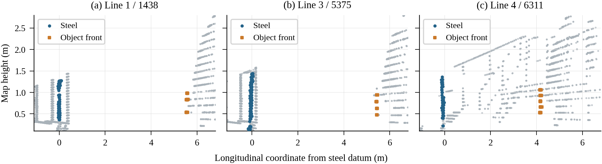
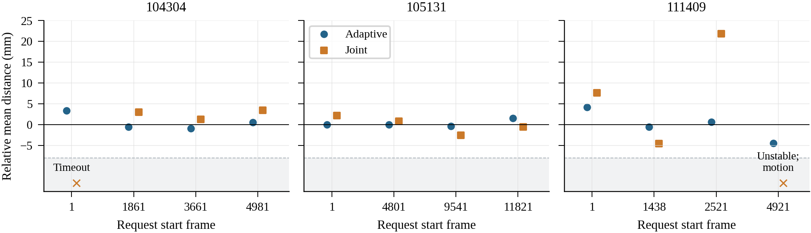

## 기준점과 종방향 거리

지도에 연결된 좌표계에서 철골 기준점 `g`, 대상체의 기준 형상에 붙인 가상점 `p₀`, 철골에서 대상체를 향하는 수평 단위벡터 `a`를 정한다. `δ`는 등록 시점에서 현재까지 추정한 대상체의 종방향 변위다.

`p = p₀ + δa`, `d = aᵀ(p − g) = d₀ + δ`

`d₀`는 등록할 때의 철골과 대상체 사이 종방향 거리이고 `d`는 현재 거리다. 두 기준점의 차이를 `a`에 투영하므로 횡방향이나 높이 차이는 계산에 포함되지 않는다. 관심 영역(ROI)은 철골과 전면 돌출부를 찾을 범위를 제한한다. 기준점의 좌표는 각 영역에서 실제로 관측한 표면으로 정한다.

*고정 철골 기준점과 대상체 기준점을 잇는 거리 정의 및 계산 흐름 개념도.*

## 기준 형상 등록

로봇이 정지하고 두 대상이 잘 보이는 구간에서 원본 스캔 5개를 골라 기준 형상을 한 번 등록했다. 철골 상부와 전면 돌출부를 지도 좌표계에 모은 뒤 2 cm 격자마다 중앙값을 구했다. 대표점의 좌표별 중앙값을 기준점으로 삼아 관측이 유난히 조밀한 부분에 위치가 치우치는 것을 줄였다.

종방향 축은 지도에 길게 이어진 양쪽 경계에서 정했다. 두 경계를 각각 직선으로 맞추고 기울기를 평균했다. 철골의 가로재·기둥과 대상체 전면의 넓은 표면도 정합용으로 저장했다. 라인별 축·기준점·형상은 공통 지도에 보관해 이후 기록에서도 그대로 사용했다. 스캔마다 다시 추정하는 값은 센서 자세 보정량과 대상체 변위다.

## 대상 분할과 라벨 검토

LiDAR Studio에서 대상체 전면 돌출부와 상부 철골을 3차원 ROI로 지정해 학습용 초기 영역을 내보냈다. 내보낸 영역을 원본 스캔에 다시 대응시켜 점 인덱스와 강도, 반환 시각을 유지했다. 전면은 평면, 철골은 가로재와 기둥을 맞춰 학습 마스크를 만들었다. 뒤쪽 표면과 하부 기둥은 배경 예로 포함하고 경계가 불확실한 점은 학습에서 제외했다.

대상체 전면 관측점을 선별하는 모델의 학습 입력 263개 중 239개의 초기 영역을 Studio에서 내보냈다. 학습 세트는 기하 보조 마스크 228개(전면 113개, 철골 115개)와 약한 ROI 라벨 35개로 구성했고, 검증 53개와 평가 50개를 별도로 뒀다. 철골 관측점 선별에 사용한 모델은 정제한 ROI 라벨을 붙인 입력 239개로 따로 학습했다. 마스크는 기하 규칙과 AI 보조 검토를 거친 라벨이며 독립 수작업 정답은 확보하지 않았다.

*원본 학습 라벨 시각화. 주황색 사각형은 전면 돌출부 84점을 표시한다.*

*원본 학습 라벨 시각화. 파란색 마름모는 상부 가로재와 기둥 218점을 표시한다.*

학습은 별도 트레이너에서 실행했다. nuScenes 사전 학습 LitePT-L에 XYZ와 반사 강도를 입력하고 최대 4,096점과 2.5 cm 격자를 사용했다. 클래스는 배경, 대상체 전면 돌출부, 상부 철골 세 가지다. 대상체의 넓은 표면은 분할 학습에서 배경에 포함되며 거리 산출 단계에서 별도로 골라 정합에 사용한다. [LiDAR Studio 소스](https://github.com/YooJuno/lidar_studio) · [기준 커밋 4107c96](https://github.com/YooJuno/lidar_studio/commit/4107c96b558ec73ccb3b418c1d66f57c43472769) · [LitePT 논문](https://arxiv.org/abs/2512.13689v3)

실행할 때는 대상체 전면 후보에 LitePT 점별 확률과 트리 모델 점수를 결합한 뒤 ROI와 표면 형상 조건을 적용한다. 상부 철골의 분할 결과와 전면 후보는 관측점을 고르는 데 쓰고, 거리는 관측된 형상을 기준 형상에 정합해 계산한다.

*1·3·4번 라인에서 거리 산출에 사용한 철골 점(원)과 대상체 전면 점(사각형).*

## 취득 시각과 자세 기준

확인한 기록에는 링 ID 32개와 원본 XYZ·반사 강도·반환별 취득 시각이 들어 있었고 스캔 빈도는 약 10 Hz였다. 한 스캔 안에서도 점이 취득된 시각은 다르다. 각 점의 시각에 맞춰 지도에 연결된 궤적의 이동과 회전을 보간한 뒤 좌표를 변환했다. 해당 시각을 궤적이 덮지 못한 관측은 제외했다.

대상체만 정합하면 센서와 대상체의 종방향 이동을 구분하기 어렵다. 이를 구분하기 위해 정적 배경이나 상부 철골로 센서 자세를 제약했다. 첫 입력 5개 중 4개 이상에서 배경 정합 조건을 통과하면 정적 배경을 자세 기준으로 쓴다. 선택한 방식은 요청이 끝날 때까지 유지한다.

- **독립 배경 정합** — 철골 뒤쪽과 바닥 가까이에서 고른 관측점을 정적 기준 점군의 표면에 맞춰 센서 자세를 먼저 정한다. 철골 일치를 확인한 뒤 대상체 변위를 추정한다.
- **철골·대상체 공동 정합** — 배경 관측이 부족하면 고정 철골의 표면과 부재 위치로 센서 자세를 제약하면서 대상체의 종방향 변위를 함께 구한다.

*1번 라인의 자세 보정용 배경 관측(왼쪽)과 기준 대상체의 네 영역에 대응된 관측점(오른쪽).*

## 대상체 변위와 유효 스캔

기준 대상체의 가로 위치와 높이 중앙값으로 표면을 네 영역으로 나눴다. 새 점은 정합된 기준점에 따라 영역을 배정한다. 각 영역에서 표면 잔차를 종방향 변위로 환산해 큰 잔차의 영향을 낮추고, 네 영역 추정치를 같은 비중으로 평균한다. 한쪽 영역에 점이 많이 찍혀도 그 영역의 최종 비중은 4분의 1이다.

몇 점만 좁게 몰리면 대상의 일부에 맞는 자세나 변위가 전체를 대표할 수 있다. 점 수와 관측 범위를 함께 확인하고, 대상체 영역마다 기준 표면을 충분히 덮는지와 추정한 변위가 서로 일치하는지를 확인했다.

| 검사 대상 | 주요 통과 조건 |
| --- | --- |
| 철골·대상체 전면 | 상부 철골 24점 이상, 전면 돌출부 12점 이상 |
| 대상체 관측 | 180점 이상, 폭 1.5 m 이상, 높이 범위 0.9 m 이상 |
| 대상체 네 영역 | 영역마다 대응점 20개 이상, 기준 영역 커버리지 25% 이상, 종방향 변위의 중앙 절대 편차(MAD) 10 mm 이하 |
| 영역 간 일치 | 네 영역 변위의 최댓값과 최솟값 차이가 10 mm 이하 |

요청에서 고르는 `N = 5, 10, 20`은 **취득 시각이 서로 다른 유효 원본 스캔의 수**다. 첫 5개 입력은 자세 기준을 선택하는 데 쓰고, 거리 표본은 스캔마다 따로 구한다. 관측을 제외한 경우에는 유효 개수를 늘리지 않고 다음 입력을 확인한다.

유효 스캔 `N`개가 모이면 거리의 표본 표준편차가 6 mm 이하이고, 시간순 앞·뒤 절반의 평균 차이가 5 mm 이하일 때 평균을 반환한다. 불안정하면 다음 유효 스캔으로 가장 오래된 표본을 교체한다. 처리 시간과 데이터 취득 시각의 제한은 각각 30초다. 어느 쪽이든 한계에 닿거나 입력이 소진되거나 요청이 취소되면 유효 거리를 반환하지 않는다.

*3번 라인의 한 요청에서 처음 20개 입력 중 16개가 통과했고, 25번째 입력까지 확인해 유효 스캔 20개를 채웠다.*

## 기록 재생 결과

2026년 11월 14일 동결한 설정으로 같은 시험장의 10월 28일 개발 기록을 재생했다. 주 평가에는 관측 구간이 겹치지 않고, 확인한 모든 입력의 오도메트리 자세가 처음 대비 10 mm·0.1° 이내인 요청 24건을 넣었다. 유효 스캔 20개를 목표로 한 요청 중 **19건이 완료**됐다.

| 라인 | 완료 / 요청 | 완료까지 확인한 입력 | 완료 요청의 표준편차 |
| --- | ---: | ---: | ---: |
| 1번 라인 | 12 / 12 | 20–23개 | 0.38–0.88 mm |
| 2번 라인 | 0 / 5 | — | — |
| 3번 라인 | 1 / 1 | 25개 | 0.55 mm |
| 4번 라인 | 6 / 6 | 20–100개 | 1.19–1.42 mm |

2번 라인 5건에서는 전면 돌출부로 분류된 관측점이 확보되지 않았고 모두 제한 시간에 도달했다. 독립적으로 기록한 대상체 유무와 가시성 주석이 없어 대상체 부재, 가림, 분할 누락 가운데 원인을 특정할 수 없다. 표의 0.38–1.42 mm는 완료된 요청에서 채택한 스캔 사이의 산포다. 절대 오차를 계산하려면 별도로 측량한 기준 거리가 필요하다.

같은 기록의 대표 요청에서 유효 스캔 20개의 평균을 비교했다. 4번 라인 시작 6551에서는 첫 20개가 모두 제외됐고, 78개를 확인한 뒤 유효 조건을 만족했다.

| 라인 / 시작 프레임 | 평균 거리 | 표준편차 | 확인한 입력 |
| --- | ---: | ---: | ---: |
| 1번 / 1438 | 5.551184 m | 0.68 mm | 20개 |
| 3번 / 5375 | 5.372706 m | 0.55 mm | 25개 |
| 4번 / 6311 | 4.268908 m | 1.29 mm | 20개 |
| 4번 / 6551 | 4.269800 m | 1.19 mm | 78개 |

## 자세 기준 비교

1번 라인의 같은 시작 지점 12곳에서 자동 선택 방식과 철골·대상체 공동 정합만 최종 자세에 사용하는 방식을 비교했다. 자동 선택은 12건, 공동 정합은 10건이 정지 구간 안에서 완료됐다. 두 방식 모두 완료된 요청만 짝지어 기록별 평균 거리의 최대–최소 범위를 구했다. 공동 정합에서 자동 선택으로 바꾸면 세 기록에서 각각 **2.19 → 1.51 mm**, **4.78 → 1.88 mm**, **26.33 → 4.72 mm**로 범위가 줄었다.

대상체 위치는 기록마다 달라질 수 있으므로, 각 기록 안에서 요청 간 일관성을 비교했다. 두 방식의 공통 초기화 단계에서는 필요할 때 배경 정합으로 철골 정합 초기값을 보조한다.

*거리의 0 mm는 기록별 자동 선택 결과의 중앙값이며, 아래쪽 × 두 개는 공동 정합으로 완료되지 않은 요청이다.*

## 점 밀도 민감도

이미 통과한 원본 스캔 140개에서 대상체 네 영역 중 하나의 점을 75%, 50%, 25%씩 남기는 변형 입력 8,400개를 만들었다. 같은 원본에서 나온 변형 입력은 하나의 현장 관측에 의존한다. 자세·초기 대상체 이동량·점 대응은 고정하고, 네 영역을 균등 평균하는 방식과 모든 점을 한데 모아 구하는 방식을 비교했다.

한 영역에서 점을 50% 남겼을 때 각 방식에서 점을 줄이기 전 추정값 대비 절대 변화량은 영역별 0.152 mm, 통합 0.171 mm였다. 두 방식에서 모두 유효한 변형의 변화량을 원본별 중앙값으로 요약한 뒤, 원본 140개의 중앙값을 구했다. 요청별로 보면 통합 방식의 변화가 더 작은 경우도 7건 중 3건이었다. 25%만 남겼을 때는 2,800개 중 209개, 원본 21개에서 나온 변형만 공통 기준을 통과했다. 이 실험은 고정한 정합 결과에서 집계 방식의 민감도를 보여준다. 실제 가림 조건에서는 대상 분할과 대응 탐색까지 함께 달라질 수 있다.

*동일한 원본에서 만든 변형을 비교한 결과, 50% 유지 조건에서 영역별 집계의 변화가 더 작은 요청은 7건 중 4건이었다.*

## 실행 시간과 검증 범위

모델을 CUDA에 유지하고 기하 연산은 재사용하는 CPU 워커 프로세스 4개에 나눴다. 결과는 스캔 취득 순으로 수집했다. 미리 읽어 둔 네 재생 구간에서 유효 스캔 20개를 구하는 연산 시간은 이전 실행 방식 대비 **PC 6.0–31.1%**, **NVIDIA Thor 70 W 7.8–25.9%** 줄었다. PC는 Core i7-14700HX와 RTX 4060 Laptop GPU를 사용했다. 같은 장치에서 비교한 두 실행 방식의 선택 스캔과 거리 결과는 일치했다.

*미리 읽어 둔 입력에서 유효 스캔 20개를 모으는 연산 시간이며, 막대는 3회 실행의 중앙값이고 검은 점은 개별 실행값이다.*

그래프의 시간에는 초기화, 파일 읽기, ROS 전송, 센서 입력 대기, 시각화가 포함되지 않는다. 이번 검증은 한 시험장의 하루 개발 기록에서 완료 여부와 스캔별 산포, 연산 시간을 확인한 결과다. 측량 기준의 절대 오차, 이후 날짜의 독립 기록, Nav2와 동시에 동작할 때의 센서 취득부터 응답까지의 지연은 후속 현장 시험에서 확인할 항목이다.
