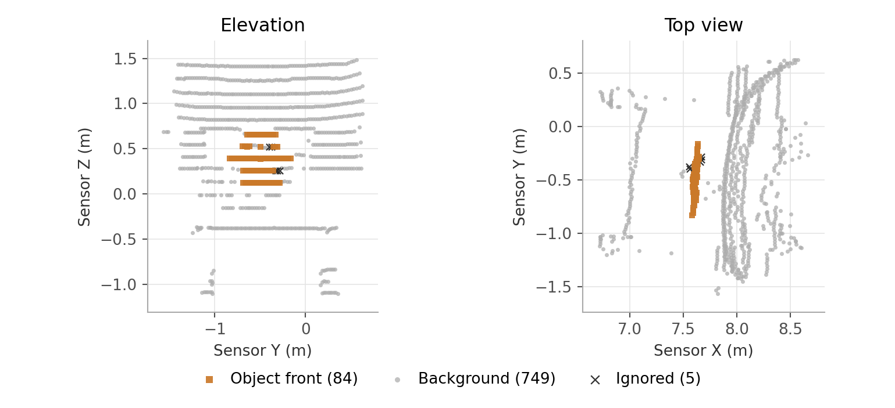
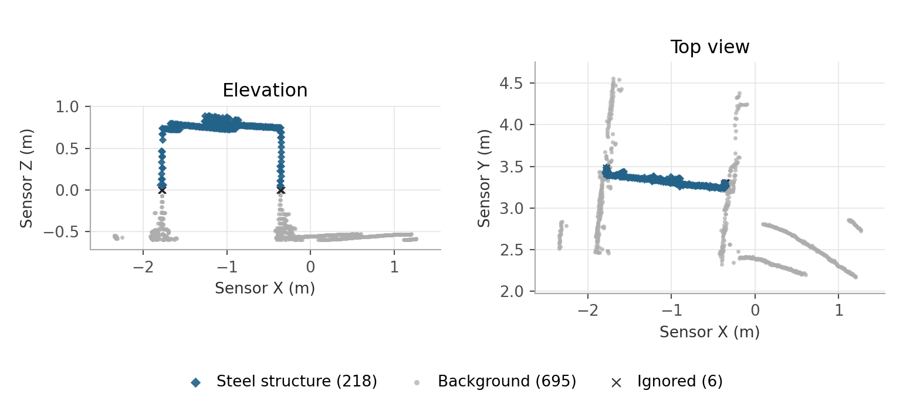
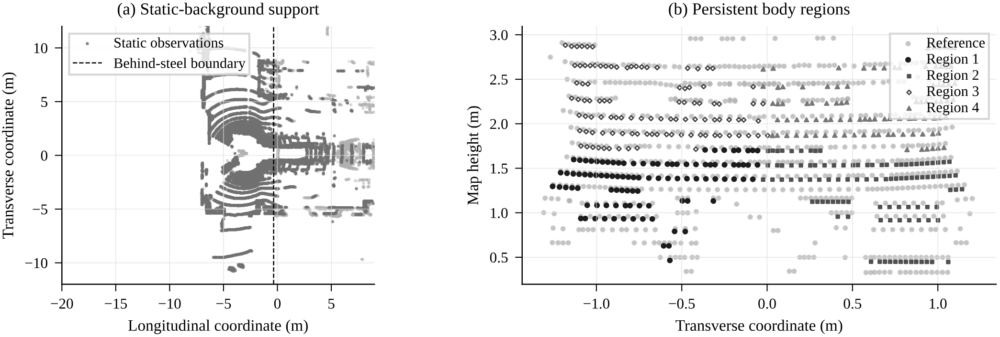
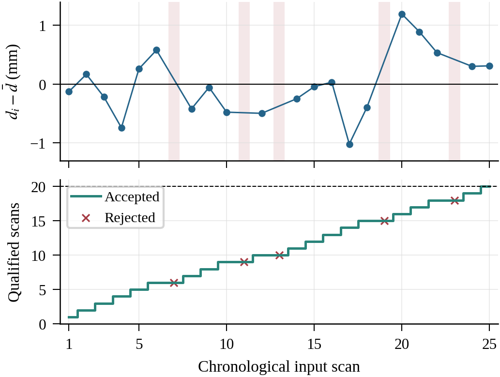
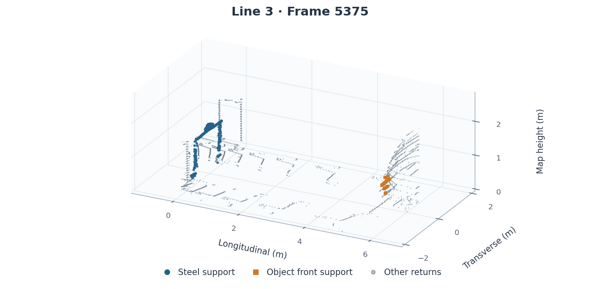
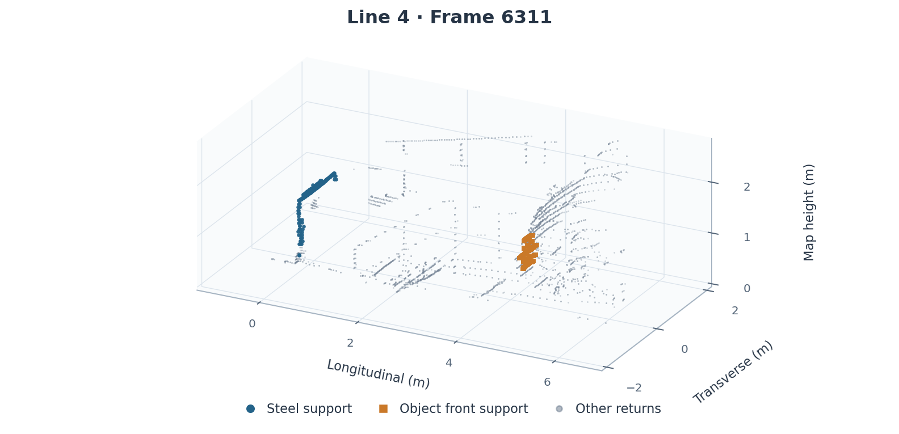
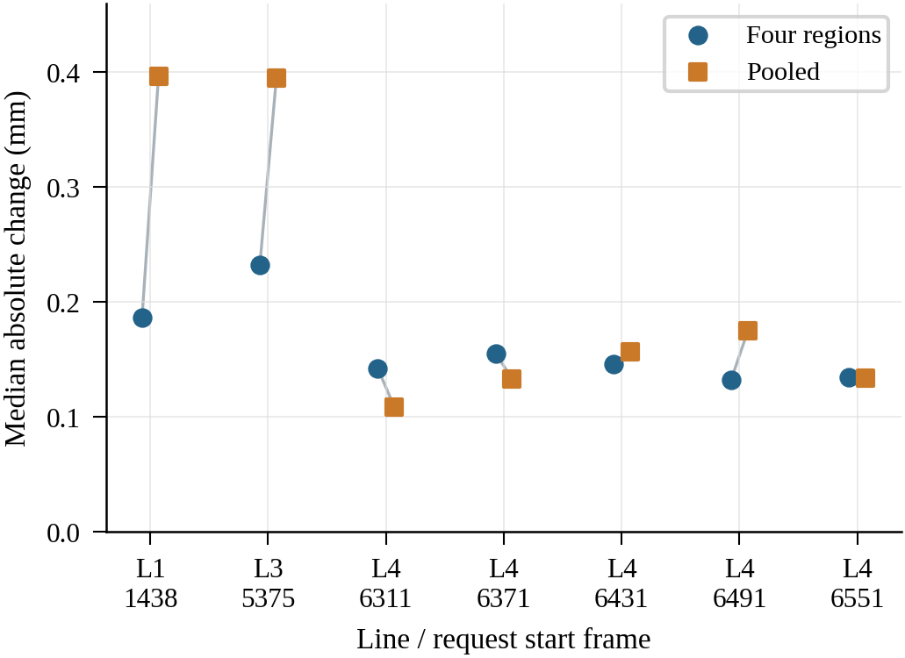
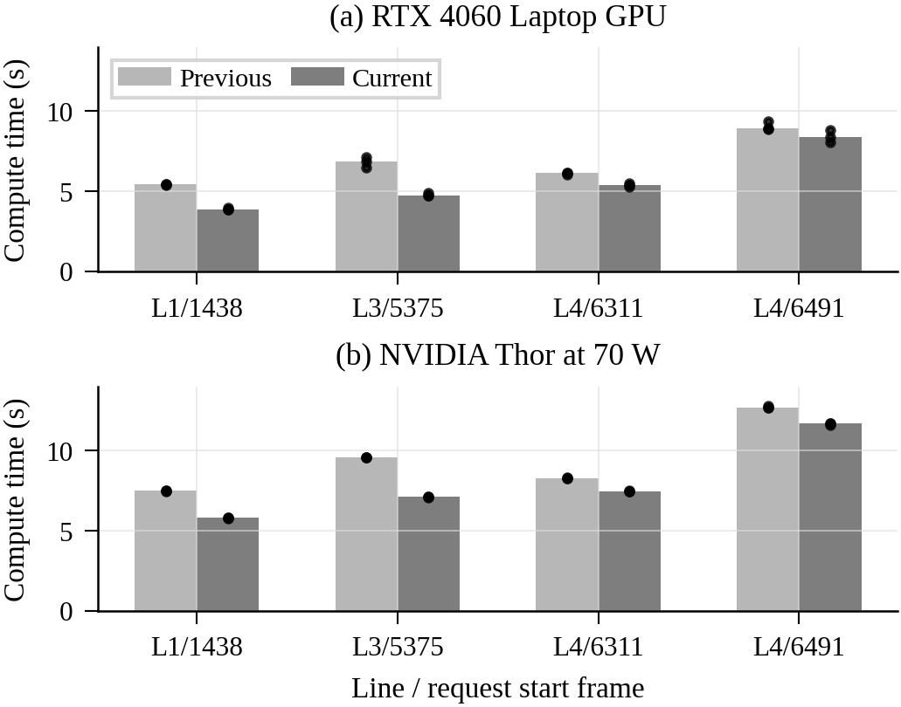

## 거리 기준

철골의 고정점 `g`와 대상체 기준 형상에 붙인 가상점 `p₀`를 등록한다. 철골에서 대상체를 향하는 수평 단위벡터 `a`는 지도 양쪽 경계의 방향을 평균해 정한다. 현재점 `p`는 종방향 변위 `δ`만큼 이동한 위치이며, 거리는 두 점의 차이를 `a`에 투영한 값이다.

`p = p₀ + δa`, `d = aᵀ(p − g) = d₀ + δ`

초기 거리 `d₀`는 정지 상태의 원본 스캔 5개에서 2 cm 격자 중앙값으로 대표점을 만든 뒤, 등록한 두 기준점으로 계산했다.

*기준점 사이의 종방향 거리와 산출 순서.*

*1번 라인·1438: 유효 20스캔 평균 거리 5.551 m. 철골 기준점은 종방향 0 m다.*

## 대상점 선별

LiDAR Studio에서 내보낸 관심 영역(ROI)과 기하 규칙으로 학습 라벨을 만들고 AI로 검토를 보조했다. 독립 수작업 정답은 확보하지 않았다. [LiDAR Studio 소스](https://github.com/YooJuno/lidar_studio)

*원본 학습 라벨에서 전면 돌출부 84점은 주황색 사각형으로 표시했다.*

*원본 학습 라벨에서 상부 철골 218점은 파란색 마름모로 표시했다.*

nuScenes 사전 학습 LitePT-L에 XYZ와 반사 강도를 넣어 배경·전면 돌출부·상부 철골을 분할한다. 전면 후보는 LitePT 확률과 트리 점수를 결합한 뒤 ROI와 표면 형상으로 거른다. 대상체의 넓은 표면은 정합 단계에서 따로 고른다. [LitePT 논문](https://arxiv.org/abs/2512.13689v3)

*같은 종방향 축척에서 비교한 철골 관측점(원)과 전면 관측점(사각형).*

## 자세 정합

각 점의 취득 시각에 맞춰 궤적의 이동과 회전을 보간하고 지도 좌표로 변환한다. 첫 스캔 5개 중 4개 이상에서 배경 정합이 유효하면 정적 배경으로 자세를 정한 뒤 대상체 변위를 구한다. 그 외에는 철골과 대상체를 공동 정합해 자세와 변위를 함께 구한다. 선택한 방식은 요청이 끝날 때까지 유지한다.

기준 표면을 가로 위치와 높이로 나눈 네 영역에서 각각 종방향 변위를 구하고, 같은 비중으로 평균한다.

*센서 자세를 제약하는 정적 배경과 변위 계산에 쓰는 대상체 네 영역.*

## 유효 스캔

| 검사 | 통과 조건 |
| --- | --- |
| 취득 시각 | 지도 궤적이 각 점의 취득 시각을 포함 |
| 대상점 | 철골 ≥ 24점, 전면 ≥ 12점 |
| 대상체 표면 | ≥ 180점, 폭 ≥ 1.5 m, 높이 범위 ≥ 0.9 m |
| 각 영역 | 대응 ≥ 20점, 기준 표면 커버리지 ≥ 25%, 변위 MAD ≤ 10 mm |
| 영역 간 일치 | 변위 최댓값과 최솟값의 차이 ≤ 10 mm |
| 요청 완료 | 표본 표준편차 ≤ 6 mm, 시간순 앞·뒤 절반 평균 차이 ≤ 5 mm |

서로 다른 취득 시각의 **유효 원본 스캔 5·10·20개**를 모은다. 탈락 스캔을 건너뛰고, 모인 거리가 불안정하면 다음 유효 스캔으로 가장 오래된 표본을 교체한다. 완료 조건을 충족하면 평균을 반환한다. 처리 시간과 데이터 취득 시각의 제한은 각각 30초다. 제한 도달, 입력 소진, 취소 시 유효 거리 없이 끝낸다.

*3번 라인 한 요청에서 25번째 입력까지 확인해 유효 스캔 20개를 채웠다.*

## 기록 재생

한 시험장의 하루 개발 기록에서 관측 구간이 겹치지 않고 오도메트리 변화가 10 mm·0.1° 이내인 요청을 재생했다. 요청마다 유효 스캔 20개를 목표로 했다.

| 라인 | 완료 / 요청 | 완료 요청별 표준편차 |
| --- | ---: | ---: |
| 1 | 12 / 12 | 0.38–0.88 mm |
| 2 | 0 / 5 | — |
| 3 | 1 / 1 | 0.55 mm |
| 4 | 6 / 6 | 1.19–1.42 mm |
| **전체** | **19 / 24** | **0.38–1.42 mm** |

2번 라인은 전면 관측점을 확보하지 못해 5건 모두 시간이 초과됐다. 대상체 유무와 가시성의 독립 기록이 없어 원인은 미확정이다. 표준편차는 채택 스캔의 산포이며, 절대 오차를 구하려면 별도 측량이 필요하다.

*3번 라인·5375: 유효 20스캔 평균 거리 5.373 m.*

*4번 라인·6311: 유효 20스캔 평균 거리 4.269 m. 세 그림의 좌표 범위는 같다.*

## 비교 결과

| 비교 | 결과 |
| --- | --- |
| 자세 기준 | 1번 라인의 같은 기록에서 두 방식 모두 완료한 요청끼리 비교. 공동 정합 → 자동 선택의 평균 거리 범위가 2.19 → 1.51 mm, 4.78 → 1.88 mm, 26.33 → 4.72 mm로 감소 |
| 점 밀도 | 한 영역 점을 50% 남겼을 때 절대 변화량 중앙값은 영역별 집계 0.152 mm, 전체 점 통합 0.171 mm. 통합의 변화가 더 작은 요청도 7건 중 3건. 25% 유지 시 변형 2,800개 중 209개 통과 |
| 연산 시간 | 유효 스캔 20개 기준 PC 6.0–31.1%, NVIDIA Thor(70 W) 7.8–25.9% 감소. 같은 장치에서 선택 스캔과 거리는 일치 |

*기록별 자동 선택 결과의 중앙값을 0 mm로 놓았고, ×는 공동 정합 미완료다.*

두 방식 모두 철골 정합을 시작할 때 필요에 따라 배경 정합 결과를 쓴다.

유효 스캔 140개에서 여러 번 점을 덜어 변형 8,400개를 만들었다. 자세·초기 변위·점 대응을 고정하고 각 방식에서 점을 줄이기 전 추정값과 비교했다.

*원본별 변화량 중앙값을 요청별로 비교했다.*

연산 시간은 CUDA 추론과 CPU 워커 4개의 기하 연산을 포함한다. 초기화·파일 읽기·ROS 전송·센서 대기·시각화는 제외했으며, Nav2 동시 운용 지연은 측정 범위 밖이다.

*미리 읽은 입력으로 유효 스캔 20개를 처리한 시간이며, 막대는 3회 중앙값, 검은 점은 개별 실행값이다.*
