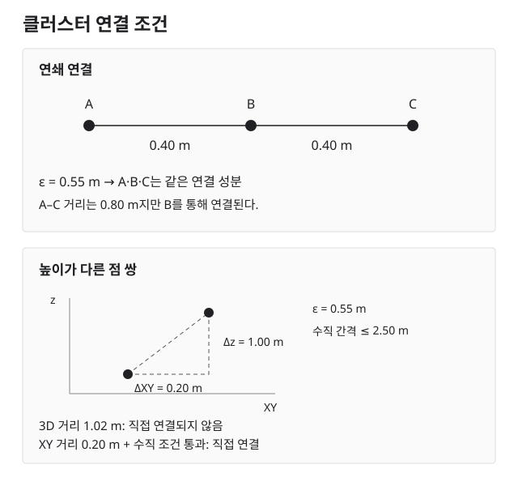
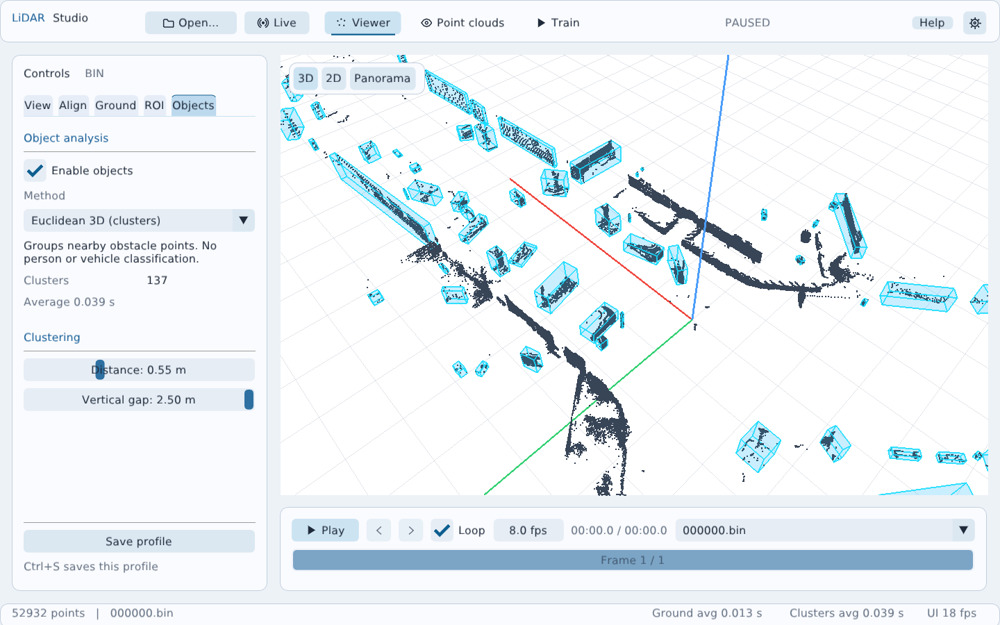
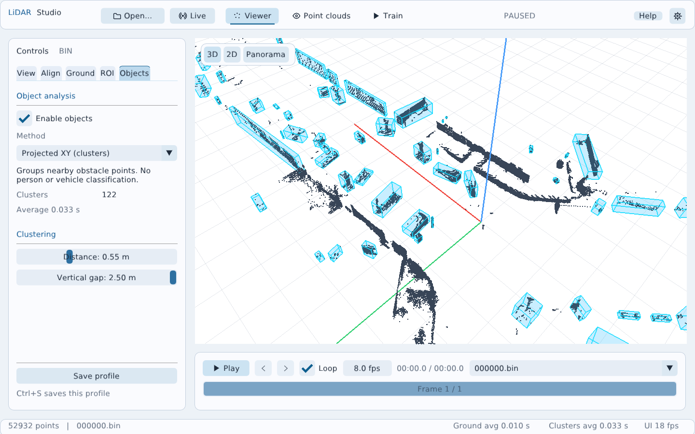

클러스터링은 **주변 점들을 연결해 하나의 점 집합으로 묶는 작업**이다. 묶음의 위치·크기는 구할 수 있지만, 그것이 사람인지 차량인지는 별도의 판단이다.

LiDAR Studio의 Euclidean 3D·Projected XY 구현을 기준으로 거리 조건, 탐색 구조, 박스 추정과 튜닝을 정리한다. 기준 소스는 [`4107c96`](https://github.com/YooJuno/lidar_studio/tree/4107c96b558ec73ccb3b418c1d66f57c43472769)이다.

**LiDAR 시리즈**

- [지면 분리 — GSeg3D·FugSeg](/blog/lidar-ground-segmentation/)
- **포인트 클라우드 클러스터링** — 현재 글
- [3D 객체 검출 — CenterPoint](/blog/lidar-object-detection/)

<details class="post-toc" id="목차">
<summary>목차</summary>

1. [입력과 출력](#1-입력과-출력)
2. [거리와 연결 성분](#2-거리와-연결-성분)
3. [3D·XY·밀도 기반 군집화](#3-3dxy밀도-기반-군집화)
4. [공간 해시와 박스 추정](#4-공간-해시와-박스-추정)
5. [주요 파라미터](#5-주요-파라미터)
6. [실제 화면과 비교 절차](#6-실제-화면과-비교-절차)
7. [오류 진단과 검증](#7-오류-진단과-검증)
8. [참고 자료](#8-참고-자료)

</details>

## 1. 입력과 출력

LiDAR Studio의 기하 처리 경로는 다음과 같다.

```text
원시 점군 → 좌표·높이 정렬 → 지면 분리
  → 비지면 점군 → 군집화 → 점 수·크기 필터 → 클러스터 박스
```

| 항목 | 내용 |
| --- | --- |
| 입력 | 같은 프레임·좌표계의 비지면 xyz 점 |
| 출력 | 클러스터별 입력 인덱스, 축 정렬 박스, 조건부 회전 박스 |
| 포함하지 않는 정보 | 사람·차량 클래스, 학습 모델의 점수, 프레임 사이 동일 객체 ID |

지면이 남으면 서로 다른 물체가 바닥 점을 통해 연결될 수 있다. 반대로 지면 분리가 물체 하단까지 제거하면 하나의 물체가 여러 군집으로 나뉠 수 있다. **군집화 파라미터보다 입력 분리 결과를 먼저 확인**한다.

앱에서는 클러스터링을 켤 때 지면 분리를 함께 활성화한다. Display ROI는 전체 비지면에서 구한 군집의 표시를 제한하는 후단 처리다. 화면에 보이는 ROI 경계를 곧바로 군집화 입력 경계로 해석하면 안 된다. [화면 처리 코드](https://github.com/YooJuno/lidar_studio/blob/4107c96b558ec73ccb3b418c1d66f57c43472769/src/viewer_app.cpp), [기하 파이프라인](https://github.com/YooJuno/lidar_studio/blob/4107c96b558ec73ccb3b418c1d66f57c43472769/src/algorithms/pipeline.cpp).

## 2. 거리와 연결 성분

### 2.1 이웃 관계

각 점을 정점으로, 거리 조건을 만족하는 점 쌍을 간선으로 보면 군집은 그래프의 **연결 성분**이다. 방문하지 않은 점에서 시작해 이웃을 큐에 넣고 더 이상 확장되지 않을 때 하나의 군집을 끝낸다.

**클러스터의 지름이 거리 임계값보다 작아야 하는 것은 아니다.** A–B, B–C가 각각 연결되면 A–C가 멀어도 같은 군집이다. 가느다란 잡음 점의 연결 때문에 두 차량이 합쳐지는 현상도 이 전이성으로 설명할 수 있다. [PCL Euclidean Cluster Extraction](https://pointclouds.org/documentation/tutorials/cluster_extraction.html).



그림은 연결 조건을 설명하기 위한 개념도이며 실제 센서 결과가 아니다.

### 2.2 거리별 임계값

LiDAR는 같은 각도 간격으로 관측해도 멀수록 점 사이의 공간 간격이 커진다. 작은 각도 간격 `Δθ`에서 횡방향 간격은 대략 `r × Δθ`다. 고정 임계값은 원거리 물체를 과분할할 수 있다.

현재 구현은 수평 거리 `r`에 따라 임계값을 늘리되 상한을 둔다.

```text
r = sqrt(x² + y²)
ε(r) = min(ε_max, ε_base + scale × r)

점 i, j의 연결 반경 = max(ε(r_i), ε(r_j))
```

설정 파일의 `ε_base=0.55 m`, `scale=0.006`, `ε_max=1.15 m`를 대입하면 다음과 같다. 실측 최적값이 아니라 **설정의 계산 예시**다.

| 수평 거리 | 연결 임계값 |
| --- | --- |
| 10 m | 0.61 m |
| 50 m | 0.85 m |
| 100 m 이상 | 1.15 m |

두 점의 임계값 중 큰 값을 사용하므로 이웃 관계가 대칭이다. 먼 점에서 가까운 점으로 탐색할 때만 연결되는 식의 방향 의존성을 피한다. 상한을 과도하게 키우면 원거리의 인접 물체가 합쳐질 수 있다. [거리·이웃 판정 구현](https://github.com/YooJuno/lidar_studio/blob/4107c96b558ec73ccb3b418c1d66f57c43472769/src/algorithms/clustering.cpp).

## 3. 3D·XY·밀도 기반 군집화

### 3.1 앱의 두 가지 거리 기준

| 방식 | 연결 조건 | 적합한 비교 장면 |
| --- | --- | --- |
| Euclidean 3D | `Δx² + Δy² + Δz² ≤ ε²`, 별도의 수직 간격 제한 | 위아래로 떨어진 구조·입체적인 물체 |
| Projected XY | `Δx² + Δy² ≤ ε²`, 별도의 수직 간격 제한 | 수직 점 간격이 커서 물체가 끊기는 장면 |

두 방식 모두 `|Δz| ≤ max_vertical_gap_m`도 만족해야 한다. Projected XY는 높이 정보를 완전히 버리는 방식이 아니라 **수평 거리와 수직 간격을 따로 제한하는 방식**이다. 저장 설정의 `euclidean_3d`는 3D, `euclidean`은 Projected XY에 해당한다.

예를 들어 수평 간격이 `0.20 m`, 높이 차이가 `1.00 m`, 연결 반경이 `0.55 m`, 수직 허용 간격이 `2.50 m`라면:

- 3D 거리 약 `1.02 m`: Euclidean 3D에서는 직접 연결되지 않는다.
- XY 거리 `0.20 m`, 높이 조건 통과: Projected XY에서는 직접 연결된다.

이는 **한 점 쌍의 판정**이다. 3D에서도 중간 높이의 점이 이어지면 전체 군집은 연결될 수 있다. XY에서는 지붕·교량·식생이 아래 물체와 합쳐지는지 확인한다.

### 3.2 DBSCAN과의 차이

DBSCAN은 반경 `eps` 안의 이웃 수가 `min_samples` 이상인 **핵심점(core point)**에서 군집을 확장한다. 핵심점에 연결된 경계점과 잡음도 구분한다. Open3D API에서는 이 밀도 기준을 `min_points`라고 부르며 잡음 라벨은 `-1`이다. [Open3D DBSCAN](https://www.open3d.org/docs/release/tutorial/geometry/pointcloud.html#dbscan-clustering), [DBSCAN 원논문](https://cdn.aaai.org/KDD/1996/KDD96-037.pdf).

LiDAR Studio의 `min_cluster_size`는 **연결 성분을 모두 구한 뒤 적용하는 전체 점 수 필터**다. 주변 밀도를 확인하는 DBSCAN의 핵심점 조건과 다르다. 현재 앱에 DBSCAN이 구현돼 있다는 뜻도 아니다.

## 4. 공간 해시와 박스 추정

### 4.1 격자 해시

모든 점 쌍의 거리를 비교하면 후보 쌍이 빠르게 늘어난다. 현재 CPU 구현은 XY 공간을 셀로 나누고, 각 셀에 들어간 점 인덱스를 해시 맵에 저장한다.

```text
셀 좌표 = (floor(x / cell_size), floor(y / cell_size))
셀 조회 → 이웃 후보 → 실제 거리·높이 검사 → 큐 확장
```

`grid_cell_m`은 탐색용 자료구조의 셀 크기다. **복셀 다운샘플링처럼 점을 대표점 하나로 합치지 않는다.** 실제 셀 폭에는 최소 폭·최대 탐색 반경에 따른 보정이 적용되므로 설정값이 항상 그대로 쓰이는 것도 아니다.

NaN·Inf나 인덱스 범위를 벗어나는 좌표는 확장에서 제외한다. 선택적 CUDA 경로는 셀 배정을 돕고, 연결 확장과 박스 처리는 이 C++ 경로에서 수행한다. `use_cuda=true`만으로 전체 군집화가 GPU에서 실행된다고 해석하지 않는다.

### 4.2 AABB와 회전 박스

| 출력 | 계산 | 주의점 |
| --- | --- | --- |
| AABB | 각 축의 좌표 최솟값·최댓값 | 물체가 회전하면 빈 공간을 많이 포함 |
| 수평 회전 박스 | XY convex hull의 변 방향별 외접 사각형 중 최소 면적 선택, z는 높이 범위 | 관측된 표면을 감싸는 박스이며 전체 물체 치수·진행 방향과 다를 수 있음 |

회전 박스를 항상 사용하는 것은 아니다. 현재 구현은 점 수 24개 미만, 짧은 변 `0.35 m` 미만, 종횡비 `1.35` 미만 등의 조건에서 불안정한 방향 대신 AABB로 돌아간다. 이는 **앱의 안정화 규칙**이며 일반적인 OBB의 정의는 아니다.

가려진 차량의 한 면만 보이면 박스가 실제 차체보다 작게 잡힐 수 있다. 박스 긴 축에는 앞·뒤 구분도 없으므로 이를 차량의 이동 방향으로 바로 쓰지 않는다. [박스·크기 필터 구현](https://github.com/YooJuno/lidar_studio/blob/4107c96b558ec73ccb3b418c1d66f57c43472769/src/algorithms/clustering.cpp).

## 5. 주요 파라미터

| 설정 | 의미 | 조정 시 확인 |
| --- | --- | --- |
| `tolerance_m` | 기본 연결 반경, m | 작으면 과분할, 크면 인접 물체 병합 |
| `range_tolerance_scale` | 수평 거리당 반경 증가량 | 원거리 분할과 병합의 균형 |
| `max_tolerance_m` | 거리 적응 반경 상한, m | 멀리 있는 물체 사이의 연결 |
| `max_vertical_gap_m` | 이웃 점 쌍의 최대 높이 차이, m | 위아래 구조의 병합 |
| `grid_cell_m` | 공간 해시 셀 크기, m | 탐색 비용과 메모리; 점 수 축소 아님 |
| `min_cluster_size`·`max_cluster_size` | 완성된 군집의 점 수 범위 | 작은 물체 누락·큰 구조 제외 |
| `min_height_m`·`max_height_m` | 군집의 `max(z)-min(z)` 범위 | 지면에서의 절대 높이가 아님 |
| 폭·길이 범위 | 회전 박스 또는 AABB 기반 크기 필터 | 가림·회전·부분 관측의 영향 |

다음은 저장소 `config/algorithms.yaml`의 군집화 부분 중 핵심 값이다. **앱 설정 파일 형식이며 ROS 파라미터 YAML이 아니다.** UI의 Distance·Vertical gap은 각각 `tolerance_m`·`max_vertical_gap_m`을 조절한다. 거리 적응·점 수·크기 범위까지 모두 UI에 노출하는 것은 아니다.

```yaml
clustering:
  enabled: true
  use_cuda: false
  mode: euclidean_3d
  tolerance_m: 0.55
  grid_cell_m: 0.25
  range_tolerance_scale: 0.006
  max_tolerance_m: 1.15
  max_vertical_gap_m: 2.5
  min_cluster_size: 8
  max_cluster_size: 20000
```

프로파일에는 일부 값이 `clustering_mode`, `clustering_tolerance_m`, `clustering_vertical_gap_m` 같은 키로 저장된다. YAML의 키와 프로파일 키를 혼용하지 않는다. [설정 원문](https://github.com/YooJuno/lidar_studio/blob/4107c96b558ec73ccb3b418c1d66f57c43472769/config/algorithms.yaml).

## 6. 실제 화면과 비교 절차



**Euclidean 3D.** 공개 Patchwork++ 예제 `000000.bin`의 동일 프레임을 사용했다. FugSeg 비지면에 기하 박스를 표시했으며 학습 모델 검출은 껐다.



**Projected XY.** 입력·지면 분리·시점은 같고 거리 기준만 바꾼 화면이다. 장면에서 결과가 비슷해 보여도 두 거리 규칙이 같다는 뜻은 아니다.

비교할 때는 다음 순서로 확인한다.

1. 프레임을 멈추고 Align·Ground에서 지면과 비지면을 점검한다.
2. Objects → Enable objects → Euclidean 3D 또는 Projected XY를 선택한다.
3. Distance를 바꾸며 한 물체가 끊기는 곳과 이웃 물체가 붙는 곳을 찾는다.
4. 같은 시점에서 Vertical gap을 바꾸고 상하 구조의 병합을 확인한다.
5. 근거리·원거리, 가림, 낮은 물체를 포함한 여러 프레임에서 재확인하고 프로파일을 저장한다.

두 화면은 ROS 없는 CPU 빌드의 실제 실행 결과다. 정답 라벨·정확도·실시간 처리 성능을 측정한 자료가 아니다. [앱 사용 안내](/utilities/lidar-studio/), [화면 출처·데이터 이용 조건](/content/images/blog/lidar-study/SOURCE.md).

## 7. 오류 진단과 검증

| 현상 | 우선 점검 | 구분할 문제 |
| --- | --- | --- |
| 두 물체가 한 박스에 들어감 | 지면 잔존·중간 연결점·과한 거리 반경 | 최대 점 수를 낮춰도 병합 자체가 풀리지는 않음 |
| 한 물체가 여러 박스로 나뉨 | 원거리 점 간격·가림·작은 반경·지면 과제거 | 반경만 키우면 이웃 물체가 합쳐질 수 있음 |
| 작은 물체가 통째로 사라짐 | 최소 점 수·최소 높이·폭·길이 | 미연결과 후단 필터 탈락을 구분 |
| 교량·식생이 아래 물체와 붙음 | XY 투영·수직 간격·연쇄 연결 | 3D 방식과 비교 |
| 박스 방향이 흔들림 | 성긴 점·거의 정사각형·가려진 표면 | 실제 회전인지 외접 박스 변화인지 구분 |
| 프레임마다 순번이 바뀜 | 출력 순서와 추적 ID 혼동 | 단일 프레임 군집에는 지속 ID가 없음 |

검증 데이터에는 물체별 정답 점 집합 또는 박스를 별도로 준비한다. 거리별 **과분할·병합·군집 누락**, 박스 크기·방향 오차와 처리 지연을 나눠 기록한다. 군집 수가 적거나 박스가 보기 좋다는 이유만으로 결과가 정확하다고 판단하지 않는다.

현재 글의 수식 대입과 화면 비교는 동작 설명이다. 여러 장면의 정답 주석을 이용한 정확도 평가는 별도 작업이다.

## 8. 참고 자료

- [LiDAR Studio `clustering.cpp`](https://github.com/YooJuno/lidar_studio/blob/4107c96b558ec73ccb3b418c1d66f57c43472769/src/algorithms/clustering.cpp): 대칭 거리 적응·공간 해시·연결 확장·회전 박스·크기 필터.
- [파라미터 정의](https://github.com/YooJuno/lidar_studio/blob/4107c96b558ec73ccb3b418c1d66f57c43472769/include/lidar_viewer/algorithms/clustering.hpp), [설정 YAML](https://github.com/YooJuno/lidar_studio/blob/4107c96b558ec73ccb3b418c1d66f57c43472769/config/algorithms.yaml).
- [PCL Euclidean Cluster Extraction](https://pointclouds.org/documentation/tutorials/cluster_extraction.html): 이웃 탐색과 flood-fill 방식의 기준 설명.
- [Ester 외, DBSCAN, KDD 1996](https://cdn.aaai.org/KDD/1996/KDD96-037.pdf), [Open3D 구현 사용법](https://www.open3d.org/docs/release/tutorial/geometry/pointcloud.html#dbscan-clustering): 밀도 조건·잡음 라벨과의 비교.
- [화면 출처·데이터 이용 조건](/content/images/blog/lidar-study/SOURCE.md): 공개 예제, 캡처 조건, 원본 고지.

**다음 글:** [3D 객체 검출 — CenterPoint](/blog/lidar-object-detection/)
