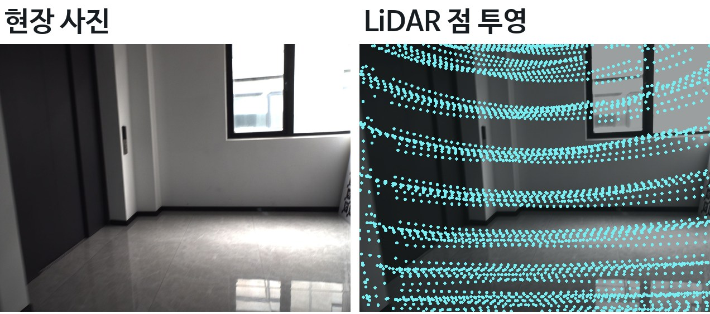
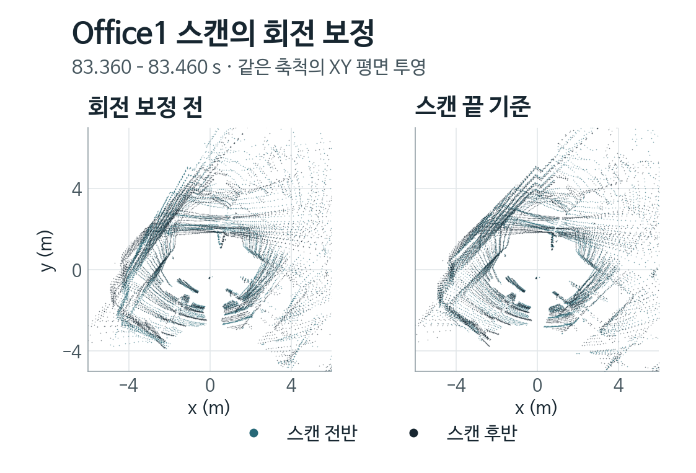
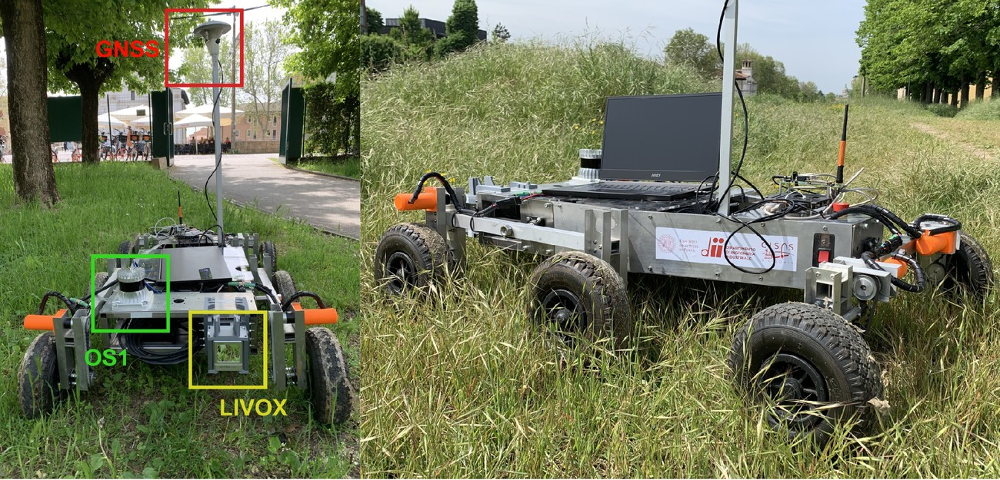
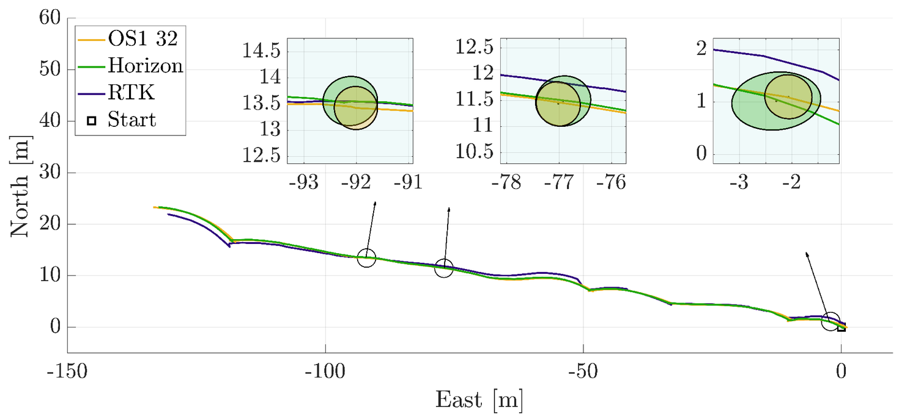

**LIO**(LiDAR–Inertial Odometry)는 IMU와 LiDAR로 3차원 위치·회전을 추정한다. **IMU 전파 → 스캔 왜곡 보정 → LiDAR 정합**.

*복도 사진에 촬영 시각 ±48 ms의 LiDAR 점 투영. [Zhang 외, Office3][office3] · [CC BY 4.0][cc-by]*

## IMU 상태 전파

- 자이로 · 바이어스 보정 후 각속도 적분, 회전 예측.
- 가속도계 · 바이어스 보정·좌표 변환·중력 반영 후 속도·위치 적분. [FAST-LIO2 논문 IV절][fast-lio2]

*Livox MID-360 내장 IMU 실측값. 음영은 점군 비교 구간. [Zhang 외, Office1][office1] · [CC BY 4.0][cc-by]*

## 스캔 왜곡 보정 (Deskew)

- 점마다 취득 시각이 달라 센서가 움직이면 벽이 휘어 보임.
- IMU로 추정한 점별 상대 자세로 공통 시각에 정렬. FAST-LIO2는 스캔 끝 기준. [FAST-LIO2 논문 IV절][fast-lio2]

*약 100 ms 동안 자이로 적분 기준 14.8° 회전한 구간. 오른쪽은 회전 성분만 보정. [Zhang 외, Office1][office1] · [CC BY 4.0][cc-by]*

## 점–평면 정합

- 예측 자세로 옮긴 스캔 점 `p`를 참조 점군의 가까운 평면에 대응.
- 평면 위의 점 `q`, 단위 법선 `n`으로 부호 있는 수직 잔차 `r = nᵀ · (p − q)` 계산. 잔차가 줄도록 자세 갱신. [FAST-LIO2 논문 IV절][fast-lio2]
- 벽과 평행한 이동에서는 잔차가 그대로. 평행한 벽만 보이는 복도는 진행 방향 보정이 약함. [LION 논문][lion]

## 대표 구현

- **FAST-LIO2** · 점–평면 잔차를 반복 확장 칼만 필터에 직접 반영. [논문][fast-lio2] · [시연][fast-lio2-demo]
- **LIO-SAM** · 모서리·평면 정합으로 구한 상대 자세와 IMU 사전 적분을 팩터 그래프에서 결합. [논문][lio-sam] · [시연][lio-sam-demo]

## FAST-LIO2 주행 결과

*FAST-LIO2를 시험한 MORPHEUS 로버와 LiDAR 장착 위치. [Fortuna 외, 그림 2a 발췌][fast-lio2-experiment] · [CC BY 4.0][cc-by]*

*GNSS RTK 좌표계에 정렬한 OS1-32·Horizon의 FAST-LIO2 추정 궤적. [Fortuna 외, 그림 4b 발췌][fast-lio2-experiment] · [CC BY 4.0][cc-by]*

## ROS 2 bag 점검

- **점별 시각** · `time`·`t`·`offset_time` 등 필드의 단위와 기준 시각. [FAST-LIO 입력 설정][fast-lio-input]
- **동기화** · LiDAR와 IMU의 시계 오프셋, 스캔 구간을 덮는 IMU 측정. [LI-Init 논문][li-init]
- **외부 보정과 단위** · LiDAR→IMU 변환 방향과 축. 자이로 `rad/s`, 가속도계 `m/s²`로 변환. [FAST-LIO 입력 설정][fast-lio-input] · [ROS REP-145][rep-145]

[fast-lio2]: https://arxiv.org/html/2107.06829
[lio-sam]: https://arxiv.org/html/2007.00258
[lion]: https://arxiv.org/html/2102.03443#S3.SS2
[fast-lio2-demo]: https://youtu.be/2OvjGnxszf8
[lio-sam-demo]: https://youtu.be/A0H8CoORZJU
[fast-lio2-experiment]: https://www.mdpi.com/1424-8220/25/17/5352
[office1]: https://huggingface.co/datasets/xiaofan0100/Elevator-LIO-Dataset/blob/main/Office1.bag
[office3]: https://huggingface.co/datasets/xiaofan0100/Elevator-LIO-Dataset/blob/main/Office3.bag
[cc-by]: https://creativecommons.org/licenses/by/4.0/
[fast-lio-input]: https://github.com/hku-mars/FAST_LIO#3-directly-run
[li-init]: https://arxiv.org/abs/2202.11006
[rep-145]: https://github.com/ros-infrastructure/rep/blob/master/rep-0145.rst#data-reporting
