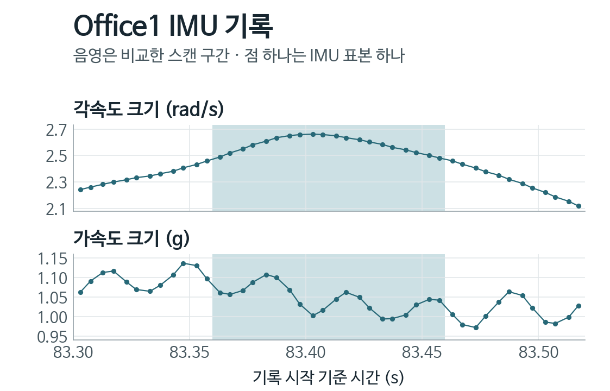
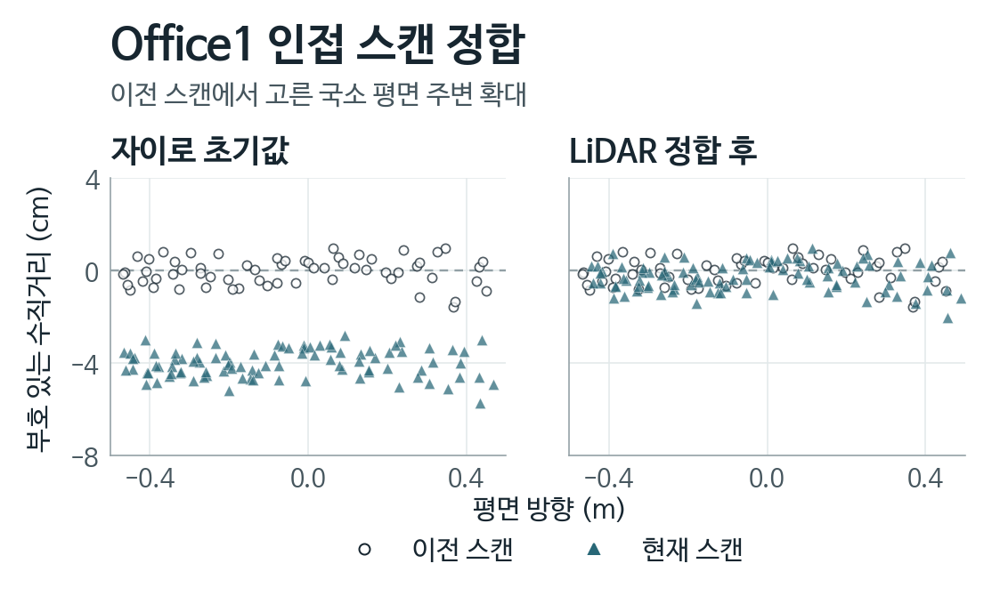
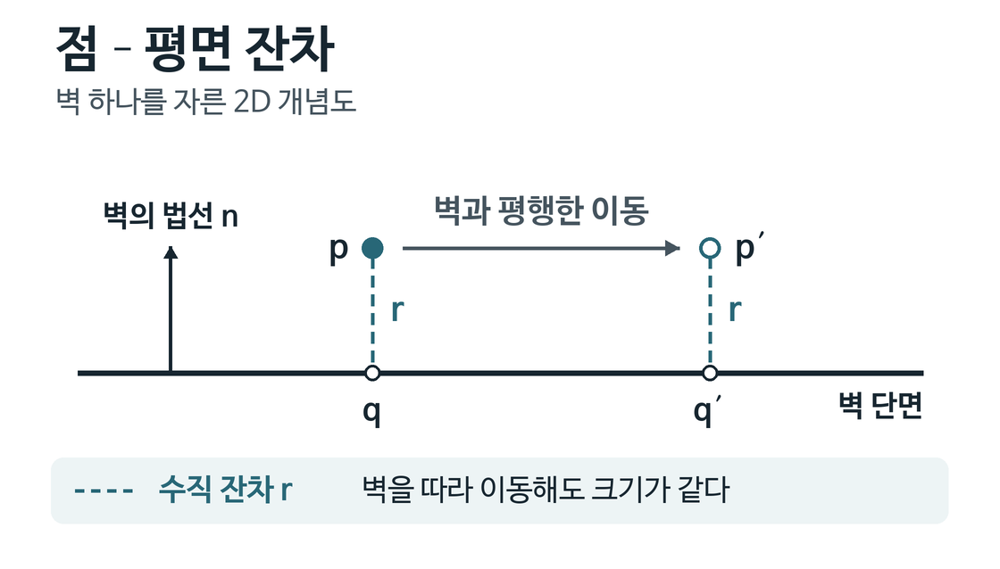

**LIO**(LiDAR–Inertial Odometry)는 IMU와 LiDAR로 위치와 회전을 추정한다. FAST-LIO2처럼 스캔 단위로 처리하는 방식은 먼저 IMU로 스캔 끝 자세를 예측한다. 그 사이의 움직임으로 점들의 좌표를 맞춘 뒤, 앞서 본 벽과 바닥에 정합해 예측 자세를 고친다. [FAST-LIO2 논문 IV절][fast-lio2]

Office1 기록의 83.360–83.460초 구간에서는 LiDAR 패킷 5개를 한 스캔으로 묶었다. 이 100 ms 동안 내장 IMU가 20번 값을 기록했고, 자이로를 적분한 회전량은 14.8°였다. [Zhang 외, Office1][office1] · [CC BY 4.0][cc-by]

## IMU 전파

직전 스캔에서 보정한 **위치·회전·속도**에서 시작한다. 자이로로 각속도를 읽을 때마다 바이어스를 빼고 짧은 시간 간격만큼 적분해 회전을 갱신한다. 가속도계의 값도 바이어스를 뺀 뒤, 갱신한 회전으로 오도메트리 좌표계에 옮기고 중력 벡터를 더한다. 이렇게 얻은 가속도를 적분해 속도와 위치를 이어 간다. [FAST-LIO2 논문 IV-A절][fast-lio2-model]



*음영은 아래에서 왜곡을 보정한 스캔의 시작과 끝을 표시한다.*

자이로에 작은 바이어스가 남으면 샘플을 적분할 때 회전 오차가 쌓인다. 기울기 추정이 틀어지면 중력을 보정한 뒤에도 수평 가속도처럼 보이는 오차가 남는다. [LIO-SAM 논문 III-B절][lio-sam-imu]

## 스캔 왜곡 보정

한 스캔의 첫 점과 마지막 점은 서로 다른 LiDAR 좌표계에서 찍힌다. 가령 회전축에서 5 m 떨어진 점은 센서가 제자리에서 14.8° 돌 때 좌표가 약 1.29 m 바뀐다. 점별 취득 시각을 무시하고 합치면 곧은 벽도 휘거나 두껍게 보인다.

IMU 자세에 LiDAR→IMU 변환을 곱하면 LiDAR 자세를 얻는다. `T_i`는 점 `p_i`를 찍은 시각의 LiDAR 자세, `T_end`는 스캔 끝 자세다. 두 자세 모두 LiDAR 좌표를 같은 오도메트리 좌표계로 옮긴다. `T_i`로 점을 옮긴 뒤 `T_end`를 역으로 적용하면 스캔 끝의 LiDAR 좌표가 된다. FAST-LIO2는 이 시각을 기준으로 모든 점을 맞춘다. [FAST-LIO2 논문 IV-A.2절][fast-lio2-deskew]

```text
p_end = inv(T_end) · T_i · p_i
```


*같은 범위와 축척. 오른쪽은 자이로로 계산한 회전 성분만 적용했다.*

점이 찍힌 시각의 자세를 찾으려면 LiDAR와 IMU가 같은 시간축을 써야 한다. 위 스캔의 회전량을 평균 속도로 환산하면 약 148°/s다. 이 속도에서 시계가 10 ms 어긋나면 점을 옮길 때 쓰는 회전도 약 1.5° 어긋난다. bag에서는 `time`, `t`, `offset_time` 같은 점별 시각 필드의 단위와 기준 시각을 확인한다. [FAST-LIO 입력 설정][fast-lio-input] · [LI-Init 논문][li-init]

## LiDAR 정합

스캔 끝 기준으로 정리한 점군을 IMU가 예측한 자세에 놓는다. 그 자세가 조금 빗나갔다면 새로 찍은 벽 점과 참조 점군의 벽 사이에 간격이 남는다. FAST-LIO2는 새 점 `p` 주위에서 참조 점을 찾아 평면을 맞춘다. 평면 위의 점이 `q`, 단위 법선이 `n`이면 `r = nᵀ · (p − q)`가 부호 있는 수직 거리다. 여러 벽과 바닥에서 얻은 잔차가 함께 작아지도록 위치와 회전을 바꾼다. [FAST-LIO2 논문 IV-B절][fast-lio2-update]

Office1에서 계산한 예시는 위 스캔과 직전 스캔 사이의 점–평면 ICP다. 두 스캔의 회전 왜곡을 보정한 뒤 자이로 상대 회전과 병진 초기값 0 m에서 정합했다. 평가용 대응 2,097쌍을 고정해 비교하면 수직 거리 절댓값의 중앙값은 **3.0 cm → 1.3 cm**였다.



*두 스캔이 함께 본 평면 한 곳을 확대했다. 오른쪽에서 두 점군의 수직 간격이 줄었다.*

벽 쪽으로 다가가면 수직 거리가 바뀐다. 벽과 평행한 이동에서는 그대로다. 끝이 보이지 않는 복도에서 평행한 벽과 바닥만 잡히면 진행 방향 이동량을 LiDAR로 보정하기 어렵다. 진행 방향을 가로막는 끝 벽까지 관측되면 그 방향의 이동도 제약할 수 있다. [LION 논문][lion]



## 상태 갱신

FAST-LIO2는 **IMU 예측과 점–평면 잔차**를 반복 확장 칼만 필터에 넣는다. IMU 예측의 불확실성과 LiDAR 관측을 함께 반영해 상태를 갱신한다. 복도처럼 특정 방향에서 잔차가 거의 변하지 않으면 그 방향은 IMU 예측에 더 의존한다. 자세 보정은 속도와 IMU 바이어스 추정에도 반영될 수 있다. 다음 스캔에서는 이 상태부터 다시 적분한다. [FAST-LIO2 논문 IV-B절][fast-lio2-update] · [저자 시연][fast-lio2-demo]

LIO-SAM은 LiDAR 정합이 구한 상대 자세와 여러 IMU 샘플의 사전 적분을 팩터 그래프로 묶어 상태를 갱신한다. [LIO-SAM 논문 III절][lio-sam]

[fast-lio2]: https://arxiv.org/html/2107.06829#S4
[fast-lio2-model]: https://arxiv.org/html/2107.06829#S4.SS1
[fast-lio2-deskew]: https://arxiv.org/html/2107.06829#S4.SS1.SSS2
[fast-lio2-update]: https://arxiv.org/html/2107.06829#S4.SS2
[fast-lio2-demo]: https://youtu.be/2OvjGnxszf8
[lio-sam]: https://arxiv.org/html/2007.00258#S3
[lio-sam-imu]: https://arxiv.org/html/2007.00258#S3.SS2
[lion]: https://arxiv.org/html/2102.03443#Ch0.S3.SS2
[office1]: https://huggingface.co/datasets/xiaofan0100/Elevator-LIO-Dataset/blob/main/Office1.bag
[cc-by]: https://creativecommons.org/licenses/by/4.0/
[fast-lio-input]: https://github.com/hku-mars/FAST_LIO#3-directly-run
[li-init]: https://arxiv.org/abs/2202.11006
