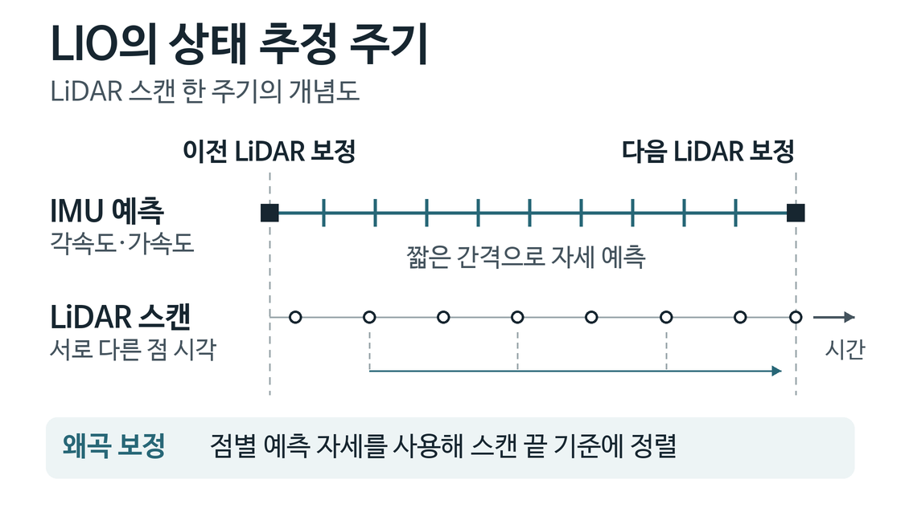

**LIO**(LiDAR–Inertial Odometry)는 LiDAR와 IMU를 결합해 로봇의 3차원 위치와 회전, 즉 6자유도 자세를 추정한다. 복도 모퉁이를 돌 때 IMU의 각속도를 적분해 스캔 도중의 회전량을 구하고, 새로 관측한 LiDAR 점을 앞서 관측한 벽에 맞춰 움직임 추정치를 보정한다. 이렇게 추정한 자세를 이어 궤적을 만든다. [FAST-LIO2][fast-lio2] · [LIO-SAM][lio-sam]

## IMU로 스캔 사이의 움직임 예측

LiDAR가 10 Hz, IMU가 200 Hz라면 100 ms짜리 스캔 하나에 IMU 측정값이 약 20개 들어온다. 직전 스캔에서 얻은 위치·회전·속도를 시작점으로 삼고, IMU의 각속도와 가속도계 측정값을 짧은 간격으로 적분한다. 이렇게 각 점이 찍힌 시점의 자세와 다음 정합에 쓸 시작 자세를 얻는다. [FAST-LIO2 논문 IV-A·B절][fast-lio2]



`R`을 IMU 좌표계에서 오도메트리 좌표계 `W`로 가는 회전, `Δt`를 IMU 측정 간격으로 두자. 자이로의 각속도 `ω_m`에서 바이어스 `b_g`를 빼 회전을 갱신한다. 가속도계가 측정한 비력 `f_m`에서 바이어스 `b_a`를 빼고 `W`로 회전한 뒤, 아래쪽을 향하는 중력 벡터 `g_W`를 더하면 병진 가속도가 된다.

```text
R_next = R · Exp((ω_m − b_g) · Δt)
a_W    = R · (f_m − b_a) + g_W
```

`Exp`는 각속도를 적분한 회전 벡터를 회전행렬로 바꾼다. `a_W`를 적분하면 속도, 속도를 한 번 더 적분하면 위치가 나온다. 바이어스는 측정값에 섞이는 오프셋이다. 예를 들어 한 축에 0.1°/s의 자이로 바이어스가 남아 있으면, 그 축을 10초 동안 적분했을 때 약 1°의 오차가 쌓인다. LiDAR 정합은 이처럼 계속 쌓이는 오차를 줄이는 관측값을 제공한다. 센서가 충분히 다양한 방향으로 움직이고 주변에서 여러 방향의 구조가 관측되면, 반복된 정합 결과를 이용해 바이어스도 갱신할 수 있다. [FAST-LIO2 논문 IV절][fast-lio2] · [LIO-SAM 논문 III절][lio-sam]

## 점마다 다른 시각을 맞추는 Deskew

회전형 LiDAR가 벽을 왼쪽에서 오른쪽으로 훑는 동안 로봇도 회전한다고 하자. 스캔 초반과 후반에 찍힌 점은 서로 다른 센서 좌표계에 있다. 이 점들을 한 자세에서 찍었다고 가정해 겹치면 곧은 벽이 휘거나 비스듬하게 보일 수 있다. **Deskew**는 점별 취득 시각의 자세를 써서 모든 점을 스캔의 한 기준 시각에 맞춘다.

`T_AB`는 좌표를 `B`에서 `A`로 옮기는 변환이다. `L`은 LiDAR, `I`는 IMU다. 센서가 같은 몸체에 고정돼 있다면 `T_IL`은 두 센서 사이의 고정 변환이다. 시각 `t_i`에 LiDAR가 찍은 점 `p_i`를 오도메트리 좌표계로 옮겼다가, 기준 시각 `t_ref`의 LiDAR 좌표계로 되돌린다.

```text
T_WL(t) = T_WI(t) · T_IL
p_ref   = inv(T_WL(t_ref)) · T_WL(t_i) · p_i
```

FAST-LIO2는 스캔 끝을 기준으로 삼는다. 이미 끝 시각에 찍힌 점은 그대로 두고, 먼저 찍힌 점만 그사이에 센서가 움직인 만큼 옮긴다. [FAST-LIO2 논문 IV-A.2·B절][fast-lio2]

## LiDAR는 점–평면 거리로 자세를 보정한다

FAST-LIO2에서는 왜곡을 보정한 점을 예측 자세로 `W`에 옮겨 `p`를 얻는다. 이전 관측의 참조 점군에서 `p`와 가까운 점들을 찾아 작은 평면을 맞춘다. 평면 위의 한 점이 `q`, 길이가 1인 법선 벡터가 `n`이면 **잔차** `r = nᵀ · (p − q)`는 점과 평면 사이의 부호 있는 수직 거리다. 여러 점의 잔차와 IMU 예측의 불확실성을 함께 사용해 위치와 회전을 갱신한다. [FAST-LIO2 논문 IV-B절][fast-lio2]


벽 하나를 볼 때 벽 쪽으로 움직이면 수직 거리가 달라진다. 벽을 따라 움직이면 거리가 그대로여서 이 잔차로는 벽을 따라 얼마나 움직였는지 알기 어렵다. 끝이 보이지 않고 평행한 벽과 바닥만 관측되는 복도에서는 진행 방향 보정이 약해지는 이유다. 복도 끝 벽처럼 다른 방향의 평면이 보이면 그 방향의 이동을 구속할 수 있다. [LION 논문][lion]

## FAST-LIO2와 LIO-SAM의 결합 방식

- **FAST-LIO2**는 스캔 점에서 점–평면 잔차를 직접 계산한다. 이 잔차를 반복 확장 칼만 필터에 넣어 IMU가 예측한 상태를 갱신한다. [FAST-LIO2 논문 III–IV절][fast-lio2] · [저자 시연 영상][fast-lio2-demo]
- **LIO-SAM**은 모서리와 평면 특징을 정합해 얻은 LiDAR 상대 자세를 팩터 그래프에 넣는다. 여러 IMU 측정은 두 시점 사이의 운동을 나타내는 사전 적분 팩터로 묶는다. 그래프의 노드는 각 시점의 상태다. 노드를 잇는 팩터가 두 시점 사이의 움직임을 제한하며, 이를 함께 풀어 위치·회전·속도와 IMU 바이어스를 추정한다. [LIO-SAM 논문 III절][lio-sam]

## ROS 2 bag에서 확인할 세 가지

1. **점별 취득 시각.** `PointCloud2.header.stamp`가 스캔의 어느 시점을 가리키는지 확인한다. 점별 `time` 또는 `t` 필드가 있다면 값이 기준 시각으로부터의 차이인지, 센서 시계의 시각인지 확인한다. 초·밀리초·마이크로초·나노초 중 어떤 단위인지도 드라이버와 LIO 설정에서 대조한다. [FAST-LIO 구현의 입력 설정][fast-lio-input]
2. **LiDAR와 IMU의 시계.** 두 기록의 시각 기준이 맞고 각 스캔 구간을 IMU 측정이 덮는지 본다. 예를 들어 90°/s로 돌 때 시각이 10 ms 어긋나면, 점을 옮길 때 쓰는 회전부터 약 0.9° 차이 난다. [LiDAR–IMU 시각 보정 논문][li-init]
3. **IMU 측정과 센서 간 변환.** 각속도는 `rad/s`, 가속도계 측정값은 `m/s²`인지 확인한다. 수평으로 놓고 정지했을 때 IMU의 `+z`가 위라면 원시 비력의 `z` 성분은 `+9.81 m/s²`에 가깝다. 설정 파일의 외부 보정값이 `T_IL`과 같은 방향인지도 확인한다. [ROS REP-145][rep-145] · [FAST-LIO 구현의 입력 설정][fast-lio-input]

관련 글 [KISS-ICP](/blog/kiss-icp/) · [Elevator-LIO](/blog/elevator-lio/)

[fast-lio2]: https://arxiv.org/html/2107.06829
[lio-sam]: https://arxiv.org/html/2007.00258
[lion]: https://arxiv.org/html/2102.03443#S3.SS2
[fast-lio2-demo]: https://youtu.be/2OvjGnxszf8
[fast-lio-input]: https://github.com/hku-mars/FAST_LIO#3-directly-run
[li-init]: https://arxiv.org/abs/2202.11006
[rep-145]: https://github.com/ros-infrastructure/rep/blob/master/rep-0145.rst#data-reporting
