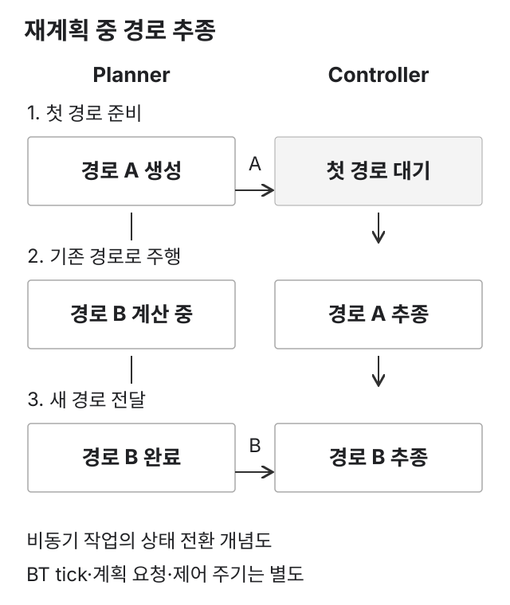
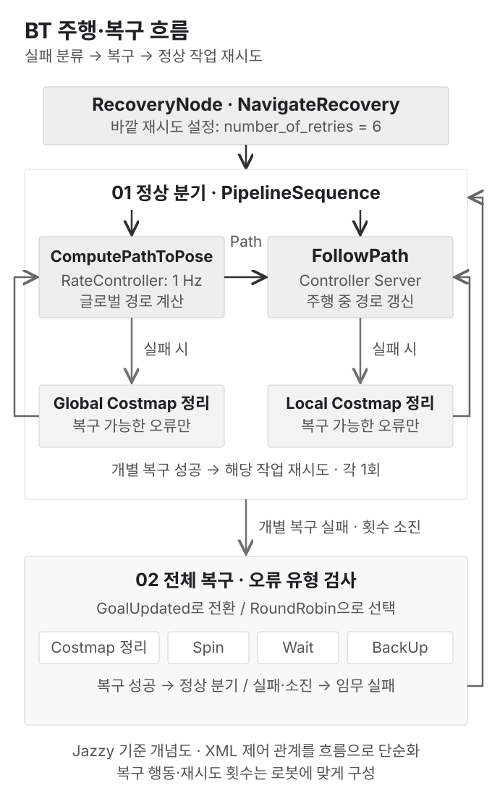

Behavior Tree(BT)는 **어떤 작업을 실행하고, 완료·실패·목표 변경에 어떻게 대응할지** 정한다. Nav2에서는 Planner·Controller 등의 액션을 연결해 하나의 주행 작업을 구성한다.

**Nav2 시리즈**

- [위치 추정과 경로 계획](/blog/nav2-navigation-study/)
- [컨트롤러 비교 — RPP·DWB·MPPI](/blog/nav2-controllers/)
- **Behavior Tree와 주행 복구** — 현재 글

> **기준: ROS 2 Jazzy · Nav2 소스 `645abd9` · 검토 2026-11-15.** XML은 학습용 구성이다. 도식·시나리오는 원본 구현을 설명하기 위한 자료이며 실기체 실행 결과가 아니다.

<details class="post-toc" id="목차">
<summary>목차</summary>

1. [BT와 서버의 역할](#1-bt와-서버의-역할)
2. [Tick과 실행 상태](#2-tick과-실행-상태)
3. [계획·추종 연결](#3-계획추종-연결)
4. [주기와 실패 전파](#4-주기와-실패-전파)
5. [복구 구성](#5-복구-구성)
6. [명령 체인과 취소](#6-명령-체인과-취소)
7. [디버깅과 시나리오 검사](#7-디버깅과-시나리오-검사)

</details>

## 1. BT와 서버의 역할

| 구성 | 책임 | 예시 |
| --- | --- | --- |
| BT Navigator | 주행 작업의 실행 순서·전환·복구 | `NavigateToPose` 처리 |
| BT Action 노드 | 서버 요청과 비동기 결과를 BT 상태로 연결 | `ComputePathToPose`, `FollowPath` |
| Planner·Controller Server | 계획·속도 계산 수행 | Smac·MPPI 플러그인 실행 |
| Behavior Server | 짧은 복구·보조 동작 수행 | `Spin`, `Wait`, `BackUp` |
| Lifecycle Manager | 서버 구성·활성화·생존 관리 | `active` 전환·bond 감시 |

BT의 노드와 ROS 2 노드는 다른 개념이다. BT 노드 하나가 반드시 ROS 프로세스 하나를 뜻하지 않는다. 서버의 Lifecycle 상태가 `active`인 것과 주행 작업이 성공한 것도 구분한다. [Nav2 BT 노드](https://docs.nav2.org/jazzy/getting_started/nav2_behavior_trees/nav2_specific_nodes/nav2_specific_nodes/), [Lifecycle Manager](https://docs.nav2.org/jazzy/configuration_and_development/configuration_guide/core_servers/configuring_lifecycle_manager/).

## 2. Tick과 실행 상태

### 2.1 주요 반환 상태

루트에 전달한 tick은 제어 노드의 규칙에 따라 자식으로 전달된다. 각 노드는 상태를 반환하고, 부모가 이를 해석한다.

| 상태 | 의미 | Nav2 예시 |
| --- | --- | --- |
| `SUCCESS` | 작업·조건 성공 | 경로 계산 완료·목표 도달 |
| `FAILURE` | 작업·조건 실패 | 유효 경로 없음·진행 조건 실패 |
| `RUNNING` | 작업 진행 중 | 경로 계산 대기·주행 중 |

`IDLE`은 실행 전·초기화 상태다. BT.CPP 4에는 `SKIPPED`도 있지만 기본 실행 흐름은 위 세 상태로 읽을 수 있다. `RUNNING` 노드는 다음 tick에서 다시 상태를 확인할 수 있어야 한다. 완료까지 tick 함수를 막아 두면 다른 분기도 제때 갱신하기 어렵다. [BT.CPP 기본 개념](https://www.behaviortree.dev/docs/learn-the-basics/BT_basics/).

### 2.2 제어 노드·Decorator

| 노드 | 실행 규칙 | 용도 |
| --- | --- | --- |
| `Sequence` | 순서대로 진행. 실행 중인 자식을 이어 tick하고 실패 시 반환 | 순차 작업 |
| `Fallback` | 실패한 자식 다음의 대안을 시도 | 대안 선택 |
| `ReactiveSequence` / `ReactiveFallback` | 매 tick 앞쪽 조건부터 재평가 | 조건 변화에 따른 중단·전환 |
| `PipelineSequence` | 뒤 작업이 진행돼도 앞서 진입한 작업을 다시 tick | 추종 중 재계획 |
| `RateController` | 자식의 새 실행 간격을 제한 | 계획 요청 주기 조절 |
| `RecoveryNode` | 정상·복구의 두 자식. 복구 성공 뒤 정상 작업 재시도 | 제한된 재시도 |
| `RoundRobin` | 대안을 순환하며 선택 | 복구 행동 분산 |

일반 Sequence와 ReactiveSequence는 앞선 조건의 재검사 방식이 다르다. PipelineSequence도 노드를 각각 새 스레드에서 실행하는 병렬 처리기가 아니다. 서버 작업이 비동기로 진행되는 동안 tick으로 여러 작업의 상태를 관리한다. [Sequence](https://www.behaviortree.dev/docs/nodes-library/SequenceNode/), [Fallback](https://www.behaviortree.dev/docs/nodes-library/FallbackNode/), [PipelineSequence 구현](https://github.com/ros-navigation/navigation2/blob/645abd95f2be02a13ca539b29c2ddc065db34f89/nav2_behavior_tree/plugins/control/pipeline_sequence.cpp).

## 3. 계획·추종 연결

### 3.1 Blackboard·Port·플러그인 ID

Blackboard는 트리 안에서 데이터를 공유하는 키·값 저장소이고, port는 BT 노드의 입출력이다.

| XML 표현 | 해석 |
| --- | --- |
| `goal="{goal}"` | Blackboard의 `goal`을 입력으로 연결 |
| `path="{path}"` | 계산 결과를 쓰거나 읽을 `path` 항목 |
| `planner_id="GridBased"` | 문자열 ID. Planner Server YAML의 `GridBased` 선택 |
| `controller_id="FollowPath"` | 문자열 ID. Controller Server YAML의 `FollowPath` 선택 |

`{path}`는 `/path` 토픽 이름이 아니다. 출력은 `{global_path}`, 입력은 `{path}`로 두면 같은 데이터를 연결한 것이 아니다. ID와 실제 알고리즘 클래스의 관계는 [플래너 설정](/blog/nav2-navigation-study/#5-플래너-설정과-선택), [컨트롤러 설정](/blog/nav2-controllers/#54-부분-설정)과 연결된다. [Blackboard와 Port](https://www.behaviortree.dev/docs/tutorial-basics/tutorial_02_basic_ports/).

### 3.2 최소 계획·추종 트리

Navigator가 `goal`을 준비하고 `GridBased`·`FollowPath` 플러그인이 등록됐다고 가정한다. **복구가 없는 학습용 트리**다.

```xml
<root BTCPP_format="4" main_tree_to_execute="MainTree">
  <BehaviorTree ID="MainTree">
    <PipelineSequence name="PlanAndTrack">
      <RateController hz="1.0">
        <ComputePathToPose goal="{goal}" path="{path}"
                           planner_id="GridBased"/>
      </RateController>
      <FollowPath path="{path}" controller_id="FollowPath"/>
    </PipelineSequence>
  </BehaviorTree>
</root>
```

실행은 다음 순서다.

1. 처음에는 경로 계산이 완료될 때까지 `RUNNING`을 반환한다.
2. 첫 경로가 `{path}`에 저장되면 추종이 시작된다.
3. 추종 중에도 계획 분기를 다시 tick한다. 재계획 중에는 기존 경로를 추종할 수 있다.
4. 새 경로가 나오면 `{path}`가 바뀌고 FollowPath 노드가 Controller Server의 경로를 갱신한다.
5. 추종이 성공하면 트리가 성공한다. 계획·추종이 실패하면 이 최소 트리는 실패한다.



일반 Sequence에서 계획 노드가 한 번 성공한 뒤 추종 노드만 계속 tick하면 같은 재계획 흐름이 만들어지지 않는다. 또한 여기의 PipelineSequence는 **앞쪽 계획이 실패하면 실행 중 자식들을 halt**한다. 모든 재계획 실패를 무시하고 계속 주행하는 구조는 아니다. [경로 갱신 구현](https://github.com/ros-navigation/navigation2/blob/645abd95f2be02a13ca539b29c2ddc065db34f89/nav2_behavior_tree/plugins/action/follow_path_action.cpp), [PipelineSequence](https://github.com/ros-navigation/navigation2/blob/645abd95f2be02a13ca539b29c2ddc065db34f89/nav2_behavior_tree/plugins/control/pipeline_sequence.cpp).

## 4. 주기와 실패 전파

### 4.1 주기 구분

| 설정 | 의미 | 예시 해석 |
| --- | --- | --- |
| `bt_loop_duration` | BT 루프의 목표 간격, ms | `10`: 약 10 ms 간격의 tick 목표 |
| `RateController hz` | 계획 분기의 새 실행 간격 | `1.0`: 완료한 계획을 약 1초 간격으로 재실행 |
| `controller_frequency` | 속도 계산 루프, Hz | `20.0`: 주기 예산 50 ms |
| Costmap `update_frequency` | 내부 장애물·비용 갱신 | 제어에 사용할 환경 갱신 |
| Costmap `publish_frequency` | Costmap 메시지 발행 | RViz 수신 주기와 관련 |
| MPPI `model_dt` | 예측 모델의 시간 간격 | 실제 BT tick과는 별개 |

RateController는 첫 진입과 이미 `RUNNING`인 자식을 계속 tick하고, 성공한 뒤 새 실행을 허용할 때 간격을 적용한다. 따라서 `hz="1.0"`이 planner 결과를 초당 한 번만 확인한다는 뜻은 아니다. `expected_planner_frequency`도 재계획을 발생시키는 타이머가 아니라 성능 경고 기준이다. [RateController 구현](https://github.com/ros-navigation/navigation2/blob/645abd95f2be02a13ca539b29c2ddc065db34f89/nav2_behavior_tree/plugins/decorator/rate_controller.cpp), [Planner Server](https://docs.nav2.org/jazzy/configuration_and_development/configuration_guide/core_servers/configuring_planner_server/).

### 4.2 실패의 출발점

```text
플러그인 계산·환경 조회 실패
→ 서버가 액션 결과 반환
→ BT Action 노드의 FAILURE
→ 부모의 중단·복구·재시도 규칙
```

예를 들어 Controller가 유효한 명령을 만들지 못하면 서버의 허용 조건에 따라 `FollowPath`가 실패하고 BT가 복구를 선택할 수 있다. 반면 Controller가 만든 명령을 드라이버가 실행하지 못하는 문제는 BT 노드 실패로 즉시 드러나지 않을 수 있다. Progress Checker와 실제 속도 관측이 필요한 이유다.

각 액션의 오류 코드와 최초 실패 노드를 남겨야 한다. 복구 중 마지막으로 본 `Spin` 실패만 기록하면 앞서 발생한 경로·TF·관측 문제를 놓칠 수 있다.

## 5. 복구 구성

### 5.1 RecoveryNode

RecoveryNode의 자식은 정확히 두 개다.

1. 정상 작업 실행.
2. 정상 작업 실패 시 복구 실행.
3. 복구 성공 시 남은 횟수 안에서 정상 작업 재시도.
4. 정상 작업 성공이면 성공. 복구 실패 또는 재시도 소진이면 실패.

`number_of_retries="2"`는 최초 정상 시도 외에 복구 후 두 번까지 재시도한다는 뜻이다. 복구가 모두 성공하는 단순 구성이라면 정상 작업은 최대 세 번 호출된다. 중첩된 RecoveryNode가 있으면 전체 호출 횟수는 별도로 계산해야 한다. [RecoveryNode 구현](https://github.com/ros-navigation/navigation2/blob/645abd95f2be02a13ca539b29c2ddc065db34f89/nav2_behavior_tree/plugins/control/recovery_node.cpp).

### 5.2 기본 Nav2 트리



기준 [Jazzy 기본 XML](https://github.com/ros-navigation/navigation2/blob/645abd95f2be02a13ca539b29c2ddc065db34f89/nav2_bt_navigator/behavior_trees/navigate_to_pose_w_replanning_and_recovery.xml)은 두 수준의 복구를 둔다.

| 수준 | 정상 작업 | 복구 동작 | 재시도 |
| --- | --- | --- | --- |
| 계획 작업 | ComputePathToPose | 복구 가능한 오류인지 검사 → Global Costmap 정리 | 1 |
| 추종 작업 | FollowPath | 복구 가능한 오류인지 검사 → Local Costmap 정리 | 1 |
| 전체 주행 | 계획·추종 파이프라인 | 오류 검사 → 복구 행동 선택 | 6 |

전체 복구의 RoundRobin은 **Costmap 정리 → Spin → Wait → BackUp** 대안을 순환한다. 복구 기회마다 네 동작을 반드시 모두 실행하는 것은 아니다. 복구 중에는 ReactiveFallback의 `GoalUpdated` 조건으로 새 목표를 감지해 기존 복구를 중단하고 정상 분기로 돌아갈 수 있다.

이 재시도 수와 행동은 해당 XML의 구성이다. Costmap 정리가 성공해도 목표에 도착한 것은 아니며 정상 작업을 다시 시도해야 한다. 센서가 같은 장애물을 다시 관측한다면 정리한 costmap에도 다시 표시된다. [기본 트리 해설](https://docs.nav2.org/jazzy/getting_started/nav2_behavior_trees/detailed_behavior_tree_walkthrough/detailed_behavior_tree_walkthrough/).

### 5.3 플랫폼·실패 유형별 정책

| 조건 | 구성 기준 |
| --- | --- |
| Ackermann 차량형 | 제자리 회전 Spin 제외. 후진·조향·후방 관측에 맞는 행동 선택 |
| 전방향·사족보행 | SDK·보행 모드가 복구 명령을 실제 지원하는지 확인 |
| 잠시 가로막힌 통로 | 기다리기·로컬 회피·글로벌 우회의 조건 구분 |
| 위치 추정·센서 실패 | Costmap 정리 반복 대신 중단·재초기화·운영자 개입 조건 |
| 반복 실패 | 재시도 한도·총 허용 시간·최종 중단 상태 명시 |

복구는 원인을 해결할 가능성이 있을 때 선택한다. 잘못된 TF·지도·구동 제약을 더 많은 재시도로 해결하려고 하면 같은 실패를 반복한다.

## 6. 명령 체인과 취소

### 6.1 최종 속도 명령

```text
Controller → Velocity Smoother → Collision Monitor → Driver·Locomotion
```

이는 구성 가능한 예시 체인이다. Velocity Smoother는 속도·가감속·deadband를 조절하고, Collision Monitor는 센서 관측에 따라 통과 명령을 제한한다. 각각의 입력·출력 리맵과 마지막 발행자를 확인한다. [Velocity Smoother](https://docs.nav2.org/jazzy/configuration_and_development/configuration_guide/core_servers/configuring_velocity_smoother/), [Collision Monitor](https://docs.nav2.org/jazzy/configuration_and_development/configuration_guide/core_servers/collision_monitor/).

경로가 보이는데 로봇이 움직이지 않으면 다음을 비교한다.

1. Controller 출력이 0인지, 후처리 뒤에 0이 됐는지.
2. 최종 토픽 타입·좌표계·발행 주기가 드라이버와 맞는지.
3. 여러 노드가 드라이버 입력에 직접 동시에 발행하는지.
4. 실제 odometry가 명령 방향·크기·시각을 따라가는지.

`Twist`와 `TwistStamped` 사용 여부도 양쪽에서 확인한다. 최종 명령은 정상인데 실제 속도가 다르면 SDK 모드·deadband·제한·watchdog·구동 상태를 점검한다.

### 6.2 Halt·취소·정지

BT의 halt는 실행 중 작업을 중단·초기화하는 동작이다. ROS 액션을 쓰는 BT 노드는 해당 서버의 취소와도 연결되어야 한다. 목표 변경·사용자 취소·통신 단절에서 상위 액션 상태, 하위 액션 종료, 최종 명령과 실제 속도를 함께 확인한다. [Nav2 BT Action 기반 클래스](https://github.com/ros-navigation/navigation2/blob/645abd95f2be02a13ca539b29c2ddc065db34f89/nav2_behavior_tree/include/nav2_behavior_tree/bt_action_node.hpp).

BT tick 중단 자체를 물리적 정지로 간주하지 않는다. 명령 timeout·watchdog와 독립적인 정지 수단이 필요하다. Collision Monitor 역시 안전 인증 제어기·범퍼·비상정지를 대체하지 않는다.

## 7. 디버깅과 시나리오 검사

### 7.1 실제 XML·서버 확인

BT는 `default_nav_to_pose_bt_xml`로 지정하거나 `NavigateToPose` 요청의 `behavior_tree` 필드로 선택한다. 파일은 Navigator 실행 환경에 있어야 한다. 같은 파일을 매 요청 다시 읽을지는 `always_reload_bt_xml`에 영향을 받는다. 기본 BT 라이브러리는 Jazzy에서 자동 등록되지만 사용자 정의 노드는 별도 라이브러리 등록이 필요하다.

Groot2 모니터링은 `navigate_to_pose.enable_groot_monitoring` 등의 navigator별 설정을 사용한다. 트리 상태와 서버 로그를 함께 확인한다. [BT Navigator 설정](https://docs.nav2.org/jazzy/configuration_and_development/configuration_guide/core_servers/configuring_bt_navigator/), [NavigateToPose 정의](https://github.com/ros-navigation/navigation2/blob/645abd95f2be02a13ca539b29c2ddc065db34f89/nav2_msgs/action/NavigateToPose.action).

아래는 이동을 요청하지 않는 조회 예시다. Namespace·최종 속도 토픽은 시스템에 맞춘다.

```bash
ros2 lifecycle get /planner_server
ros2 lifecycle get /controller_server
ros2 action list -t
ros2 param get /bt_navigator default_nav_to_pose_bt_xml
ros2 param get /controller_server controller_frequency
ros2 topic info /cmd_vel --verbose
ros2 topic echo /odom --once
```

### 7.2 증상별 관측

| 증상 | 우선 확인 |
| --- | --- |
| 서버는 보이지만 작업을 시작하지 못함 | Lifecycle active·액션 이름·TF·costmap 준비 |
| XML 수정이 반영되지 않음 | 실제 파일 경로·요청 override·reload 설정 |
| 주행 중 재계획이 없음 | 실제 트리의 PipelineSequence·RateController·계획 상태 |
| 계획·추종이 반복 중단됨 | 최초 오류 코드·개별 복구·전체 복구 전환 |
| 복구 행동만 계속 반복함 | 실패 분류·행동 가능 여부·재시도 한도 |
| 취소했는데 계속 움직임 | 액션 취소 전파·최종 명령 발행자·구동 timeout |

### 7.3 시나리오 검사

먼저 시뮬레이션·통제된 환경에서 아래 흐름을 관측한다. 이 표는 검사 설계이며 실제 시험 통과 기록이 아니다.

| 시나리오 | 관측할 흐름 |
| --- | --- |
| 정상 주행 | 첫 경로 → 추종 → 도착 판정 → 액션 성공 |
| 경로 중간 장애물 | 관측 반영 → 제어 반응 → 재계획·대기·복구 선택 |
| 계획·추종 실패 각각 유도 | 최초 실패 노드·오류 코드 → 해당 costmap 복구 → 재시도 |
| 복구 중 목표 변경 | 이전 복구 halt → 새 목표 계획·추종 |
| 사용자 취소 | 상위·하위 액션 종료 → 최종 명령·실제 속도 확인 |
| 센서·통신 두절 | 관측 유효성·오류 → 중단 정책·watchdog 확인 |

기록에는 사용 XML·파라미터·지도·시작·목표, 시간순 액션 결과·오류 코드·복구 횟수·최종 속도를 포함한다. 성공률·도착 시간·복구 횟수를 비교하면 알고리즘 문제와 실행 정책 문제를 분리하기 쉽다.

**이전:** [컨트롤러 비교 — RPP·DWB·MPPI](/blog/nav2-controllers/) · **시리즈 시작:** [위치 추정과 경로 계획](/blog/nav2-navigation-study/)

### 참고 자료

- [기준 Jazzy BT XML](https://github.com/ros-navigation/navigation2/blob/645abd95f2be02a13ca539b29c2ddc065db34f89/nav2_bt_navigator/behavior_trees/navigate_to_pose_w_replanning_and_recovery.xml)
- [Nav2 Behavior Tree 해설](https://docs.nav2.org/jazzy/getting_started/nav2_behavior_trees/), [BehaviorTree.CPP 기본 문서](https://www.behaviortree.dev/docs/learn-the-basics/BT_basics/)
- [Nav2 BT 플러그인 소스](https://github.com/ros-navigation/navigation2/tree/645abd95f2be02a13ca539b29c2ddc065db34f89/nav2_behavior_tree/plugins)
