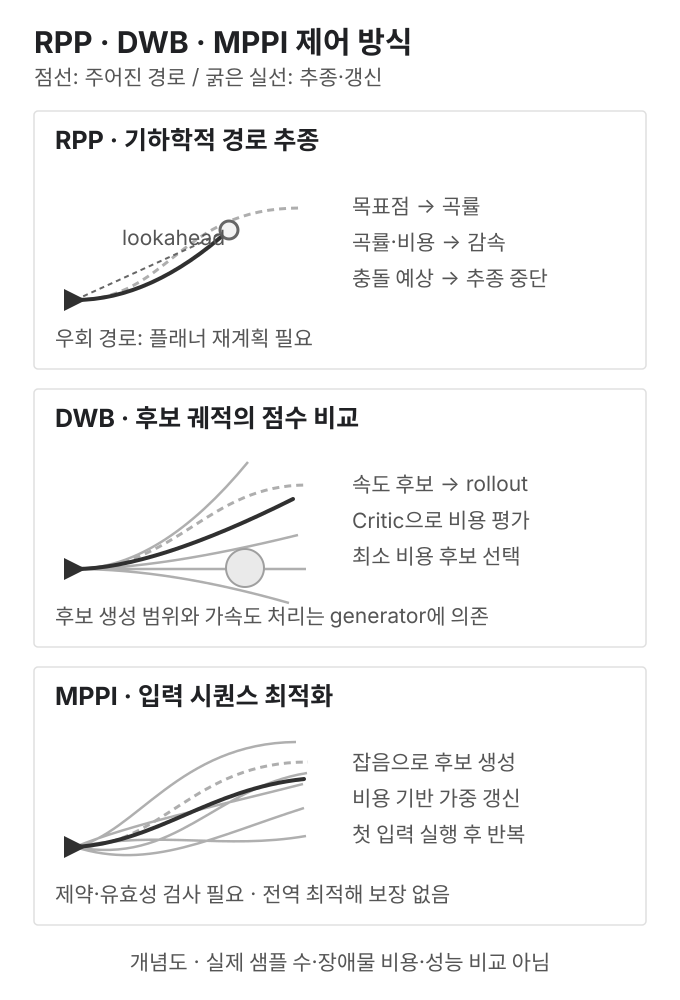
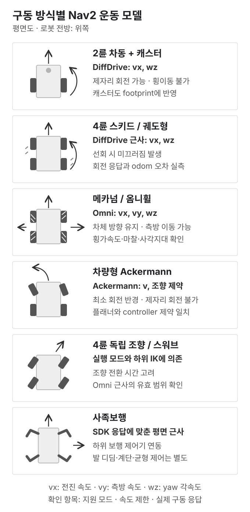
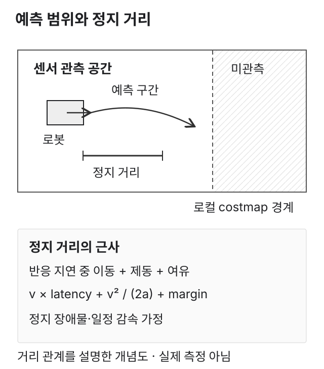

Nav2 Controller는 경로·현재 상태·로컬 장애물 정보를 받아 **지금 실행할 몸체 속도**를 계산한다. 모터 속도·조향각·관절 토크를 제어하는 하위 구동기와는 역할이 다르다.

**Nav2 시리즈**

- [위치 추정과 경로 계획](/blog/nav2-navigation-study/)
- **컨트롤러 비교 — RPP·DWB·MPPI** — 현재 글
- [Behavior Tree와 주행 복구](/blog/nav2-behavior-tree/)

> **기준: ROS 2 Jazzy · Nav2 소스 `645abd9` · 검토 2026-11-15.** 수치와 YAML은 학습용 예시다. 실기체 성능·안전 검증 결과가 아니며, 설치된 패키지의 파라미터와 대조해야 한다.

<details class="post-toc" id="목차">
<summary>목차</summary>

1. [컨트롤러 비교](#1-컨트롤러-비교)
2. [구동 모델과 제한](#2-구동-모델과-제한)
3. [Pure Pursuit와 RPP](#3-pure-pursuit와-rpp)
4. [DWB](#4-dwb)
5. [MPPI](#5-mppi)
6. [도착·진행 판정](#6-도착진행-판정)
7. [튜닝과 비교 실험](#7-튜닝과-비교-실험)

</details>

## 1. 컨트롤러 비교

문헌의 local planner는 로봇 주변에서 실행할 궤적·명령을 계산하는 역할을 가리키기도 한다. Nav2에서는 이 역할을 Controller 플러그인으로 구현한다. Pure Pursuit·DWA·MPC라는 **알고리즘 계열**과 RPP·DWB·MPPI라는 **구현**을 구분해서 읽는다.

| 구현 | 방식 | 적용 범위·제약 |
| --- | --- | --- |
| **RPP** | Lookahead 목표점의 곡률 + 속도 조절 | 주어진 경로 추종 중심. 막힌 경로의 우회는 재계획과 조합 |
| **DWB** | 속도 후보를 rollout하고 critic 점수로 선택 | 후보 범위 안의 회피 탐색. Generator·샘플링·가중치 설정 필요 |
| **MPPI** | 여러 입력 시퀀스를 예측·평가해 가중 갱신 | 모델 기반 로컬 최적화. 예측 범위·제약·계산량 관리 필요 |
| Graceful | 목표 자세로 수렴하는 기하학적 제어 | Motion target과 자세 오차 기반 접근 |
| Vector Pursuit | 목표점 위치·방향을 함께 사용하는 추종 | 외부 플러그인. 경로 방향과 배포판 호환성 확인 |
| TEB | Pose·시간 간격을 포함한 궤적 최적화 | 원 프로젝트는 ROS 1. ROS 2 포트·배포판 지원 별도 확인 |
| Rotation Shim | 방향 정렬 후 주 컨트롤러에 위임 | 보조 래퍼. 제자리 회전 가능한 플랫폼에 적용 |

RPP·DWB·MPPI·Graceful·Rotation Shim은 기준 Jazzy 소스 트리에 있다. 외부 플러그인 목록 등재가 해당 배포판의 설치·호환성을 보장하지는 않는다. [Nav2 플러그인 목록](https://docs.nav2.org/jazzy/configuration_and_development/navigation_plugins/#controllers), [Graceful](https://github.com/ros-navigation/navigation2/blob/645abd95f2be02a13ca539b29c2ddc065db34f89/nav2_graceful_controller/README.md), [Vector Pursuit](https://github.com/blackcoffeerobotics/vector_pursuit_controller), [TEB](https://github.com/rst-tu-dortmund/teb_local_planner).



아래에서는 **기하학적 추종 → 후보 선택 → 입력 시퀀스 최적화** 순서로 세 구현을 비교한다. 계산량·추종 성능의 순위는 로봇·설정·CPU·장애물 조건을 고정한 실험으로 확인해야 한다.

## 2. 구동 모델과 제한

### 2.1 플랫폼별 입력

모델 선택 기준은 바퀴 수보다 **차체가 실행할 수 있는 움직임**이다. 몸체 기준 `vx`는 전진, `vy`는 측방 속도, `wz`는 yaw 각속도다.

| 플랫폼 | 실행 가능한 평면 입력 | 점검 항목 |
| --- | --- | --- |
| 2륜 차동 + 캐스터 | `vx`, `wz` | 제자리 회전·캐스터 외형 |
| 4륜·6륜 스키드·궤도형 | `vx`, `wz`의 근사 | 선회 미끄러짐·유효 바퀴 간격·yaw odometry |
| 메카넘·옴니휠 | `vx`, `vy`, `wz` | 횡이동 응답·가속도·센서 사각지대 |
| Ackermann 차량형 | 전후진 속도와 조향 제약 | 최소 회전 반경·후진·저속 조향 변환 |
| 독립 조향·스워브 | 조향 모드·하위 역기구학에 의존 | 조향 전환 시간·모드별 twist 제한 |
| 사족보행 | 보행 모드가 허용하는 몸체 속도 | SDK 응답·포화·지연. 발 디딤·균형 제어는 별도 |



Jazzy MPPI의 기본 `motion_model`은 `DiffDrive`·`Omni`·`Ackermann`이다. DWB의 전방향 주행에는 횡속도 제한·샘플링이 필요하다. RPP는 전방향 베이스에서도 사용할 수 있지만 횡이동 능력을 충분히 활용하는 추종기는 아니다. [MPPI 모델](https://github.com/ros-navigation/navigation2/blob/645abd95f2be02a13ca539b29c2ddc065db34f89/nav2_mppi_controller/README.md), [RPP 지원 범위](https://github.com/ros-navigation/navigation2/blob/645abd95f2be02a13ca539b29c2ddc065db34f89/nav2_regulated_pure_pursuit_controller/README.md).

### 2.2 차동·차량형의 관계식

이상적인 차동구동에서 좌우 바퀴의 접선 속도가 `v_left`, `v_right`, 좌우 간격이 `b`라면 다음과 같다.

```text
vx = (v_right + v_left) / 2
wz = (v_right - v_left) / b
```

스키드 선회에는 횡방향 미끄러짐이 개입하므로 노면·하중에 따라 회전량이 달라진다. 직진 거리와 선회 각도 오차를 분리하고, 엔코더 기반 yaw를 IMU·외부 odometry와 비교한다.

차량형의 이상적인 자전거 모델은 다음 관계를 사용한다. `L`은 앞뒤 차축 거리, `δ`는 조향각이다.

```text
curvature = tan(δ) / L
wz = vx × curvature
R_min ≈ L / tan(δ_max)
```

속도가 0에 가까울 때 `wz / vx`만으로 조향각을 계산하면 문제가 생긴다. 속도 기준점·조향 제한·전환 시간은 하위 구동기에서 처리한다. [ROS 2 모바일 로봇 운동학](https://control.ros.org/jazzy/doc/ros2_controllers/doc/mobile_robot_kinematics.html).

### 2.3 계층 간 설정 일치

- **Planner:** 생성 경로의 회전 반경·후진 구간이 실행 가능한지 확인한다.
- **Controller:** 같은 이동 자유도와 속도·가감속 제한을 사용한다.
- **명령 후처리·드라이버:** `vy`·후진을 버리거나 더 낮은 제한으로 잘라내지 않는지 확인한다.
- **복구:** 차량형의 `Spin`처럼 불가능한 동작을 BT에서 제외한다.

예를 들어 Hybrid-A*가 만든 후진 경로를 `vx_min: 0.0`인 MPPI에 전달하면 설정이 모순된다. 사족보행도 SDK가 횡속도를 받는지뿐 아니라 실제 보행 모드의 응답을 확인해야 한다. [Smac 경로 제약](/blog/nav2-navigation-study/#43-hybrid-a와-state-lattice), [BT 복구 구성](/blog/nav2-behavior-tree/#5-복구-구성).

## 3. Pure Pursuit와 RPP

### 3.1 Lookahead와 곡률

Pure Pursuit는 경로 앞쪽의 목표점인 carrot을 고르고, 그 점으로 향하는 원호를 계산한다. 목표점의 로봇 기준 좌표가 `(x_L, y_L)`일 때:

```text
L_d² = x_L² + y_L²
κ = 2 y_L / L_d²
wz = vx × κ
```

`L_d`는 이 기하식에서 로봇과 목표점 사이의 직선거리다. Lookahead 목표점을 고르는 경로상의 거리와 구분한다. 짧은 lookahead는 반응이 빠르지만 흔들리기 쉽고, 긴 lookahead는 코너에서 횡오차가 커질 수 있다.

예를 들어 `L_d = 0.6 m`, `y_L = 0.1 m`, `vx = 0.4 m/s`이면 곡률은 약 `0.56 m⁻¹`, 각속도는 약 `0.22 rad/s`다. 이 계산은 장애물·가속도 제한을 적용하기 전의 기하학적 예시다. [RPP 논문](https://arxiv.org/abs/2305.20026).

### 3.2 RPP의 속도 조절

RPP는 Pure Pursuit에 속도 기반 lookahead, 곡률·장애물 비용·목표 접근에 따른 감속, 전방 충돌 검사를 결합한다.

| 설정 묶음 | 주요 파라미터 | 의미 |
| --- | --- | --- |
| 목표 속도 | `desired_linear_vel` | 기본 목표 선속도 |
| Lookahead | `lookahead_dist`, `lookahead_time`, `min_lookahead_dist`, `max_lookahead_dist` | 고정·속도 비례 목표점 선택 |
| 곡률 감속 | `use_regulated_linear_velocity_scaling` | 큰 곡률에서 속도 조절 |
| 비용 감속 | `use_cost_regulated_linear_velocity_scaling`, `cost_scaling_dist` | 장애물 근처에서 감속 |
| 충돌 검사 | `max_allowed_time_to_collision_up_to_carrot` | 시간과 carrot 거리로 제한한 검사 범위 |

비용을 장애물 거리로 해석하는 `inflation_cost_scaling_factor`는 costmap의 `cost_scaling_factor`와 맞춘다. `cost_scaling_dist`도 inflation 반경 안에서 정한다. [RPP 설정](https://docs.nav2.org/jazzy/configuration_and_development/configuration_guide/controller_plugins/configuring_regulated_pp/).

RPP의 감속·충돌 검사는 우회 경로 검색과 다르다. 충돌이 예상되면 `NoValidControl` 예외가 발생할 수 있고, Controller Server의 처리와 BT 정책에 따라 추종 실패·재계획·복구로 이어진다. [충돌 처리 구현](https://github.com/ros-navigation/navigation2/blob/645abd95f2be02a13ca539b29c2ddc065db34f89/nav2_regulated_pure_pursuit_controller/src/regulated_pure_pursuit_controller.cpp).

### 3.3 부분 설정

아래 `FollowPath` 블록은 `controller_server.ros__parameters` 아래에 둔다. 제자리 회전 가능한 전진 플랫폼의 설명용 예시이며 공통 서버·costmap 설정은 생략했다.

```yaml
FollowPath:
  plugin: "nav2_regulated_pure_pursuit_controller::RegulatedPurePursuitController"
  desired_linear_vel: 0.4
  use_velocity_scaled_lookahead_dist: true
  lookahead_time: 1.0
  min_lookahead_dist: 0.3
  max_lookahead_dist: 0.8
  use_collision_detection: true
  use_rotate_to_heading: true
  allow_reversing: false
```

Jazzy RPP의 `use_rotate_to_heading`과 `allow_reversing`은 동시에 활성화할 수 없다. 차량형에서는 제자리 회전을 비활성화하고 planner·구동기의 회전 제약도 맞춘다.

## 4. DWB

### 4.1 후보 생성과 점수

DWB는 속도 후보를 만들고 일정 시간 전방 시뮬레이션한 뒤, 유효 후보의 critic 점수를 비교한다.

```text
score(trajectory) = Σ scale_j × critic_j(trajectory)
command = 유효 후보 중 점수가 가장 낮은 궤적의 명령
```

DWA는 현재 속도와 가속도 한계에서 단시간에 도달 가능한 속도 집합을 탐색한다. DWB의 `StandardTrajectoryGenerator`는 trajectory rollout 계열, `LimitedAccelGenerator`는 DWA 계열이다. **DWB라는 이름만으로 후보 생성 방식까지 같다고 가정하지 않는다.** [DWB 구현·플러그인](https://github.com/ros-navigation/navigation2/blob/645abd95f2be02a13ca539b29c2ddc065db34f89/nav2_dwb_controller/README.md).

### 4.2 Critic 평가 요소

| Critic | 평가 요소 |
| --- | --- |
| `PathDist`, `PathAlign` | 경로와의 거리·정렬 |
| `GoalDist`, `GoalAlign` | 목표와의 거리·정렬 |
| `BaseObstacle` | 궤적이 지나는 costmap 비용 |
| `ObstacleFootprint` | 로봇 외형을 고려한 장애물 충돌 |
| `Oscillation` | 앞뒤 이동 등 반복 진동 |
| `RotateToGoal` | 목표 부근 회전 동작 |

Critic의 원시 점수 단위·범위가 달라 `scale`의 숫자만 비교할 수는 없다. **후보가 모두 충돌하는 경우**와 **유효 후보 중 이상한 것을 고르는 경우**부터 구분한다. 전자는 외형·관측·제한·후보 생성 문제, 후자는 비용 균형 문제일 수 있다. [DWB 설정·Critic 목록](https://docs.nav2.org/jazzy/configuration_and_development/configuration_guide/controller_plugins/dwb_controller/).

### 4.3 부분 설정

```yaml
FollowPath:
  plugin: "dwb_core::DWBLocalPlanner"
  trajectory_generator_name: "dwb_plugins::StandardTrajectoryGenerator"
  min_vel_x: 0.0
  max_vel_x: 0.4
  min_vel_y: 0.0
  max_vel_y: 0.0
  max_vel_theta: 1.2
  acc_lim_x: 0.5
  decel_lim_x: -0.5
  acc_lim_theta: 0.8
  decel_lim_theta: -0.8
  sim_time: 1.5
  vx_samples: 20
  vy_samples: 1
  vtheta_samples: 30
  critics: ["Oscillation", "ObstacleFootprint", "GoalAlign",
            "PathAlign", "PathDist", "GoalDist", "RotateToGoal"]
```

최대 속도·가감속을 맞춘 뒤 `sim_time`·샘플 수, 마지막으로 critic scale을 조절한다. 위 조각은 전체 속도 조건·critic별 scale을 모두 지정한 완성 설정이 아니다. [Generator·속도 설정](https://docs.nav2.org/jazzy/configuration_and_development/configuration_guide/controller_plugins/dwb_controller/dwb_params/controller/).

## 5. MPPI

### 5.1 입력 시퀀스 최적화

MPPI는 샘플링 기반 MPC 계열이다. DWB가 후보 하나를 고르는 설명과 달리, **여러 후보의 비용으로 입력 시퀀스를 가중 갱신**한다.

1. 현재 pose·속도와 제어 시퀀스 `U = [u₀, …, uₙ₋₁]`를 준비한다.
2. `K`개의 잡음 시퀀스 `ε_k`를 더해 후보 입력을 만든다.
3. 운동 모델로 각 후보의 `N`단계 움직임을 예측한다.
4. 경로·목표·장애물·제약 비용을 계산한다.
5. 비용이 낮은 후보의 기여를 높여 `U`를 갱신한다.
6. 첫 입력을 실행하고 다음 제어 주기에 다시 계산한다.

다음은 직관을 위한 개념식이다. 입력 비용·샘플링 보정·제약 처리는 생략했다.

```text
w_k ∝ exp[-(S_k - S_min) / temperature],  Σ w_k = 1
U_new ≈ U + Σ w_k ε_k
```

이전 해를 활용하고 예측을 반복하지만 전역 최적해·충돌 회피를 보장하는 것은 아니다. Nav2 MPPI가 예측하는 것은 설정 모델에 따른 **로봇의 움직임**이다. 이동 장애물의 미래 궤적 추정은 별도 인지·예측이 필요하다. [MPPI 이론 논문](https://arxiv.org/abs/1707.02342), [Nav2 Optimizer 구현](https://github.com/ros-navigation/navigation2/blob/645abd95f2be02a13ca539b29c2ddc065db34f89/nav2_mppi_controller/src/optimizer.cpp).

### 5.2 예측 범위와 계산량



```text
T_horizon = time_steps × model_dt
S_predict ≈ 일정한 전진 속도 × T_horizon
```

`56 × 0.05 s = 2.8 s`이고, `0.4 m/s`로 일정하게 전진하면 약 `1.12 m`다. 실제 예측 거리는 가감속·회전에 따라 달라진다. Local Costmap·유효 관측·`prune_distance`가 이 구간을 뒷받침해야 한다.

| 설정 | 조절 대상 | 확인 항목 |
| --- | --- | --- |
| `time_steps`, `model_dt` | 예측 시간·분해능 | 관측 범위·모델 오차 |
| `batch_size`, `iteration_count` | 후보 수·갱신 횟수 | 계산 시간·제어 주기 초과 |
| `vx_std`, `vy_std`, `wz_std` | 후보 입력의 탐색 폭 | 우회 후보 부족·제한에 걸리는 후보 |
| `temperature` | 비용 가중치의 선택성 | 낮은 비용 후보의 기여 분포 |
| `prune_distance` | 앞쪽 경로 사용 범위 | 속도·horizon과의 일치 |

이 글의 기준 구현은 제어 주기가 `model_dt`보다 크면 초기화 중 예외를 발생시킨다. 따라서 예제는 **20 Hz 제어와 `model_dt: 0.05`를 일치**시킨다. 다른 버전의 일반 지침보다 설치 소스의 검사를 우선 확인한다. [시간 간격 검사 `setOffset()`](https://github.com/ros-navigation/navigation2/blob/645abd95f2be02a13ca539b29c2ddc065db34f89/nav2_mppi_controller/src/optimizer.cpp#L117-L135).

정지 거리 점검에는 다음 근사를 사용할 수 있다.

```text
D_stop ≈ v × latency + v² / (2 × deceleration) + margin
```

정지 장애물·일정 감속을 가정하면 `v = 0.4 m/s`, 지연 `0.2 s`, 감속 `0.5 m/s²`에서 margin 전 거리는 약 `0.24 m`다. 실제 여유에는 외형·미끄러짐·관측 지연·이동 장애물을 반영하고 제동 시험으로 확인한다.

### 5.3 Critic 평가 요소

| Critic | 평가 요소 |
| --- | --- |
| `ConstraintCritic` | 모델별 속도·회전 반경 위반 비용 |
| `CostCritic` / `ObstaclesCritic` | 장애물·주변 비용. 서로 다른 구현·파라미터 |
| `PathAlignCritic` | 경로 형상과의 정렬 |
| `PathFollowCritic` | 경로를 따라 앞으로 진행 |
| `PathAngleCritic` | 경로 방향과 몸체 자세 |
| `GoalCritic`, `GoalAngleCritic` | 목표 위치·방향 접근 |
| `PreferForwardCritic` | 전진 선호. 후진 금지와는 다름 |

기준 Jazzy에는 `CostCritic`과 `ObstaclesCritic`이 모두 있지만 설정을 서로 대체할 수는 없다. 아래 예제는 `CostCritic`을 사용한다. 가중 비용과 속도·가속도 제한, 최종 유효성 검사는 구분한다. Critic 가중치를 키우는 것만으로 물리 제약을 보증할 수는 없다. [MPPI 설정](https://docs.nav2.org/jazzy/configuration_and_development/configuration_guide/controller_plugins/mppi_controller/configuring_mppic/), [ConstraintCritic 구현](https://github.com/ros-navigation/navigation2/blob/645abd95f2be02a13ca539b29c2ddc065db34f89/nav2_mppi_controller/src/critics/constraint_critic.cpp).

### 5.4 부분 설정

다음은 차동형·전진 추종용 예시다. TF·costmap·footprint·BT와 하위 드라이버 설정은 별도로 필요하다.

```yaml
controller_server:
  ros__parameters:
    controller_frequency: 20.0
    controller_plugins: ["FollowPath"]
    FollowPath:
      plugin: "nav2_mppi_controller::MPPIController"
      motion_model: "DiffDrive"
      model_dt: 0.05
      time_steps: 56
      batch_size: 1000
      iteration_count: 1
      vx_max: 0.4
      vx_min: 0.0
      wz_max: 1.2
      ax_max: 0.5
      ax_min: -0.5
      az_max: 0.8
      visualize: false
      critics: ["ConstraintCritic", "CostCritic", "GoalCritic",
                "GoalAngleCritic", "PathAlignCritic", "PathFollowCritic",
                "PathAngleCritic", "PreferForwardCritic"]
      CostCritic:
        consider_footprint: true
```

Omni는 `vy`의 속도·가속도·샘플 분산을, Ackermann은 `AckermannConstraints.min_turning_r`를 함께 설정한다. 디버그 궤적 시각화도 계산 자원을 사용하므로 성능 비교 때 활성화 여부를 기록한다. [공식 설정 예제](https://github.com/ros-navigation/navigation2/blob/645abd95f2be02a13ca539b29c2ddc065db34f89/nav2_bringup/params/nav2_params.yaml).

실제 동작 영상은 [Nav2 공식 MPPI 데모](https://github.com/ros-navigation/navigation2/blob/645abd95f2be02a13ca539b29c2ddc065db34f89/nav2_mppi_controller/README.md#model-predictive-path-integral-controller)를 참고한다. 영상의 주행 품질·계산 시간을 다른 로봇의 보장값으로 해석하지 않는다.

## 6. 도착·진행 판정

Controller가 명령을 계산하는 것과 목표 도착·진행 성공 판정은 별도다.

| 구성 | 판정 기준 | 주의점 |
| --- | --- | --- |
| SimpleGoalChecker | 목표와 위치·yaw 오차 | `xy_goal_tolerance`: m, `yaw_goal_tolerance`: rad |
| [StoppedGoalChecker](https://docs.nav2.org/jazzy/configuration_and_development/configuration_guide/core_servers/controller_server/controller_server_plugins/stopped_goal_checker/) | 위치·yaw와 정지 속도 조건 | 도착 때 정지 상태까지 요구하는 경우 검토 |
| SimpleProgressChecker | 일정 시간 안의 위치 변화 | 제자리 회전만으로는 진행 기준을 만족하지 못할 수 있음 |

공통 서버 설정의 예시다. 앞의 Controller Server 블록과 같은 `ros__parameters` 아래에 **병합**한다. YAML 키를 중복 선언하지 않는다.

```yaml
progress_checker_plugins: ["progress_checker"]
goal_checker_plugins: ["goal_checker"]
progress_checker:
  plugin: "nav2_controller::SimpleProgressChecker"
  required_movement_radius: 0.2
  movement_time_allowance: 10.0
goal_checker:
  plugin: "nav2_controller::SimpleGoalChecker"
  xy_goal_tolerance: 0.15
  yaw_goal_tolerance: 0.15
  stateful: true
```

`stateful: true`인 SimpleGoalChecker는 한 번 위치 허용 범위에 들어온 뒤 방향 정렬 중 XY를 계속 재검사하지 않는다. 추정·저속 구동 오차보다 무조건 작은 tolerance를 주면 목표 근처의 반복 동작을 만들 수 있다. [도착 판정](https://docs.nav2.org/jazzy/configuration_and_development/configuration_guide/core_servers/controller_server/controller_server_plugins/simple_goal_checker/), [진행 판정](https://docs.nav2.org/jazzy/configuration_and_development/configuration_guide/core_servers/controller_server/controller_server_plugins/simple_progress_checker/).

회전도 진행으로 판정해야 한다면 위치 또는 각도 변화를 사용하는 [PoseProgressChecker](https://docs.nav2.org/jazzy/configuration_and_development/configuration_guide/core_servers/controller_server/controller_server_plugins/pose_progress_checker/)를 검토한다.

기준 소스의 `failure_tolerance`는 `NoValidControl` 실패를 허용하는 시간이며 BT 재시도 횟수와 다르다. TF·잘못된 경로 등 모든 오류에 같은 재시도를 적용하는 값은 아니다. `min_x_velocity_threshold` 등은 **입력 odometry의 작은 속도를 0으로 처리하는 기준**이지 최소 출발 명령이 아니다. [Controller Server](https://docs.nav2.org/jazzy/configuration_and_development/configuration_guide/core_servers/controller_server/), [실패 처리 구현](https://github.com/ros-navigation/navigation2/blob/645abd95f2be02a13ca539b29c2ddc065db34f89/nav2_controller/src/controller_server.cpp).

## 7. 튜닝과 비교 실험

### 7.1 조절 순서

1. TF·odometry·footprint와 planner 경로를 먼저 확인한다.
2. 모델·속도·가감속 제한을 실제 구동 응답에 맞춘다.
3. RPP lookahead, DWB rollout·샘플, MPPI horizon·분산을 조절한다.
4. 유효 후보·충돌 상태를 확인한 뒤 비용 가중치를 조절한다.
5. [최종 속도 명령 체인](/blog/nav2-behavior-tree/#6-명령-체인과-취소)을 통과한 값과 실제 속도를 비교한다.

| 증상 | 구분해서 확인할 항목 |
| --- | --- |
| 직진 좌우 진동 | yaw 추정·구동 지연·lookahead·회전 후보·경로 정렬 비용 |
| 코너에서 경로 이탈 | 속도·lookahead·곡률·회전 반경·실제 조향 응답 |
| 유효 궤적 없음 | 초기 충돌·외형·관측 지연·입력 범위·후보 생성 |
| 목표 근처 반복 회전 | 목표 방향·Goal Checker·Progress Checker·정지 속도 |
| 샘플 증가 뒤 주행 불안정 | 계산 꼬리 지연·주기 누락·시각화 부하 |

### 7.2 평가 지표

같은 지도·시작·목표·속도 제한·장애물 배치에서 **한 설정씩** 바꾼다. 아래는 실험 제안이며 측정 결과가 아니다.

- **RPP:** Lookahead를 바꾸며 코너 횡오차·각속도 변화를 기록한다.
- **DWB:** Critic을 고정하고 샘플 수·`sim_time`별 유효 후보·계산 시간을 비교한다.
- **MPPI:** `model_dt`를 고정하고 horizon·샘플 수별 우회·정지·계산 시간을 비교한다.

공통 지표는 경로 횡오차·최소 장애물 간격·명령 대비 실제 속도·계산 시간 p95/p99·주기 초과 횟수다. 20 Hz의 주기 예산은 50 ms이므로 평균 계산 시간만으로 여유를 판단하지 않는다. 제어에 쓰는 같은 odometry를 평가 기준으로 사용한 결과는 절대 위치 정확도와 구분한다.

**이전:** [위치 추정과 경로 계획](/blog/nav2-navigation-study/) · **다음:** [Behavior Tree와 주행 복구](/blog/nav2-behavior-tree/)

### 참고 자료

- [Jazzy 기준 소스](https://github.com/ros-navigation/navigation2/tree/645abd95f2be02a13ca539b29c2ddc065db34f89), [Controller 선택 가이드](https://docs.nav2.org/jazzy/configuration_and_development/tuning_guide/#controller-plugin-selection)
- Fox·Burgard·Thrun, [The Dynamic Window Approach to Collision Avoidance](https://publications.ri.cmu.edu/the-dynamic-window-approach-to-collision-avoidance), 1997
- Macenski 외, [Regulated Pure Pursuit for Robot Path Tracking](https://arxiv.org/abs/2305.20026), 2023
- Williams 외, [Information Theoretic Model Predictive Control](https://arxiv.org/abs/1707.02342), 2017
