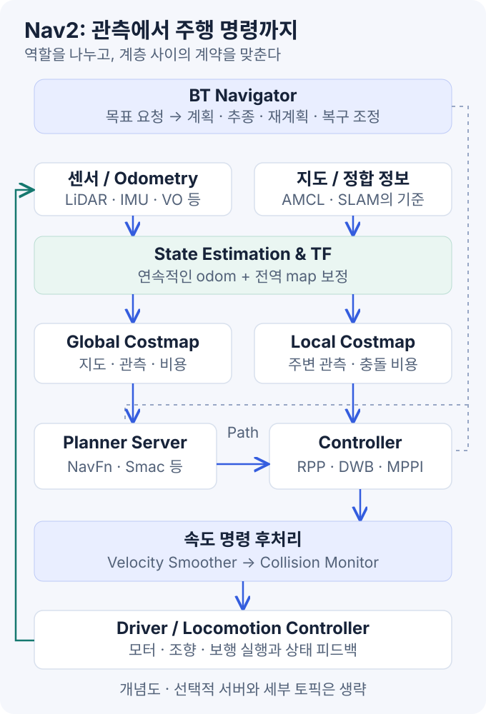
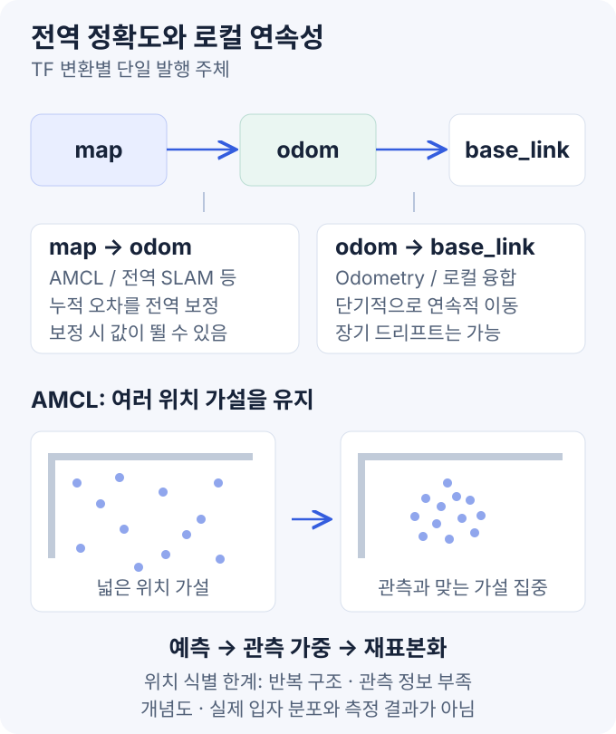
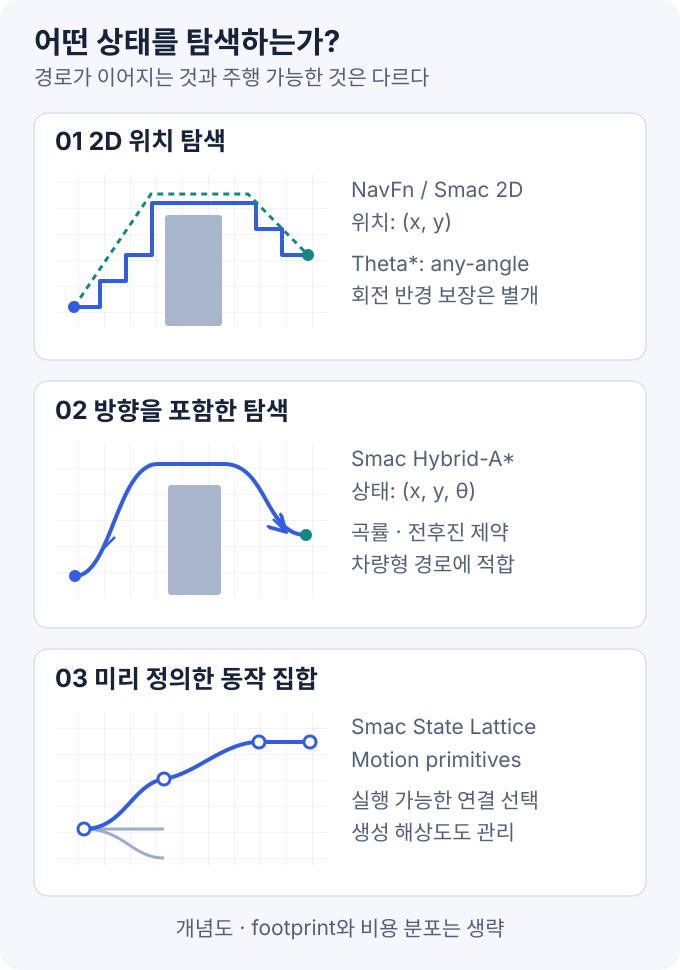
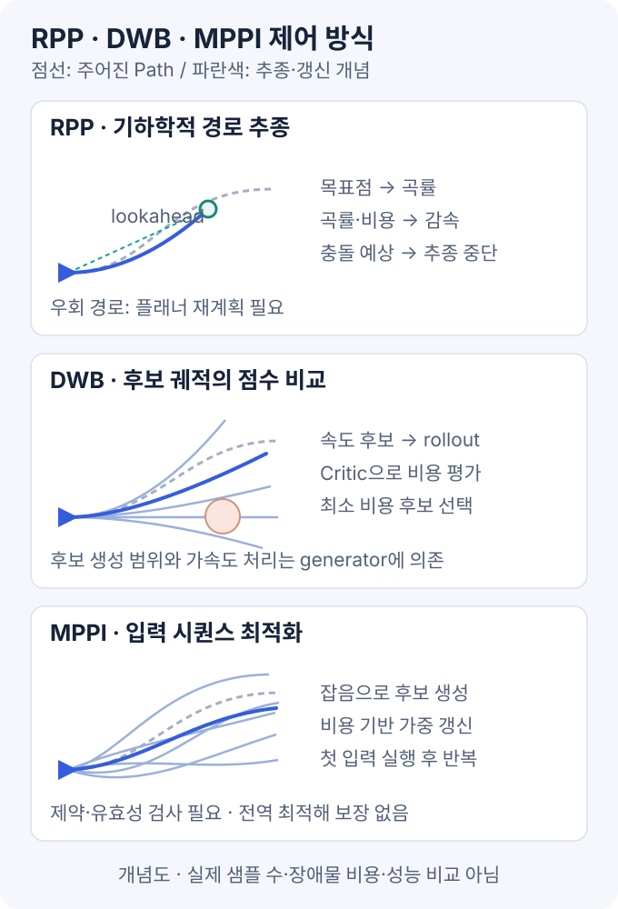
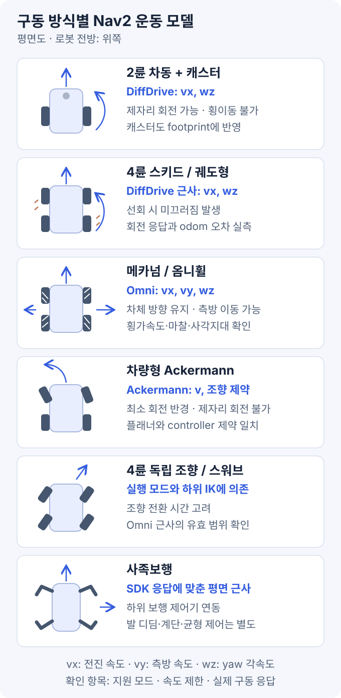
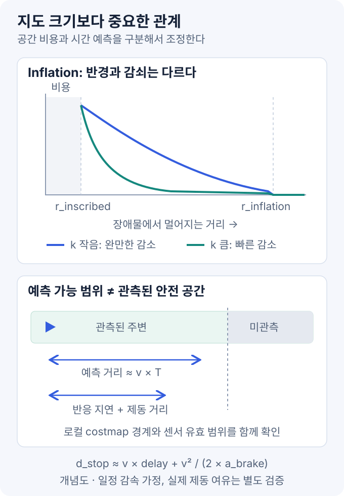
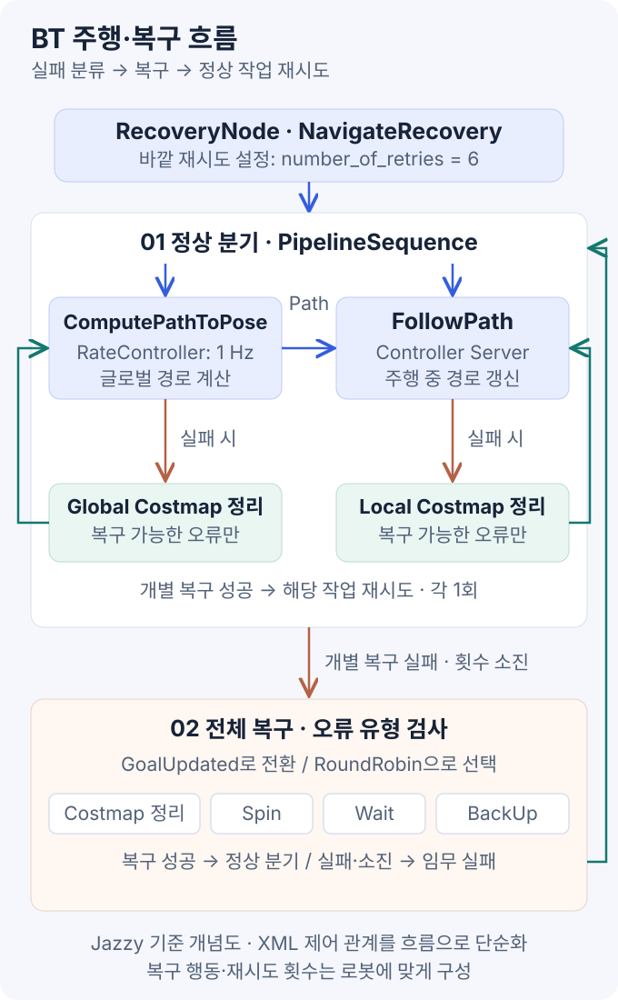

Nav2는 **위치 추정 → 환경 표현 → 경로 계획 → 경로 추종**을 연결하는 ROS 2 내비게이션 프레임워크다. Planner와 Controller는 플러그인으로 선택하고, Behavior Tree로 실행·재계획·복구 흐름을 구성한다.

> **기준: ROS 2 Jazzy · 확인일 2026-10-14.** 설치 절차는 제외한다. 설정은 학습용 부분 예시이며 로봇별 검증이 필요하다. 예시의 소스 기준점은 10절에 명시했다.

### 목차

1. [전체 구조](#1-전체-구조)
2. [TF와 위치 추정](#2-tf와-위치-추정)
3. [Costmap과 충돌 검사](#3-costmap과-충돌-검사)
4. [글로벌 플래너](#4-글로벌-플래너)
5. [로컬 제어기와 구동 모델](#5-로컬-제어기와-구동-모델)
6. [Pure Pursuit와 RPP](#6-pure-pursuit와-rpp)
7. [DWB](#7-dwb)
8. [MPPI](#8-mppi)
9. [Behavior Tree — 실행·재계획·복구](#9-behavior-tree-실행재계획복구)
10. [조합과 설정 예시](#10-조합과-설정-예시)
11. [튜닝 순서와 관측 방법](#11-튜닝-순서와-관측-방법)
12. [증상별 진단과 사족보행 로봇 적용](#12-증상별-진단과-사족보행-로봇-적용)
13. [학습 실험과 참고 자료](#13-학습-실험과-참고-자료)

그림은 직접 작성한 개념도이며 성능 비교나 실험 결과가 아니다. 공식 주행 데모는 별도로 출처를 표시했다.

## 1. 전체 구조



### Pose·Path·Trajectory·Command

| 구분 | 표현 | 주의사항 |
| --- | --- | --- |
| Pose | 특정 좌표계에서의 위치와 자세 | 좌표계와 시각이 빠지면 해석할 수 없다 |
| Path | 따라갈 위치·자세의 배열 | 보통 그 자체로 도착 시각·속도 프로파일을 지정하지 않는다 |
| Trajectory | 시간에 따라 변화하는 상태·입력 | 제어기의 예측 구간과 운동 모델에 의존한다 |
| Velocity command | 지금 하드웨어에 요구하는 속도 | 실제 속도와 같다는 보장은 없다 |

Nav2의 대표적인 흐름은 `NavigateToPose → 경로 계산 → FollowPath → 속도 명령`이다. Planner Server는 글로벌 costmap을 사용해 경로를 계산하고, Controller Server는 경로·로봇 상태·로컬 costmap을 바탕으로 주행 명령을 만든다. BT Navigator는 이 작업의 실행, 재계획과 복구를 조합한다. 서버와 실제 알고리즘 플러그인을 구분해야 한다. [Nav2 Navigation Servers](https://docs.nav2.org/jazzy/getting_started/navigation_concepts/navigation_servers/).

| 인터페이스 | 실행하는 서버 | YAML에서 고르는 알고리즘 |
| --- | --- | --- |
| `NavigateToPose` 액션 | BT Navigator | 실행할 BT와 navigator 구성 |
| `ComputePathToPose` 액션 | Planner Server | 예: `planner_id="GridBased"` → Smac 2D |
| `FollowPath` 액션 | Controller Server | 예: `controller_id="FollowPath"` → MPPI |

`FollowPath`는 액션 타입 이름이면서 예시에서 관례적으로 쓰는 제어기 ID이기도 하다. ID는 임의로 정할 수 있고, 실제 알고리즘은 그 ID 아래의 `plugin`이 결정한다. planner만 바꿔도 controller가 함께 바뀌는 것은 아니다. XML과 YAML을 연결하는 예시는 9·10절에서 다룬다.

위치 추정도 Nav2가 반드시 직접 수행해야 하는 작업은 아니다. AMCL이나 SLAM 시스템이 필요한 위치와 TF를 제공하면 Nav2는 이를 소비한다. 따라서 외부 3D SLAM을 붙일 때도 먼저 데이터와 좌표계의 계약을 맞춰야 한다. [Nav2 State Estimation](https://docs.nav2.org/jazzy/getting_started/navigation_concepts/state_estimation/).

## 2. TF와 위치 추정

### 2.1 TF 체인: `map → odom → base_link`



| 좌표계 | 역할 | 오차와 연속성 |
| --- | --- | --- |
| `map` | 환경에 고정된 장기 기준 | 전역 보정으로 로봇의 추정 위치가 불연속적으로 바뀔 수 있다 |
| `odom` | 짧은 구간의 연속적인 이동 기준 | 시간에 따라 드리프트하지만 갑자기 뛰지 않아야 한다 |
| `base_link` | 로봇 몸체에 고정된 기준 | 센서와 구동 명령을 해석할 기준이 된다 |

일반적으로 `odom → base_link`는 오도메트리·센서 융합기가, `map → odom`은 전역 위치 추정기가 제공한다. 전역 보정 중에도 로컬 이동 기준의 연속성을 유지하는 구조다. [REP-105](https://github.com/ros-infrastructure/rep/blob/master/rep-0105.rst).

기구에 따라 `base_footprint`가 중간에 들어간다. IMU·LiDAR·카메라 프레임까지 포함해 **각 TF 변환의 발행 주체는 하나**로 정리한다. 예를 들어 AMCL과 3D localization이 동시에 같은 `map → odom`을 발행하게 두면 안 된다. 어떤 시스템을 전역 기준으로 사용할지 먼저 결정한다.

### 2.2 EKF·UKF 센서 융합

`robot_localization`은 휠 오도메트리·IMU·VO 등의 관측을 융합한다. EKF는 비선형 모델을 선형화하고, UKF는 시그마 포인트로 상태 분포를 근사한다. 상대 이동 관측만 융합하면 전역 드리프트는 남는다. [robot_localization 상태 추정 노드](https://github.com/cra-ros-pkg/robot_localization/blob/ros2/doc/state_estimation_nodes.rst).

- 센서 외부 파라미터·축 방향·단위·timestamp의 일치
- 같은 엔코더에서 계산한 pose·velocity의 중복 융합 여부
- 관측 불확실성을 반영한 covariance
- 평면 주행 가정에 맞는 `two_d_mode` 설정

평면 제약을 걸면 일부 3D 상태를 0으로 제한한다. 경사로에서 움직이는 사족보행 로봇의 3D 추정기까지 무조건 평면화하는 것은 다른 문제다. 내비게이션용 평면 기준과 원래의 3D 상태를 분리할 수 있다. [센서 융합 구성 가이드](https://github.com/cra-ros-pkg/robot_localization/blob/ros2/doc/configuring_robot_localization.rst).

또한 odometry 메시지의 pose는 보통 `header.frame_id`인 `odom` 기준이고, twist는 `child_frame_id`인 몸체 기준으로 해석한다. 위치가 그럴듯해 보여도 속도의 축·부호가 틀리면 controller의 초기 상태가 잘못된다. [Odometry 메시지 정의](https://github.com/ros2/common_interfaces/blob/jazzy/nav_msgs/msg/Odometry.msg).

### 2.3 AMCL 지도 기반 위치 추정

AMCL은 알려진 지도와 레이저 관측을 이용하는 입자 필터 기반 위치 추정 방식이다. 개념적인 한 주기는 다음과 같다.

1. **예측:** 오도메트리 이동량과 운동 잡음으로 각 입자를 이동시킨다.
2. **관측 갱신:** 각 위치 가설에서 레이저 관측이 지도와 얼마나 잘 맞는지 평가한다.
3. **재표본화:** 중요도가 높은 가설을 중심으로 입자 집합을 갱신한다.
4. **적응적 입자 수 조정:** 위치 가설의 분포에 따라 필요한 표현량을 조절한다.

여기서 `likelihood_field`는 관측 끝점과 지도 장애물 사이의 거리 정보를 활용하는 대표적인 센서 모델이다. 입자 수만 늘려도 지도에 없는 특징이 새로 생기지는 않는다. 반복되는 복도, 큰 개방 공간, 지도 변경은 관측의 구별 능력 자체를 낮출 수 있다. [AMCL 구현](https://github.com/ros-navigation/navigation2/tree/jazzy/nav2_amcl).

| 설정 묶음 | 설정 대상 | 점검할 현상 |
| --- | --- | --- |
| `min_particles`, `max_particles`, `pf_err`, `pf_z` | 입자 수와 적응적 표본화 | 위치 가설이 충분히 표현되는지, 계산량이 감당되는지 |
| `alpha1`부터 `alpha5` | 운동 모델의 오도메트리 잡음 | 회전·직진·횡이동에서 오차가 어떻게 생기는지 |
| `update_min_d`, `update_min_a` | 이동량 기반 관측 갱신 조건 | 이동 중 갱신이 지나치게 뜸하지 않은지 |
| `max_beams`, `sigma_hit`, `z_hit`, `z_rand` | 관측 사용량과 센서 모델 | 스캔 품질, 지도와 관측의 불일치 |

위치가 틀어진 상태에서 컨트롤러 critic을 조절하면 잘못된 좌표계를 더 열심히 따라가게 될 뿐이다. 스캔을 지도에 겹쳐 보고, 입자 분포와 pose 불확실성을 함께 확인하는 편이 먼저다. [AMCL 파라미터](https://docs.nav2.org/jazzy/configuration_and_development/configuration_guide/others/configuring_amcl/).

### 2.4 SLAM·Localization·3D 정합

- **SLAM:** 지도와 궤적을 함께 추정한다. 루프 폐쇄로 전역 보정이 생길 수 있다.
- **AMCL:** 주어진 2D 지도에서 위치를 추정한다. 지도 작성 알고리즘과 역할이 다르다.
- **SLAM Toolbox localization mode:** 저장한 pose graph를 이용하는 별도의 localization 운용 방식이다. 단순 지도 이미지와 직렬화된 pose graph를 혼동하지 않는다. [SLAM Toolbox](https://github.com/SteveMacenski/slam_toolbox).
- **3D LiDAR·Visual localization:** ICP·NDT·특징 정합 등의 외부 시스템을 연결할 수 있다. 지도 형식, 초기 위치, 정합 실패 검출, TF 발행 책임을 별도로 설계해야 한다.

3D point cloud 지도가 있다고 Nav2의 2D costmap이 자동으로 만들어지는 것은 아니다. localization용 지도, 주행 가능 영역, 장애물 투영 결과를 같은 데이터라고 가정하지 않는 것이 핵심이다.

## 3. Costmap과 충돌 검사

### 3.1 점유 지도와 Costmap

Occupancy map이 점유 정보를 표현한다면 costmap은 계획·제어에서 사용할 비용을 구성한다. 전형적으로 글로벌 costmap은 지도 좌표계의 넓은 영역을, 로컬 costmap은 로봇 주변의 rolling window를 담당한다. 단, 프레임과 rolling 여부는 구성 사항이지 모든 시스템에서 고정된 규칙은 아니다. [환경 표현 개념](https://docs.nav2.org/jazzy/getting_started/navigation_concepts/environmental_representation/).

| 계층 | 역할 | 점검 항목 |
| --- | --- | --- |
| Static Layer | 저장된 지도 반영 | 지도 원점·해상도·업데이트 |
| Obstacle Layer | 스캔 등의 장애물 표시와 clearing | 관측 소스, 탐지·raytracing 범위, 데이터 지연 |
| Voxel Layer | 높이 정보를 가진 장애물을 관리하고 2D로 투영 | 높이 범위, 지면, 투영 기준 |
| Inflation Layer | 장애물 주변에 거리 기반 비용 생성 | 반경과 비용 감쇠 |
| Keepout·Speed Filter | 진입 금지 구역·구역별 속도 정책 | 마스크 좌표계와 정책의 일치 |

레이어 추가와 필터 적용은 같은 연산이 아니며, 관측 범위를 늘리는 것과 장애물을 오래 유지하는 것도 다르다. 물체가 사라졌는데 장애물이 남으면 먼저 marking·clearing 조건과 센서의 유효 관측을 살펴본다. [Costmap 2D 설정](https://docs.nav2.org/jazzy/configuration_and_development/configuration_guide/core_servers/costmap_2d/).

### 3.2 해상도·범위·미관측 영역

- **해상도:** 작을수록 좁은 형상을 표현하기 좋지만 셀 수와 계산·메모리 비용이 증가한다. 같은 면적에서 해상도를 절반으로 줄이면 셀 수는 약 네 배다.
- **로컬 범위:** 예측 궤적과 정지 여유를 담아야 한다. 범위만 키워도 센서가 관측하지 못한 공간이 안전해지는 것은 아니다.
- **Unknown 정책:** costmap의 `track_unknown_space`와 planner의 `allow_unknown`을 함께 해석한다. unknown과 free는 다르며, planner 옵션만 바꿔도 costmap의 정보 표현이 바뀌는 것은 아니다.

센서가 장애물을 표시하는 marking과 관측 광선으로 제거하는 clearing은 별개다. 센서 바깥으로 나간 물체는 제거 관측 자체가 없을 수 있다. 지면 필터링·높이 범위·최대 거리 처리와 TF·시각 문제를 먼저 확인한다. [Obstacle Layer](https://docs.nav2.org/jazzy/configuration_and_development/configuration_guide/core_servers/costmap_2d/costmap_plugins/obstacle/).

### 3.3 Inflation 비용 분포

장애물과 가까운 공간에 높은 비용을 부여하면 cost-aware planner가 여유 있는 경로를 선택할 근거가 생긴다. 다만 `inflation_radius` 전체가 통행 불가 영역으로 변하는 것은 아니다. 지수 감쇠 구간의 개념식은 다음과 같다.

```text
C(d) ∝ exp[-k · (d - r_inscribed)]
```

`inflation_radius`는 영향 범위를, `cost_scaling_factor`에 대응하는 `k`는 감쇠 속도를 조절한다. **k가 커지면 비용이 더 빠르게 감소한다.** 따라서 반경 증가와 감쇠 계수 증가는 같은 효과가 아니다. 이 식은 장애물 바로 안쪽의 lethal·inscribed 처리나 unknown 값을 설명하는 전체 구현식은 아니다. [Inflation Layer](https://docs.nav2.org/jazzy/configuration_and_development/configuration_guide/core_servers/costmap_2d/costmap_plugins/inflation/).

### 3.4 Footprint 충돌 영역

길쭉한 로봇을 원으로만 근사하면 좁은 통로를 과도하게 막거나 특정 방향의 충돌을 놓칠 수 있다. 회전을 고려하는 planner와 footprint-aware collision checker를 쓴다면 실제 외형을 반영한 다각형 footprint가 중요하다. 반면 2D 위치만 탐색하는 planner를 선택했다고 정밀한 SE(2) 형상 탐색까지 자동으로 생기지는 않는다. [Nav2 footprint 튜닝 가이드](https://docs.nav2.org/jazzy/configuration_and_development/tuning_guide/#robot-footprint-vs-radius).

Voxel Layer도 내부 3D 관측을 최종 2D 계획 공간으로 투영하는 방식이다. 높은 장애물, 지면 반사, 몸체 아래 공간과 낙하지형을 모두 해결하는 지형 주행 모델로 해석하면 안 된다. [Voxel Layer](https://docs.nav2.org/jazzy/configuration_and_development/configuration_guide/core_servers/costmap_2d/costmap_plugins/voxel/).

## 4. 글로벌 플래너

| 플래너 | 핵심 방식 | 선택 기준 |
| --- | --- | --- |
| NavFn | Dijkstra 또는 A* 확장과 potential 기반 경로 생성 | 단순한 2D 글로벌 계획의 기준선 |
| SmacPlanner2D | 비용을 고려하는 2D A* | 장애물 주변 비용을 반영하는 격자 계획 |
| Theta* | line-of-sight 연결을 활용하는 any-angle 검색 | 격자 방향에 덜 묶인 선분 경로 |
| Smac Hybrid-A* | 방향·운동 모델을 포함한 상태 탐색 | 차량형의 최소 회전 반경과 전후진 제약 반영 |
| Smac State Lattice | 미리 정의한 motion primitive 연결 | 차동·전방향·차량형에 맞는 동작 집합 구성 |

위치만 탐색하는 2D 플래너와 방향·운동 제약까지 다루는 플래너를 먼저 구분한다. 아래에서 탐색 원리와 대표 설정을 설명한다. [Nav2 플래너 선택 가이드](https://docs.nav2.org/jazzy/configuration_and_development/tuning_guide/#planner-plugin-selection).

### 4.1 Dijkstra·A*

검색에서 `g(n)`은 현재까지의 비용, `h(n)`은 목표까지 남은 비용의 추정이다. Dijkstra는 누적 비용을 중심으로 확장하고, A*는 보통 `f(n) = g(n) + h(n)`을 사용한다. 실제 결과는 검색 이름뿐 아니라 이웃 연결, 비용 정의, 휴리스틱과 종료 조건에 달려 있다.

계획 결과는 탐색 상태 공간에 따라 달라진다. `(x, y)` 위치 탐색과 `(x, y, yaw)`에 운동 제약을 적용한 탐색을 구분한다. 출력 Path의 orientation 값만으로 방향·운동 제약의 반영 여부를 판단할 수는 없다.



### 4.2 NavFn·Smac 2D·Theta*

NavFn은 `use_astar`로 검색 방식을 선택한다. Smac 2D도 단순 최단 거리만 보는 검색과 달리 costmap의 통과 비용을 고려한다. Theta*는 시야가 확보된 노드를 직접 연결해 경로의 방향 선택을 넓힌다. **Any-angle은 최소 회전 반경을 만족한다는 뜻이 아니다.** [NavFn](https://docs.nav2.org/jazzy/configuration_and_development/configuration_guide/planners_plugins/configuring_navfn/), [Smac 2D](https://docs.nav2.org/jazzy/configuration_and_development/configuration_guide/planners_plugins/smac/smac_2d/configuring_smac_2d/), [Theta*](https://docs.nav2.org/jazzy/configuration_and_development/configuration_guide/planners_plugins/thetastar/configuring_thetastar/).

### 4.3 Smac Hybrid-A*: 방향과 최소 회전 반경

Hybrid-A*는 연속적인 차량 상태를 운동 모델로 확장하면서 이산화된 상태 공간을 검색한다. 차량처럼 제자리 회전이 안 되는 플랫폼에서 의미가 크다. Nav2의 대표 설정은 다음과 같다.

- `minimum_turning_radius`: 실제 플랫폼이 가능한 최소 회전 반경.
- `motion_model_for_search`: `DUBIN` 또는 `REEDS_SHEPP` 등 검색 모델.
- `angle_quantization_bins`: 방향 상태의 분해능.
- `reverse_penalty`, `non_straight_penalty`: 후진·비직진 동작의 선호 비용.

Dubins 계열은 전진 경로를, Reeds–Shepp 계열은 후진을 포함한 경로를 다룬다. penalty는 선호를 바꾸지만 물리적으로 불가능한 회전을 가능하게 만들지는 않는다. 후진 경로를 생성한다면 controller와 하위 구동기도 이를 지원해야 한다. [Smac Hybrid-A*](https://docs.nav2.org/jazzy/configuration_and_development/configuration_guide/planners_plugins/smac/smac_hybrid/configuring_smac_hybrid/).

### 4.4 Smac State Lattice 동작 집합

State Lattice는 사전에 구성한 motion primitive·control set을 연결해 검색한다. 차동·전방향·차량형 등 플랫폼에 맞는 동작 집합을 만들 수 있다는 점이 핵심이다. 전방향 로봇이라고 임의의 lattice 파일을 쓰면 안 된다. 횡이동·회전·곡률 제약이 로봇과 맞는지 확인한다.

Nav2에서는 lattice 생성 당시의 해상도와 동작 집합이 연결된다. Hybrid-A*의 `minimum_turning_radius`만 바꾸듯이 동일하게 접근할 수 없으며, `lattice_filepath`가 가리키는 control set을 함께 관리해야 한다. [Smac State Lattice](https://docs.nav2.org/jazzy/configuration_and_development/configuration_guide/planners_plugins/smac/smac_lattice/configuring_smac_lattice/).

### 4.5 경로 스무딩

경로가 충돌 없이 연결돼 있어도 꺾임이나 불필요한 요철이 추종을 어렵게 할 수 있다. Simple Smoother와 Constrained Smoother 등의 목적은 경로 후처리다. 특히 Constrained Smoother는 곡률, 장애물 비용과 부드러움 등을 함께 최적화한다. [Constrained Smoother](https://docs.nav2.org/jazzy/configuration_and_development/configuration_guide/smoother_plugins/constrained_smoother/configuring_constrained_smoother/).

다만 경로 스무딩과 속도 명령 스무딩은 다르다. 운동학적으로 가능한 경로도 속도·가속도·저크·마찰·구동 지연까지 모두 만족하는 시간 궤적은 아닐 수 있다. 전후진 전환점인 cusp와 시작·목표 방향을 잘못 다듬지 않도록 후처리 뒤에도 경로를 검사한다.

## 5. 로컬 제어기와 구동 모델

Nav2의 Controller는 문헌에서 local planner 또는 local trajectory planner라고 부르는 역할까지 포함할 수 있다. 모터 전류·관절 토크를 직접 제어하는 하위 제어기와 구분해야 한다.

| 제어기 | 구분 | 핵심 방식 | 선택 기준·주의점 |
| --- | --- | --- | --- |
| [RPP](#6-pure-pursuit와-rpp) | Nav2 포함 | 경로의 목표점에서 곡률 계산·속도 조절 | 경로 추종 중심. 장애물 우회는 재계획과 조합 |
| [DWB](#7-dwb) | Nav2 포함 | 속도 후보의 예측 궤적을 critic으로 평가 | 후보 범위 안에서 회피 탐색. 샘플링·가중치 튜닝 필요 |
| [MPPI](#8-mppi) | Nav2 포함 | 입력 시퀀스를 샘플링하는 예측 최적화 | 예측 구간 안에서 회피 탐색. 모델·제약·계산량 관리 |
| [Graceful](https://github.com/ros-navigation/navigation2/blob/jazzy/nav2_graceful_controller/README.md) | Nav2 포함 | 목표 자세로 부드럽게 수렴하는 기하학적 제어 | motion target과 자세 오차에 따른 접근 동작 조절 |
| [Vector Pursuit](https://github.com/blackcoffeerobotics/vector_pursuit_controller) | 외부 | 목표점의 위치·방향을 screw theory로 결합 | 경로 자세를 활용하는 추종. Jazzy 호환성 별도 확인 |
| [TEB](https://github.com/rst-tu-dortmund/teb_local_planner) | 외부·포트 확인 | pose·시간 간격을 포함한 궤적 최적화 | 시간·장애물·운동 제약을 평가. 원 프로젝트는 ROS 1 |
| [Rotation Shim](https://github.com/ros-navigation/navigation2/blob/jazzy/nav2_rotation_shim_controller/README.md) | Nav2 포함·보조 | 새 경로 방향으로 회전한 뒤 주 제어기에 전달 | 단독 추종기가 아닌 래퍼. 제자리 회전 가능한 기체에 적용 |

**Nav2 포함**은 Jazzy 소스 트리에 포함된 구현을 뜻한다. 공식 플러그인 목록에는 외부 프로젝트도 있으므로, 목록 등재와 해당 배포판의 설치·지원 상태를 구분한다. 외부 플러그인은 제공 브랜치·Nav2 API 호환성·유지보수 상태를 확인한다. [Nav2 플러그인 목록](https://docs.nav2.org/jazzy/configuration_and_development/navigation_plugins/#controllers).

Pure Pursuit·DWA·MPC는 알고리즘 계열 이름이다. 여기서는 이를 구현·확장한 RPP·DWB·MPPI와 구분한다. 상세 해설은 **기하학적 추종 → 후보 궤적 평가 → 입력 시퀀스 최적화** 순서로 6~8절에 정리한다.



계산량과 주행 품질은 horizon·샘플 수·충돌 검사 방식·CPU·로봇 응답에 따라 달라진다. 같은 조건에서 비교한다. [Nav2 controller 선택 가이드](https://docs.nav2.org/jazzy/configuration_and_development/tuning_guide/#controller-plugin-selection).

### 5.1 운동 모델

차동형의 주 입력은 `vx`·`wz`, 전방향은 여기에 `vy`가 추가된다. Ackermann은 조향에 따라 전진 속도와 회전이 연결된다. 이 구분은 바퀴 수가 아니라 **차체가 실행할 수 있는 속도와 회전 제약**에 따른다.

이상적인 자전거 모델의 관계는 `curvature = tan(steering_angle) / wheelbase`, `yaw_rate = velocity × curvature`다. `cmd_vel`을 받는 차량형 드라이버는 이 제약을 지키는 변환을 수행해야 한다. 속도가 0에 가까울 때 단순히 `yaw_rate / velocity`를 계산하는 구현도 피해야 한다.

### 5.2 구동·조향 방식

플랫폼은 바퀴 수보다 구동·조향 방식으로 분류한다. 몸체 좌표계의 `vx`·`vy`는 전진·측방 속도, `wz`는 yaw 각속도다.



| 플랫폼 | 차체 움직임 | Nav2 설정·점검 항목 |
| --- | --- | --- |
| 2륜 차동구동 + 보조 캐스터 | `vx`, `wz`; 이상적 모델에서 `vy = 0`, 제자리 회전 가능 | DiffDrive, DWB·MPPI·RPP 검토. 캐스터까지 포함한 실제 외형과 회전 공간 확인 |
| 4륜·6륜 스키드 또는 궤도형 | 좌우 구동 속도 차이로 회전; 선회 중 미끄러짐 발생 | DiffDrive를 평면 근사로 쓰되 선회 응답·오도메트리 오차를 실측. 바퀴 수만큼 모델 상태를 늘리는 방식이 아님 |
| 메카넘·옴니휠 | `vx`, `vy`, `wz`; 차체를 돌리지 않고 측방 이동 가능 | MPPI Omni 또는 DWB의 횡속도 샘플링. 측방 속도·가속도·센서 사각지대 검증 |
| 차량형 Ackermann | 전진·후진하면서 조향; 제자리 회전 불가 | 최소 회전 반경을 고려하는 planner와 MPPI Ackermann 또는 RPP. 회전 복구·목표 방향 정책도 변경 |
| 4륜 독립 조향·스워브 | 모듈 구성과 모드에 따라 crab·제자리 회전·차량형 동작 | 모드별 실행 가능한 twist를 정의하고 하위 역기구학·조향 전환을 연결. 항상 이상적인 Omni라고 가정하지 않음 |
| 사족보행 | 보행 모드가 허용하는 `vx`, `vy`, `wz` | SDK·locomotion의 응답에 맞춰 DiffDrive 또는 Omni 근사 검토. 발 디딤·균형·지형 주행은 별도 계층 |

이 표는 특정 제품의 보증된 기능표가 아니라 인터페이스를 분류하는 기준이다. 차동구동 하위 제어기는 몸체 twist를 바퀴 명령으로, 메카넘 제어기는 횡이동을 포함한 twist를 각 바퀴 속도로 변환한다. **Nav2 Controller와 `ros2_control`의 구동 controller는 다른 계층이다.** [차동구동 controller](https://control.ros.org/jazzy/doc/ros2_controllers/diff_drive_controller/doc/userdoc.html), [메카넘 controller](https://control.ros.org/jazzy/doc/ros2_controllers/mecanum_drive_controller/doc/userdoc.html).

### 5.3 차동·스키드 조향 오차

이상적인 차동구동에서 좌우 바퀴의 접선 속도를 `v_left`, `v_right`, 바퀴 사이 거리를 `b`라고 하면 다음과 같다.

```text
vx = (v_right + v_left) / 2
wz = (v_right - v_left) / b
```

하지만 스키드 조향의 선회에는 타이어와 지면 사이의 횡방향 미끄러짐이 개입한다. 같은 명령이라도 노면·하중·타이어에 따라 회전량이 달라질 수 있다. 다음은 이 차이에서 나오는 튜닝·검증 관점이다.

- 직진 거리 오차와 회전 각도 오차를 분리해 측정한다. 엔코더만으로 만든 선회 odometry를 그대로 정답으로 취급하지 않는다.
- 유효한 wheel separation 보정값을 맞췄더라도 모든 노면에서 같은 보정이 통한다고 가정하지 않는다.
- IMU·LiDAR/Visual Odometry 등과 비교해 선회 중의 yaw 오차와 covariance를 점검한다.
- DWB·MPPI의 각속도·각가속도 제한과 하위 구동기의 제한을 맞춘다. 반응이 느린 플랫폼에 큰 `wz`를 요청한다고 즉시 더 빠르게 회전하지는 않는다.

이상적인 운동학과 wheel separation의 의미는 [ROS 2 모바일 로봇 운동학](https://control.ros.org/jazzy/doc/ros2_controllers/doc/mobile_robot_kinematics.html), 보정·피드백 인터페이스는 [diff_drive_controller](https://control.ros.org/jazzy/doc/ros2_controllers/diff_drive_controller/doc/userdoc.html)를 참고한다.

### 5.4 전방향·차량형 설정

**전방향 플랫폼:** `vy`를 허용하려면 controller의 모델·샘플링뿐 아니라 smoother, SDK 어댑터와 최종 드라이버까지 횡속도를 유지해야 한다. Nav2에서만 `vy`를 생성하고 드라이버가 이를 버리면 예측과 실제 움직임이 달라진다. 기본 RPP는 전방향 베이스에서도 사용할 수 있지만 측방 이동 능력을 충분히 활용하는 추종기는 아니다. [RPP의 플랫폼 범위](https://github.com/ros-navigation/navigation2/blob/jazzy/nav2_regulated_pure_pursuit_controller/README.md).

**Ackermann 플랫폼:** `R_min ≈ wheelbase / tan(max_steering_angle)`이라는 이상적 관계를 기준으로 최소 회전 반경을 맞춘다. Smac Hybrid-A*·State Lattice 등의 경로와 controller의 회전 제약이 서로 일치해야 한다. NavFn이 만든 급격한 꺾임을 MPPI Ackermann 하나가 언제나 해결한다고 기대하면 안 된다. 조향각·조향 속도 제한과 저속 변환은 하위 구동 계층에서도 검증한다. [Ackermann 구동 controller](https://control.ros.org/jazzy/doc/ros2_controllers/ackermann_steering_controller/doc/userdoc.html), [Smac Hybrid-A*](https://docs.nav2.org/jazzy/configuration_and_development/configuration_guide/planners_plugins/smac/smac_hybrid/configuring_smac_hybrid/).

여기서 `wheelbase`는 좌우 바퀴 간격이 아니라 앞뒤 차축 사이 거리다. 단순 자전거 모델의 선속도 기준점은 뒤차축 중심이므로, 몸체 좌표계·속도 기준점과 어댑터의 변환도 일치시킨다. [차량형 운동학](https://control.ros.org/jazzy/doc/ros2_controllers/doc/mobile_robot_kinematics.html#car-like-bicycle-model).

차량형에서는 RPP의 제자리 회전, Rotation Shim, BT의 `Spin` 같은 동작을 그대로 활성화하지 않는다. 좁은 공간에서 목표 방향까지 맞춰야 한다면 진입 방향과 후진·다점 회전 가능 여부를 계획 단계부터 다룬다.

독립 조향 플랫폼은 이 구분을 한 번 더 확장한다. Jazzy MPPI의 기본 모델 이름을 선택하는 것만으로 개별 바퀴의 조향각과 조향 전환 시간이 모델링되지는 않는다. 하위 제어기로 감출 수 없는 제약이 크다면 custom motion model·controller 또는 모드별 계획을 검토해야 한다. [Jazzy MPPI 모델과 제약](https://github.com/ros-navigation/navigation2/blob/jazzy/nav2_mppi_controller/README.md).

### 5.5 사족보행 운동 모델

SDK가 측방 속도를 받는다는 것과 모든 속도 조합을 즉시 실현할 수 있다는 것은 다르다. 예를 들어 Unitree Go2의 Sport API에는 몸체 이동 속도를 받는 `Move(vx, vy, vyaw)` 인터페이스가 있다. 그러나 이 함수의 존재만으로 다른 모델·펌웨어·보행 모드의 제한까지 알 수는 없다. [Unitree Go2 SportClient 원본 인터페이스](https://github.com/unitreerobotics/unitree_sdk2/blob/main/include/unitree/robot/go2/sport/sport_client.hpp).

전진·측방·회전을 각각 시험하고, 동시에 요청했을 때의 포화와 지연을 확인한 뒤 모델과 제한을 고른다. 지형·발 디딤과 평면 내비게이션의 책임 분리는 12절에서 정리한다.

### 5.6 계층별 운동 모델 설정

위치 추정·계획·제어·구동 계층의 운동 가정과 제한을 함께 맞춘다.

- **위치 추정:** AMCL을 쓴다면 `robot_model_type`의 `nav2_amcl::DifferentialMotionModel`·`nav2_amcl::OmniMotionModel`을 실제 odometry 특성에 맞춘다. 이것은 입자 예측의 운동 잡음 모델이며 MPPI의 제어 예측 모델과 같은 설정이 아니다. `alpha5`도 Omni 모델에서만 사용하는 항목이다. [AMCL 운동 모델](https://docs.nav2.org/jazzy/configuration_and_development/configuration_guide/others/configuring_amcl/#robot_model_type).
- **글로벌 계획:** 위치만 탐색해도 되는지, 방향·최소 회전 반경·후진 제약을 경로에 포함해야 하는지 정한다.
- **로컬 제어:** Jazzy MPPI의 `motion_model`은 `DiffDrive`·`Omni`·`Ackermann`을 구분한다. Omni라면 횡방향 제한을, Ackermann이라면 `AckermannConstraints.min_turning_r`도 확인한다. [MPPI 모델 설정](https://docs.nav2.org/jazzy/configuration_and_development/configuration_guide/controller_plugins/mppi_controller/configuring_mppic/).
- **명령 실행:** 하위 드라이버가 같은 자유도와 제한을 지원하는지 확인한다. 평면 twist를 바퀴 속도·조향각·보행 명령으로 바꾸는 책임은 이쪽에 있다.

## 6. Pure Pursuit와 RPP

### 6.1 Pure Pursuit 기하

Pure Pursuit는 경로에서 앞쪽 목표점인 carrot을 고르고, 그 점에 도달하는 원호의 곡률을 계산한다. 목표점의 로봇 기준 좌표를 `(x_L, y_L)`로 두면 개념식은 다음과 같다.

```text
L_d² = x_L² + y_L²
curvature = 2 y_L / L_d²
yaw_rate = velocity × curvature
```

여기서 `L_d`는 해당 기하식의 목표점까지 거리다. 구현에서 경로를 따라 목표점을 고르는 거리와 구분해서 읽는다. lookahead가 짧으면 빠르게 반응하는 대신 흔들리기 쉽고, 길면 안정적인 대신 코너를 잘라 먹거나 지연이 커질 수 있다. [RPP 논문](https://arxiv.org/abs/2305.20026).

### 6.2 RPP 속도 조절·충돌 예측

RPP(Regulated Pure Pursuit)는 속도에 따른 lookahead 조정, 큰 곡률에서의 감속, 장애물 가까이에서의 감속, 목표 접근 감속과 전방 충돌 검사를 결합한다. 고정 속도로 기하학적 경로만 추종하는 Pure Pursuit보다 실제 운용을 위한 제약 처리가 보강된 형태다. [Jazzy RPP 구현 설명](https://github.com/ros-navigation/navigation2/blob/jazzy/nav2_regulated_pure_pursuit_controller/README.md).

| 설정 | 해석 |
| --- | --- |
| `desired_linear_vel` | 기본 목표 선속도 |
| `lookahead_dist` | 고정 lookahead 사용 시 거리 |
| `use_velocity_scaled_lookahead_dist`, `lookahead_time` | 속도에 따른 lookahead와 시간 계수 |
| `min_lookahead_dist`, `max_lookahead_dist` | lookahead의 하한·상한 |
| `use_regulated_linear_velocity_scaling` | 곡률에 따른 감속 |
| `use_cost_regulated_linear_velocity_scaling` | 장애물 주변 비용에 따른 감속 |
| `max_allowed_time_to_collision_up_to_carrot` | 충돌 검사의 시간 범위. carrot까지의 거리 제한도 받음 |

장애물 거리 추정에 사용하는 `inflation_cost_scaling_factor`는 로컬 costmap Inflation Layer의 `cost_scaling_factor`와 맞춰야 한다. `cost_scaling_dist`도 inflation 반경 이내여야 한다. 제자리 회전과 후진을 제어하는 `use_rotate_to_heading`·`allow_reversing`은 Jazzy RPP에서 동시에 활성화할 수 없다. [RPP 파라미터와 제약](https://docs.nav2.org/jazzy/configuration_and_development/configuration_guide/controller_plugins/configuring_regulated_pp/).

**이 글 기준 RPP의 충돌 검사·감속은 우회 경로 검색과 다르다.** 막힌 경로에서는 BT의 재계획·복구 정책까지 함께 구성한다. 최신 Rolling 기능과 이름 차이는 설정 절의 버전 메모에서 따로 구분했다.

구현상 전방 충돌이 예상되면 `NoValidControl` 예외가 발생할 수 있다. 이를 Controller Server가 처리한 뒤 추종 실패·복구로 이어질 수 있으므로, “RPP가 장애물 앞에서 계속 0 속도를 반환하며 기다린다”는 흐름으로만 이해하지 않는다. [RPP 충돌 처리 소스](https://github.com/ros-navigation/navigation2/blob/645abd95f2be02a13ca539b29c2ddc065db34f89/nav2_regulated_pure_pursuit_controller/src/regulated_pure_pursuit_controller.cpp).

## 7. DWB

### 7.1 후보 궤적 생성·선택

DWB는 DWA와 trajectory rollout 계열을 플러그인 기반으로 확장한 제어기다. 속도 후보를 만들고 전방 시뮬레이션한 뒤, 충돌 등으로 무효인 후보를 제외하고 유효 후보의 critic 점수를 비교한다. 단순화하면 다음과 같다.

```text
score(trajectory) = Σ scale_j × critic_j(trajectory)
command = 유효한 후보 중 점수가 낮은 궤적의 명령
```

DWA는 현재 속도와 가속도 한계에서 단시간에 도달 가능한 속도 집합을 탐색한다. DWB의 후보 생성은 generator에 따라 달라진다. `StandardTrajectoryGenerator`는 trajectory rollout 계열, `LimitedAccelGenerator`는 DWA 계열이다. [DWB README](https://github.com/ros-navigation/navigation2/blob/jazzy/nav2_dwb_controller/README.md), [DWB generator 설정](https://docs.nav2.org/jazzy/configuration_and_development/configuration_guide/controller_plugins/dwb_controller/dwb_params/controller/).

### 7.2 Critic 평가 요소

| Critic | 평가 요소 |
| --- | --- |
| `PathDist` / `PathAlign` | 글로벌 경로와의 거리·정렬 |
| `GoalDist` / `GoalAlign` | 목표와의 거리·정렬 |
| `BaseObstacle` | 궤적이 지나는 costmap 비용 |
| `ObstacleFootprint` | 로봇 형상을 고려한 장애물 충돌 |
| `Oscillation` | 반복적인 앞뒤 이동 등의 진동 |
| `RotateToGoal` | 목표 부근에서의 회전 동작 |
| `PreferForward` / `Twirling` | 전진 선호·불필요한 회전 억제 |

충돌 검사 범위는 critic 종류·로봇 외형·inflation 설정에 따라 달라진다. `scale`은 각 critic의 점수 단위·범위와 함께 조절한다. [DWB 플러그인과 critic](https://github.com/ros-navigation/navigation2/blob/jazzy/nav2_dwb_controller/README.md).

### 7.3 DWB 튜닝 항목

1. **명령 범위:** 선속도·각속도·가감속 제한이 실제 로봇과 맞는지 확인한다.
2. **샘플 분해능:** `vx_samples`, `vy_samples`, `vtheta_samples`가 필요한 동작을 충분히 표현하는지 본다.
3. **예측 구간:** `sim_time`과 궤적의 시간·공간 분해능을 확인한다.
4. **유효 후보:** 모든 후보가 충돌하는지, 유효 후보는 있는데 점수 때문에 이상한 선택을 하는지 구분한다.
5. **critic 균형:** 그 다음에 경로 추종·목표 접근·장애물 비용의 가중치를 조절한다.

예측 구간이 짧으면 회피가 늦어지고, 길면 계산량과 모델 오차의 영향이 커질 수 있다. [DWB 구성 가이드](https://docs.nav2.org/jazzy/configuration_and_development/configuration_guide/controller_plugins/dwb_controller/).

## 8. MPPI

### 8.1 입력 시퀀스 최적화

MPPI(Model Predictive Path Integral)는 sampling-based MPC 계열이다. Nav2에서는 이전 해를 초기값으로 활용하고, 입력 시퀀스에 잡음을 더해 여러 후보를 전방 시뮬레이션한다. 비용을 평가한 뒤 낮은 비용의 후보가 더 크게 기여하도록 제어 시퀀스를 갱신한다. [MPPI 구현 설명](https://github.com/ros-navigation/navigation2/blob/jazzy/nav2_mppi_controller/README.md).

1. 현재 상태와 이전 제어 시퀀스 `U`를 준비한다.
2. `K`개의 잡음 시퀀스 `ε_k`를 샘플링한다.
3. `U + ε_k`를 운동 모델에 넣어 `N`단계의 후보 궤적을 만든다.
4. 경로·목표·장애물·제약 등의 비용을 합산한다.
5. 비용 기반 가중치로 입력 시퀀스를 갱신한다.
6. 첫 입력을 적용하고, 다음 주기에는 갱신한 상태에서 다시 계산한다.

가중 갱신의 직관은 다음과 같다. 이는 설명용 개념식이며 실제 구현의 입력 비용, 샘플링 보정과 제약 처리를 생략했다.

```text
w_k ∝ exp[-(S_k - S_min) / temperature]
Σ w_k = 1
U_new ≈ U + Σ w_k ε_k
```

MPPI는 정보이론적 제어와 importance sampling에 기반한 가중 갱신 방식이다. 전역 최적해나 모든 조건의 충돌 회피를 보장하지는 않는다. [Information Theoretic Model Predictive Control](https://arxiv.org/abs/1707.02342).

<details>
<summary>공식 MPPI 주행 데모 보기 — 외부 GIF, 약 8 MB</summary>


출처: [Nav2 Jazzy MPPI README와 원본 미디어](https://github.com/ros-navigation/navigation2/blob/645abd95f2be02a13ca539b29c2ddc065db34f89/nav2_mppi_controller/README.md). 공식 프로젝트의 데모이며, 이 글 작성자의 실험 결과가 아니다. GIF는 원본 저장소에서 직접 불러온다.

</details>

### 8.2 예측 구간·연산량

```text
T_horizon = time_steps × model_dt
S_predict ≈ velocity × T_horizon
```

예를 들어 `time_steps = 56`, `model_dt = 0.05 s`이면 예측 구간은 약 `2.8 s`다. 설정 예시와 같은 `0.4 m/s`로 일정하게 전진한다고 가정하면 약 `1.12 m`에 해당한다. 실제 궤적은 가속·회전·입력 시퀀스에 따라 달라진다.

`batch_size`와 `time_steps`를 함께 늘리면 후보 수와 궤적 평가량이 함께 증가한다. `model_dt`는 제어 주기와 맞춰 해석한다. 예를 들어 20 Hz 제어 주기는 0.05 s다. 큰 horizon이 항상 더 좋은 것은 아니며, 로컬 costmap 범위·경로 잘라내기·관측 범위가 뒷받침돼야 한다. [MPPI 파라미터](https://docs.nav2.org/jazzy/configuration_and_development/configuration_guide/controller_plugins/mppi_controller/configuring_mppic/).



정지 거리는 다음과 같은 근사로 점검할 수 있다.

```text
D_stop ≈ v × latency + v² / (2 × deceleration) + margin
```

이는 정지 장애물과 일정 감속을 가정한 점검식이다. `v = 0.4 m/s`, 지연 `0.2 s`, 감속 `0.5 m/s²`이면 margin 전의 정지 거리는 약 `0.24 m`다. 여기에는 로봇 외형과 이동 장애물의 접근, 미끄러짐이 포함되지 않는다. **관측 거리·costmap 범위·예측 거리·정지 거리는 서로 다른 값이며, 실제 제동 시험으로 여유를 정해야 한다.**

### 8.3 Critic 평가 요소

| Critic | 평가 요소·점검 항목 |
| --- | --- |
| `ConstraintCritic` | 모델별 속도 한계와 Ackermann 최소 회전 반경 위반 비용 |
| `CostCritic` / `ObstaclesCritic` | 장애물과 주변 비용. 방식·설정은 서로 다르므로 구분 |
| `PathAlignCritic` | 경로 형상과의 정렬. 우회가 필요한 상황에서 지나치게 지배적이지 않은지 확인 |
| `PathFollowCritic` | 경로를 따라 앞으로 진행하도록 유도 |
| `PathAngleCritic` | 경로 방향과 로봇 자세의 관계 |
| `GoalCritic` / `GoalAngleCritic` | 목표 위치·방향 접근 |
| `PreferForwardCritic` | 전진 선호. 후진 금지라는 하드 제약과는 다름 |

`CostCritic`과 `ObstaclesCritic`은 이 기준의 Jazzy 소스에 **둘 다 존재하지만 계산 방식과 파라미터가 다르다.** 이 글은 기본 bringup 구성과 같은 `CostCritic`을 사용한다. 이름만 바꾸거나 비용을 중복 추가하기 전에 각 항의 의미를 확인한다. [MPPI critic 문서](https://docs.nav2.org/jazzy/configuration_and_development/configuration_guide/controller_plugins/mppi_controller/configuring_mppic/), [기준 Jazzy 구성](https://github.com/ros-navigation/navigation2/blob/645abd95f2be02a13ca539b29c2ddc065db34f89/nav2_bringup/params/nav2_params.yaml).

가중 비용과 하드 제한도 구분해야 한다. critic 가중치를 키우는 것은 위반을 비싸게 만드는 방식이다. 최적화기의 속도·가속도 제한 처리, 운동 모델 제약, 충돌 검사까지 모두 `ConstraintCritic` 하나가 수행하는 것은 아니다. 소프트웨어 제약이 실제 노면의 마찰이나 보행 안정성까지 보증하지도 않는다. [ConstraintCritic 소스](https://github.com/ros-navigation/navigation2/blob/645abd95f2be02a13ca539b29c2ddc065db34f89/nav2_mppi_controller/src/critics/constraint_critic.cpp), [Optimizer 소스](https://github.com/ros-navigation/navigation2/blob/645abd95f2be02a13ca539b29c2ddc065db34f89/nav2_mppi_controller/src/optimizer.cpp).

### 8.4 샘플링·가중치·경로 범위

| 설정 | 동작에 미치는 영향 | 튜닝 시 확인 |
| --- | --- | --- |
| `vx_std`, `vy_std`, `wz_std` | 입력 시퀀스 주변을 탐색하는 잡음의 표준편차 | 작으면 필요한 우회 후보가 부족하고, 크면 제한에 걸리는 후보가 늘 수 있음 |
| `batch_size`, `iteration_count` | 후보 수와 한 주기 안의 갱신 횟수 | 계산 시간과 제어 주기 초과 여부 |
| `temperature` | 비용에 따른 가중치의 선택성 | 양의 값 사용. 낮추는 것만으로 추정·구동 오차가 해결되지는 않음 |
| `gamma` | 입력과 샘플 잡음에 관련된 비용 보정 계수 | 단순한 부드러움 조절값으로 보지 않고 구현식과 함께 해석 |
| `prune_distance` | 로봇 앞쪽에서 controller가 사용할 경로 구간 | horizon·속도에 비해 너무 짧지 않은지 |
| `cost_weight`, `cost_power` | critic의 비중과 점수 곡선 | 항마다 점수 단위·범위가 달라 숫자 크기만으로 영향 비교 불가 |

**모델·제한 → 경로·관측 범위 → 잡음 분산 → critic 균형** 순서로 조절하고, 계산 시간과 주행 결과로 검증한다. [MPPI 설정 해설](https://github.com/ros-navigation/navigation2/blob/645abd95f2be02a13ca539b29c2ddc065db34f89/nav2_mppi_controller/README.md), [입력 비용과 갱신 구현](https://github.com/ros-navigation/navigation2/blob/645abd95f2be02a13ca539b29c2ddc065db34f89/nav2_mppi_controller/src/optimizer.cpp).

MPPI가 예측하는 것은 설정한 모델에 따른 로봇의 움직임이다. 기본 costmap의 현재 장애물 관측만으로 보행자의 미래 궤적이나 이동 의도를 알게 되는 것은 아니다. 동적 장애물 예측이 필요한 시스템은 별도의 인지·예측과 비용 표현을 설계해야 한다.

## 9. Behavior Tree — 실행·재계획·복구

**플래너가 어디로 갈지, 컨트롤러가 지금 어떻게 움직일지를 계산한다면, BT는 그 작업을 언제 실행하고 실패했을 때 무엇을 할지 결정한다.** costmap이나 controller를 잘 튜닝해도 재계획·복구 흐름이 맞지 않으면 로봇은 멈추거나 같은 작업을 반복할 수 있다.

### 9.1 Tick·실행 상태

Behavior Tree는 루트에서 시작한 tick을 자식에게 전달하면서 실행 상태를 반환받는 구조다. 주요 상태는 다음과 같다.

- **`SUCCESS`:** 해당 작업·조건이 성공했다. 예: 경로 계산 완료, 목표 변경 감지.
- **`FAILURE`:** 해당 작업·조건이 실패했다. 예: 유효한 경로 없음, 조건 불충족.
- **`RUNNING`:** 작업이 진행 중이다. 예: 경로 추종 중, planner 결과 대기.

`IDLE`은 아직 실행되지 않았거나 reset된 상태다. BT.CPP 4에는 `SKIPPED`도 있지만, 기본 흐름을 읽을 때는 위 세 상태의 전파를 먼저 이해하면 된다. **`RUNNING`은 실패도, 함수 안에서 완료까지 블로킹한다는 뜻도 아니다.** 다음 tick에서 실행 상태를 다시 확인할 수 있어야 한다. [BT.CPP 기본 개념](https://www.behaviortree.dev/docs/learn-the-basics/BT_basics/).

또한 BT의 노드와 ROS 2 노드는 다른 개념이다. BT Action 노드도 모두 ROS 액션 클라이언트인 것은 아니지만, Nav2의 `ComputePathToPose`·`FollowPath`는 서버에 비동기 작업을 요청하는 대표적인 노드다. [Nav2 BT 노드 개요](https://docs.nav2.org/jazzy/getting_started/nav2_behavior_trees/nav2_specific_nodes/nav2_specific_nodes/).

### 9.2 제어 노드·Decorator

| 노드 | 실행 규칙과 용도 |
| --- | --- |
| `Sequence` | 왼쪽부터 진행. 자식이 실행 중이면 이어서 tick하고, 실패하면 전체 실패. 정상 작업의 순차 실행에 사용 |
| `Fallback` | 실패한 자식을 건너뛰고 다음 대안 실행. 성공 또는 실행 중인 자식을 찾으면 반환 |
| `ReactiveSequence` / `ReactiveFallback` | 매 tick 앞쪽 조건부터 재평가. 조건 변화에 따라 실행 중인 동작 중단·전환 |
| `PipelineSequence` | 뒤의 작업 진행 중에도 앞에서 이미 진입한 작업을 다시 tick. 추종과 재계획을 함께 진행 |
| `RateController` | 자식의 새 실행을 주기적으로 허용. 경로 계산 재실행 간격을 제한하는 Decorator |
| `RecoveryNode` | 정상·복구 두 자식으로 구성. 정상 작업 실패 시 복구 후 횟수 한도 내에서 재시도 |
| `RoundRobin` | 대안을 순환하며 선택. 앞선 복구가 성공한 뒤에도 다음 복구 기회에는 다른 대안을 선택 가능 |

일반 `Sequence`의 실행 중 자식을 다시 tick하는 것과, `ReactiveSequence`가 앞선 조건을 재검사하는 것은 다르다. 또 `PipelineSequence`는 모든 작업을 새 스레드에서 병렬 실행한다는 뜻이 아니다. ROS 액션이 비동기로 진행되는 동안, BT가 여러 작업의 상태를 함께 관리하는 방식이다. [BT.CPP Sequence 계열](https://www.behaviortree.dev/docs/nodes-library/SequenceNode/), [Fallback 계열](https://www.behaviortree.dev/docs/nodes-library/FallbackNode/), [PipelineSequence 구현](https://github.com/ros-navigation/navigation2/blob/645abd95f2be02a13ca539b29c2ddc065db34f89/nav2_behavior_tree/plugins/control/pipeline_sequence.cpp).

### 9.3 Blackboard·XML 예제

Blackboard는 BT 작업 사이에서 데이터를 전달하는 키·값 저장소이고, port는 노드의 입출력이다. XML의 `path="{path}"`는 `/path`라는 ROS 토픽이 아니라 blackboard의 `path` 항목과 port를 연결한다. 반면 `planner_id="GridBased"`는 리터럴 ID다. [BT.CPP Blackboard와 ports](https://www.behaviortree.dev/docs/tutorial-basics/tutorial_02_basic_ports/).

재계획과 추종을 연결한 **학습용 BT**다. 실제 주행에는 복구·취소·안전 정책을 추가해야 한다.

```xml
<root BTCPP_format="4" main_tree_to_execute="MainTree">
  <BehaviorTree ID="MainTree">
    <PipelineSequence name="PlanAndTrack">
      <RateController hz="1.0">
        <ComputePathToPose goal="{goal}" path="{path}"
                           planner_id="GridBased"/>
      </RateController>
      <FollowPath path="{path}" controller_id="FollowPath"/>
    </PipelineSequence>
  </BehaviorTree>
</root>
```

1. Navigator가 목적지 `goal`을 blackboard에 준비한다.
2. 처음에는 `ComputePathToPose`가 경로를 만들 때까지 기다린다. 출력 `path`가 생기면 `FollowPath`에 전달한다.
3. 추종 중에는 `PipelineSequence`가 앞의 계획 분기도 다시 tick한다. `RateController`가 재실행 시점을 제한한다.
4. 새 경로가 계산되면 같은 `path` 항목이 갱신되고, `FollowPath`가 변경된 경로를 Controller Server로 전달한다.
5. 목표 도달은 `FollowPath`의 성공으로, 계획·추종 실패는 트리의 실패로 전파된다. 이 최소 예시에는 복구가 없다.

같은 `path` 키를 연결해야 데이터가 이어진다. 예를 들어 출력은 `{global_path}`, 입력은 `{path}`로 둔다면 필요한 데이터가 전달되지 않는다. `GridBased`·`FollowPath`는 10절 YAML의 플러그인 ID와 일치시킨다. [Nav2 기본 BT 예제](https://docs.nav2.org/jazzy/getting_started/nav2_behavior_trees/), [FollowPath의 경로 갱신 구현](https://github.com/ros-navigation/navigation2/blob/645abd95f2be02a13ca539b29c2ddc065db34f89/nav2_behavior_tree/plugins/action/follow_path_action.cpp).

### 9.4 Nav2 기본 복구 구조



기준 소스의 `navigate_to_pose_w_replanning_and_recovery.xml` 복구 구조:

- **정상 분기:** planner·controller를 선택하고, 주기적 경로 계산과 추종을 진행한다.
- **개별 작업 복구:** 경로 계산 실패는 global costmap, 추종 실패는 local costmap을 정리하는 분기를 둔다. 각각 재시도 횟수는 1이다.
- **전체 복구:** 개별 복구로 해결되지 않으면 바깥 `RecoveryNode`의 복구 분기로 넘어간다. 재시도 설정은 6이다.
- **복구 선택:** `RoundRobin`은 costmap 정리, `Spin`, `Wait`, `BackUp`을 순환한다. 복구 한 번에 네 작업을 무조건 전부 실행하는 구조가 아니다.
- **실패 분류와 목표 변경:** `WouldAPlannerRecoveryHelp`·`WouldAControllerRecoveryHelp`로 복구 가능성을 검사하고, `GoalUpdated`를 이용해 새 목표가 들어왔을 때 기존 복구를 중단하고 정상 분기로 돌아갈 수 있게 한다.

위 수치와 작업은 **해당 XML의 구성**이지 BT 자체의 고정 규칙이 아니다. 재시도 횟수는 처음 시도를 제외한 횟수이며, 내부 노드의 재시도까지 있으므로 바깥의 6을 총 planner 호출 횟수로 해석하면 안 된다. [기준 Jazzy 기본 BT 원본](https://github.com/ros-navigation/navigation2/blob/645abd95f2be02a13ca539b29c2ddc065db34f89/nav2_bt_navigator/behavior_trees/navigate_to_pose_w_replanning_and_recovery.xml).

`RecoveryNode`는 자식이 정확히 두 개다. 첫째는 정상 작업, 둘째는 복구 작업이다. 복구가 성공하면 정상 작업을 재시도하고, 복구 자체가 실패하거나 횟수를 소진하면 실패를 반환한다. **costmap 정리 성공은 내비게이션 성공이 아니다.** [RecoveryNode 구현](https://github.com/ros-navigation/navigation2/blob/645abd95f2be02a13ca539b29c2ddc065db34f89/nav2_behavior_tree/plugins/control/recovery_node.cpp).

### 9.5 실행·갱신 주기

| 설정 위치 | 의미 | 혼동하기 쉬운 점 |
| --- | --- | --- |
| BT의 `RateController hz` | 경로 계산 분기의 재실행 간격 | Controller Server의 속도 명령 주기가 아님 |
| `bt_loop_duration` | BT 실행 루프의 목표 간격, ms 단위 | 값이 10이라고 planner를 매번 100 Hz로 호출하는 것이 아님 |
| `controller_frequency` | Controller Server의 제어 루프 주파수 | 재계획 주기와 독립적 |
| costmap `update_frequency` | 장애물·비용지도 갱신 주파수 | `publish_frequency`와 다름 |
| costmap `publish_frequency` | 비용지도 발행 주파수 | RViz 화면 갱신만 보고 내부 갱신을 판단하지 않음 |
| MPPI `model_dt` | 예측 모델의 시간 간격 | BT tick 간격이나 센서 수신 주기가 아님 |

`RateController hz="1.0"`은 모든 자식 tick을 정확히 초당 한 번으로 제한한다는 뜻도 아니다. Jazzy 구현은 첫 진입과 이미 `RUNNING`인 자식을 계속 tick하고, 완료 뒤 새 실행을 시작할 때 주기를 적용한다. 따라서 planner 작업의 상태 확인과 새 경로 계산 요청을 구분해야 한다. [RateController 소스](https://github.com/ros-navigation/navigation2/blob/645abd95f2be02a13ca539b29c2ddc065db34f89/nav2_behavior_tree/plugins/decorator/rate_controller.cpp).

Planner Server의 `expected_planner_frequency`는 계산 성능의 경고 기준이다. 주기적 재계획은 BT에서 설정한다. [Planner Server](https://docs.nav2.org/jazzy/configuration_and_development/configuration_guide/core_servers/configuring_planner_server/), [Costmap 갱신·발행 설정](https://docs.nav2.org/jazzy/configuration_and_development/configuration_guide/core_servers/costmap_2d/).

### 9.6 플랫폼별 BT 구성

- **차량형:** 제자리 회전인 `Spin`을 관성적으로 남기지 않는다. 후진·조향 제약과 실제 후방 관측 범위에 맞는 복구를 설계한다.
- **사족보행:** `BackUp`·`Spin`이 SDK의 보행 모드에서 허용되는지 확인한다. 자세 안정화나 지형 대응은 별도의 행동으로 통합한다.
- **일시적 장애물:** 재계획, 대기, 로컬 우회가 각각 언제 필요한지 정한다. 무조건 빠른 재계획은 경로 변경을 지나치게 잦게 만들 수 있다.
- **위치 추정·센서 실패:** 같은 costmap을 계속 지우는 대신 실패 원인을 분류하고 중단·재초기화·운영자 개입 조건을 둔다.
- **취소·전환:** 실행 중인 액션의 halt·취소와 하위 구동기의 정지 처리를 함께 검증한다. tick을 멈췄다는 사실만으로 물리적 정지를 가정하지 않는다.

BT 파일은 `bt_navigator`의 `default_nav_to_pose_bt_xml`로 지정할 수 있고, `NavigateToPose` 요청의 `behavior_tree` 필드로 선택할 수도 있다. 파일은 Navigator가 실행되는 환경에 존재해야 한다. Nav2 기본 BT 라이브러리는 Jazzy에서 자동 등록되지만, 사용자 정의 BT 노드는 별도의 구현·라이브러리 등록이 필요하다. [BT Navigator 설정](https://docs.nav2.org/jazzy/configuration_and_development/configuration_guide/core_servers/configuring_bt_navigator/), [NavigateToPose 액션 정의](https://github.com/ros-navigation/navigation2/blob/645abd95f2be02a13ca539b29c2ddc065db34f89/nav2_msgs/action/NavigateToPose.action).

디버깅할 때는 어떤 XML을 실제로 읽었는지부터 확인한다. 이어서 최초 실패 노드, `compute_path_error_code`·`follow_path_error_code`, 복구 후 정상 작업으로 돌아오는지를 기록한다. Groot2의 상태 시각화와 각 서버 로그를 함께 보면 “컨트롤러가 멈춘 것”과 “BT가 추종을 취소한 것”을 구분하기 쉽다.

편집한 XML이 반영되지 않으면 파일 경로와 요청의 `behavior_tree` override를 먼저 확인한다. 같은 경로의 XML을 매 요청 다시 읽을지는 `always_reload_bt_xml` 설정에 영향을 받는다. Groot2 모니터링은 `navigate_to_pose.enable_groot_monitoring` 등 해당 navigator의 설정으로 활성화한다. [BT 파일 로딩·모니터링 설정](https://docs.nav2.org/jazzy/configuration_and_development/configuration_guide/core_servers/configuring_bt_navigator/).

## 10. 조합과 설정 예시

### 10.1 플랫폼별 조합

플랫폼별 후보 조합이다. 같은 환경과 계산 조건에서 비교한다.

| 플랫폼·요구 | 글로벌 플래너 후보 | Controller 후보 | 검증 항목 |
| --- | --- | --- | --- |
| 제자리 회전 가능한 차동형 실내 로봇 | NavFn·Smac 2D | DWB·MPPI | 오도메트리, 회전 응답, footprint |
| 정해진 경로의 정확한 추종 | 구동 제약에 맞는 Smac 계열 등 | RPP | 막힌 경로의 재계획과 정지 정책 |
| 차량형·Ackermann | Smac Hybrid-A*·적절한 Lattice | MPPI Ackermann·RPP | 회전 반경, 전후진, 조향 변환 |
| 비원형 전방향 플랫폼 | 전방향 control set의 State Lattice | MPPI Omni·DWB | 횡이동 가능 여부와 방향별 형상 충돌 |
| 사족보행 고수준 평면 내비게이션 | 허용하는 몸체 이동 모델에 맞춰 선택 | 실제 SDK 입력 모델에 맞춰 선택 | 3D 추정, 평면 투영, 지형·보행 제약의 분담 |

예를 들어 Hybrid-A*가 만든 후진 구간을 MPPI의 `vx_min: 0.0` 설정으로 추종하게 하면 계층 간 계약부터 어긋난다. 이런 문제는 critic 가중치로 해결할 대상이 아니다. [Smac 구현과 플랫폼 범위](https://github.com/ros-navigation/navigation2/blob/jazzy/nav2_smac_planner/README.md).

### 10.2 MPPI 부분 설정 예제

코드 기준은 Nav2 `jazzy` 브랜치의 `645abd9` 커밋이다. 이 기준의 MPPI는 `motion_model: "DiffDrive"`, RPP는 `desired_linear_vel`을 사용한다. Rolling 문서나 다른 배포판의 YAML을 그대로 섞지 않는다. [기준 파라미터 파일](https://github.com/ros-navigation/navigation2/blob/645abd95f2be02a13ca539b29c2ddc065db34f89/nav2_bringup/params/nav2_params.yaml), [Jazzy RPP 문서](https://docs.nav2.org/jazzy/configuration_and_development/configuration_guide/controller_plugins/configuring_regulated_pp/).

<details>
<summary>다른 배포판의 설정을 가져올 때</summary>

최신 Rolling에는 Jazzy 예시와 다른 MPPI 운동 모델 설정 방식, RPP의 `max_linear_vel` 이름과 DWPP 관련 기능이 있다. 검색에서 찾은 문서가 설치된 패키지 버전과 같은지 먼저 확인한다. 이 글의 Jazzy 설명에 최신 기능을 암묵적으로 섞지 않는다. [Rolling MPPI](https://docs.nav2.org/rolling/configuration_and_development/configuration_guide/controller_plugins/mppi_controller/configuring_mppic/), [Rolling RPP](https://docs.nav2.org/rolling/configuration_and_development/configuration_guide/controller_plugins/configuring_regulated_pp/).

</details>

아래는 planner·controller의 관계를 보여주는 **부분 YAML**이다. TF, costmap, footprint, 센서, BT, goal·progress checker와 하위 구동 설정은 포함하지 않았다. 실제 로봇에서 그대로 실행하기 위한 완성 설정이 아니다.

```yaml
planner_server:
  ros__parameters:
    planner_plugins: ["GridBased"]
    GridBased:
      plugin: "nav2_smac_planner::SmacPlanner2D"
      allow_unknown: false
      tolerance: 0.2

controller_server:
  ros__parameters:
    controller_frequency: 20.0
    controller_plugins: ["FollowPath"]
    FollowPath:
      plugin: "nav2_mppi_controller::MPPIController"
      motion_model: "DiffDrive"
      model_dt: 0.05
      time_steps: 56
      batch_size: 1000
      iteration_count: 1
      vx_max: 0.4
      vx_min: 0.0
      wz_max: 1.2
      ax_max: 0.5
      ax_min: -0.5
      az_max: 0.8
      visualize: false
      critics:
        - ConstraintCritic
        - CostCritic
        - GoalCritic
        - GoalAngleCritic
        - PathAlignCritic
        - PathFollowCritic
        - PathAngleCritic
        - PreferForwardCritic
      CostCritic:
        consider_footprint: true
```

`GridBased`·`FollowPath`를 유지한 채 그 아래 `plugin`만 바꾸면 9절 XML의 ID는 그대로 쓸 수 있다. ID를 새로 만들었다면 XML 또는 selector의 선택값도 맞춘다. `allow_unknown: false`는 이 예시의 정책이며, 가감속 값은 실측한 응답으로 대체해야 한다. [Smac 2D 설정](https://docs.nav2.org/jazzy/configuration_and_development/configuration_guide/planners_plugins/smac/smac_2d/configuring_smac_2d/), [Jazzy MPPI 예시](https://github.com/ros-navigation/navigation2/blob/645abd95f2be02a13ca539b29c2ddc065db34f89/nav2_bringup/params/nav2_params.yaml).

### 10.3 RPP·DWB 부분 설정 예제

RPP의 `FollowPath` 부분 설정 예제다.

```yaml
FollowPath:
  plugin: "nav2_regulated_pure_pursuit_controller::RegulatedPurePursuitController"
  desired_linear_vel: 0.4
  use_velocity_scaled_lookahead_dist: true
  lookahead_time: 1.0
  min_lookahead_dist: 0.3
  max_lookahead_dist: 0.8
  use_collision_detection: true
  use_rotate_to_heading: true
  allow_reversing: false
```

이 구성은 제자리 회전할 수 있는 전진 추종 플랫폼을 가정한 예시다. 차량형에 그대로 적용하지 않는다. [RPP 구성 예시](https://docs.nav2.org/jazzy/configuration_and_development/configuration_guide/controller_plugins/configuring_regulated_pp/#example).

DWB에서는 generator와 critic 선택을 함께 살펴본다.

```yaml
FollowPath:
  plugin: "dwb_core::DWBLocalPlanner"
  trajectory_generator_name: "dwb_plugins::StandardTrajectoryGenerator"
  sim_time: 1.5
  vx_samples: 20
  vy_samples: 1
  vtheta_samples: 30
  critics:
    - Oscillation
    - ObstacleFootprint
    - GoalAlign
    - PathAlign
    - PathDist
    - GoalDist
    - RotateToGoal
```

이 조각에는 DWB의 전체 속도·가감속·critic scale 설정이 빠져 있다. MPPI에서 쓰던 파라미터를 이름만 바꿔 대응시키기보다, DWB의 후보 생성과 점수 체계로 다시 해석한다. [DWB 구성 예시](https://docs.nav2.org/jazzy/configuration_and_development/configuration_guide/controller_plugins/dwb_controller/).

## 11. 튜닝 순서와 관측 방법

### 11.1 계층별 튜닝 순서

1. **하위 구동:** 제한된 시험 조건에서 속도·회전 명령과 실제 응답, 정지·watchdog를 확인한다.
2. **시간과 TF:** 센서 시각, clock, 외부 파라미터, 프레임 발행 중복을 확인한다.
3. **연속 오도메트리:** 직진·회전에서 단위, 방향과 지연을 확인한다.
4. **전역 위치:** 지도와 스캔 정합, 반복 위치와 재위치 추정의 안정성을 본다.
5. **Costmap:** footprint, 장애물 표시·제거, inflation과 유효 관측 범위를 확인한다.
6. **글로벌 경로:** 차량이 실제로 통과·회전할 수 있는지, 후진이 필요한지 확인한다.
7. **Controller:** 운동 모델과 제한 → horizon·샘플링 → critic 순서로 조절한다.
8. **명령 체인:** Velocity Smoother·Collision Monitor·드라이버를 통과한 최종 명령을 비교한다.
9. **도착·진행 판정:** Goal Checker와 Progress Checker를 확인한다.
10. **BT와 동일 조건 회귀:** 재계획·복구·취소를 확인하고 같은 지도·출발·목표·장애물 조건으로 반복 비교한다.

한 번에 한 계층의 설정을 바꾸고, 같은 조건에서 반복 측정한다.

### 11.2 상태·설정 조회

서버 프로세스가 떠 있어도 Lifecycle 상태가 `active`가 아니면 요청을 정상 수행하지 못할 수 있다. Lifecycle Manager는 서버의 구성·활성화 순서와 생존 상태를 관리한다. **서버 활성화는 BT의 주행 성공·실패와 다른 계층**이다. [Lifecycle Manager](https://docs.nav2.org/jazzy/configuration_and_development/configuration_guide/core_servers/configuring_lifecycle_manager/).

아래는 이동을 요청하지 않는 조회 예시다. 네임스페이스·리맵은 실제 시스템에 맞춘다. `hz`·`tf2_echo`는 계속 출력되므로 관찰 후 `Ctrl+C`로 종료한다.

```bash
ros2 node list
ros2 lifecycle get /planner_server
ros2 lifecycle get /controller_server
ros2 action list -t
ros2 topic list -t
ros2 run tf2_ros tf2_echo map odom
ros2 run tf2_ros tf2_echo odom base_link
ros2 topic hz /odom
ros2 topic hz /scan
ros2 topic echo /odom --once
ros2 param get /controller_server controller_frequency
ros2 param get /bt_navigator default_nav_to_pose_bt_xml
ros2 param list /controller_server
```

토픽이 존재하는 것과 최신 데이터가 정상적으로 도착하는 것은 다르다. 수신 주기 외에도 header timestamp, frame, covariance와 TF 조회 가능 시각을 함께 본다. `topic hz`는 해당 구독자가 관찰한 수신율이므로 QoS·부하·네트워크 조건의 영향도 받는다. [ROS 2 토픽 CLI](https://docs.ros.org/en/jazzy/Tutorials/Beginner-CLI-Tools/Understanding-ROS2-Topics/Understanding-ROS2-Topics.html).

### 11.3 출력 명령 추적

Controller의 속도 명령은 후처리를 거쳐 드라이버로 전달된다. Velocity Smoother는 속도·가감속·deadband를 조절·보간하고, Collision Monitor는 센서 관측에 따라 명령을 제한한다. 토픽 리맵과 최종 발행자를 확인한다. [Velocity Smoother](https://docs.nav2.org/jazzy/configuration_and_development/configuration_guide/core_servers/configuring_velocity_smoother/), [Collision Monitor](https://docs.nav2.org/jazzy/configuration_and_development/configuration_guide/core_servers/collision_monitor/).

이후에는 최종 명령과 odometry의 실제 속도를 비교한다. 드라이버가 속도를 제한하거나 횡속도를 무시한다면 상위 controller의 최적화 모델과 실제 로봇이 달라진다. Smoother가 만드는 추가 응답 지연도 포함한다.

> 소프트웨어 기반 충돌 감시가 안전 인증 제어기, 범퍼와 비상정지를 대체하는 것은 아니다. 실제 로봇 적용 전에는 분리된 시험 공간과 독립적인 정지 수단을 확보하고, 정지 거리를 실측한다.

### 11.4 성능 평가 지표

| 관측량 | 평가 대상 |
| --- | --- |
| 경로 횡오차·방향 오차 | 추종 품질과 코너 동작 |
| 목표 위치·방향 오차 | 도착 판정의 일관성 |
| 최소 장애물 간격 | 지나치게 붙거나 우회하는 동작 |
| 성공률·복구 횟수·도착 시간 | 전체 시스템의 임무 수행 능력 |
| 명령 대비 실제 속도·지연 | 운동 모델과 하위 구동기의 차이 |
| 제어 계산 시간 p95·p99·주기 초과 횟수 | 실시간 주기 여유 |

20 Hz의 주기 예산은 50 ms다. 평균·p95·p99·주기 초과 횟수를 함께 측정하고, 센서 처리·TF·통신·시각화의 부하와 지연을 포함한다. 비교 시 로봇·시험 조건·계산 자원을 맞추고 디버그 출력 활성화 여부도 기록한다.

절대 위치 정확도를 평가하려면 별도의 기준 위치가 필요하다. 같은 오도메트리를 제어와 평가 기준에 동시에 사용한 결과를 곧바로 전역 위치 정확도라고 부르지 않는다.

## 12. 증상별 진단과 사족보행 로봇 적용

### 12.1 증상별 관측 항목

| 증상 | 점검 항목 |
| --- | --- |
| 지도 위 로봇 위치나 경로가 갑자기 뜀 | 전역 보정, localization 실패, TF 중복 발행, 시간 불일치 |
| 유효한 궤적이 없다는 오류 | footprint·costmap·초기 충돌·관측 지연·명령 제한 |
| 직진하면서 좌우로 흔들림 | 오도메트리 잡음, 회전 응답, lookahead·샘플링·critic 균형 |
| 코너를 잘라 먹거나 크게 돎 | lookahead와 속도, 경로 곡률, 회전 반경, 구동 지연 |
| 경로가 보이는데 출발하지 않음 | 최종 속도 토픽, Collision Monitor, 드라이버 deadband·watchdog |
| 서버가 보이는데 작업을 시작하지 못함 | Lifecycle `active`, 액션 서버 이름·namespace, TF와 costmap 준비 |
| 재계획이 없거나 지나치게 잦음 | 실제 BT XML, `RateController`, 경로 유효성 조건. `expected_planner_frequency`와 구분 |
| costmap 정리·회전·후진을 계속 반복 | 최초 오류 코드, contextual·전체 복구 전환, 플랫폼에 맞는 행동과 재시도 한도 |
| 장애물이 없어졌는데 계속 멈춤 | costmap clearing, 센서 유효 범위·QoS, localization과 재계획 |
| 목표 근처에서 반복 회전·복구 | goal tolerance, 정지 속도 판정, Progress Checker의 진행 조건 |
| 샘플 수를 키운 뒤 오히려 불안정 | 계산 시간의 꼬리 지연, 주기 누락, 시각화 부하 |

이름이 비슷한 설정은 다음처럼 구분한다.

- Controller Server의 `min_x_velocity_threshold` 등은 오도메트리 속도의 작은 값을 처리하는 기준이지, 명령을 최소 전진 속도로 올려주는 설정이 아니다. [Controller Server](https://docs.nav2.org/jazzy/configuration_and_development/configuration_guide/core_servers/controller_server/).
- MPPI의 `vx_min`은 허용 선속도의 하한이다. 음수이면 후진을 허용하는 범위가 생기며, “양의 최소 출발 속도”와 다르다.
- **도착 판정:** SimpleGoalChecker의 `xy_goal_tolerance`는 m, `yaw_goal_tolerance`는 rad 단위다. 둘은 각각 위치·방향의 허용 오차이며 저속 구동·추정 정밀도와 함께 맞춘다. [SimpleGoalChecker](https://docs.nav2.org/jazzy/configuration_and_development/configuration_guide/core_servers/controller_server/controller_server_plugins/simple_goal_checker/).
- **진행 판정:** SimpleProgressChecker는 `movement_time_allowance`초 안에 `required_movement_radius`m만큼 위치가 변했는지 본다. 제자리 회전만으로는 진행 조건을 만족하지 않을 수 있다. [SimpleProgressChecker](https://docs.nav2.org/jazzy/configuration_and_development/configuration_guide/core_servers/controller_server/controller_server_plugins/simple_progress_checker/).
- **제어 실패 허용:** `failure_tolerance`는 유효한 제어를 만들지 못한 상태에 대한 시간 허용 설정이다. 이를 늘리는 것과 BT의 복구 재시도 횟수를 늘리는 것은 다르며, TF 오류나 잘못된 경로를 해결하는 만능 timeout도 아니다. [Controller Server](https://docs.nav2.org/jazzy/configuration_and_development/configuration_guide/core_servers/controller_server/).

또한 `transform_tolerance`를 키우는 것은 잘못된 외부 파라미터나 센서 시간 동기화를 보정하는 방법이 아니다. 목표 허용 오차를 무작정 줄여도 추정 오차·구동 해상도보다 정밀한 도착이 자동으로 실현되지는 않는다.

### 12.2 사족보행 계층별 역할

Nav2는 몸체의 평면 이동 명령을 생성하고, locomotion controller는 이를 보행·자세 제어로 실행한다.

1. **3D 상태와 평면 기준:** 몸체의 roll·pitch·높이 변화와 내비게이션용 평면 기준을 어떻게 연결할지 정한다.
2. **고수준 입력:** SDK가 `vx`, `vy`, `wz`를 실제로 지원하는지, 모드별 제한과 지연이 무엇인지 확인한다.
3. **운동 모델:** 측방 이동이 가능하더라도 목표 속도를 즉시 실현한다고 가정하지 않는다. 가감속과 회전 응답을 반영한다.
4. **충돌 외형:** 몸통 외형뿐 아니라 센서 돌출부와 운용 중의 여유 공간을 검토한다.
5. **지형과 보행:** 턱·계단·경사·낙하 위험·발 디딤 위치는 평면 costmap 기반 추종만으로 해결되지 않는다.
6. **운용 모드:** localization 실패, 센서 두절, 통신 timeout에 대한 정지·복구 책임을 명확히 나눈다.

통과 가능 지형 인지와 발 디딤 계획은 별도 계층에서 구성한다.

## 13. 학습 실험과 참고 자료

### 비교 실험

먼저 시뮬레이션이나 통제된 시험 환경에서 한 번에 하나의 조건만 바꾼다. 다음은 실험 제안이며 이 글에서 측정한 결과는 아니다.

1. **계획 상태 공간:** 같은 장애물 배치에서 Smac 2D와 Hybrid-A*의 경로를 비교한다. 출력 모양보다 최소 회전 반경을 만족하는지 본다.
2. **Lookahead:** 동일한 RPP 경로·속도에서 lookahead만 바꾼다. 코너 횡오차와 각속도 변화를 기록한다.
3. **DWB 후보:** critic을 고정하고 샘플 수·`sim_time`을 바꾼다. 유효 후보 수, 선택 동작과 계산 시간을 비교한다.
4. **MPPI horizon:** `model_dt`를 고정하고 `time_steps`를 바꾼다. costmap·센서 범위를 함께 표시해 관측 밖을 예측하는 상황을 구분한다.
5. **모델 불일치:** 하위 구동기의 지연·제한을 모사하고 예측과 실제 궤적이 어떻게 달라지는지 본다.
6. **정지와 우회:** 경로를 장애물로 막고 감속·정지, 로컬 이탈, 글로벌 재계획을 별개의 사건으로 기록한다.
7. **BT 실패 전파:** 시뮬레이션에서 계획·추종 실패를 각각 유도하고, 어느 costmap을 정리하는지와 정상 분기로 돌아오는지 확인한다. 복구 중 목표 변경·취소도 별도로 시험한다.

### 참고 자료

- 좌표계의 의미: [REP-105](https://github.com/ros-infrastructure/rep/blob/master/rep-0105.rst).
- 전체 구성과 튜닝 기준: [Nav2 개념 문서](https://docs.nav2.org/jazzy/getting_started/navigation_concepts/navigation_servers/), [Nav2 Tuning Guide](https://docs.nav2.org/jazzy/configuration_and_development/tuning_guide/).
- 실행 흐름과 복구: [Nav2 BT 해설](https://docs.nav2.org/jazzy/getting_started/nav2_behavior_trees/detailed_behavior_tree_walkthrough/detailed_behavior_tree_walkthrough/), [기준 Jazzy BT XML](https://github.com/ros-navigation/navigation2/blob/645abd95f2be02a13ca539b29c2ddc065db34f89/nav2_bt_navigator/behavior_trees/navigate_to_pose_w_replanning_and_recovery.xml), [BT.CPP 기본 개념](https://www.behaviortree.dev/docs/learn-the-basics/BT_basics/).
- 구현과 설정을 같이 보기: [Jazzy 소스 기준점](https://github.com/ros-navigation/navigation2/tree/645abd95f2be02a13ca539b29c2ddc065db34f89), [Smac README](https://github.com/ros-navigation/navigation2/blob/jazzy/nav2_smac_planner/README.md), [DWB README](https://github.com/ros-navigation/navigation2/blob/jazzy/nav2_dwb_controller/README.md), [MPPI README](https://github.com/ros-navigation/navigation2/blob/jazzy/nav2_mppi_controller/README.md).
- 제어 원리 심화: Macenski 외, [Regulated Pure Pursuit for Robot Path Tracking](https://arxiv.org/abs/2305.20026), 2023; Williams 외, [Information Theoretic Model Predictive Control](https://arxiv.org/abs/1707.02342), 2017.
