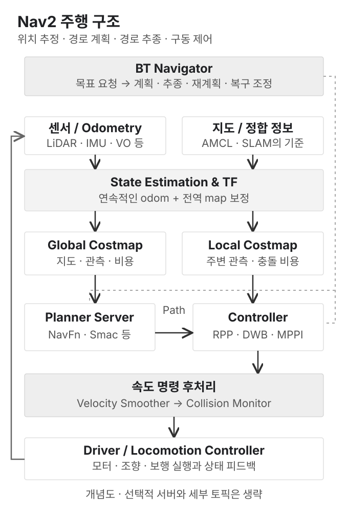
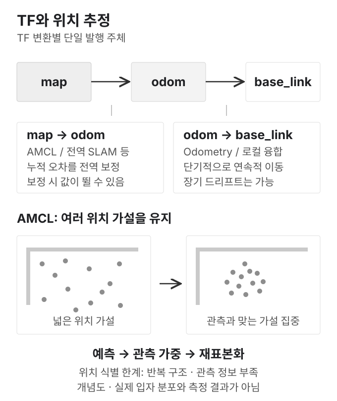
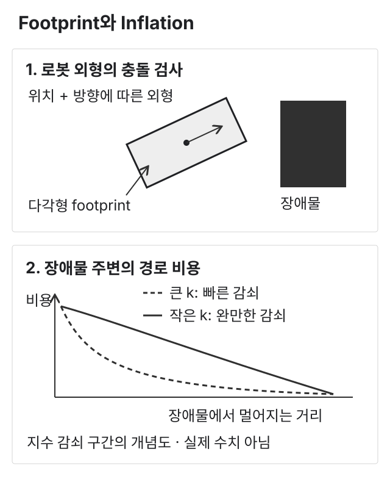
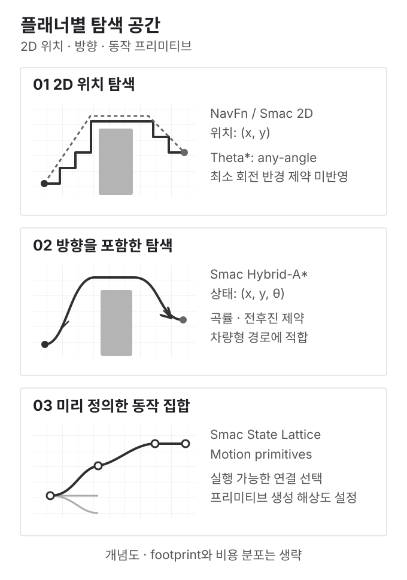

Nav2의 경로 계획에는 **현재 위치, 장애물 비용지도, 로봇의 이동 제약**이 필요하다. 이 글은 센서와 지도에서 글로벌 경로가 만들어지는 과정까지 다룬다.

**Nav2 학습 시리즈**

1. **위치 추정과 경로 계획** — 현재 글
2. [경로 추종과 컨트롤러](/blog/nav2-controllers/)
3. [Behavior Tree와 주행 실행](/blog/nav2-behavior-tree/)

> **기준: ROS 2 Jazzy · Nav2 소스 `645abd9` · 검토 2026-11-15.** 설정은 원리를 설명하는 부분 예시이며 실기체 검증 결과가 아니다. 도식은 직접 작성했다.

<details class="post-toc" id="목차">
<summary>목차</summary>

1. [주행 구조와 데이터](#1-주행-구조와-데이터)
2. [TF와 위치 추정](#2-tf와-위치-추정)
3. [Costmap과 충돌 영역](#3-costmap과-충돌-영역)
4. [글로벌 플래너](#4-글로벌-플래너)
5. [플래너 설정과 선택](#5-플래너-설정과-선택)
6. [관측과 비교 실험](#6-관측과-비교-실험)

</details>

## 1. 주행 구조와 데이터



| 구성 | 입력 → 출력 | 역할 |
| --- | --- | --- |
| 위치 추정 | 센서·이동 관측·지도 → pose·TF·odometry | 현재 위치와 움직임 제공 |
| Global Costmap | 지도·장애물 관측 → 전역 비용 격자 | 경로 탐색의 환경 표현 |
| Planner Server | 시작·목표·비용지도 → `nav_msgs/Path` | 이동 경로 계산 |
| Controller Server | 경로·현재 상태·Local Costmap → 속도 명령 | 경로 추종과 로컬 동작 계산 |
| BT Navigator | 목표·작업 결과 → 액션 실행·재시도 | 계획·추종·복구 순서 관리 |

**서버는 실행 틀이고, 플러그인은 알고리즘이다.** Planner Server 안에서 NavFn·Smac 등을 고르고, Controller Server 안에서 RPP·DWB·MPPI 등을 고른다. 위치 추정은 AMCL뿐 아니라 외부 SLAM·LiDAR localization도 연결할 수 있다. [Nav2 서버 구조](https://docs.nav2.org/jazzy/getting_started/navigation_concepts/navigation_servers/).

### Pose·Path·Trajectory

- **Pose:** 특정 좌표계·시각에서의 위치와 자세.
- **Path:** 따라갈 pose의 배열. 일반적인 글로벌 경로에는 시간별 목표 속도가 지정되어 있지 않다.
- **Trajectory:** 시간에 따른 상태·입력의 변화. 제어기가 후보 움직임을 예측할 때 사용한다.
- **속도 명령:** 현재 실행할 몸체 선속도·각속도. 실제 로봇의 속도는 구동 지연과 제한에 따라 달라진다.

따라서 경로가 그려졌다는 사실만으로 그 경로를 실제 속도로 추종할 수 있다고 판단하지 않는다.

## 2. TF와 위치 추정

### 2.1 `map → odom → base_link`



| 좌표계·변환 | 의미 | 일반적인 제공 주체 |
| --- | --- | --- |
| `map` | 환경에 고정된 전역 기준. 위치 보정으로 추정 pose가 뛸 수 있음 | 저장 지도·전역 위치 추정 |
| `odom → base_link` | 짧은 구간에서 연속적인 몸체 이동. 장기 드리프트 가능 | 휠 odometry·VO·로컬 센서 융합 |
| `map → odom` | odom의 누적 오차를 전역 기준으로 보정 | AMCL·SLAM·외부 localization |

각 변환은 **하나의 발행 주체**로 정한다. AMCL과 외부 localization이 동시에 `map → odom`을 발행하면 충돌할 수 있다. 센서 장착 변환과 필요한 경우의 `base_footprint`도 같은 TF 트리에 연결한다. [REP-105 좌표계 규약](https://github.com/ros-infrastructure/rep/blob/master/rep-0105.rst).

TF는 좌표 변환의 연결뿐 아니라 **센서 관측 시각의 변환**을 제공해야 한다. 현재 시각의 TF가 조회되더라도 과거 스캔 시각의 변환이 없으면 costmap이나 위치 추정이 관측을 사용하지 못할 수 있다.

### 2.2 Odometry·EKF의 연결

`robot_localization`의 EKF·UKF는 휠·IMU·VO 등의 관측을 융합한다. 상대 이동 정보만 사용하면 전역 드리프트는 남으므로 지도 기반 보정과 역할을 구분한다.

- `nav_msgs/Odometry`의 pose는 `header.frame_id`, twist는 `child_frame_id` 기준으로 해석한다.
- 축·부호·단위·timestamp와 센서 장착 변환을 맞춘다.
- 같은 엔코더에서 계산한 pose·velocity를 독립 관측처럼 중복 사용하지 않도록 확인한다.
- 평면 제약인 `two_d_mode`는 상태 추정기의 운용 가정에 맞춰 선택한다.

공분산·중복 관측·센서별 설정은 [EKF 센서 융합](/blog/ekf-sensor-fusion/)에서 다룬다. 여기서는 Nav2에 **연속적인 이동 상태와 일관된 TF를 전달하는지**가 점검 기준이다. [Odometry 정의](https://github.com/ros2/common_interfaces/blob/jazzy/nav_msgs/msg/Odometry.msg), [robot_localization 구성](https://github.com/cra-ros-pkg/robot_localization/blob/ros2/doc/configuring_robot_localization.rst).

### 2.3 AMCL

AMCL은 알려진 2D 지도에서 레이저 관측과 odometry로 위치를 추정하는 입자 필터다.

1. Odometry 이동량과 운동 잡음으로 입자를 이동시킨다.
2. 각 위치 가설에서 스캔과 지도의 일치도를 계산한다.
3. 가중치에 따라 재표본화하고 필요한 입자 수를 조정한다.

대표적인 `likelihood_field` 모델은 관측 끝점과 지도 장애물 사이의 거리 정보를 사용한다. 반복되는 복도나 넓은 개방 공간에서는 위치를 구분할 관측 자체가 부족할 수 있다.

| 설정 | 조절 대상 |
| --- | --- |
| `robot_model_type`, `alpha1`~`alpha5` | odometry 예측의 운동 모델·잡음. `alpha5`는 Omni 모델 항목 |
| `min_particles`, `max_particles`, `pf_err`, `pf_z` | 입자 수·적응적 표본화 |
| `update_min_d`, `update_min_a` | 이동량 기반 관측 갱신 조건 |
| `max_beams`, `sigma_hit`, `z_hit`, `z_rand` | 레이저 관측량·센서 모델 |

먼저 스캔이 지도에 맞는지와 입자 분포를 확인하고, 그다음 잡음·입자 설정을 조정한다. AMCL 운동 모델은 **입자 예측용 모델**이며 MPPI의 운동 예측 모델과 별도다. [AMCL 설정](https://docs.nav2.org/jazzy/configuration_and_development/configuration_guide/others/configuring_amcl/).

SLAM은 지도와 궤적을 함께 추정한다. 저장한 지도를 이용한 localization과 구분하며, SLAM Toolbox의 localization에는 직렬화한 pose graph가 사용된다. 외부 3D localization을 연결해도 Nav2의 표준 costmap·계획은 평면 표현을 사용하므로 지도·장애물 투영·TF 책임을 별도로 정한다. [SLAM Toolbox](https://github.com/SteveMacenski/slam_toolbox).

## 3. Costmap과 충돌 영역

### 3.1 지도·관측·비용의 결합

Occupancy map은 점유 정보를 표현하고, costmap은 계획·제어에 사용할 장애물과 주변 비용을 구성한다. 전형적으로 global costmap은 `map` 기준의 넓은 영역, local costmap은 `odom` 기준의 rolling window를 사용한다. 실제 프레임과 범위는 설정으로 정한다.

| 구성 | 역할 | 주요 점검 항목 |
| --- | --- | --- |
| Static Layer | 저장 지도 반영 | 원점·해상도·지도 갱신 |
| Obstacle Layer | 장애물 marking·raytracing clearing | 센서 TF·높이·거리·지연 |
| Voxel Layer | 3D 관측을 높이 격자로 관리한 뒤 2D 투영 | 지면·높이 범위·투영 조건 |
| Inflation Layer | 장애물 주변 거리 비용 생성 | 반경·감쇠 계수 |
| Keepout·Speed Filter | 금지 구역·구역별 속도 정책 | 마스크 좌표계·Filter Info |

**Marking은 장애물 추가, clearing은 관측 광선으로 장애물 제거**다. 사라진 물체가 남아 있다면 센서의 clearing 범위·유효 관측·TF를 확인한다. 로컬 창을 넓히는 것과 센서의 관측 범위를 넓히는 것은 다르다. [Costmap 구성](https://docs.nav2.org/jazzy/configuration_and_development/configuration_guide/core_servers/costmap_2d/), [Obstacle Layer](https://docs.nav2.org/jazzy/configuration_and_development/configuration_guide/core_servers/costmap_2d/costmap_plugins/obstacle/).

### 3.2 Footprint와 Inflation



Footprint는 로봇의 충돌 외형이다. 길쭉한 차체는 센서 돌출부까지 포함한 다각형으로 표현하고 회전 중의 충돌도 검사해야 한다. 다만 다각형을 설정했다는 이유로 모든 planner가 방향을 포함한 동일한 충돌 검사를 하는 것은 아니다.

Inflation은 장애물 근처 경로를 비싸게 만들어 여유 공간을 선택하도록 유도한다. `inflation_radius` 전체가 통행 불가 영역이 되는 것은 아니다. 지수 감쇠 구간의 관계는 다음과 같다.

```text
C(d) ∝ exp[-k × (d - r_inscribed)]
```

- `inflation_radius`: 비용의 영향 범위.
- `cost_scaling_factor`에 대응하는 `k`: 비용 감쇠 속도. 클수록 더 빠르게 감소.

반경과 감쇠 계수는 함께 조절한다. 중심 경로가 장애물에서 멀어져 보여도 회전 중 차체까지 통과하는지는 별도 문제다. [Footprint 기준](https://docs.nav2.org/jazzy/configuration_and_development/tuning_guide/#robot-footprint-vs-radius), [Inflation Layer](https://docs.nav2.org/jazzy/configuration_and_development/configuration_guide/core_servers/costmap_2d/costmap_plugins/inflation/).

### 3.3 해상도·Unknown 정책

같은 면적에서 격자 해상도를 절반으로 줄이면 셀 수는 약 네 배가 된다. 좁은 형상 표현과 계산·메모리 비용을 함께 검토한다.

미관측 공간은 자유 공간과 다르다. Costmap의 `track_unknown_space`와 planner의 `allow_unknown`을 함께 확인한다. Planner에서 unknown 통과를 허용해도 새로운 센서 정보가 생기는 것은 아니다.

Voxel Layer 역시 최종적으로 2D 계획 공간에 투영한다. 이 표현만으로 계단·낙하 지형·발 디딤 가능성을 판정할 수는 없다. 지면 제거가 필요하면 [LiDAR 지면 분리](/blog/lidar-ground-segmentation/)와 연결해 관측 입력부터 구성한다.

## 4. 글로벌 플래너

### 4.1 전체 비교

| 플래너 | 탐색 방식·상태 | 적합한 조건 |
| --- | --- | --- |
| NavFn | 2D 격자·potential, Dijkstra 또는 A* | 기본적인 위치 경로 계획의 기준선 |
| Smac 2D | 비용을 고려한 2D A* | 장애물 주변 비용을 반영하는 격자 탐색 |
| Theta* | line-of-sight로 노드를 연결하는 any-angle 탐색 | 격자 방향에 덜 묶인 선분 경로 |
| Smac Hybrid-A* | `(x, y, yaw)`와 차량형 운동 확장 | 최소 회전 반경·전후진 제약 |
| Smac State Lattice | 사전 생성한 motion primitive 연결 | 차동·전방향·차량형에 맞춘 동작 집합 |



### 4.2 2D 탐색과 방향 제약

Dijkstra는 누적 비용 `g(n)`, A*는 보통 `g(n) + h(n)`을 기준으로 노드를 확장한다. `h(n)`은 남은 비용의 추정이다. 실제 경로는 이웃 연결·통과 비용·휴리스틱·종료 조건에 따라 달라진다.

NavFn의 `use_astar`는 탐색 방식을 선택한다. Smac 2D는 costmap 비용을 반영한 A*를 사용하고, Theta*는 직접 연결 가능한 선분을 활용한다. **Any-angle 경로는 차량의 최소 회전 반경을 보장하는 경로와 다르다.** Path에 orientation 값이 있어도 탐색이 차량형 제약을 사용했다는 뜻은 아니다. [NavFn](https://docs.nav2.org/jazzy/configuration_and_development/configuration_guide/planners_plugins/configuring_navfn/), [Smac 2D](https://docs.nav2.org/jazzy/configuration_and_development/configuration_guide/planners_plugins/smac/smac_2d/configuring_smac_2d/), [Theta*](https://docs.nav2.org/jazzy/configuration_and_development/configuration_guide/planners_plugins/thetastar/configuring_thetastar/).

### 4.3 Hybrid-A*와 State Lattice

Hybrid-A*는 로봇의 방향과 운동 모델을 포함해 상태를 확장한다. 차량형에서는 다음 설정이 중요하다.

| 설정 | 의미 |
| --- | --- |
| `minimum_turning_radius` | 실행 가능한 최소 회전 반경 |
| `motion_model_for_search` | `DUBIN`: 전진, `REEDS_SHEPP`: 후진 포함 모델 |
| `angle_quantization_bins` | 방향 상태의 분해능 |
| `reverse_penalty`, `non_straight_penalty` | 후진·비직진 동작의 선호 비용 |

선호 비용은 불가능한 동작을 가능하게 만드는 제한값이 아니다. 후진 경로를 생성하면 controller·하위 구동기·후방 관측도 후진을 지원해야 한다.

State Lattice는 지정한 동작 집합을 연결한다. `lattice_filepath`의 primitive·생성 해상도가 실제 지도와 로봇의 이동 방식에 맞아야 한다. Hybrid-A*의 회전 반경 하나를 바꾸는 것과 같은 설정 절차가 아니다. [Hybrid-A*](https://docs.nav2.org/jazzy/configuration_and_development/configuration_guide/planners_plugins/smac/smac_hybrid/configuring_smac_hybrid/), [State Lattice](https://docs.nav2.org/jazzy/configuration_and_development/configuration_guide/planners_plugins/smac/smac_lattice/configuring_smac_lattice/).

### 4.4 경로 후처리

경로 스무딩은 꺾임·요철을 줄이는 **경로 후처리**다. 속도 명령을 다듬는 Velocity Smoother와 구분한다. Simple Smoother·Constrained Smoother 등을 사용할 수 있으며, 후처리 뒤에도 충돌·곡률·전후진 전환점인 cusp를 확인한다. [Constrained Smoother](https://docs.nav2.org/jazzy/configuration_and_development/configuration_guide/smoother_plugins/constrained_smoother/configuring_constrained_smoother/).

## 5. 플래너 설정과 선택

제자리 회전 가능한 실내 로봇에서 비교를 시작하기 위한 Smac 2D **부분 설정**이다. Costmap·TF·센서·Controller 설정은 생략했다.

```yaml
planner_server:
  ros__parameters:
    planner_plugins: ["GridBased"]
    GridBased:
      plugin: "nav2_smac_planner::SmacPlanner2D"
      tolerance: 0.2
      allow_unknown: false
```

`GridBased`는 사용자가 정한 플러그인 ID이고, `plugin`이 실제 구현이다. BT의 `planner_id`도 이 ID와 연결한다. `tolerance`는 planner의 목표 탐색 허용 범위이며 Controller의 실제 도착 판정과는 별도다.

선택 순서는 다음과 같다.

1. 제자리 회전·횡이동·후진 가능 여부를 정한다.
2. `(x, y)` 경로로 충분한지, 방향·곡률 제약이 필요한지 고른다.
3. Footprint·costmap 해상도·계획 시간을 맞춘다.
4. 생성 경로를 실제 controller가 추종할 수 있는지 확인한다.

`expected_planner_frequency`는 계산 성능의 경고 기준이다. 주기적 재계획은 [3편의 BT](/blog/nav2-behavior-tree/#4-주기와-실패-전파)에서 구성한다. [Planner Server](https://docs.nav2.org/jazzy/configuration_and_development/configuration_guide/core_servers/configuring_planner_server/).

## 6. 관측과 비교 실험

### 6.1 점검 순서

**시각·TF → odometry → 지도와 스캔 정합 → costmap → 생성 경로** 순서로 확인한다. 아래는 이동 요청이 없는 조회 명령이다. Namespace와 실제 토픽 이름에 맞춰 사용하고, 연속 출력은 `Ctrl+C`로 종료한다.

```bash
ros2 run tf2_ros tf2_echo map odom
ros2 run tf2_ros tf2_echo odom base_link
ros2 topic echo /odom --once
ros2 topic hz /scan
ros2 param get /planner_server GridBased.plugin
```

| 증상 | 우선 확인 |
| --- | --- |
| 지도 위 pose가 갑자기 뜀 | 전역 보정·TF 중복·시각 불일치 |
| 스캔이 지도에서 회전·이동해 보임 | 센서 장착 변환·축·지도·localization |
| 사라진 장애물이 계속 남음 | clearing 범위·관측 지연·TF·QoS |
| 경로가 좁은 통로를 통과하지 못함 | 외형·해상도·inflation·실제 여유 폭 |
| 차량이 추종할 수 없는 꺾임 | planner 상태 공간·회전 반경·후진 설정 |

`transform_tolerance`를 늘리는 것은 잘못된 센서 장착 변환이나 시간 동기화를 보정하는 방법이 아니다.

### 6.2 비교 실험

동일한 지도·시작·목표·footprint에서 Smac 2D와 Hybrid-A*를 비교한다. 경로 모양만 보지 말고 계획 시간·길이·최소 여유·곡률·후진 구간을 기록한다. Inflation 실험에서는 planner를 고정하고 반경 또는 감쇠 계수 하나만 바꾼다. 이 절은 실험 설계이며 측정 결과를 제시한 것은 아니다.

**다음 글:** [Nav2 2. 경로 추종과 컨트롤러](/blog/nav2-controllers/)

### 참고 자료

- [Nav2 Jazzy 기준 소스](https://github.com/ros-navigation/navigation2/tree/645abd95f2be02a13ca539b29c2ddc065db34f89), [플래너 선택·튜닝 가이드](https://docs.nav2.org/jazzy/configuration_and_development/tuning_guide/#planner-plugin-selection)
- [Nav2 위치 추정 개념](https://docs.nav2.org/jazzy/getting_started/navigation_concepts/state_estimation/), [환경 표현 개념](https://docs.nav2.org/jazzy/getting_started/navigation_concepts/environmental_representation/)
- [Smac 구현 설명](https://github.com/ros-navigation/navigation2/blob/645abd95f2be02a13ca539b29c2ddc065db34f89/nav2_smac_planner/README.md)
