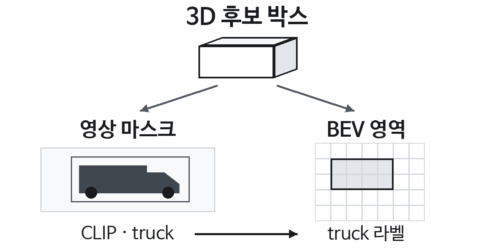
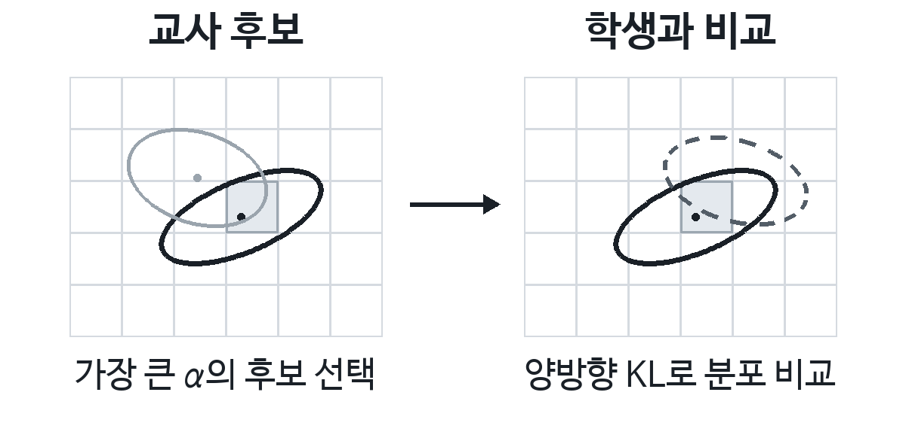
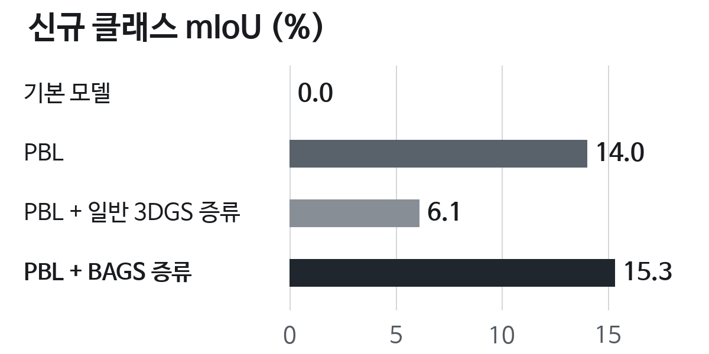

BEV(Bird’s-Eye View) 분할은 차량 주변을 위에서 본 격자에 차·보행자 같은 범주를 표시하는 작업이다. 이미지에서 트럭 마스크를 정확히 구해도 카메라 광선 위에서 어느 깊이를 택하느냐에 따라 BEV 위치가 달라진다. OVBEVSeg는 **학습용 라벨을 만들 때 3D 박스로 위치를 정하고, 카메라에서 읽은 클래스 이름을 붙인다**. 이어 카메라와 BEV 양쪽에서 일치하는 3D 형상을 만들고, 그 형상을 카메라 영상만으로 동작하는 모델에 증류한다. [논문 1절][intro] · [논문 그림 2][framework]

*Open-Vocabulary BEV Segmentation with 3D-Aware Geometric Constraints* · Hojun Choi 외, ECCV 2026. [논문 원문][paper] · [공식 프로젝트][project]

## 3D 박스 기반 의사 라벨

PBL(Pseudo-BEV Labeling)의 출발점은 비지도 3D 검출기 UNION의 **클래스 구분 없는 3D 박스**다. UNION은 LiDAR 점군의 군집과 여러 시점 사이의 움직임을 이용해 물체 후보를 만든다. OVBEVSeg는 그 박스를 보정된 카메라에 투영해 영상 마스크의 위치를 잡고, 같은 박스의 바닥 영역을 BEV 격자에 옮긴다. 두 영역이 같은 3D 물체를 가리키므로, 영상에서 얻은 이름을 BEV의 어느 칸에 붙일지 정해진다. [논문 3.1절][pbl] · [부록 K][baselines]

1. 카메라에 투영한 박스를 단서로 Grounded SAM이 물체 마스크를 만든다. 여러 카메라에 잡히면 가장 큰 마스크 하나를 남긴다.
2. 마스크와 투영된 박스의 면적 차이가 큰 후보를 걸러낸다. 남은 마스크에서 배경을 가리고 CLIP 이미지 특징을 얻는다.
3. 이미지 특징과 클래스 이름의 텍스트 특징을 코사인 유사도로 비교한다. 가장 가까운 이름이 `truck`이면, 같은 3D 박스가 덮는 BEV 영역에 `truck` 의사 라벨을 붙인다. [논문 3.1절][pbl]



### 의사 라벨의 개수와 품질

학습 세트에서 신규 3개 클래스의 의사 라벨은 **37,830개**, 정답 인스턴스는 96,087개였다. 두 개수의 비율은 전체 39.4%이며 버스 77.5%, 트럭 32.2%, 오토바이 41.2%다. 이 비율은 클래스별 라벨 개수를 센 값이다. 위치와 범주가 맞는지는 따로 평가했고, 의사 라벨 자체의 학습 세트 mIoU는 가시성 필터 적용 시 13.5, 미적용 시 13.0이었다. [부록 표 A9–A10][pseudo-quality]

CLIP이 트럭을 정확히 골라도 3D 박스가 밀려 있으면 라벨도 같이 밀린다. 후보 박스가 빠지면 해당 물체에 붙일 라벨도 빠진다. 면적 필터로 맞지 않는 박스를 거를 수 있지만, PBL이 확보하는 학습 신호의 양과 위치는 초기 3D 박스에 달려 있다. [논문 3.1절][pbl]

## 영상과 BEV의 점유 제약

3D 가우시안의 평균 `μ`는 중심 위치, 공분산 `Σ`는 퍼지는 크기와 방향을 나타낸다. 관측 각도가 적으면 카메라에서 비슷한 실루엣을 만드는 여러 가지 3D 배치가 가능하다. 일반 3DGS로 영상의 색을 잘 재현해도 위에서 보면 가우시안이 차체 밖에 넓게 퍼질 수 있다. BAGS(BEV-Aware 3D Gaussian Splatting)는 **같은 가우시안 집합을 영상과 BEV에서 렌더링하고, 두 평면에서 물체가 덮는 영역을 각각 맞춘다**. [논문 3.2절][bags]

한 픽셀 또는 BEV 칸 `v`에 대한 각 가우시안의 기여 `αₖ(v)`는 가우시안 자체의 불투명도와 그 위치에서의 2D 가우시안 값을 곱한 것이다. 색과 깊이는 이 기여에 앞쪽 가우시안들을 통과한 투과율을 곱해 합성한다. 점유값은 모든 가우시안을 통과하고 남는 투과율을 1에서 빼서 구한다. 한 칸에서 두 가우시안의 기여가 0.5와 0.4라면 누적 점유는 0.7이다. [논문 식 (1)–(4)][bags]

```text
O(v) = 1 − ∏ₖ [1 − αₖ(v)]
```

- **영상 점유**는 Grounded SAM의 물체 마스크에 맞춘다.
- **BEV 점유**는 3D 박스로 만든 바닥 영역에 맞춘다. 두 점유 오차에 Smooth L1을 적용한다.
- **색과 깊이**도 함께 최적화한다. 단안 깊이 추정값은 희소 LiDAR 깊이와 맞도록 스케일과 오프셋을 조정한다. 물체 밖의 영상 배경을 가려 불필요한 가우시안도 줄인다. [논문 식 (3)–(6)][bags]


*흰색은 물체가 차지한 영역이다. 일반 3DGS에서 한 덩어리로 퍼진 점유가 BAGS에서는 기준 마스크의 차량 위치를 따라 나뉜다. [Choi 외, 그림 5의 점유 비교 부분 발췌][fig5] · [CC BY 4.0][cc]*

그림 A7은 같은 장면에서 점유 손실 세 가지를 비교한다. 3만 회 최적화한 뒤 L1은 BEV 형상이 끊어졌다. BCE에서는 위에서 본 형태가 남았고 카메라 영상 복원이 흐렸다. Smooth L1 결과에서는 영상과 BEV 양쪽의 차량 형태가 더 잘 유지됐다. [부록 I.2·그림 A7][loss-study]

### Lang–BAGS 확장

Lang–BAGS는 가우시안에 CLIP 특징도 담는다. 특징을 압축했다 복원하면 `truck`이나 `bus`가 유사한 `car` 특징으로 뭉칠 수 있다. 저자들은 원본 특징과 복원 특징이 각 클래스 이름에 주는 유사도를 분포로 만들고, 두 분포를 KL 발산으로 맞췄다. 학습 세트의 인스턴스에서 원본과 복원 특징의 최상위 클래스가 일치한 비율은 LangSplat 43.7%, Lang–BAGS 99.4%였다. [논문 식 (7)][lang-bags] · [부록 표 A11][lang-result]

## 가우시안 증류와 추론

BAGS 교사는 장면별로 최적화한 불규칙한 가우시안 집합을 갖는다. 학생은 카메라 특징 격자에서 가우시안을 예측한다. 개수와 배열이 다른 두 집합을 연결하는 기준으로 BAGD(BEV-Aware Gaussian Distillation)는 **공통 BEV 좌표**를 쓴다. 높이 축을 주변화하고 중심의 `x, y`와 공분산의 XY 부분을 격자 좌표로 옮기면, 같은 평면에서 중심과 퍼짐을 비교할 수 있다. [논문 3.3절][bagd] · [부록 L.2][view-transform]

한 BEV 칸에 교사 가우시안이 여러 개 닿으면 그 칸에서 `αₖ(v)`가 가장 큰 하나를 고른다. 예를 들어 같은 칸에서 기여가 0.6과 0.4라면 0.6인 교사의 분포를 목표로 삼는다. 학생과 교사를 모두 BEV로 투영한 뒤 두 방향의 KL 발산을 평균한다. 차량 중심이 밀리거나 분포가 지나치게 넓어지면 위치와 퍼짐의 차이가 손실에 반영된다. [논문 식 (8)·그림 2][bagd]



*왼쪽과 오른쪽의 회색 칸은 같은 BEV 위치다. 오른쪽 실선은 선택한 교사 분포, 점선은 학생의 예측을 나타낸다.*

부록 그림 A8에서는 교사를 더 많이 남길수록 투영한 중심점이 조밀해진다. 기본 Top-1은 도로 장면의 한 칸을 대표하는 가우시안을 하나로 줄여 학습 비용을 낮추는 선택이다. 높이가 다른 구조가 같은 XY 칸에 겹치는 환경에서는 이 가정을 별도로 검증할 필요가 있다. [논문 3.3절][bagd] · [부록 그림 A8][top-k]

학생을 학습할 때는 기존 클래스 정답과 신규 클래스 의사 라벨로 계산한 분할 손실에 1.0, 기하 KL 손실에 0.01의 가중치를 둔다. 추론 때는 여섯 카메라 영상에서 **특징·깊이·불투명도**를 예측한다. 가우시안을 BEV에 옮겨 각 칸에 기여하는 특징을 가중 합산하고, CLIP 텍스트 특징과의 코사인 유사도로 클래스 점수를 낸다. [논문 4절][experiments] · [부록 H][implementation] · [부록 L.2][view-transform]

## nuScenes 검증

nuScenes 검증 세트에서 차량 기준 앞뒤와 좌우 각각 −50 m에서 50 m까지를 0.5 m 간격의 200×200 격자로 나눈다. 트럭·버스·오토바이 3개가 신규 클래스다. 기존 5개는 승용차·트레일러·건설 차량·보행자·자전거다. 표 1은 가시성 40% 이상인 객체를 평가한다. IoU는 예측과 정답 영역의 교집합을 합집합으로 나눈 값이고, mIoU는 클래스별 IoU의 평균이다. 아래 기존 클래스 평균은 표 1의 개별 IoU로 계산했다. 단위는 %다. [논문 표 1][experiments]

| 모델 | 신규 3개 | 기존 5개 | 전체 8개 |
| --- | ---: | ---: | ---: |
| GaussianLSS | 0.0 | 20.3 | 12.7 |
| TaDe | 0.0 | 21.7 | 13.6 |
| OVBEVSeg | **15.3** | 21.8 | **19.3** |

OVBEVSeg의 트럭·버스·오토바이 IoU는 각각 **19.0·20.3·6.6**이다. TaDe와 전체에서 5.7%p 차이가 났고, 기존 클래스 평균은 두 모델이 비슷했다. 전체 점수 차이의 대부분은 신규 세 클래스에서 생겼다. 오토바이는 신규 클래스 중 가장 낮았고, 기존 클래스 중 승용차·자전거는 TaDe의 IoU가 더 높았다. [논문 표 1][experiments]

표 3에서는 신규 정답 라벨을 쓰지 않은 두 경로를 비교한다. 영상에서 물체를 검출하고 깊이로 BEV 위치를 만드는 `2D-OV-then-BEV`는 2.1 mIoU, OVBEVSeg는 15.3이다. 신규 정답을 20% 사용한 Semi-BEVseg는 14.6, 40% 사용한 경우는 17.0이었다. 표 3의 %는 학습에 제공한 신규 클래스 정답 라벨의 비율이다. [논문 표 3][experiments]


*주황색에는 기존 차량과 신규 차량 클래스가 모두 들어 있다. 맨 아래 확대 상자에서 GaussianLSS의 뭉친 경계와 OVBEVSeg에서 분리된 차량 두 대를 볼 수 있다. [Choi 외, 그림 5의 분할 비교 부분 발췌][fig5] · [CC BY 4.0][cc]*

## 모듈별 기여

표 6에서 **PBL만으로 신규 클래스 mIoU가 0.0에서 14.0**으로 오른다. 같은 PBL에 일반 3DGS 교사의 증류를 붙이면 신규 평균은 6.1, 기존 평균은 20.5에서 9.8로 떨어진다. 교사를 BAGS로 바꾸면 신규 15.3, 기존 21.8이 된다. PBL로 새 클래스의 학습 신호가 생겼고, 그 신호를 살리려면 교사 가우시안도 BEV에서 올바른 위치에 있어야 했다. [논문 표 6][ablation]



3D 후보를 바꿔도 클래스별 결과가 달라진다. 표 4에서 UNION을 VLM 기반 F&B로 교체하자 트럭은 19.0에서 14.2, 버스는 20.3에서 15.5로 내려갔다. 오토바이는 6.6에서 7.9로 올랐고, F&B는 교통 콘도 11.5 IoU를 기록했다. 같은 의사 라벨 생성 방식에서도 어떤 물체를 3D 후보로 잡느냐가 검출 범위에 영향을 준다. [논문 표 4][priors]

## 학습 비용과 검증 범위

표 1에서 OVBEVSeg와 GaussianLSS는 각각 79.6 FPS와 80.2 FPS, 메모리는 32.4 MiB와 33.0 MiB로 비슷하다. 약 2.5배의 속도 차이는 표 2의 단일 차량 범주 설정에서 **PointBeV 32.0 FPS와 OVBEVSeg 80.2 FPS**를 비교한 값이다. 표 5의 A100 모듈 측정에는 백본 29.3 ms와 학습용 BAGD 0.37 ms가 따로 보고돼 있다. 표 1·2의 FPS는 각 비교 설정에서 읽고, 차량에서의 입력부터 출력까지 걸리는 지연은 같은 조건에서 측정해야 한다. [논문 표 1·2][experiments] · [논문 표 5][runtime]

- **오프라인 전처리** · 학습 세트 약 3만 샘플에 A100 8장으로 약 4일. BAGS 최적화는 장면 내 프레임의 10%, 보통 4장에 적용했다. 표 7에서 증류 프레임 비율을 5%에서 10%로 늘리면 전체 mIoU가 18.9에서 19.3으로 올랐다. [논문 표 7][ratio] · [부록 F][device]
- **학생 학습** · 논문의 기본 설정은 224×480 입력과 EfficientNet-B4 백본이다. 오프라인 결과를 준비한 뒤 50 에폭 학습에 A100 2장으로 약 6시간 걸렸고, 최대 VRAM은 장당 21 GB였다. [논문 4절][experiments] · [부록 F][device]

실험의 신규 클래스 이름은 CLIP 텍스트 후보에 들어 있다. 검증 결과는 이렇게 지정한 클래스의 수작업 BEV 라벨을 학습에서 생략하는 설정을 뒷받침한다. 새 환경에서는 필요한 물체를 3D 후보가 얼마나 포착하는지가 먼저 달라질 수 있다. 프레임마다 얻은 결과를 시간축에서 일관되게 유지하는 문제도 저자들이 후속 과제로 남겼다. [논문 3.1절][pbl] · [부록 G][limitations]

[paper]: https://arxiv.org/html/2606.24353v2
[project]: https://hchoi256.github.io/projects/ovbevseg/
[intro]: https://arxiv.org/html/2606.24353v2#S1
[framework]: https://arxiv.org/html/2606.24353v2#S3.F2
[pbl]: https://arxiv.org/html/2606.24353v2#S3.SS1
[baselines]: https://arxiv.org/html/2606.24353v2#S11
[pseudo-quality]: https://arxiv.org/html/2606.24353v2#S9.SS1
[bags]: https://arxiv.org/html/2606.24353v2#S3.SS2
[loss-study]: https://arxiv.org/html/2606.24353v2#S9.SS2
[lang-bags]: https://arxiv.org/html/2606.24353v2#S3.E7
[lang-result]: https://arxiv.org/html/2606.24353v2#S9.T11
[bagd]: https://arxiv.org/html/2606.24353v2#S3.SS3
[top-k]: https://arxiv.org/html/2606.24353v2#S9.SS4
[experiments]: https://arxiv.org/html/2606.24353v2#S4
[priors]: https://arxiv.org/html/2606.24353v2#S4.T5.fig1
[runtime]: https://arxiv.org/html/2606.24353v2#S4.T5.fig2
[ablation]: https://arxiv.org/html/2606.24353v2#S4.T8.fig1
[ratio]: https://arxiv.org/html/2606.24353v2#S4.T8.fig2
[fig5]: https://arxiv.org/html/2606.24353v2#S4.F5
[device]: https://arxiv.org/html/2606.24353v2#S6
[limitations]: https://arxiv.org/html/2606.24353v2#S7
[implementation]: https://arxiv.org/html/2606.24353v2#S8
[view-transform]: https://arxiv.org/html/2606.24353v2#S12.SS2
[cc]: https://creativecommons.org/licenses/by/4.0/
