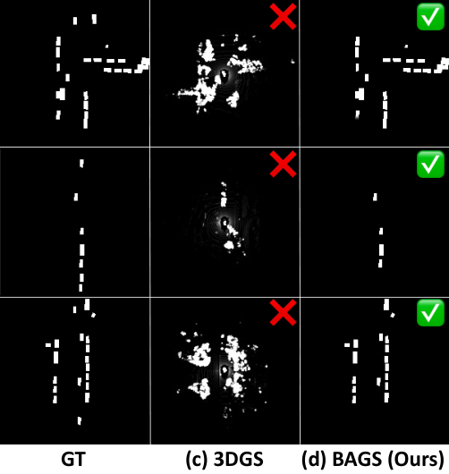
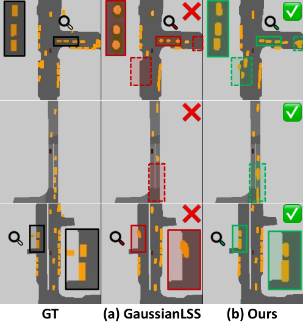

BEV(Bird’s-Eye View) 분할은 차량 주변을 위에서 본 격자에 차·보행자 같은 범주를 표시하는 작업이다. 카메라에서 트럭 마스크를 정확히 구해도 깊이가 어긋나면 BEV의 다른 칸에 놓인다. OVBEVSeg는 **3D 박스로 물체 위치를 잡고, 카메라에서 읽은 클래스 이름을 그 위치에 붙인다**. 이렇게 만든 의사 라벨과 3D 기하를 학습에 쓰고, 추론에는 여섯 카메라의 영상을 사용한다. [논문 1절][intro]

*Open-Vocabulary BEV Segmentation with 3D-Aware Geometric Constraints* · Hojun Choi 외, ECCV 2026. [논문 원문][paper] · [공식 프로젝트][project]

## 3D 박스 기반 의사 라벨

PBL(Pseudo-BEV Labeling)의 출발점은 비지도 3D 검출기 UNION이 LiDAR에서 뽑은 **클래스가 없는 3D 박스**다. 같은 박스를 카메라 영상과 BEV 격자에 투영하면, 영상 속 물체가 BEV의 어느 영역에 해당하는지 연결할 수 있다. [논문 3.1절][pbl]

1. 카메라에 투영한 박스를 단서로 Grounded SAM이 물체 마스크를 만든다. 여러 카메라에서 보이면 가장 큰 마스크를 쓴다.
2. 박스와 마스크의 크기가 크게 어긋나는 후보를 걸러낸다. 남은 마스크에서 배경을 가리고 CLIP 이미지 특징을 얻는다.
3. 이미지 특징과 클래스 이름의 텍스트 특징을 코사인 유사도로 비교한다. 가장 가까운 이름이 `truck`이면, 같은 3D 박스가 덮는 BEV 영역에 `truck` 의사 라벨을 붙인다. [논문 3.1절·그림 2][pbl]

## 영상과 BEV의 점유 제약

카메라에서 보이는 색을 잘 재현하는 3D Gaussian도 위에서 보면 물체 바깥에 퍼져 있을 수 있다. 특히 차량 주위의 카메라끼리 관측이 겹치는 영역이 좁으면, 영상의 재구성 오차만으로 깊이를 정하기 어렵다. BAGS(BEV-Aware 3D Gaussian Splatting)는 **동일한 가우시안 집합으로 렌더링한 카메라 점유와 BEV 점유를 각각 PBL의 마스크에 맞춘다**. 앞에서 본 실루엣과 위에서 본 바닥 면적이 모두 맞아야 손실이 줄어든다. [논문 3.2절][bags]

점유는 해당 픽셀에 닿는 가우시안들의 불투명도를 합성해 계산한다. 영상과 BEV의 점유 오차에 Smooth L1을 쓰고, 영상의 색상 재구성과 깊이도 함께 최적화한다. 깊이의 기준은 단안 깊이 모델 출력을 희소 LiDAR 깊이에 맞춰 스케일과 오프셋을 조정한 값이다. 영상 배경은 인스턴스 마스크로 가려 물체 바깥에 가우시안이 생기는 현상을 줄인다. [논문 식 (2)–(6)][bags]

*흰색은 물체가 차지한 영역이다. 가운데의 일반 3DGS에서 뭉쳐 보이던 점유가 오른쪽 BAGS에서는 더 뚜렷이 나뉜다. [Choi 외, 그림 5의 점유 비교 부분 발췌][fig5] · [CC BY 4.0][cc]*

부가 실험인 Lang–BAGS는 가우시안에 CLIP 특징을 담는다. 임베딩을 압축하고 복원할 때 `car`와 `truck`처럼 가까운 클래스가 섞이는 문제를 줄이기 위해, 복원 특징의 클래스별 유사도 분포를 원본에 맞춘다. [논문 그림 4·6][lang-bags]

## 가우시안 증류와 추론

BAGS로 장면마다 최적화한 가우시안은 위치가 불규칙하다. 학생 모델은 카메라 특징의 격자에서 가우시안을 예측하므로, 두 집합을 번호 순서대로 대응시킬 수 없다. BAGD(BEV-Aware Gaussian Distillation)는 공통 BEV 칸을 기준으로 교사의 가우시안을 고른다. 그 칸에 기여하는 교사 후보들 가운데 불투명도 기여 `α`가 가장 큰 하나를 택하고, 학생과 교사의 투영 분포를 양방향 KL 발산으로 맞춘다. [논문 3.3절·그림 2][bagd]

배포되는 학생 모델은 입력 영상에서 특징·깊이·불투명도를 예측하고, 3D 가우시안을 거쳐 BEV 특징을 만든다. 각 BEV 칸의 특징을 CLIP 텍스트 특징과 비교해 클래스 점수를 낸다. LiDAR 정보와 장면별 최적화는 이 모델을 가르치는 오프라인 단계에 쓰인다. [논문 4절 및 부록 H][experiments] · [뷰 변환][view-transform]

## nuScenes 검증

nuScenes 검증 세트에서 차량 기준 앞뒤와 좌우 각각 −50~50 m를 0.5 m 간격의 200×200 격자로 나눈다. 멀티클래스 학습에는 기존 5개 클래스의 정답 라벨과 트럭·버스·오토바이의 의사 라벨을 사용한다. 표 1은 가시성 40% 이상인 객체를 대상으로 한다. IoU는 예측 영역과 정답 영역의 교집합을 합집합으로 나눈 값이고, mIoU는 클래스별 IoU의 평균이다. [논문 표 1·3][experiments]

| 모델 | 신규 3개 mIoU | 전체 8개 mIoU |
| --- | ---: | ---: |
| GaussianLSS | 0.0 | 12.7 |
| TaDe | 0.0 | 13.6 |
| OVBEVSeg | **15.3** | **19.3** |

OVBEVSeg의 트럭·버스·오토바이 IoU는 각각 **19.0·20.3·6.6**이다. 전체 mIoU는 TaDe보다 5.7%p 높았고, 이미 학습한 클래스 중 승용차와 자전거 IoU는 TaDe가 더 높았다. 신규 클래스의 정답 라벨을 40% 사용한 Semi-BEVseg는 같은 3개 클래스에서 17.0 mIoU를 기록했다. [논문 표 1·3][experiments]

*주황색에는 기존 차량과 신규 차량 클래스가 모두 들어 있다. 아래 장면의 확대 상자에서 GaussianLSS의 뭉친 경계와 OVBEVSeg의 분리된 차량 두 대를 비교할 수 있다. [Choi 외, 그림 5의 분할 비교 부분 발췌][fig5] · [CC BY 4.0][cc]*

## 모듈별 기여

표 6에서는 PBL만 붙여도 신규 클래스 mIoU가 **0.0 → 14.0**으로 오른다. 같은 PBL에 일반 3DGS 교사를 붙여 증류하면 6.1로 떨어진다. 이미지와 BEV 점유를 함께 맞춘 BAGS 교사를 쓰면 15.3까지 오른다. 이 결과에서는 신규 클래스 성능의 대부분이 의사 라벨에서 나왔고, 증류의 효과는 교사가 BEV에서 물체 위치를 얼마나 잘 보존하느냐에 달렸다. [논문 표 6][ablation]

## 학습 비용과 검증 범위

표 1에서 OVBEVSeg와 GaussianLSS는 각각 79.6 FPS와 80.2 FPS, 메모리는 32.4 MiB와 33.0 MiB로 비슷하다. 논문의 약 2.5배 속도 차이는 표 2의 단일 차량 범주 설정에서 PointBeV의 32.0 FPS와 OVBEVSeg의 80.2 FPS를 비교한 값이다. [논문 표 1·2][experiments]

추론 단계에서 덜어낸 계산은 학습 전처리로 옮겨 간다. nuScenes 학습 데이터 약 3만 샘플의 오프라인 전처리는 A100 8장으로 약 4일 걸렸다. 장면별 BAGS 최적화에는 전체 프레임의 10%, 보통 장면당 4장을 사용했다. [논문 표 7][ablation] · [부록 F][device]

이 실험에서 `truck` 같은 신규 클래스 이름은 CLIP 후보에 들어 있고, 그 클래스의 수작업 정답 라벨을 빼고 학습한다. 15.3 mIoU는 이 조건에서 선정한 세 클래스의 결과다. 의사 라벨을 만들 수 있는 범위는 첫 단계에서 찾은 3D 박스에도 달려 있다. 저자들은 프레임마다 얻은 결과를 시간축에서 일관되게 유지하는 문제를 후속 과제로 남겼다. [논문 3.1절][pbl] · [부록 G][limitations]

[paper]: https://arxiv.org/html/2606.24353v2
[project]: https://hchoi256.github.io/projects/ovbevseg/
[intro]: https://arxiv.org/html/2606.24353v2#S1
[pbl]: https://arxiv.org/html/2606.24353v2#S3.SS1
[bags]: https://arxiv.org/html/2606.24353v2#S3.SS2
[bagd]: https://arxiv.org/html/2606.24353v2#S3.SS3
[lang-bags]: https://arxiv.org/html/2606.24353v2#S3.SS2.SSSx3
[experiments]: https://arxiv.org/html/2606.24353v2#S4
[ablation]: https://arxiv.org/html/2606.24353v2#S4.SS2
[fig5]: https://arxiv.org/html/2606.24353v2#S4.F5
[device]: https://arxiv.org/html/2606.24353v2#S6
[limitations]: https://arxiv.org/html/2606.24353v2#S7
[view-transform]: https://arxiv.org/html/2606.24353v2#S12.SS2
[cc]: https://creativecommons.org/licenses/by/4.0/
