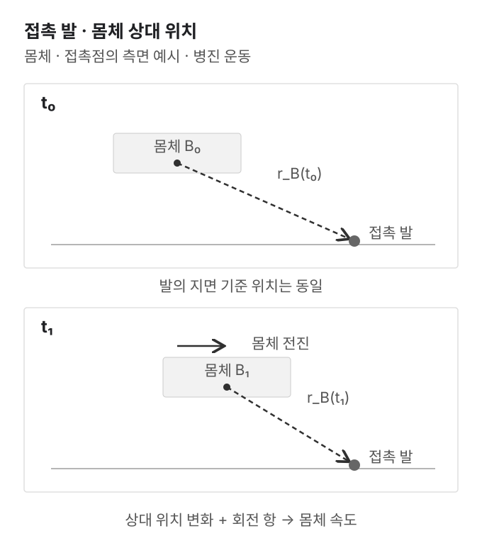
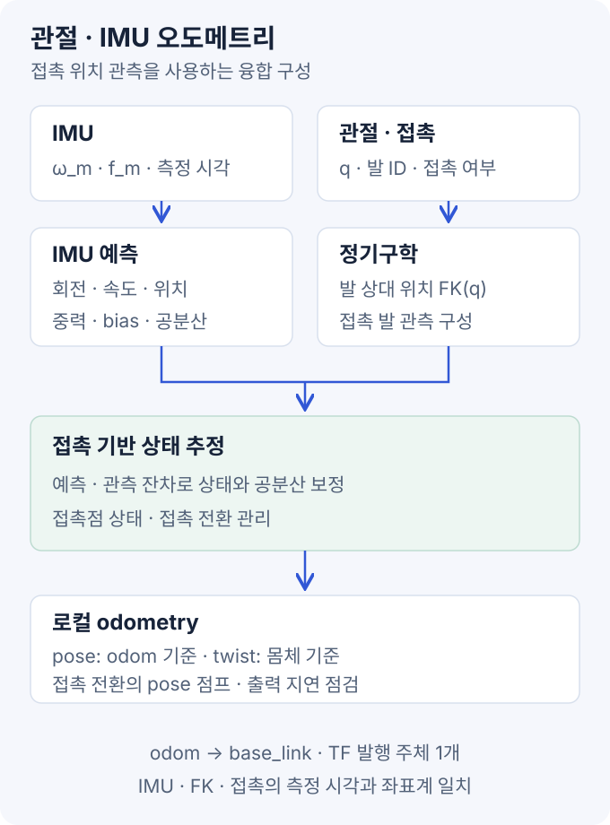
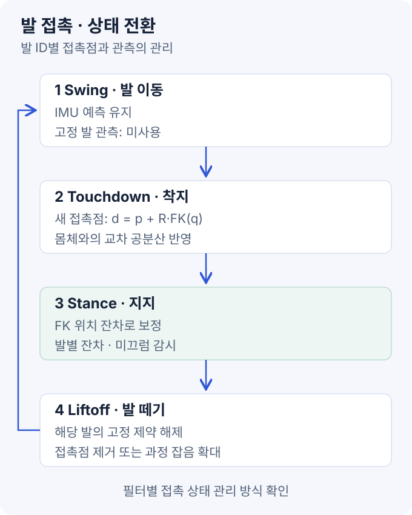

사족보행 로봇의 관절 엔코더는 **몸체에 대한 발의 위치**를 알려준다. IMU는 각속도와 비력(specific force)을 측정한다. 여기에 **지면을 딛고 있는 발이 미끄러지지 않는다**는 제약을 결합하면 몸체의 움직임을 추정할 수 있다.

이렇게 얻는 legged odometry는 출발점에 대한 연속적인 위치·자세·속도 추정이다. 관절·IMU만으로 지도상의 절대 위치나 절대 yaw까지 알아내는 것은 아니다.

먼저 접촉 발에서 몸체 속도를 구하는 식을 유도하고, 이를 IMU 기반 상태 추정과 연결한다. 그림과 수치 예제는 직접 작성한 학습 자료다. 특정 로봇에서 검증한 성능이나 완성된 ROS 2 추정기 구현은 아니다.

### 목차

1. [입력과 좌표계](#1-입력과-좌표계)
2. [관절 기구학](#2-관절-기구학)
3. [접촉 발 기반 몸체 속도](#3-접촉-발-기반-몸체-속도)
4. [IMU 예측과 접촉 보정](#4-imu-예측과-접촉-보정)
5. [논문과 공개 구현](#5-논문과-공개-구현)
6. [접촉 전환과 미끄럼](#6-접촉-전환과-미끄럼)
7. [공분산과 중복 정보](#7-공분산과-중복-정보)
8. [NumPy 계산 예제](#8-numpy-계산-예제)
9. [ROS 2 연결](#9-ros-2-연결)
10. [검증](#10-검증)
11. [참고 자료](#11-참고-자료)

## 1. 입력과 좌표계

### 1.1 필요한 입력

| 입력 | 용도 | 확인할 내용 |
| --- | --- | --- |
| 측정 관절각 `q` | 몸체 기준 발 위치 계산 | 관절 이름·순서·회전축·영점·rad 단위 |
| 측정 관절속도 `q̇` | 발 상대속도 계산 | rad/s, SDK 측정값인지 수치 미분값인지 |
| IMU 각속도 `ω_m` | 회전 예측·발 속도의 회전 항 계산 | 축·rad/s·bias·측정 시각 |
| IMU 비력 `f_m` | 몸체 속도·위치 예측 | m/s²·중력 처리·장착 위치 |
| 발별 접촉 정보 | 고정 발 제약의 적용 여부 | 접촉 센서 또는 별도의 접촉 추정 |
| 로봇 기구학 모델 | 정기구학·Jacobian | 링크 길이·hip 위치·발 접촉점·IMU 외부 파라미터 |

관절 **명령값**과 측정값은 다르다. 목표 관절각이나 보행 명령 속도를 실제 움직임으로 취급하면 추종 오차·충돌·미끄럼을 놓친다.

접촉 센서가 없다면 보행 위상, 관절 토크·전류, 발 높이와 잔차 등을 이용해 접촉을 추정해야 한다. 관절·IMU 데이터를 받는 것만으로 접촉 여부가 자동으로 결정되지는 않는다.

### 1.2 표기

| 표기 | 의미 |
| --- | --- |
| `W` | 중력축을 정렬한 로컬 `odom` 좌표계 |
| `B` | 몸체에 고정된 `base_link` 좌표계 |
| `I` | IMU 센서 좌표계 |
| `R_WB` | B 좌표의 벡터를 W 좌표로 회전하는 행렬 |
| `p_WB`, `v_WB` | B 원점의 W 기준 위치와 선속도 |
| `r_Bi` | B 원점에서 i번 발 접촉점까지의 벡터, B로 표현 |
| `d_Wi` | i번 발 접촉점의 W 기준 위치 |
| `ω_B` | 몸체 각속도를 B로 표현한 값 |

몸체 축은 x 전방·y 좌측·z 위쪽으로 둔다. `R_WBᵀ`는 반대 방향, 즉 W의 벡터를 B로 바꾼다. **회전 방향과 벡터의 표현 좌표계**를 먼저 고정해야 부호를 검증할 수 있다.

## 2. 관절 기구학

### 2.1 정기구학과 Jacobian

i번 다리의 관절각을 `q_i`라고 하면 발의 상대 위치와 속도는 다음과 같다.

```text
r_Bi     = FK_i(q_i)
J_i      = ∂FK_i / ∂q_i
ṙ_Bi    = J_i(q_i) q̇_i
```

- **정기구학(FK):** 관절각과 링크 구조로 발의 위치를 계산한다.
- **Jacobian:** 각 관절이 조금 움직일 때 발 위치가 얼마나 변하는지 나타낸다.
- **`ṙ_Bi`:** 움직이는 몸체 좌표계에서 본 발의 상대 위치 변화율이다. 아직 지면 기준 발 속도는 아니다.

여기서 `J_i`는 **몸체를 기준으로 한 발 위치를 관절각으로 미분한 행렬**이다. 부유 기저(floating base)의 속도까지 포함한 전체 로봇 Jacobian을 그대로 대입하면 몸체 운동 항을 중복 계산할 수 있다. 라이브러리의 Jacobian이 어떤 원점·축·속도 변수를 사용하는지 확인한다.

### 2.2 모델 점검

다리만의 FK가 hip 원점을 기준으로 나온다면 몸체 원점까지의 변환을 포함해야 한다. hip과 몸체 사이에 회전이 있으면 위치를 더하는 것만으로는 부족하다.

발 프레임의 원점과 실제 접촉점도 구분한다. 구형 발의 중심, 발바닥의 변형, 접촉 중 굴러가는 현상은 고정 접촉점 가정에 오차를 만든다. 점 접촉 모델은 **발의 위치 제약**이며, 발의 자세까지 지면에 고정된다는 가정은 아니다.

구현 전에는 한 관절만 조금 움직여 FK의 변화 방향을 확인한다. 수치 미분한 FK와 해석 Jacobian을 비교하면 관절 순서·회전축·부호 오류를 찾기 쉽다.

## 3. 접촉 발 기반 몸체 속도



### 3.1 고정 접촉점 제약

발의 지면 기준 위치는 몸체 위치와 상대 위치의 합이다.

```text
d_Wi = p_WB + R_WB r_Bi
```

이를 시간으로 미분한다. 회전하는 좌표계의 변화까지 포함하면 다음과 같다.

```text
ḋ_Wi = v_WB + R_WB (ω_B × r_Bi + J_i q̇_i)
```

발이 지면에 고정돼 있다면 `ḋ_Wi=0`이므로 몸체 속도는 다음처럼 계산된다.

```text
v_WB = -R_WB (J_i q̇_i + ω_B × r_Bi)
v_B  = R_WBᵀ v_WB
     = -J_i q̇_i - ω_B × r_Bi
```

**발이 몸체에 대해 움직이는 속도와 몸체 회전으로 생기는 속도를 모두 빼는 식**이다. `-Jq̇`만 사용하면 회전 중 병진 속도를 잘못 추정할 수 있다.

### 3.2 회전 보정 계산

다음은 하나의 접촉 발에 대한 계산 예시다.

```text
r_Bi      = [ 0.30,  0.20, -0.45] m
ω_B       = [ 0.00,  0.00,  1.00] rad/s
J_i q̇_i  = [-0.20, -0.25,  0.00] m/s

ω_B × r_Bi = [-0.20, 0.30, 0.00] m/s
v_B         = [ 0.40, -0.05, 0.00] m/s
```

회전 항을 빼지 않으면 `[0.20, 0.25, 0] m/s`가 된다. 크기뿐 아니라 횡방향 부호도 달라진다.

이때 몸체 yaw가 90°라면 같은 속도의 W 기준 표현은 `[0.05, 0.40, 0] m/s`다. **몸체 기준 속도를 그대로 world 위치에 적분하면 안 되는 이유**다.

### 3.3 여러 발의 결합

접촉 발마다 `v_Bi`를 구하고 신뢰도 `w_i`로 결합할 수 있다.

```text
v̂_B = Σ(w_i v_Bi) / Σw_i
e_i = v_Bi - v̂_B
```

이 식은 스칼라 가중치를 사용하는 최소제곱 형태다. 실제로는 방향별 관측 공분산과 발 사이의 상관관계까지 고려할 수 있다. `e_i`는 발별 속도 추정의 불일치를 보는 진단값이다.

알려진 각속도와 유효한 고정 발이 있으면 한 발에서도 이 속도 식을 사용할 수 있다. 그러나 이것이 전체 자세·bias·절대 위치까지 한 번에 관측된다는 뜻은 아니다. 여러 발도 함께 미끄러지면 서로 비슷한 잘못된 값을 낼 수 있다.

접촉 발이 없는 비행 구간에는 이 제약을 사용하지 않는다. **관측 없음과 몸체 속도 0은 다르다.** 이때는 IMU 예측을 이어가고 불확실성을 반영한다.

## 4. IMU 예측과 접촉 보정



### 4.1 상태 구성

속도를 구해 단순 적분하는 방식은 기본 관계를 확인하기에 좋다. 장시간 추정에는 IMU와 접촉 관측을 하나의 필터에서 다루는 구성이 유용하다.

```text
상태 = (R_WB, p_WB, v_WB, b_g, b_a, d_W1, …, d_Wn)
```

`b_g`, `b_a`는 자이로·가속도계 bias다. `d_Wi`는 추정기에 포함한 접촉점 위치다. 구현에 따라 모든 발을 유지하거나 현재 접촉 중인 발만 상태에 넣는다.

회전을 quaternion으로 저장하더라도 작은 회전 오차는 3차원으로 다룬다. quaternion 성분 4개를 서로 독립적인 값처럼 더하는 대신, 선택한 회전 오차 정의에 맞춰 상태와 공분산을 보정한다. 기본 예측·보정과 P·Q·R의 의미는 [EKF 센서 융합](/blog/ekf-sensor-fusion/)을 참고한다.

### 4.2 초기화

안정적으로 정지한 구간이 있다면 다음 순서로 시작할 수 있다.

1. 자이로 평균으로 초기 bias를 추정한다. 로봇이 움직인 구간은 제외한다.
2. 가속도계 평균과 중력 방향으로 초기 roll·pitch를 정한다. 한 자세의 정지 데이터만으로 가속도 bias와 기울기 오차를 모두 분리할 수는 없다.
3. 외부 방향 기준이 없으면 초기 yaw를 0 등으로 정한다. 이는 북쪽 방향을 측정했다는 뜻이 아니다.
4. 로컬 위치 원점과 초기 공분산을 정한다. 정지가 확인된 경우에만 초기 속도를 0으로 둔다.
5. 확인된 접촉 발의 위치와 공분산을 초기화한다. 상태 증강 방식은 6절에서 설명한다.

초기 몸체 높이를 0으로 잡았다면 지면의 접촉점 z는 음수일 수 있다. 좌표계 원점 선택과 실제 몸체 높이를 구분한다.

### 4.3 IMU 예측

먼저 **IMU 원점과 축이 B와 일치하는 경우**로 설명한다. 외부 파라미터가 있는 경우는 9절에서 구분한다. 잡음 항을 생략한 연속시간 식은 다음과 같다.

```text
ω = ω_m - b_g
f = f_m - b_a

Ṙ_WB = R_WB [ω]×
v̇_WB = g_W + R_WB f
ṗ_WB = v_WB

g_W = [0, 0, -9.81] m/s²
```

`[ω]×`는 다른 벡터와의 곱이 `ω × 벡터`가 되는 외적 행렬이다. bias에는 느린 변화를 표현하는 과정 잡음을 둘 수 있다.

가속도계의 비력은 중력이 제거된 world 가속도와 다르다. 정상적인 축·부호에서 정지한 수평 IMU는 z축에 약 `+9.81 m/s²`를 보고한다. 이를 회전한 뒤 `g_W`를 더하면 정지 가속도는 약 0이 된다. SDK가 이미 중력을 제거했다면 같은 처리를 다시 적용하지 않는다. [IMU 데이터 규약](https://github.com/ros-infrastructure/rep/blob/master/rep-0145.rst)

작은 시간 간격의 예측은 다음처럼 이해할 수 있다.

```text
a_W   = g_W + R_WB f
R_next = R_WB Exp([ω Δt]×)
v_next = v_WB + a_W Δt
p_next = p_WB + v_WB Δt + 0.5 a_W Δt²
```

`Exp`는 회전 벡터를 회전 행렬로 바꾸는 행렬 지수다. 위 식은 구간 시작의 가속도를 사용하는 근사다. 실제 구현은 적분 방식과 잡음 이산화, 센서 시각에 맞춰 공분산도 함께 전파해야 한다.

### 4.4 접촉 위치 관측

관절각으로 구한 발 상대 위치를 관측으로 사용할 수 있다.

```text
관측값       z_i = FK_i(q_i)
예상 관측  h_i(x) = R_WBᵀ (d_Wi - p_WB)
잔차         ν_i = z_i - h_i(x)
```

필터가 예상한 발 상대 위치와 엔코더로 계산한 위치를 비교하는 식이다. 상태 사이의 공분산을 통해 몸체 위치·자세뿐 아니라 속도·bias도 간접적으로 보정할 수 있다. 실제로 추정 가능한 항목은 접촉 상태와 운동 조건에 달려 있다.

이 경로는 `q̇`를 미분해 속도 관측을 만드는 대신 **관절각의 FK 위치를 직접 사용**한다. 따라서 관절속도가 없다고 접촉 기반 필터 전체를 사용할 수 없는 것은 아니다.

접촉점은 stance 중 거의 일정하다고 모델링하되, 작은 미끄럼·발 변형에는 과정 잡음을 둔다. 큰 미끄럼을 작은 Gaussian 잡음으로만 처리하면 잘못된 접촉 제약이 몸체 추정을 끌고 갈 수 있다.

### 4.5 절대 기준과 드리프트

외부 기준 없이 관절·IMU·접촉만 사용할 때 **절대 위치와 중력축 주위의 절대 yaw는 관측되지 않는다.** 출발 위치와 초기 yaw를 정해 로컬 좌표계를 만들 수 있지만, 이는 전역 위치를 측정한 결과가 아니다.

특히 모든 접촉점의 높이를 0으로 고정하면 평지라는 추가 가정을 넣게 된다. 경사·계단에서는 발마다 높이가 다를 수 있다. 접촉점 상태를 쓰는 모델과 별도의 평면 높이 제약을 구분한다.

## 5. 논문과 공개 구현

### 5.1 Bloesch 외, RSS 2012

[State Estimation for Legged Robots — Consistent Fusion of Leg Kinematics and IMU](https://www.roboticsproceedings.org/rss08/p03.html)는 몸체 상태와 발 접촉점 위치를 함께 추정하는 구성을 설명한다.

읽을 부분은 세 가지다.

1. **접촉점을 상태에 포함:** 몸체와 지면 사이의 상대 위치 관측을 구성한다.
2. **IMU 예측·FK 보정:** 관절속도를 직접 적분하는 방식과 구분한다.
3. **관측 가능성 유지:** 비선형 시스템에서 알 수 없는 절대 위치·yaw를 선형화 때문에 아는 것처럼 처리하지 않도록 한다.

원논문은 swing 발의 위치 과정 잡음을 크게 설정하는 접촉 처리도 설명한다. 모든 구현이 touchdown마다 같은 방식으로 상태를 추가·제거하는 것은 아니다. 또한 논문의 quaternion은 이 글의 `R_WB`와 변환 방향이 다르므로 표기와 부호를 그대로 섞지 않는다.

### 5.2 Hartley 외, Contact-aided InEKF

[RSS 2018 논문](https://arxiv.org/abs/1805.10410)과 [2019년 확장 원고](https://arxiv.org/abs/1904.09251v2)는 회전·속도·위치·접촉점을 불변 오차 구조로 다루는 **InEKF(Invariant Extended Kalman Filter)**를 설명한다.

핵심은 단순히 EKF를 다른 이름으로 부르는 것이 아니라, 상태의 기하 구조와 관측 가능성에 맞는 오차를 정의하는 데 있다. IMU bias와 접촉점 추가·제거도 다룬다. 기본 모델의 이론적 성질을 bias가 포함된 모든 실제 조건의 수렴 보장으로 확대해서는 안 된다.

주요 실험 플랫폼은 이족 로봇 Cassie다. 점 접촉·IMU 모델은 사족에도 참고할 수 있지만, 해당 실험 결과가 특정 사족 로봇에서의 검증을 대신하지는 않는다.

### 5.3 공개 코드의 대응 위치

[RossHartley/invariant-ekf](https://github.com/RossHartley/invariant-ekf/tree/ef16e8a1df72f9272111a488880e3fe9d161f59f)의 `kinematics.cpp`와 `InEKF.cpp`를 기준으로 보면 다음과 같다.

이 라이브러리는 **IMU와 접촉점 사이의 상대 기구학**을 받는다. 몸체 기준 FK를 계산했다면 IMU 외부 파라미터를 이용해 입력 기준을 맞춰야 한다.

| 코드 | 역할 | 연결 시 주의 |
| --- | --- | --- |
| `Propagate` | 각속도·가속도와 `dt`로 IMU 예측 | 원시 IMU 정의·bias·시간 간격 확인 |
| `setContacts` | 발 ID별 접촉 플래그 저장 | 플래그 저장과 상태 제거는 별도 처리 |
| `Kinematics` | 발 ID·상대 pose·6×6 공분산 전달 | raw 관절각이 아니라 FK 결과를 전달 |
| `CorrectKinematics` | 접촉 상태에 따라 보정·상태 추가·제거 | 확인한 점 접촉 보정은 위치 성분을 사용 |

특히 이 구현은 **`CorrectKinematics`에서 해당 발의 데이터를 순회할 때** contact=false인 기존 접촉 상태를 제거한다. 따라서 swing 발의 FK 데이터를 무조건 목록에서 빼고 `setContacts(false)`만 호출하면 제거 경로가 실행되지 않을 수 있다. 접촉 플래그와 기구학 데이터를 함께 전달하는 wrapper가 필요하다. [접촉 처리 코드](https://github.com/RossHartley/invariant-ekf/blob/ef16e8a1df72f9272111a488880e3fe9d161f59f/src/InEKF.cpp)

다른 구현 예로 [MIT Cheetah의 `PositionVelocityEstimator.cpp`](https://github.com/mit-biomimetics/Cheetah-Software/blob/c71c5a138d3e418cc833e94e25357ceea8955daa/common/src/Controllers/PositionVelocityEstimator.cpp)는 이미 계산된 자세를 사용하고, 몸체 위치·속도·네 발 위치의 18개 상태를 선형 KF로 추정한다. `ω × r` 보정과 접촉 신뢰도에 따른 잡음 조절을 볼 수 있다. 발 높이 관측 등 구현별 가정까지 포함하므로 위 논문 필터와 동일한 모델로 취급하지 않는다.

## 6. 접촉 전환과 미끄럼



### 6.1 접촉 생명주기

| 구간 | 처리 |
| --- | --- |
| Swing | 고정 발 제약 제외. 발이 움직인다는 사실을 몸체 이동으로 해석하지 않기 |
| Touchdown | 접촉 확인 후 새 지지점 구성. 충격·센서 지연 구간의 신뢰도 점검 |
| Stance | 고정 접촉 모델로 보정. 발별 잔차·미끄럼 감시 |
| Liftoff | 고정 제약 해제. 선택한 필터 방식에 따라 접촉 상태 제거 또는 잡음 확대 |

접촉 상태를 추가하는 방식에서는 착지 시 다음 위치로 초기화할 수 있다.

```text
d_Wi,new = p_WB + R_WB FK_i(q_i)
```

새 발 위치는 현재 몸체 추정에서 계산했으므로 몸체와 오차가 상관된다. 평균만 초기화하고 접촉점 공분산을 독립적인 0으로 설정하면 안 된다. 상태 증강의 Jacobian과 교차 공분산도 처리해야 한다.

같은 발이 다시 착지해도 이전 발자국에 고정되는 것은 아니다. 물리적인 발 ID와 그 발의 현재 지지점 상태를 구분한다.

### 6.2 접촉 신뢰도

접촉 판정에는 힘 센서·토크 기반 추정·보행 위상 등을 사용할 수 있다. 보행 제어기가 stance를 계획했다는 사실만으로 실제 접촉을 확정하지 않는다.

- 접촉 시작·해제 임계값을 다르게 두는 hysteresis로 플래그의 빠른 진동을 줄인다.
- touchdown 직후의 큰 충격과 시간 지연을 확인한다.
- 예상치 못한 조기 접촉·헛디딤을 계획된 보행 위상과 구분한다.
- 발별 잔차와 다른 발의 추정을 함께 비교한다.

### 6.3 미끄럼

실제 발 속도가 0이 아니라면 3절에서 계산한 값은 다음과 같다.

```text
v_B,estimate = v_B,true - R_WBᵀ ḋ_Wi
```

즉, 발의 미끄럼 속도가 몸체 속도 오차로 들어온다. 접촉력이 크다는 이유만으로 미끄럼이 없다고 가정할 수 없다.

약한 미끄럼에는 접촉점 과정 잡음이나 관측 공분산 조정이 도움이 될 수 있다. 강한 미끄럼·접촉 실패는 해당 제약의 제외나 별도 모델이 필요하다. 여러 발이 같은 방향으로 미끄러지는 상황은 발 사이의 일치도만으로 놓칠 수 있다.

## 7. 공분산과 중복 정보

### 7.1 관절 오차의 위치 전파

관절각 공분산을 `Σ_q`라고 하면 FK 위치 관측의 공분산은 1차 근사로 다음처럼 구성할 수 있다.

```text
Σ_FK ≈ J_i Σ_q J_iᵀ + Σ_model
```

`Σ_model`은 링크 길이·영점·발 변형 등 추가 오차의 근사다. 관절각 분산은 rad², 발 위치 분산은 m²다. **엔코더 분산을 발 위치 공분산 자리에 그대로 넣지 않는다.** 고정된 기구학 bias까지 작은 백색 잡음으로 설명할 수 있는지도 따로 확인한다.

여기서 FK 관측 공분산과 **지면에 고정된 발이 얼마나 움직일 수 있는지 나타내는 접촉 과정 잡음**은 다른 항목이다.

### 7.2 발 사이의 공유 오차

속도 기반 결합에서는 모든 발이 같은 자이로를 사용한다. 자이로 오차가 있으면 발별 추정 오차도 상관된다.

`[r]×`를 외적 행렬로 두면, 자이로 잡음이 만드는 교차 공분산 항은 다음과 같다.

```text
Cov(v_Bi, v_Bj)의 공유 자이로 항
  ≈ [r_Bi]× Σ_ω [r_Bj]×ᵀ
```

따라서 네 발을 평균했다고 모든 불확실성이 독립 관측 네 개처럼 줄지는 않는다. 아래 코드의 가중 평균은 **기구학 계산 예제**이며, 이 상관관계를 모델링한 완성된 필터가 아니다.

### 7.3 외부 EKF와의 중복 융합

이미 IMU를 사용한 legged odometry와 같은 IMU를 다른 EKF에 독립 입력처럼 넣으면 공유 정보가 생긴다. 같은 관절에서 만든 FK 위치와 FK 속도를 함께 사용할 때도 상관관계를 검토해야 한다.

로봇 SDK가 제공하는 odometry를 쓸 때는 내부 센서 구성을 먼저 확인한다. 새 추정기를 추가하기 전에 **무엇이 이미 융합됐는지, 추가로 필요한 정보가 무엇인지** 정리한다.

## 8. NumPy 계산 예제

다음 코드는 FK·Jacobian으로 얻은 발 상대 위치·속도가 이미 준비됐다고 가정한다. 자이로 bias도 보정된 입력을 사용한다. 로봇별 FK나 IMU 적분·공분산 보정을 구현한 전체 추정기는 아니다.

```python
import numpy as np


def estimate_body_velocity(foot_positions, foot_velocities, gyro, weights):
    foot_positions = np.asarray(foot_positions, dtype=float)
    foot_velocities = np.asarray(foot_velocities, dtype=float)
    gyro = np.asarray(gyro, dtype=float)
    weights = np.asarray(weights, dtype=float)
    if foot_positions.ndim != 2 or foot_positions.shape[1] != 3:
        raise ValueError("foot_positions must have shape (N, 3)")
    if foot_velocities.shape != foot_positions.shape:
        raise ValueError("foot_velocities must match foot_positions")
    if gyro.shape != (3,) or weights.shape != (len(foot_positions),):
        raise ValueError("invalid gyro or weights shape")
    if not all(np.all(np.isfinite(values)) for values in
               (foot_positions, foot_velocities, gyro, weights)):
        raise ValueError("inputs must be finite")
    if np.any(weights < 0):
        raise ValueError("weights must be nonnegative")
    valid = weights > 0
    if not np.any(valid):
        return None
    candidates = -foot_velocities - np.cross(gyro, foot_positions)
    return np.average(candidates[valid], axis=0, weights=weights[valid])


foot_positions = np.array([
    [ 0.30,  0.20, -0.45],
    [ 0.30, -0.20, -0.45],
    [-0.30,  0.20, -0.45],
    [-0.30, -0.20, -0.45],
])
foot_velocities = np.array([
    [-0.20, -0.25, 0.0],
    [-0.60, -0.25, 0.0],
    [-0.20,  0.35, 0.0],
    [ 3.00,  2.00, 1.0],
])
gyro = np.array([0.0, 0.0, 1.0])

for label, weights in [
    ("접촉 발만", [1, 1, 1, 0]),
    ("공중 발 포함", [1, 1, 1, 1]),
    ("접촉 발 없음", [0, 0, 0, 0]),
]:
    velocity = estimate_body_velocity(
        foot_positions, foot_velocities, gyro, weights
    )
    print(label, velocity)
```

출력은 다음과 같다. 속도 단위는 m/s다.

```text
접촉 발만 [ 0.4  -0.05  0.  ]
공중 발 포함 [-0.5    -0.4625 -0.25  ]
접촉 발 없음 None
```

네 번째 발은 의도적으로 swing 속도를 넣었다. 같은 가중치로 포함하면 몸체 속도가 크게 달라진다. 이 예제의 목적은 회전 보정과 접촉 선택을 확인하는 것이며, 실제 보행 정확도를 평가하는 것이 아니다.

## 9. ROS 2 연결

### 9.1 입력·출력 계약

아래 이름은 **연결 설계 예시**다. 특정 패키지의 기본 토픽 이름이 아니다.

| 방향 | 예시 | 내용 |
| --- | --- | --- |
| 입력 | `/joint_states` | `JointState`의 측정 관절각·속도, 관절 이름 매핑 |
| 입력 | `/imu/data_raw` | 각속도·가속도계 비력, 센서 기준·측정 시각 |
| 입력 | `/foot_contacts` | 발 ID·접촉 여부·선택적 신뢰도, 별도 메시지 계약 |
| 출력 | `/legged/odometry` | `nav_msgs/Odometry`와 타당한 공분산 |
| 출력 | `odom → base_link` | 한 발행 주체가 담당하는 로컬 TF |

관절 배열의 순서를 가정하기보다 이름으로 기구학 모델에 매핑한다. IMU·관절·접촉은 **측정 시각**을 기준으로 정렬한다. 같은 수신 시각을 붙이는 것으로 지연이 해결되지는 않는다.

IMU 시각 사이에 들어온 관절 관측을 처리하려면 해당 시각까지 예측하고 보정하는 정책이 필요하다. 늦은 데이터는 추정기의 재전파·거부 정책을 정한다. 센서마다 실제 정보 주기가 다른데 같은 측정을 복제해 출력 주기만 맞추지 않는다.

### 9.2 IMU와 몸체 원점의 차이

`R_BI`를 IMU 축에서 몸체 축으로의 회전, `l_BI`를 몸체 원점에서 IMU 원점까지의 B 기준 벡터라고 하자.

```text
ω_B = R_BI (ω_m,I - b_g,I)
```

이것은 축 회전이다. 원점이 다른 위치·선속도에는 장착 위치도 반영해야 한다. 추정기가 IMU 원점의 상태를 출력한다면 다음 관계를 사용한다.

```text
R_WB = R_WI R_BIᵀ
p_WB = p_WI - R_WB l_BI
v_WB = v_WI - R_WB (ω_B × l_BI)
```

회전 중에는 IMU 원점과 몸체 원점의 선속도가 다르다. 가속도에도 각가속도·구심 항이 생기므로 단순히 축만 회전한 값을 B 원점의 가속도로 취급하지 않는다.

한 방법은 **IMU 원점을 추정 기준으로 유지하고 FK 관측도 IMU 기준으로 변환**한 뒤, 출력할 때 `base_link`로 옮기는 것이다. 공분산 역시 원점·회전 오차 정의에 맞는 Jacobian으로 변환한다.

### 9.3 Odometry 메시지

`nav_msgs/Odometry`는 pose와 twist의 표현 좌표계가 다르다. [Jazzy 메시지 정의](https://github.com/ros2/common_interfaces/blob/jazzy/nav_msgs/msg/Odometry.msg)

```text
header.frame_id = "odom"
child_frame_id  = "base_link"

pose.position    ← p_WB
pose.orientation ← R_WB를 변환한 quaternion
twist.linear     ← R_WBᵀ v_WB
twist.angular    ← ω_B
```

world 기준 선속도를 몸체 기준 twist 자리에 그대로 넣지 않는다. 내부 상태가 IMU 원점이면 먼저 9.2절의 원점 변환을 적용한다.

pose·twist 공분산은 메시지의 6×6 순서와 표현 좌표계에 맞춘다. 필터 내부 회전 오차 공분산을 quaternion 성분이나 Euler 각 공분산처럼 무조건 복사하지 않는다. 추정하지 못하는 항목을 오차 0인 것처럼 발행하지 않는 것도 중요하다.

### 9.4 TF와 다른 추정기

```text
map → odom → base_link → imu_link / 각 다리 링크
```

legged odometry는 `odom → base_link`를 담당할 수 있다. 지도 정합·GNSS 등 전역 추정기가 필요하면 `map → odom`으로 역할을 구분한다. SDK·SLAM·별도 EKF가 같은 TF를 중복 발행하지 않도록 한다. [REP-105](https://github.com/ros-infrastructure/rep/blob/master/rep-0105.rst)

`robot_localization`은 raw 관절각과 접촉 플래그만 연결해서 이 발 기구학·접촉점 필터를 대신하는 패키지가 아니다. 발 접촉 기반 추정기를 먼저 구성하고, 추가 융합이 필요할 때 입력 출처와 상관관계를 검토한다.

## 10. 검증

### 10.1 단계별 시험

1. **FK:** 정지 자세와 한 관절 움직임에서 발 위치·방향 확인.
2. **Jacobian:** `FK(q±ε)`의 중심 차분과 `J` 비교.
3. **정지:** 자이로 bias, 비력 부호, 속도 잔차와 위치 드리프트 기록.
4. **접촉 유지 운동:** 안전하게 지지한 조건에서 접촉점을 유지하며 몸체를 이동·회전. `ω×r` 보정 전후 비교.
5. **보행:** 느린 직진·좌우 이동·제자리 회전부터 확인. touchdown·liftoff의 속도 점프 기록.
6. **실패 조건:** 접촉 플래그 오류·센서 지연·발 미끄럼·데이터 중단을 기록 데이터에서 재생.

가능하면 모션캡처·측량·독립적인 외부 위치 기준과 비교한다. SDK odometry가 같은 센서를 사용한다면 서로 일치한다는 사실만으로 독립 검증이 되지는 않는다.

### 10.2 증상별 점검

| 증상 | 먼저 확인할 내용 |
| --- | --- |
| 회전할 때 옆으로 이동하는 추정 | `ω×r` 누락·부호, hip 위치, IMU와 몸체 원점 차이 |
| 발을 들 때 속도 급변 | swing 발 포함, 접촉 지연, 접촉 해제 처리 |
| 착지마다 pose 점프 | 접촉점 재초기화·상태 증강 공분산·충격 처리 |
| 정지 중 z 속도 증가 | 중력 부호·중복 중력 제거·가속도 bias |
| 계단에서 높이가 눌림 | 모든 발 높이를 0으로 두는 평면 제약 |
| 경로는 매끄럽지만 실제 위치와 다름 | 공통 미끄럼·기구학 bias·yaw 드리프트 |
| 발이 늘수록 공분산만 급격히 감소 | 공유 자이로·모델 오차의 상관관계 누락 |

평가에는 위치·속도·방향 오차뿐 아니라 접촉 전환의 점프, 발별 잔차, 센서 시각부터 출력까지의 지연을 함께 기록한다. 위험한 지형 시험은 추정기 결과만 믿고 진행하지 말고 지지·정지 수단이 있는 통제 환경에서 수행한다.

## 11. 참고 자료

- [Bloesch 외, RSS 2012](https://www.roboticsproceedings.org/rss08/p03.html), [원문 PDF](https://www.roboticsproceedings.org/rss08/p03.pdf): 접촉점 상태·IMU 예측·FK 관측·관측 가능성 제약.
- [Hartley 외, RSS 2018](https://arxiv.org/abs/1805.10410), [2019 확장 원고 v2](https://arxiv.org/abs/1904.09251v2): contact-aided InEKF와 bias·접촉점 관리.
- [invariant-ekf 기준점 `ef16e8a`](https://github.com/RossHartley/invariant-ekf/tree/ef16e8a1df72f9272111a488880e3fe9d161f59f), [기구학 예제](https://github.com/RossHartley/invariant-ekf/blob/ef16e8a1df72f9272111a488880e3fe9d161f59f/src/examples/kinematics.cpp): 라이브러리 입출력과 실제 접촉 상태 처리.
- [Cheetah-Software 기준점 `c71c5a1`](https://github.com/mit-biomimetics/Cheetah-Software/blob/c71c5a138d3e418cc833e94e25357ceea8955daa/common/src/Controllers/PositionVelocityEstimator.cpp): 회전 보정·접촉 신뢰도를 사용하는 별도 선형 KF 구현.
- [REP-105](https://github.com/ros-infrastructure/rep/blob/master/rep-0105.rst), [REP-145](https://github.com/ros-infrastructure/rep/blob/master/rep-0145.rst), [Odometry 메시지](https://github.com/ros2/common_interfaces/blob/jazzy/nav_msgs/msg/Odometry.msg): 프레임·IMU·출력 규약.
- [EKF 센서 융합](/blog/ekf-sensor-fusion/): 공분산, 예측·보정, 중복 정보의 기본 개념.
