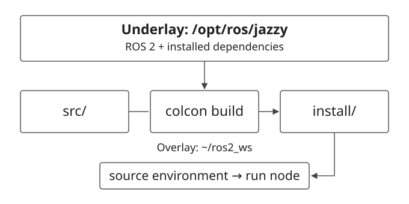

Ubuntu 24.04·ROS 2 Jazzy·Bash 기준이다. Humble 등 다른 배포판은 OS·Python·패키지 지원 조합이 다르므로 경로만 바꿔 혼용하지 않는다.

## 1. 워크스페이스 구조



```text
ros2_ws/
├── src/       패키지 소스
├── build/     중간 빌드 결과
├── install/   실행·배포 환경
└── log/       빌드 로그
```

`ament`는 패키지 빌드에 필요한 규칙·기능을 제공하고, `colcon`은 여러 패키지를 의존성 순서에 맞춰 빌드하는 도구다. `package.xml`의 의존성과 실제 빌드 설정을 함께 관리한다.

설치된 `/opt/ros/jazzy`는 underlay, 그 위에 개발하는 워크스페이스는 overlay가 된다. overlay의 패키지가 같은 이름의 underlay 패키지를 가릴 수 있다. [공식 워크스페이스 설명](https://github.com/ros2/ros2_documentation/blob/jazzy/source/Tutorials/Beginner-Client-Libraries/Creating-A-Workspace/Creating-A-Workspace.rst).

## 2. 패키지 생성과 빌드

Jazzy와 colcon·rosdep이 준비된 환경에서 실행한다.

```bash
source /opt/ros/jazzy/setup.bash
mkdir -p ~/ros2_ws/src
cd ~/ros2_ws/src
ros2 pkg create study_nodes --build-type ament_python --license Apache-2.0 --dependencies rclpy std_msgs
cd ~/ros2_ws
rosdep install --from-paths src --ignore-src -r -y
colcon build --symlink-install --packages-select study_nodes
```

`rosdep` 데이터베이스는 먼저 초기화·갱신되어 있어야 한다. 빌드는 새 터미널에서 underlay만 읽은 상태로 시작하는 편이 기존 overlay의 영향을 줄일 수 있다.

| 옵션 | 범위 |
| --- | --- |
| 옵션 없음 | 워크스페이스의 패키지 전체 |
| `--packages-select study_nodes` | 지정한 패키지; 의존 패키지는 이미 준비돼 있어야 함 |
| `--packages-up-to study_nodes` | 지정 패키지와 워크스페이스 내 빌드 의존성 |
| `--symlink-install` | 가능한 파일을 심볼릭 링크로 설치; 모든 변경의 재빌드를 없애지는 않음 |

## 3. Python 노드와 실행 파일

`src/study_nodes/study_nodes/talker.py`에 저장하는 예시다.

```python
import rclpy
from rclpy.node import Node
from std_msgs.msg import String


class Talker(Node):
    def __init__(self):
        super().__init__("study_talker")
        self.publisher = self.create_publisher(String, "chatter", 10)
        self.timer = self.create_timer(1.0, self.publish_message)

    def publish_message(self):
        self.publisher.publish(String(data="hello"))


def main(args=None):
    rclpy.init(args=args)
    node = Talker()
    try:
        rclpy.spin(node)
    except KeyboardInterrupt:
        pass
    finally:
        node.destroy_node()
        if rclpy.ok():
            rclpy.shutdown()
```

생성된 `setup.py`의 `entry_points`에 실행 이름을 등록한다. 일반 모듈을 추가할 때마다 모든 파일을 실행 파일로 등록하는 것은 아니다.

```python
entry_points={
    "console_scripts": [
        "talker = study_nodes.talker:main",
    ],
}
```

설정 변경 후 빌드하고 **별도 실행 터미널**에서 환경을 읽는다.

```bash
source /opt/ros/jazzy/setup.bash
source ~/ros2_ws/install/local_setup.bash
ros2 run study_nodes talker
```

`setup.bash`는 연결된 underlay까지 포함하는 환경 설정이고, `local_setup.bash`는 해당 워크스페이스 환경을 읽는다. 환경을 읽는 순서를 의도적으로 유지한다.

## 4. C++ 패키지

```bash
cd ~/ros2_ws/src
ros2 pkg create study_cpp --build-type ament_cmake --license Apache-2.0 --dependencies rclcpp std_msgs
```

C++ 실행 파일은 `CMakeLists.txt`에서 타깃·의존성·설치 위치를 등록한다. 소스 파일을 만드는 것만으로 `ros2 run`에 나타나지 않는다. 라이브러리·헤더를 다른 패키지에 제공할 때는 export 설정도 필요하다. [공식 패키지 구조](https://github.com/ros2/ros2_documentation/blob/jazzy/source/Tutorials/Beginner-Client-Libraries/Creating-Your-First-ROS2-Package.rst).

## 5. 실행 파일을 찾지 못할 때

```bash
colcon list
ros2 pkg prefix study_nodes
ros2 pkg executables study_nodes
```

소스 위치 → 빌드 성공 → 설치 결과 → 현재 셸의 overlay 순서로 확인한다. Python에서는 `console_scripts`와 `setup.cfg`의 설치 경로를 확인한다. 원인 확인 없이 시스템의 setuptools를 특정 구버전으로 내리는 방식은 피한다.

통신 확인은 [ROS 2 토픽·서비스·액션과 CLI](/blog/ros2-communication-cli)에서 이어진다.
