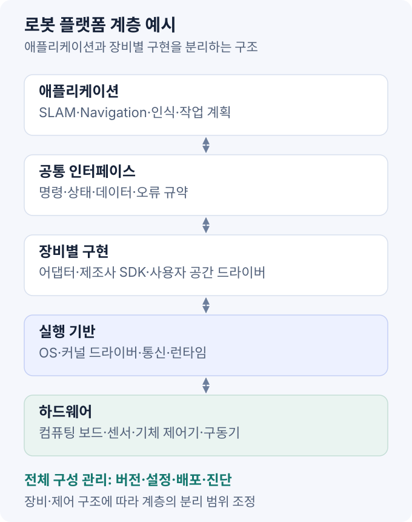

로봇·임베디드 분야의 시스템 엔지니어는 **하드웨어와 상위 소프트웨어를 연결하는 플랫폼**을 설계·구현한다. 컴퓨팅 보드, 센서, 기체 제어기, OS, 제조사 SDK·드라이버를 통합하고, 배포·진단·유지보수 환경을 구성한다.

이 글은 로봇 플랫폼 개발 직무를 기준으로 정리한다. 조직에 따라 플랫폼 엔지니어, 로보틱스 소프트웨어 엔지니어, 시스템 소프트웨어 엔지니어가 비슷한 업무를 맡을 수 있다. 서버·네트워크 운영 중심의 시스템 엔지니어와는 담당 범위가 다르다.

## 1. 직무 범위

| 업무 | 주요 내용 | 산출물 예시 |
| --- | --- | --- |
| 장비 연동 | 제조사 SDK·드라이버 적용, 연결·종료·재연결 처리 | 장비별 어댑터, 호환성 목록 |
| 시스템 레이어 설계 | 명령·상태·오류 인터페이스와 계층별 책임 정의 | 구성도, 인터페이스 명세 |
| 데이터 통합 | 통신, 시간 동기화, 좌표계·단위·보정값 관리 | 데이터 규약, 장비별 설정 |
| 공통 패키지 | 재사용 가능한 코드와 기체·현장별 설정 분리 | 로봇·센서 패키지, 실행 구성 |
| 배포·운영 | 빌드·배포 자동화, 상태 관측, 장애 분석·복구 | 릴리스, 진단 도구, 운영 절차 |

예를 들어 새 LiDAR를 도입하면 데이터 수신뿐 아니라 SLAM 입력 형식, 시간 기준, 장착 좌표계, 부팅 시 실행, 현장 교체·복구까지 연결한다. 핵심은 **장비를 반복해서 사용할 수 있는 개발·운영 단위로 만드는 일**이다.

C++·Python·Linux·ROS 2 구현 경험에 네트워크 분석, 프로세스·장치 권한 관리, 로그 기반 디버깅이 필요하다. 기구·전장 담당자와는 장착·전원 조건을, 인식·제어 담당자와는 데이터 품질·명령 조건을 합의한다.

## 2. 플랫폼 계층 설계

상위 애플리케이션이 제조사 API에 직접 의존하면 장비 교체 때 수정 범위가 커진다. 장비별 차이는 어댑터에 모으고, 상위 계층에는 합의한 명령·상태 인터페이스를 제공하는 구조를 사용할 수 있다.



직접 작성한 설계 예시다. 연결선은 계층 간 연동 관계를 나타내며, 실제 분리 범위는 장비와 제어 구조에 따라 달라진다.

ROS 2 환경에서는 토픽·서비스·액션을 인터페이스로 사용할 수 있다. 관절 제어에는 상태와 명령 인터페이스를 분리하는 `ros2_control`도 활용한다. 센서·기체의 모든 SDK를 반드시 이 프레임워크에 넣어야 하는 것은 아니다. [ros2_control 하드웨어 인터페이스](https://control.ros.org/jazzy/doc/ros2_control/hardware_interface/doc/hardware_interface_types_userdoc.html).

차체 속도 명령, 보행 모드 요청, 관절 토크 명령은 제어 수준이 다르다. 특히 사족보행에서는 내비게이션과 제조사 보행 제어기의 책임을 구분하고, 명령 권한·모드 전환·통신 장애 시 동작을 정의해야 한다. 고장 시 대응은 기체 특성과 위험 분석을 바탕으로 결정한다.

## 3. SDK·드라이버 연동

SDK는 제조사가 제공하는 API·라이브러리·도구 묶음이고, 드라이버는 장비 통신과 데이터·명령 처리를 담당한다. 로봇 분야의 드라이버는 사용자 공간 프로그램일 수도 있으며, 커널 드라이버와 구분해야 한다. 제조사 패키지가 이미 ROS 인터페이스를 제공하는 경우에는 필요한 설정·진단 기능만 보완할 수 있다.

### 연동 전 확인 항목

- **지원 환경:** CPU 아키텍처, OS·커널, 라이브러리 의존성, SDK·펌웨어 호환 버전
- **연결 조건:** USB·Ethernet·CAN·Serial, 장치 식별자, IP·포트, 전원·대역폭
- **데이터 규격:** 메시지 구조, 단위, 좌표계, timestamp 의미, 보정 정보
- **제어 조건:** 지원 모드, 명령 주기·한계, 제어 권한, 응답·오류 코드
- **배포 조건:** 라이선스, 바이너리·SDK 재배포 허용 범위

### 실행·오류 처리

샘플 코드로 기본 동작을 확인한 뒤 다음 항목을 구현·시험한다.

1. 설정 검증, 연결, 데이터 수신, 종료의 상태 구분
2. 콜백·스레드·버퍼의 수명과 종료 순서
3. 타임아웃, 손상 데이터, 중복·역순 패킷 처리
4. 연결 끊김 감지, 재시도 한도·간격, 재연결 후 상태 초기화
5. 명령 유효기간, 권한 변경, 오류 상태의 상위 전달

재연결 성공과 임무 재개는 별도 조건이다. 새 데이터·시각 동기화·제어 모드 등을 다시 확인한 뒤 재개 여부를 판단한다. 자동 재시도 중 같은 동작 명령이 중복 실행될 가능성도 검토한다.

## 4. 통신·시간·좌표계

### 데이터 인터페이스

| 항목 | 정의할 내용 | 대표 문제 |
| --- | --- | --- |
| 형식·단위 | 필드 의미, 거리·각도·속도 단위, 유효하지 않은 값 | mm·m, degree·radian 혼용 |
| 좌표계 | 축 방향, `frame_id`, 장착 변환, 변환 발행 주체 | 뒤집힌 포인트클라우드, 중복 TF |
| 시간 | 취득·수신 시각, 시계 기준, 허용 오차·지연 | 센서 간 시각 불일치, 오래된 관측 |
| 전달 정책 | 통신 방식, ROS 2 QoS, 큐·처리량 | 구독 실패, 큐 적체, 데이터 손실 |
| 상태·명령 | 준비 상태, 명령 한계·유효기간, 오류 의미 | 오래된 명령 적용, 비정상 상태의 임무 시작 |

ROS의 일반적인 차체 좌표계는 x 전방·y 좌측·z 상방이며, 카메라 optical frame은 z 전방·x 우측·y 하방이다. 제조사 규약과 다르면 데이터·변환의 일관성을 확인한다. [REP-103 단위·좌표계 규약](https://github.com/ros-infrastructure/rep/blob/master/rep-0103.rst).

이동 로봇에서는 `map`, `odom`, `base_link`의 의미와 각 TF 발행 주체도 정한다. tf2는 시간에 따른 좌표 변환을 관리하므로, 센서 데이터 시각에 필요한 변환이 존재해야 한다. [REP-105 이동 로봇 좌표계](https://github.com/ros-infrastructure/rep/blob/master/rep-0105.rst), [tf2 공식 문서 원문](https://github.com/ros2/ros2_documentation/blob/jazzy/source/Concepts/Intermediate/About-Tf2.rst).

### 시간 동기화

센서 취득 시각, 호스트 수신 시각, 알고리즘 처리 시각을 구분한다. 센서 자체 시계를 쓰면 호스트·다른 센서와의 시각 대응과 오차를 확인해야 한다. 수신 시각으로 덮어쓰면 통신 지연이 관측 시각에 섞인다.

시뮬레이션·rosbag 재생에서는 관련 노드의 `use_sim_time`과 `/clock` 사용도 맞춘다. 장치 타임아웃처럼 경과 시간을 재는 내부 처리에는 단조 시계가 적합할 수 있다. 서로 다른 시계의 값을 변환 없이 빼서 지연으로 해석하면 안 된다. [ROS 2 Clock and Time 설계](https://github.com/ros2/design/blob/gh-pages/articles/130_ros_time.md).

### QoS·처리량

ROS 2는 같은 토픽 이름·타입을 사용해도 QoS가 호환되지 않으면 데이터를 전달하지 못한다. 예를 들어 `best_effort` 발행자와 `reliable` 구독자는 연결되지 않는다. QoS는 송수신 쌍으로 확인한다. [ROS 2 QoS 공식 문서 원문](https://github.com/ros2/ros2_documentation/blob/jazzy/source/Concepts/Intermediate/About-Quality-of-Service-Settings.rst).

처리량은 센서 출력부터 최종 소비자까지 측정한다. 드라이버 발행 주기가 정상이더라도 직렬화·네트워크·후처리 큐에서 지연이 늘 수 있다. 데이터 손실과 지연의 허용 범위를 정하고 CPU·메모리·네트워크 사용량을 함께 비교한다.

## 5. 공통 패키지·재사용

재사용 단위에는 코드, 설정 규격, 의존성, 실행 방법, 시험·진단 도구가 포함된다. 제조사 코드를 그대로 복사하는 방식보다 **장비별 구현과 프로젝트 설정의 분리**가 중요하다.

다음은 가상의 ROS 2 패키지 구성이다.

```text
src/
├── platform_interfaces/
├── robot_vendor_adapter/
├── lidar_vendor_driver/
├── robot_description/
├── robot_bringup/
└── platform_diagnostics/
```

- **공통 인터페이스:** 명령·상태·진단 규약. ROS 표준 메시지로 충분한 경우 이를 우선 사용
- **장비별 구현:** SDK 의존성, 프로토콜 처리, 단위 변환, 연결·오류 처리
- **기체 구성:** 센서 배치·보정값, TF, 네트워크·포트, 기능 활성화 설정
- **실행·진단:** 실행 구성, 준비 상태 확인, 로그 수집·점검 도구

LiDAR를 교체할 때는 장비 패키지와 보정·실행 설정을 교체하고, 상위 SLAM 입력은 합의한 규약을 유지하도록 설계할 수 있다. 다만 `PointCloud2` 타입이 같아도 필드·시각 의미가 다르면 호환되지 않으므로 소비자 요구를 확인해야 한다.

공통화 범위도 제한한다. 사족보행과 로봇팔의 모드·제어 기능을 억지로 하나의 API에 맞추기보다 공통 상태·진단은 공유하고, 장비 고유 기능은 명시적으로 노출하는 편이 유지보수에 유리할 수 있다.

## 6. 배포·유지보수

### 릴리스 구성

실행 파일과 함께 실제 동작을 결정하는 구성을 식별한다.

- 소스 커밋, 패키지 버전, 빌드 산출물·컨테이너 이미지 식별자
- CPU 아키텍처, OS·커널, 런타임·ROS 배포판, 의존 라이브러리
- 장비 모델, 펌웨어, SDK·드라이버 호환 조합
- 실행 설정, 보정값, 로봇 모델·지도 버전

Docker는 사용자 공간 의존성 묶음에 유용하지만 호스트 커널까지 고정하지는 않는다. 장치 접근 권한, GPU·커널 드라이버, 네트워크와 호스트 설정은 별도로 관리한다. [Docker 컨테이너 구조](https://docs.docker.com/get-started/docker-concepts/the-basics/what-is-a-container/).

### 배포 흐름

```text
대상·호환성 확인 → 빌드·시험 → 버전 지정
→ 배포 → 준비 상태·기능 점검 → 적용 확정 또는 복원
```

프로세스 실행 여부와 기능 준비 상태는 구분한다. 장치 연결, 유효한 최신 데이터, 필수 TF, 제어 모드 등을 확인한 뒤 상위 기능을 시작한다. ROS 2 Lifecycle은 설정·활성화·비활성화·정리의 전이 관리에 활용할 수 있지만, 준비 조건의 판정 로직은 별도로 구현해야 한다. [ROS 2 Managed Nodes 설계](https://github.com/ros2/design/blob/gh-pages/articles/node_lifecycle.md).

배포 절차에는 재부팅 후 실행, 실패 시 재시작 한도, 로그 보존, 이전 버전 복원 조건을 포함한다. 펌웨어·설정 형식 변경은 소프트웨어만 되돌려도 복구되지 않을 수 있으므로 호환 가능한 복원 범위를 정한다. 장비 접근 권한과 배포 자격증명은 필요한 범위로 제한한다.

## 7. 진단·통합 시험

### 관측 항목

장비 ID, 버전, 연결 상태, 마지막 유효 데이터 시각, 처리 주기·지연, 오류 코드·재연결 횟수를 기록한다. 센서 입력·드라이버 출력·알고리즘 입력을 같은 시간 기준으로 비교하면 문제가 생긴 구간을 좁힐 수 있다.

ROS 2의 `diagnostic_aggregator`는 장비별 진단을 그룹화하는 데 활용할 수 있다. 진단 메시지와 별도로, 허용 지연·데이터 유효성·명령 가능 상태의 판정 기준을 설계해야 한다. [ROS Diagnostics 공식 문서](https://github.com/ros/diagnostics/blob/ros2/diagnostic_aggregator/README.md).

| 증상 | 점검 항목 |
| --- | --- |
| 장치 연결 실패 | 전원·케이블, 장치 식별자·권한, IP·포트, SDK·펌웨어 조합 |
| 토픽은 있지만 수신 불가 | 발행·구독 상태, 메시지 타입·QoS, 네트워크 탐색·방화벽 |
| SLAM 입력 지연·정합 불량 | timestamp, TF·보정값, 필드·단위, 데이터 손실·큐 적체 |
| 부팅 직후만 실패 | 장치 준비·실행 순서, 설정 로딩, 시간 동기화, 재시도 조건 |
| 배포 후 특정 기체만 실패 | 하드웨어·OS·드라이버 차이, 기체 설정, 장치 권한 |

증상만으로 원인을 단정하지 않고, 정상 기체·정상 릴리스와 조건을 대조한다. rosbag 재생은 데이터 처리 재현에 유용하지만 전원·케이블·장치 응답·실제 통신 시점의 문제까지 재현하지는 못한다.

### 통합·회귀시험

- **기본 동작:** 연결, 데이터 규격, 명령·상태 대응, 정상 종료
- **장애 조건:** 데이터 중단·지연, 연결 끊김, 프로세스 재시작, 장치 오류
- **장시간·부하:** 메모리·스레드 증가, 온도·전력 조건, 통신·연산 여유
- **배포·복원:** 재부팅, 설정 오류, 업데이트 실패, 이전 구성 복원
- **기체·현장 변경:** 지원 장비 조합, 실제 운영 시나리오, 기존 기능 회귀

시험은 재생·모의 장치에서 시작해 통제된 실기 환경으로 확대한다. 기체 동작을 수반하는 장애 시험은 제조사 절차와 위험 검토에 따라 진행한다. 결과에는 장비·버전·설정, 입력 조건, 기대 결과, 측정값과 판정을 남긴다.

## 8. 시스템 엔지니어링과의 연결

**시스템 엔지니어링**(Systems Engineering)은 사용자 요구를 시스템 설계·구현·검증·운영으로 연결하는 공학적 접근이다. 하드웨어·소프트웨어뿐 아니라 운영자·절차·외부 환경을 포함하며, 수명주기 전체의 상충 관계와 변경 영향을 다룬다. 로봇 플랫폼 개발은 이 가운데 구현·인터페이스·통합에 가까운 실무 영역이다. [INCOSE 정의](https://www.incose.org/About%20Systems%20Engineering/), [NASA SE 개요](https://www.nasa.gov/reference/2-0-fundamentals-of-systems-engineering/).

예를 들어 LiDAR 교체는 드라이버 수정 외에도 전력·네트워크 예산, 장착·보정, SLAM 입력, 배포 구성, 회귀시험에 영향을 준다. 각 담당자와 변경 범위를 확인하고 요구사항·인터페이스·시험 기록을 연결한다.

```text
요구: 필수 센서 준비 상태 충족 후 자율 임무 시작
설계: 데이터 유효성·지연·동기화 기준과 상태 인터페이스
구현: 드라이버·진단·임무 시작 조건
시험: 준비 상태 조합별 시작 허용·거부 확인
```

실제 요구에는 허용 지연, 판정 기간, 실패 동작과 승인 기준을 구체화한다. **검증**(Verification)은 명시한 요구 충족 여부를, **타당성 확인**(Validation)은 실제 환경에서의 사용 목적 충족 여부를 확인한다. 센서 수신 시험과 현장 임무 수행 시험을 모두 준비하는 이유다. [NASA 검증·타당성 확인](https://www.nasa.gov/reference/5-0-product-realization/).

## 참고 자료

- [INCOSE — Systems Engineering 정의](https://www.incose.org/About%20Systems%20Engineering/)
- [NASA — Systems Engineering Handbook](https://www.nasa.gov/reference/systems-engineering-handbook/)
- [ros2_control — Hardware Components](https://control.ros.org/jazzy/doc/ros2_control/hardware_interface/doc/hardware_components_userdoc.html)
- [ROS 2 — 공식 문서 원문 저장소](https://github.com/ros2/ros2_documentation/tree/jazzy)
- [ROS — REP 규약 저장소](https://github.com/ros-infrastructure/rep)
