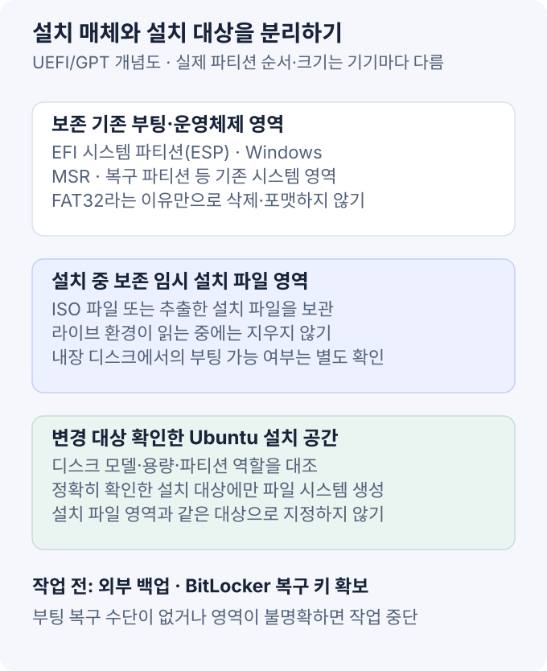

USB 메모리 없이 Ubuntu 설치 환경을 부팅하는 방법은 있다. 하지만 **설치 매체가 없어지는 것이 아니라, 내장 디스크나 네트워크가 그 역할을 대신하는 것**이다.

이 글은 Windows가 있는 x86-64 UEFI/GPT PC에서 내장 디스크를 활용하려 할 때 확인할 원리와 안전 조건을 정리한다. 펌웨어와 ISO 구성에 따라 달라지는 방법을 모든 PC에서 동작하는 클릭 순서로 안내하지는 않는다. 표준 설치 절차는 [Ubuntu 공식 설치 문서](https://ubuntu.com/desktop/docs/en/latest/tutorial/install-ubuntu-desktop/)를 기준으로 한다.

> **파티션을 지우기 전에:** “FAT 볼륨은 삭제해도 된다”는 판단은 위험하다. Windows 부팅에 필요한 EFI System Partition도 FAT32를 사용한다. 기존 ESP·Windows·복구 파티션을 설치 파일용 영역과 혼동하지 않는다.

## 1. 먼저 설치 목적과 부팅 경로를 구분한다

| 현재 환경·목적 | 검토할 방법 |
| --- | --- |
| Windows에서 Linux 개발 도구만 필요 | WSL이나 가상 머신. 물리적 듀얼 부팅과는 다른 구성 |
| 기존 Linux와 GRUB이 정상 동작 | ISO loopback 부팅을 검토할 수 있지만 해당 이미지의 부팅 지원과 설정을 확인 |
| UEFI에서 파일을 직접 선택해 부팅 가능 | 내장 임시 영역에서 부트로더·설치 환경을 읽을 수 있는지 확인 |
| 위 부팅 경로를 검증할 수 없음 | 공식 USB 설치나 별도로 관리되는 네트워크 부팅 환경 사용 |

GRUB의 ISO 부팅과 ISO 내부 파일을 풀어 UEFI에서 실행하는 방식은 다르다. Windows 파티션에 ISO 하나를 복사하는 것만으로 설치 메뉴가 생기지는 않는다. [GNU GRUB의 loopback 부팅 설명](https://www.gnu.org/software/grub/manual/grub/html_node/Loopback-booting.html)처럼 GRUB이 이미지를 읽는 것 외에도 운영체제가 설치 파일과 루트 환경을 찾을 수 있어야 한다. 이미지와 배포판의 지원 조건을 먼저 확인한다.

## 2. 세 영역을 분리해서 생각한다

- **기존 시스템 영역:** ESP, Windows, MSR, 복구 영역 등. 역할을 식별하고 보존한다.
- **임시 설치 매체 영역:** ISO 또는 설치 파일을 읽는 곳. 설치 완료 전까지 계속 필요할 수 있다.
- **Ubuntu 설치 대상:** 새 운영체제의 파일시스템을 만드는 곳. 포맷 여부를 명확히 확인해야 한다.

ESP는 부트로더를 저장하는 시스템 파티션이지 일반적인 임시 파일 보관소가 아니다. 같은 디스크의 다른 영역에 설치 환경이 있다면, 그 디스크 전체를 지우는 옵션과도 양립할 수 없다. [Microsoft UEFI/GPT 파티션 설명](https://learn.microsoft.com/en-us/windows-hardware/manufacture/desktop/configure-uefigpt-based-hard-drive-partitions?view=windows-11).

## 3. 변경 전 준비

### 데이터와 복구 수단

1. 중요한 파일을 변경 대상 디스크 밖에 백업한다.
2. 디스크 모델·용량과 각 파티션의 크기·용도를 기록한다. 드라이브 문자나 표시 순서만으로 식별하지 않는다.
3. BitLocker를 사용한다면 **복구 키를 다른 장치에서도 확인할 수 있게** 보관한다. 부팅 설정 변경 후 복구 키가 요구될 수 있다.
4. 기존 부팅 항목으로 되돌아갈 방법과, 실패했을 때 사용할 복구 매체를 준비한다.

백업과 복구 수단을 확보하지 못했다면 파티션 작업부터 시작하지 않는다. [Microsoft BitLocker 복구 키 안내](https://support.microsoft.com/en-us/windows/security/encryption/find-your-bitlocker-recovery-key).

### 이미지와 부팅 조건

공식 릴리스에서 CPU 아키텍처에 맞는 ISO를 내려받고 체크섬을 검증한다. 가능하면 체크섬 파일의 서명까지 확인해 이미지의 무결성과 출처를 함께 확인한다. [Ubuntu 이미지 다운로드](https://releases.ubuntu.com/), [공식 검증 절차](https://ubuntu.com/tutorials/how-to-verify-ubuntu).

내장 FAT32 영역에 ISO 내용을 풀어 사용하는 방식을 검토한다면, 총용량뿐 아니라 **개별 파일 크기 제한**도 확인해야 한다. FAT32에는 약 4 GiB의 단일 파일 한계가 있으므로, 큰 파일이 포함된 이미지를 단순 복사하는 방식이 성립하지 않을 수 있다. 파일이 들어가지 않는다고 설치 구성 파일을 임의로 누락하거나 분할하지 않는다. [파일시스템 제한 비교](https://learn.microsoft.com/en-us/windows/win32/fileio/filesystem-functionality-comparison).

## 4. 내장 영역에서 부팅을 검토하는 순서

아래는 장비별 검증 순서이지, 검증 없이 실행할 공통 설치 명령은 아니다.

1. **임시 영역 식별:** 기존 ESP나 설치할 Ubuntu 영역이 아닌, 별도로 확보한 영역인지 확인한다.
2. **부팅 방식 결정:** GRUB이 ISO를 읽을 것인지, UEFI가 추출된 설치 환경의 EFI 실행 파일을 읽을 것인지 구분한다.
3. **파일 구성 확인:** 파일을 푸는 방식이라면 숨김 항목을 포함한 설치 구조가 보존되어야 한다. ISO 파일만 복사하는 것과 다르다.
4. **일회성 부팅 시험:** 펌웨어가 지원하는 경우 일회성 부팅 메뉴나 파일 선택 기능으로 시험한다. 메뉴 이름과 내장 영역 검색 방식은 제조사마다 다르다.
5. **Live 환경 확인:** 설치 화면이 나타났다는 것만으로 진행하지 않고, 디스크·입력 장치·네트워크와 설치 파일 접근이 정상인지 확인한다.

예를 들어 x86-64 UEFI 이미지에는 `EFI/BOOT/BOOTX64.EFI` 같은 부팅 파일이 있을 수 있지만, **그 경로를 선택하면 모든 내장 디스크에서 부팅된다는 뜻은 아니다.** 펌웨어가 영역을 읽어야 하고, 이후 부트로더와 Live 환경도 필요한 설치 파일을 찾아야 한다.

Secure Boot 오류를 만나도 무조건 기능을 끄는 방향으로 해결하지 않는다. Ubuntu의 서명된 부팅 구성, 이미지와 아키텍처, 펌웨어의 신뢰 정책부터 확인한다. [Ubuntu Secure Boot](https://documentation.ubuntu.com/security/security-features/platform-protections/secure-boot/).

## 5. 설치 프로그램에서 확인할 것

수동 파티션 구성을 선택했다면 적용 직전의 변경 목록을 확인한다.

- **Ubuntu 루트:** 의도한 대상 영역을 선택하고 파일시스템과 `/` 마운트 지점을 확인한다.
- **EFI 영역:** UEFI 설치에 사용할 ESP와 부트로더 대상이 맞는지 확인한다. 기존 Windows와 공유하는 ESP를 임의로 포맷하지 않는다.
- **보존 대상:** Windows·복구·데이터 영역과 설치 매체 영역이 변경 목록에 들어가지 않았는지 확인한다.
- **표시 이름:** Windows에서 Linux 파일시스템을 인식하지 못해 표시하는 이름이나 `Unknown`만 보고 삭제 대상을 결정하지 않는다.

암호화된 Windows와의 병행 설치는 설치 프로그램의 제약이 있을 수 있다. BitLocker가 활성화된 상태에서 진행 가능 여부를 확인하고, 암호화 해제나 파티션 변경이 필요하면 먼저 공식 안내와 백업 상태를 검토한다. [Ubuntu의 BitLocker 설치 안내](https://ubuntu.com/desktop/docs/en/latest/reference/bitlocker-during-ubuntu-installation/).

## 6. 설치 후와 중단해야 할 상황

설치가 끝나면 새 Ubuntu를 **설치 환경이 아니라 설치된 시스템으로 부팅**해 확인한다. Windows도 유지하는 구성이라면 양쪽 부팅과 데이터 접근이 정상인지 확인한 뒤, 처음 기록한 임시 설치 매체 영역만 정리한다. EFI 영역을 임시 영역처럼 삭제해서는 안 된다.

다음 상황에서는 추측으로 진행하지 않는다.

| 상황 | 다음 확인 |
| --- | --- |
| UEFI 부팅 메뉴에 내장 설치 영역이 없음 | 해당 펌웨어의 지원 여부. 지원하지 않으면 다른 설치 매체 사용 |
| 설치 파일 복사가 끝나지 않음 | 파일 크기 제한·공간·무결성. 누락 파일을 무시하지 않음 |
| Live 환경이 설치 파일을 찾지 못함 | 선택한 부팅 방식과 이미지의 경로·지원 조건 |
| 디스크가 안 보이거나 파티션 용도를 모름 | 암호화·스토리지 모드·디스크 구성 확인 후 중단 |
| 부팅 실패·BitLocker 복구 화면 | 기존 부팅 설정과 준비한 복구 키·매체 사용 |

USB가 없는 방식의 핵심은 파티션을 덜 신중하게 다뤄도 된다는 것이 아니다. **부팅에 필요한 파일을 읽는 영역과 설치하며 변경할 영역을 구분하고, 실패해도 복구할 수 있는 상태에서만 진행하는 것**이다.
