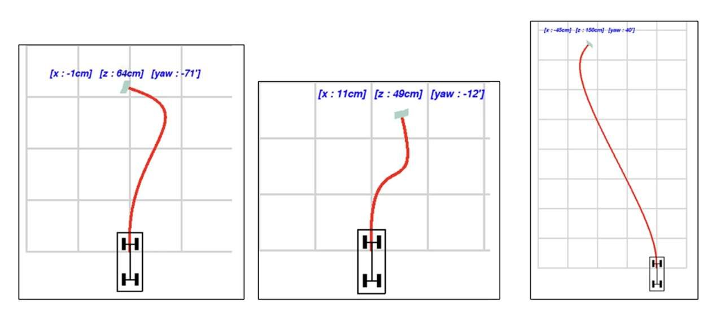
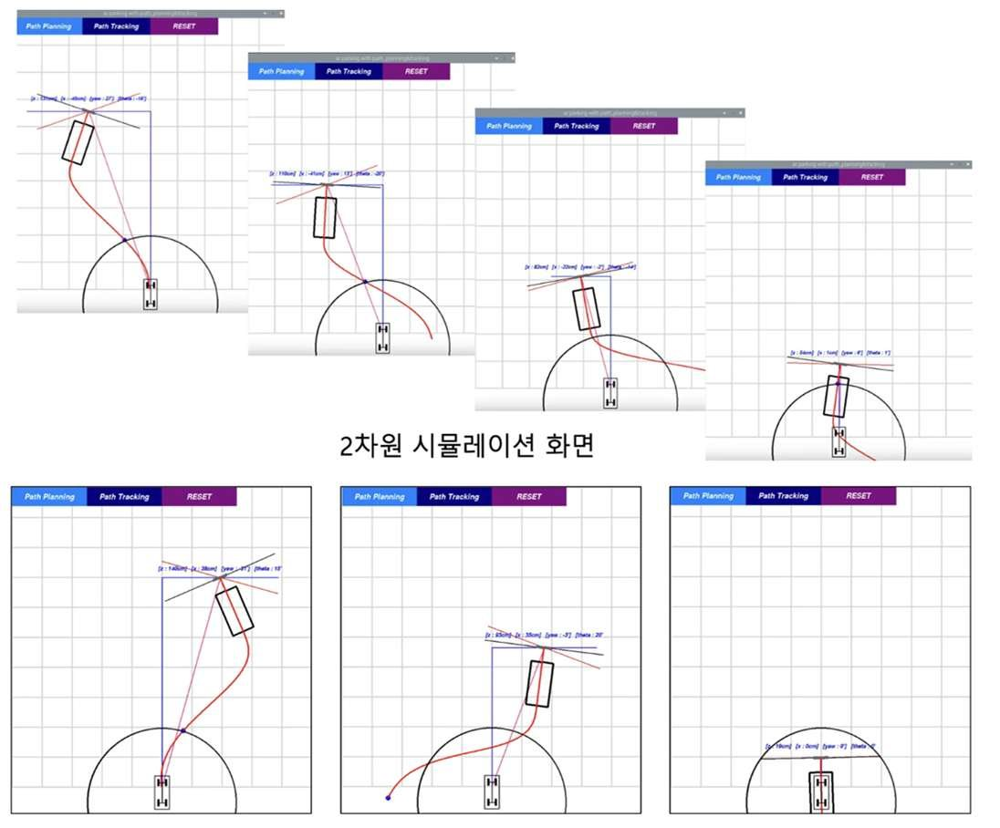

카메라의 AR-Tag 인식으로 위치를 추정하고 주차 경로를 생성·추종하는 프로그램을 만들었습니다. 자이트론 인턴 기간의 1인 프로젝트로 카메라 보정, 경로 생성·추종과 Pygame GUI를 담당했습니다.

- Camera Calibration 으로 얻은 Intrinsic Parameter 로 입력 영상의 왜곡 제거
- 왜곡을 제거한 이미지에서 AR-Tag 를 식별해 카메라의 현재 Pose 추정
- Quintic-Polynomial 로 현재 Pose 에서 도착 Pose 까지의 경로 생성
- Pure-Pursuit 로 경로를 추종하도록 제어하고 PyGame 으로 2D 시각화

#### 문제 해결

**문제** AR-Tag 위치 추정이 제대로 되지 않고 오차가 5cm 이상 생기는 지점이 있었습니다.

**해결** Camera Calibration 의 입력 이미지가 부족했다고 판단해 30\~40 장에서 80\~100 장으로 두 배 이상 늘렸습니다. Calibration 에 한 시간 넘게 걸렸지만 오차 증상은 사라졌습니다.

#### 회고

- 차량의 특성과 주행 환경을 고려한 경로 생성·추종 알고리즘 선택이 중요합니다.
- AR-Tag 기반 위치 추정에서는 카메라 보정 품질이 이후 경로 생성·추종의 입력 오차로 이어졌습니다.

`OpenCV` `AR-Tag` `Path Planning` `Pygame`

[보안상 공개 불가]() [Demo Video](<https://www.youtube.com/watch?v=-GKsm9lfCZk>)

