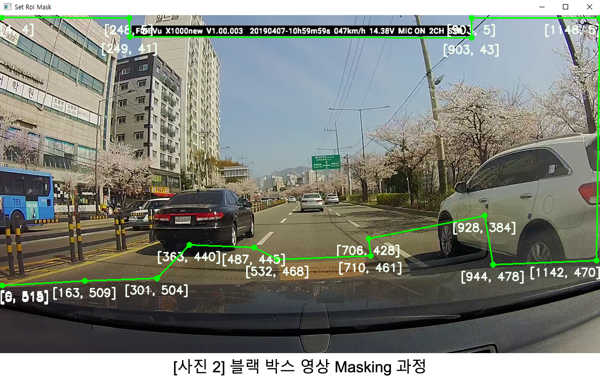
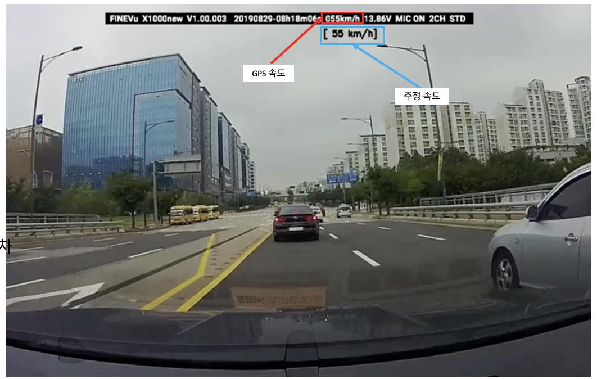
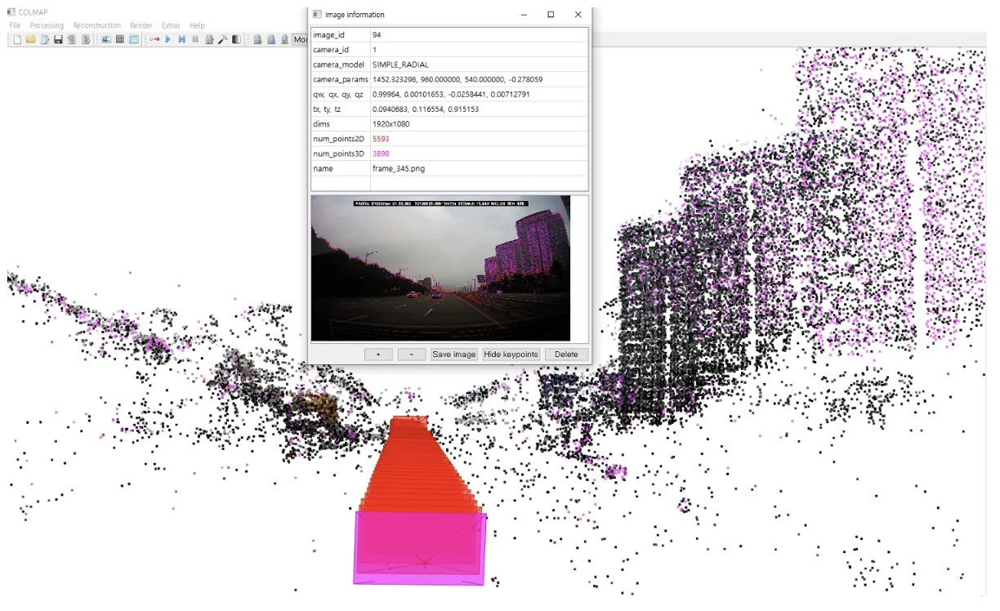

블랙박스 영상의 3D 재구성 결과와 실거리 기준을 이용해 차량 속도를 추정했습니다. GMD SOFT 인턴 기간에 1인으로 진행했습니다.

- 블랙박스 영상을 마스킹 전처리한 뒤 COLMAP 으로 3D 재구성
- 실제 길이와 재구성 공간의 길이를 비교해 미터 단위 환산 계수 계산
- 프레임 간 이동 거리와 시간 차로 실제 속도 산출

#### 문제 해결

**문제** 3D 재구성이 불규칙하게 이루어져 Point Cloud 품질이 나빴습니다.

**원인** 영상 상단의 블랙박스 정보 표시와 하단의 차량 보닛이 매 프레임 같은 자리에 찍혀 재구성에 노이즈로 작용했습니다.

**해결** 해당 영역을 마스킹해 제거하자 훨씬 안정적인 Point Cloud 를 얻었습니다.

#### 스케일 산출 방법

- 구간 내 눈에 띄는 랜드마크(주로 가로등 간격)를 골라 지도로 실제 길이 측정
- 재구성한 3D 공간에서 같은 랜드마크 사이의 좌표 거리 측정
- 실제 거리 / 재구성 거리의 비율을 카메라 이동 거리에 적용한 뒤 시간 차로 나눠 속도 계산

단안 SfM의 3D 좌표 단위는 이미지의 픽셀 단위와 다릅니다. 실거리 기준이 없으면 절대 스케일을 정할 수 없습니다.

#### 결과와 한계

주행 영상 세 편 모두 일정 구간에서는 ±3 km/h 수준의 오차를 보였고, 그 구간은 대부분 랜드마크를 측정한 지점 근처였습니다. 반면 랜드마크에서 멀어질수록 오차가 커져 후방 카메라에서는 250 km/h 까지 벌어졌습니다.

**오차 분석** 기준 지점에서 얻은 하나의 환산 계수를 전체 구간에 적용했을 때 오차가 커졌습니다. 재구성의 국소 왜곡과 카메라 위치 추정 오차가 원인 후보이며, 각각의 기여는 추가 검증이 필요합니다.

**개선 과제** 여러 실거리 기준점에서 스케일의 일관성을 확인하고, 카메라 보정·특징점 매칭·위치 추정 오차를 분리해 검증해야 합니다.

`COLMAP` `SfM` `OpenCV`

[보안상 공개 불가]() [후방 Demo 1](<https://www.youtube.com/watch?v=_HwGZA1f8t0>) [후방 Demo 2](<https://www.youtube.com/watch?v=oEf1EfqPtWA>) [전방 Demo](<https://www.youtube.com/watch?v=cIEgDyLUE0I>)

