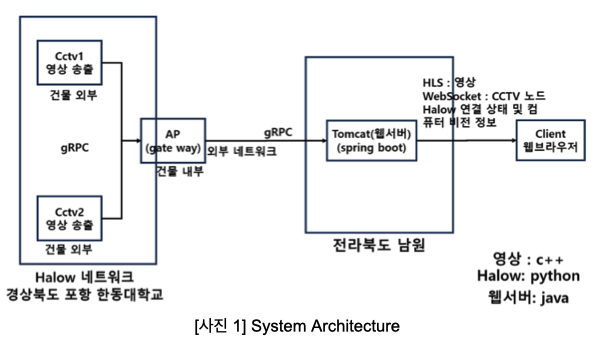
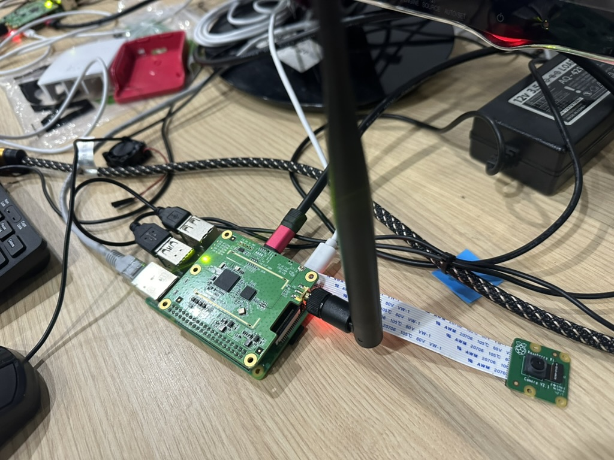
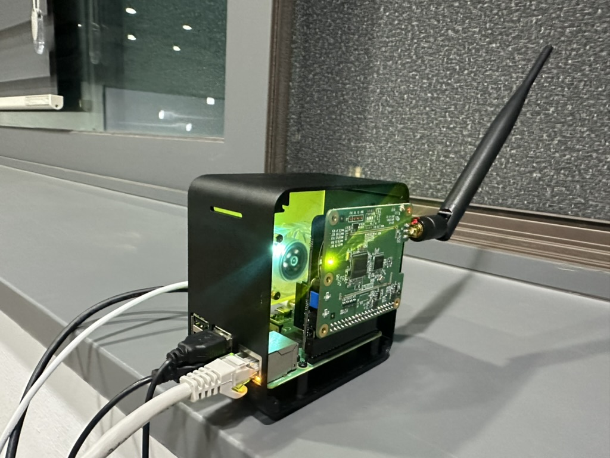

유선 연결이 어려운 곳에도 CCTV 를 설치할 수 있도록, 여러 노드에서 촬영한 영상을 실시간 웹 스트리밍하는 시스템을 4인 팀으로 구축했습니다. 임베디드 프로그래밍과 영상처리, gRPC 통신 개발을 맡았습니다.

- CCTV 노드와 게이트웨이를 직접 설치하고 라즈베리파이에 Wi-Fi HaLow 모듈 연동
- gRPC로 영상 송신 — Protocol Buffers로 메시지 구조를 정의하고 클라이언트·서버 연동
- Crontab 으로 CCTV 노드를 자동 실행하고 이상 발생 시 대처

#### Wi-Fi HaLow 를 선택한 이유

Sub-1GHz 대역의 장거리·저전력 통신을 활용해 건물 외부 CCTV 노드와 내부 게이트웨이를 연결하려고 선택했습니다. 실제 통신 거리와 처리량은 출력·안테나·장애물·채널 설정에 따라 달라집니다.

`gRPC` `Wi-Fi HaLow` `Raspberry Pi` `Crontab`

[GitHub](<https://github.com/InternetOfTough/CCTV_HaLow>)

