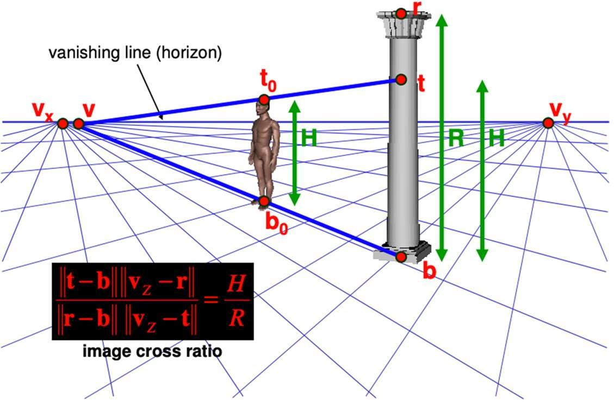
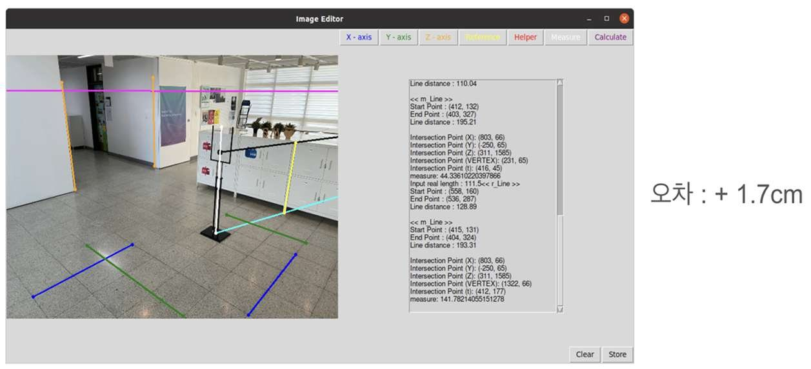

범죄 현장에서 용의자의 인상착의를 특정하기 어렵다는 문제에서 출발해, CCTV 영상 한 장으로 용의자의 키를 추정했습니다. GMD SOFT 산학 과제로 5인이 참여했고 선행 연구 조사와 Single View Geometry 기반 높이 추정 알고리즘 개발을 맡았습니다.

- PyQT 로 X, Y, Z 방향별 평행선을 두 개씩 입력받아 방향별 Vanishing Point 생성
- X, Y 방향의 Vanishing Point 를 이어 수평선에 해당하는 Vanishing Line 생성
- 실제 길이를 아는 Reference Line 과 Z Vanishing Point 로 비율을 계산해 대상 높이 산출

#### 실측 결과

높이를 아는 사물함을 Reference 로 삼아 표지판과 사람의 키를 측정했고, 오차는 각각 +1.7cm 와 +1cm 였습니다.

#### 한계와 회고

- 기준 물체의 높이와 지면·수직 방향의 기하 조건을 이용한 추정값입니다. 두 사례의 오차를 다른 CCTV 환경의 정확도로 일반화할 수는 없습니다.
- 이 구현은 X·Y·Z 방향의 평행선을 입력해야 합니다. 해당 선을 식별하기 어려운 장면은 현재 방식으로 처리하기 어렵습니다.
- 사용자가 GUI 에서 마우스로 점을 찍을 때 생기는 오차를 줄이는 전처리가 필요합니다.

#### 성과

- 산학 과제 계약 연장
- 방학 기간 인턴십 기회 확보

`OpenCV` `Single View Geometry` `PyQT`

[보안상 공개 불가]() [Demo Video](<https://www.youtube.com/watch?v=-ZYTrtNs5Vk>)

