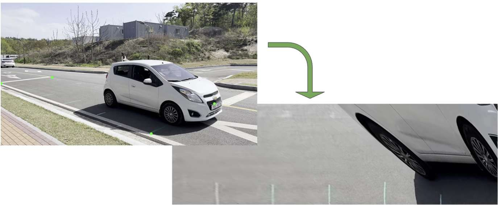
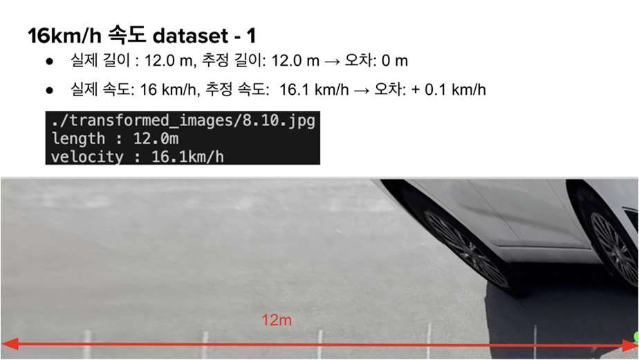

고정 CCTV 영상에서 차량의 이동 거리와 시간 차로 속도를 추정했습니다. GMD SOFT 산학 과제로 5인이 참여했고 경쟁사 제품 분석, 속도 추정 알고리즘 개발과 데모 데이터 수집을 맡았습니다.

- 차량이 주행하는 지면의 직사각형 길이를 현장에서 직접 측정
- 해당 구간을 직접 주행하며 속도별 데이터셋 촬영(청테이프로 구간 표시)
- 지면의 네 점을 대응시킨 Perspective Transformation으로 직사각형 RoI를 정면 시점으로 변환
- 차량이 영역에 들어오면 미리 그은 기준선을 클릭해 시점별 위치 저장
- 이전 시점과의 위치·시간 차로 속도 추정

#### 문제 해결

**문제** 원근 제거를 위한 Affine & Metric Rectification 은 연산량이 많고 결과가 직각으로 제대로 나오지 않았습니다.

**해결** 정해진 기한을 지키기 위해 더 단순하고 직관적인 Perspective Transformation 으로 방법을 바꿨습니다. 특정 RoI 에 대해서만 수행하면 사각형 복원이 가능합니다.

#### 결과

촬영 데이터셋 기준 평균 오차는 0.5 km/h였습니다. 아래는 개별 측정 사례입니다.

- 13 km/h 구간: 추정 12.4 km/h (오차 -0.6)
- 16 km/h 구간: 추정 16.1 km/h (오차 +0.1)
- 18 km/h 구간: 추정 17.9 km/h (오차 -0.1)

#### 한계와 회고

- 촬영 여건상 고속 데이터셋을 찍지 못해 고속 주행에서의 성능은 보장할 수 없습니다.
- 현재 결과는 보정한 지면 RoI 안의 측정입니다. 영역을 넓히려면 카메라 보정·도로 평면 가정과 위치별 오차를 다시 검증해야 합니다.
- 지면 밖의 점에는 같은 평면 변환을 그대로 적용할 수 없습니다. 차량에서 선택한 측정점의 높이와 클릭 오차도 오차 요인입니다.

#### 성과

- 산학 과제 계약 연장
- 방학 기간 인턴십 기회 확보

`OpenCV` `Perspective Transform` `Dataset`

[보안상 공개 불가]() [Demo Video](<https://www.youtube.com/watch?v=v-8i_FkTkIU>)

