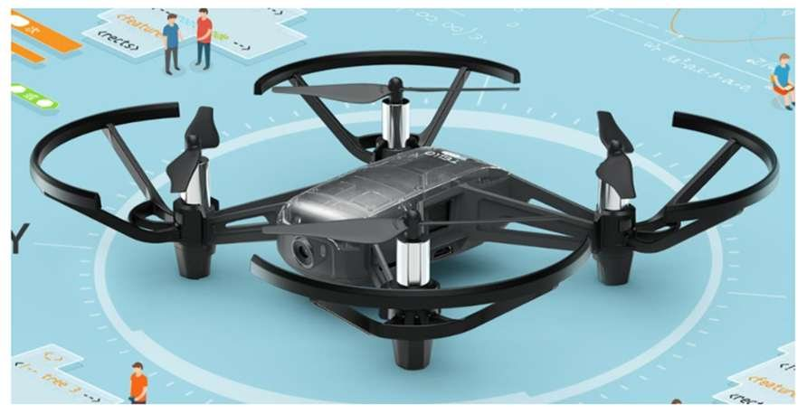

객체를 인식해 그 앞까지 자율 주행하는 드론을 1인으로 만들었습니다. 객체 인식과 제어 최적화를 맡아, 대상을 정확히 인식하고 그 앞까지 자연스럽게 주행하도록 다듬었습니다.

- OpenCV 의 HSV 변환과 Edge 검출로 대상 인식
- YOLO 로 객체를 인식해 회피 주행
- PID 제어로 객체 앞까지의 접근을 부드럽게 조절
- Djitellopy 와 UDP 로 Tello 드론을 원격 조작

`OpenCV` `YOLO` `PID` `djitellopy`

[보안상 공개 불가]()

