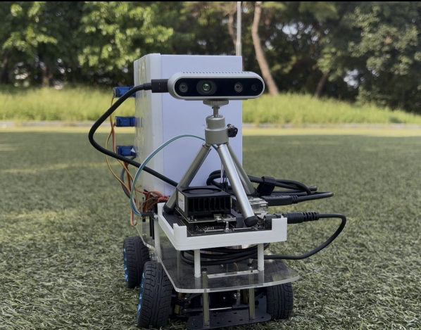
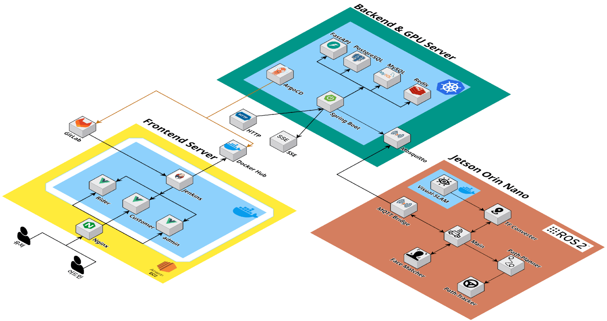
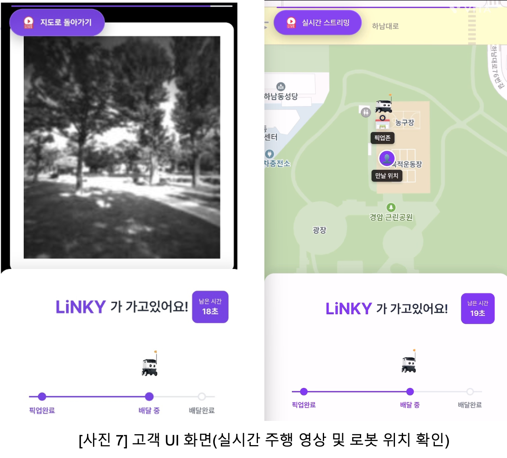
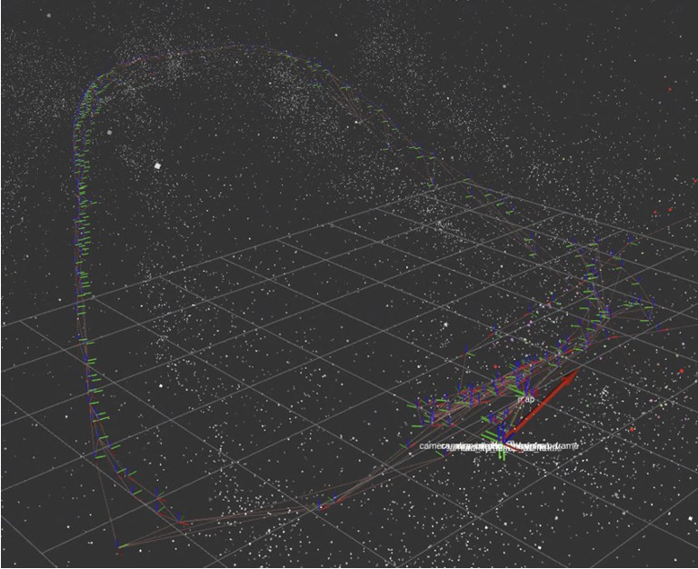
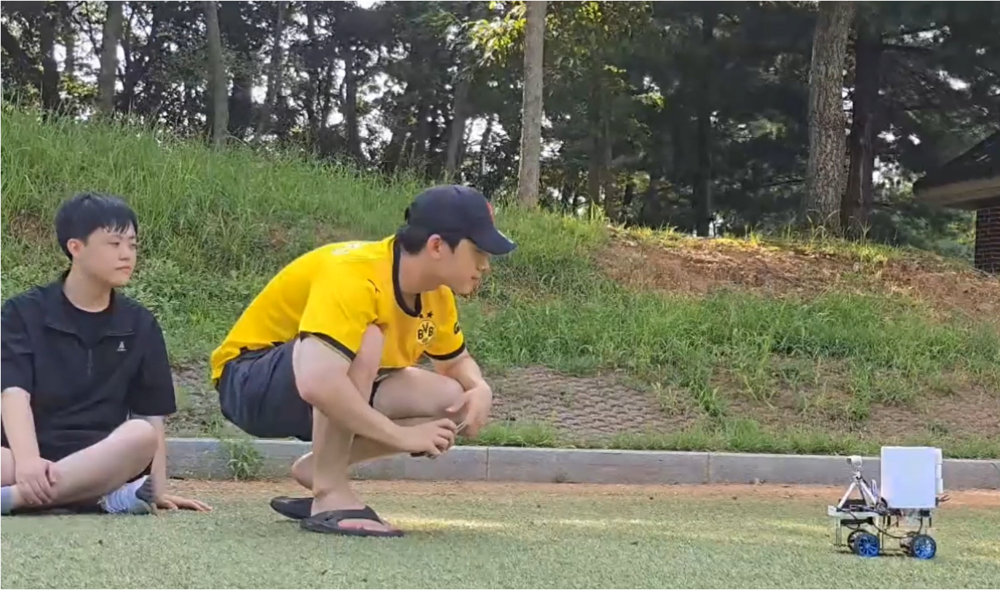

한강에서 배달 음식을 받으려면 먼 거리를 걸어가야 하는 불편을 해결하기 위해, 야외에서 카메라 기반으로 자율주행하는 배달 로봇을 만들었습니다. 6인 팀에서 팀장이자 PM 으로 자율주행 로봇 개발을 맡았습니다.

- Jetson Orin Nano 에 최적화된 Isaac ROS Visual-SLAM 으로 온디바이스 위치 추정
- RealSense D435i 로 Point Cloud 를 얻어 주행 환경 지도를 미리 생성
- 주행 환경의 GPS 정보를 SLAM 좌표와 매핑해 GPS \<-\> SLAM 실시간 변환
- 가까운 고객 순으로 경로를 만들고 Pure-Pursuit 로 추종
- FaceNet 으로 사전 등록 사진과 실시간 이미지를 비교해 수령자 확인
- 실시간 영상을 base64 로 변환해 MQTT 로 송신, 관리자·고객 화면에서 확인

#### 설계 변경

**gRPC → REST + SSE** 서버·로봇 간 gRPC 통신은 동작했지만 브라우저 연동에서 문제가 생겼습니다. gRPC-Web 클라이언트·중계 구성의 연동을 완료하지 못해, 일정 안에 구현할 수 있는 REST와 SSE로 전환했습니다.

**WebRTC → MQTT 이미지 전송** C++ FFmpeg 파이프라인과 백엔드 OpenVIDU 연동을 완료하지 못했고, 별도 시그널링 구현 시간도 부족했습니다. 대안으로 이미지 프레임을 Base64로 변환해 MQTT 토픽으로 전달했습니다. WebRTC 스트리밍과 달리 프레임별 이미지 전송 방식이며, 인코딩 비용·전송량·수신 지연을 별도로 관리해야 합니다.

`ROS2` `Isaac ROS VSLAM` `MQTT` `FaceNet` `Docker`

[GitHub](<https://github.com/YooJuno/LiNKY>)

