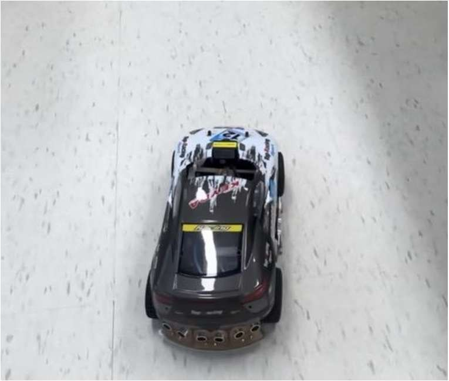

자이트론이 주관한 대회에서 카메라 영상만으로 트랙을 자율 주행했습니다. 3인 팀에서 조향 알고리즘 최적화를 맡아 부드러운 조향으로 주어진 트랙을 성공적으로 완주했습니다.

- OpenCV 의 Hough 변환으로 차선 인식
- PID 로 직선과 코너 모두에서 차선 중앙 주행 유지
- YOLO 로 객체를 인식해 회피 주행

`OpenCV` `PID` `YOLO`

[보안상 공개 불가]()

