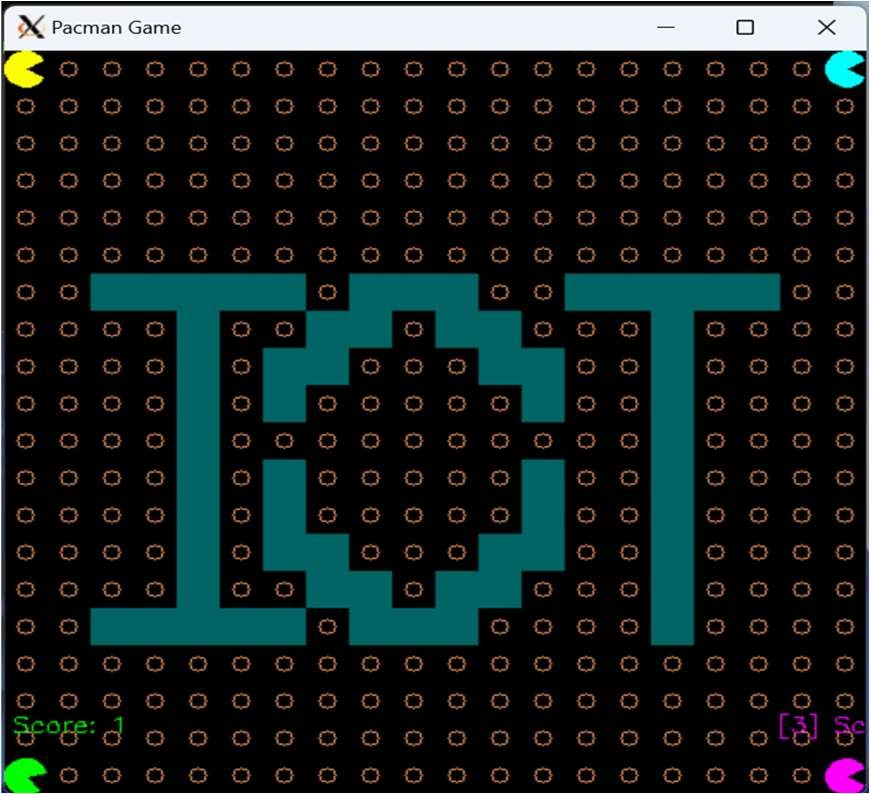
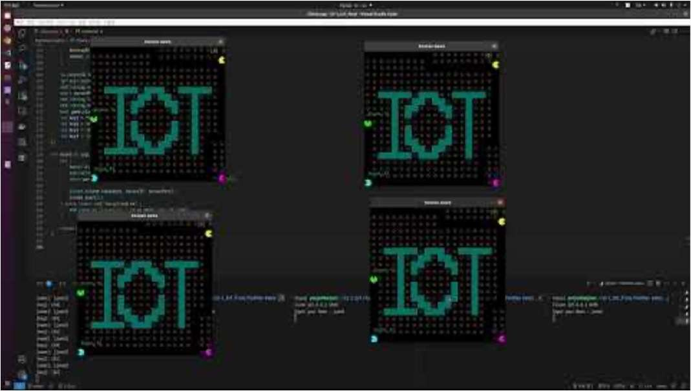

서버 비동기 처리 방식의 수요가 늘어나는 흐름에서, 다중 사용자가 함께 플레이하는 온라인 Pacman 을 2인으로 만들었습니다. 게임 인터페이스 제작과 클라이언트 비동기 통신 설계를 맡았습니다.

- 서버: io\_context 기반 이벤트 루프, 클라이언트별 Session 클래스로 연결 유지
- 비동기로 들어오는 키 입력을 처리하고 게임 상태를 브로드캐스트
- 클라이언트: 방향키 입력을 서버로 보내고 응답에 따라 OpenCV 로 UI 갱신
- UI 와 네트워크 로직을 모듈로 분리해 유지보수성 확보

#### 한계

- 메시지 패킷의 직렬화·압축이 없어 클라이언트가 많아지면 지연이 생길 수 있습니다.
- 단일 맵의 이동과 점수 처리만 구현했고 Ghost AI, 충돌, 레벨은 없습니다.
- strand 만으로 동기화해 IOCP 기반의 고성능 확장성은 고려하지 않았습니다.
- OpenCV UI 는 그래픽 성능과 애니메이션이 제한적이라 OpenGL 이나 SDL 로 확장할 여지가 있습니다.

`Boost ASIO` `TCP` `OpenCV`

[GitHub](<https://github.com/YooJuno/PacmanGame-BoostASIO>) [Demo Video](<https://www.youtube.com/watch?v=2uh6XcFZric>)

