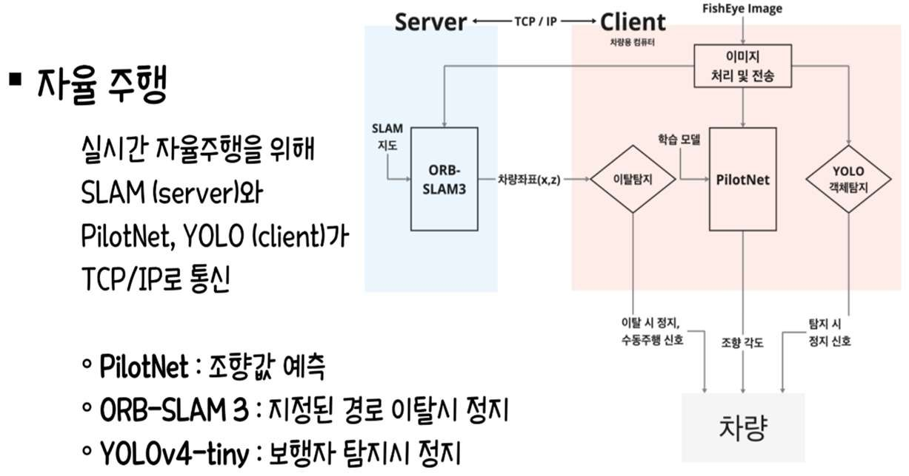
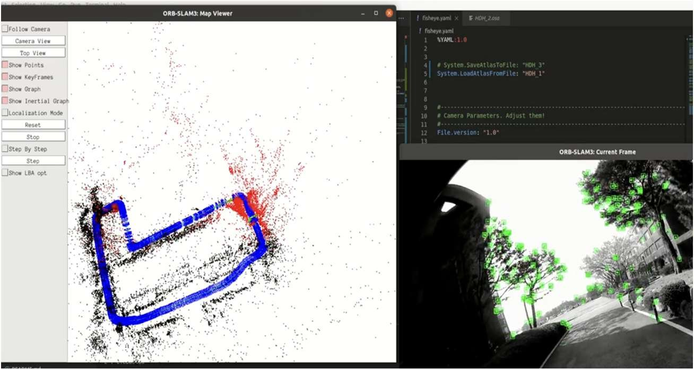
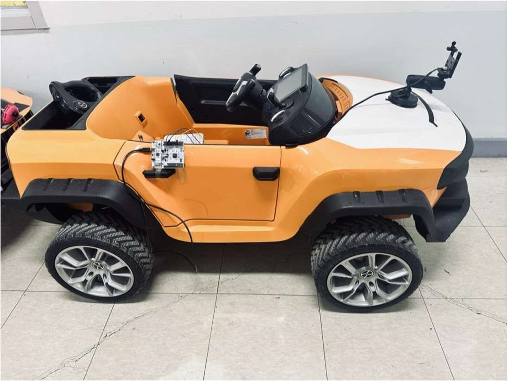

End-to-End 자율주행 모델인 PilotNet 의 단점을 보완하고 성능을 높이는 연구입니다. 앤씨앤 기술 자문으로 5인이 참여했고, 서버 기반 Visual-SLAM 개발과 YOLO·PilotNet 결합을 맡았습니다.

- 정확한 SLAM 처리를 위한 어안렌즈 Calibration
- PilotNet 으로 경로를 학습해 조향값 예측
- ORB-SLAM3 로 경로 지도를 만들고 실시간 위치 추정, 이후 주행에서 Relocalization
- YOLO 로 보행자를 탐지하면 정지, 지정 경로를 벗어나면 정지

#### 구조 개선

기존에는 차량용 노트북에서 모든 연산을 실행했습니다. 전방 영상을 TCP 로 서버에 보내 Visual-SLAM 을 수행하고 좌표만 회신받는 서버-클라이언트 구조로 바꿔 차량의 부하를 줄였고, 그 결과 실시간 자율주행이 가능해졌습니다.

`PilotNet` `ORB-SLAM3` `YOLOv5` `TCP`

[GitHub](<https://github.com/YooJuno/Autonomous-Driving_E2E_SLAM>) [논문](<https://www.dbpia.co.kr/journal/articleDetail?nodeId=NODE11522374>) [Demo Playlist](<https://www.youtube.com/playlist?list=PLg3p47m-psINqF_8QVGMixhW7zAv6Ir2F>)

