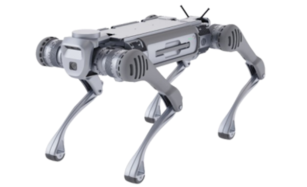
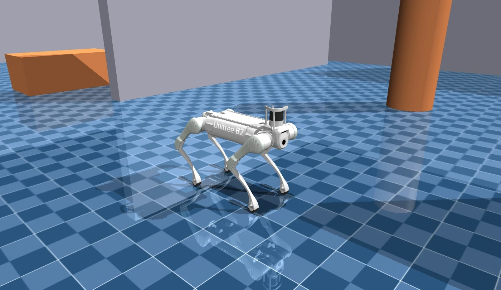
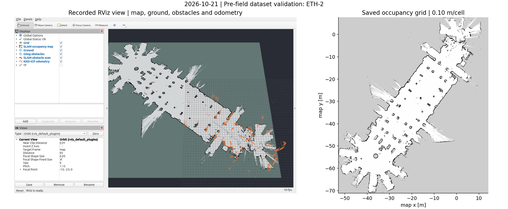
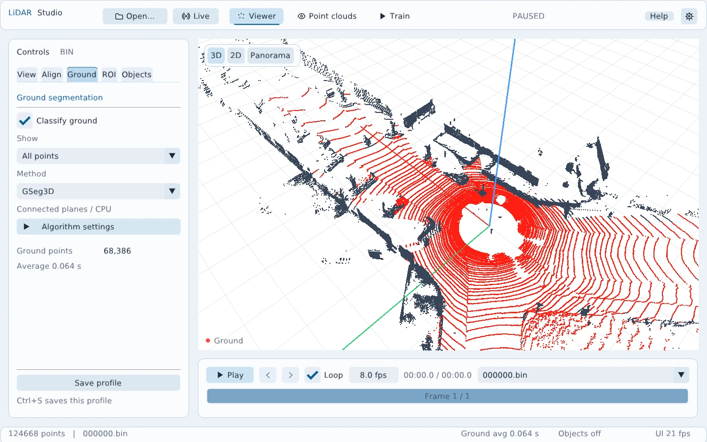
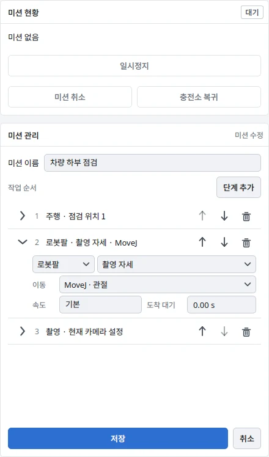
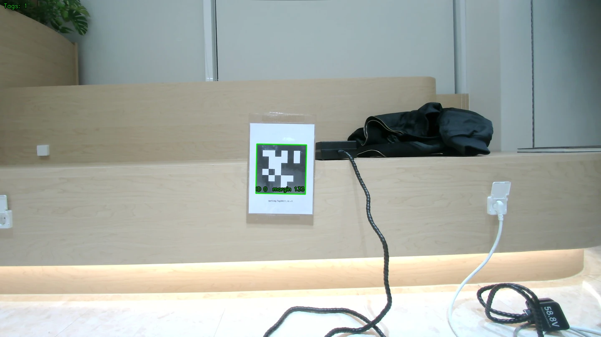

Unitree B2로 철도 차량 하부를 점검하는 프로젝트입니다. 지도 생성, Nav2·관제 연동, 열차 정차 거리 측정과 충전 도킹을 맡았습니다.

#### 지도 생성·정합

LiDAR·IMU 주행 기록 6개로 초기 통합 지도를 만들었습니다. 재방문 구간을 대조하고 기준 포즈를 고정해 이중 벽과 통로 폭 왜곡을 보정했습니다.

#### 지면 분리·코스트맵

IMU로 점군을 수평화하고 GSeg3D로 지면을 분리했습니다. bag 재생에서는 Ground Consistency Layer로 3D 장애물 반영을 검증했고, 실기에는 높이를 제한한 LaserScan과 Nav2 ObstacleLayer를 썼습니다.

#### 열차 정차 거리

철제 구조물과 열차 전면을 점군에서 분리해 열차 진행 방향의 거리를 계산했습니다. 정지 상태에서 반복성을 확인했고, 절대 오차는 추가 실측이 필요합니다.

#### 실기 주행·관제

관제에서 지정한 웨이포인트를 Nav2로 주행해 목표점 5곳에 도착했습니다. 일부 구간에서는 오도메트리 갱신 지연으로 보호 정지가 반복됐습니다.

#### AprilTag 도킹

B2 전방 카메라를 보정해 마커 기준 목표 자세를 구했습니다. 진입·정렬·앉기를 연동해 시험했습니다. 반복 정렬 오차는 추가 실측이 필요합니다.

`ROS 2` `Nav2` `SLAM Toolbox` `GSeg3D` `AprilTag` `C++·Qt`

[위고로보틱스 경력](#career-wego) [GSeg3D 기술 글](/blog/lidar-ground-segmentation/)

장비 이미지 [Unitree](https://www.unitree.com/b2/) · ETH-2 지도 [GrandTour](https://grand-tour.leggedrobotics.com/dataset), [CC BY-SA 4.0](https://creativecommons.org/licenses/by-sa/4.0/)
