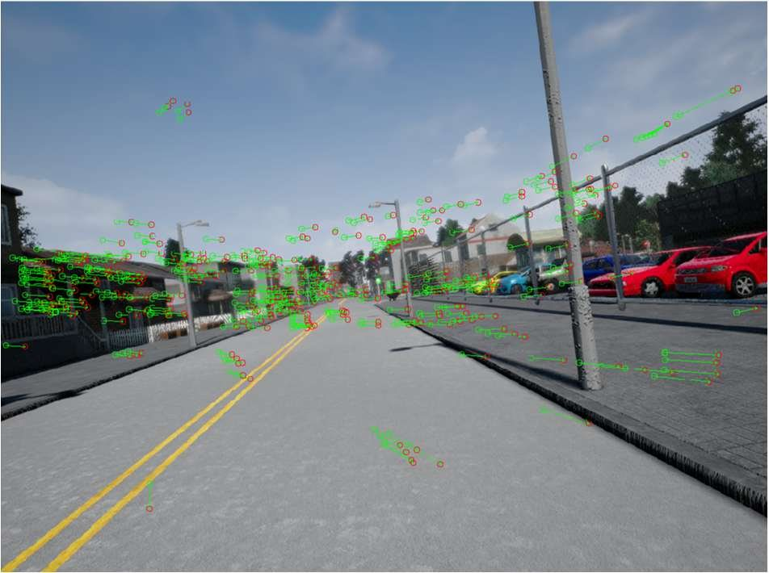
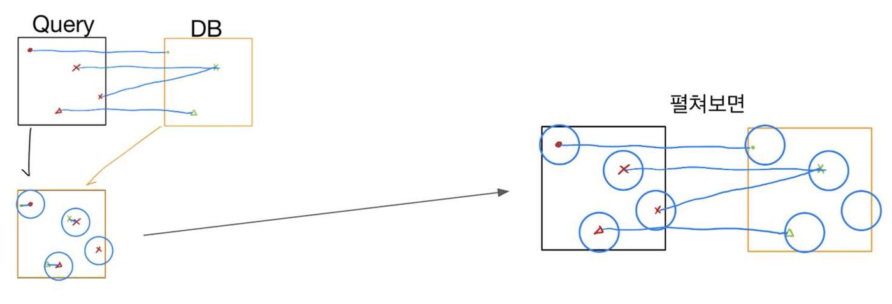

공장 규모가 커지면서 작업자 관리 필요성이 높아진 배경에서, 영상만으로 작업자의 실시간 이동 경로를 확인했습니다. 포항산업과학기술원 산학 과제로 4인이 참여했고 Feature Extraction 과 Matching 알고리즘 최적화를 맡았습니다.

- 작업자 안전모에 부착한 360° 파노라마 카메라의 천장·전면 이미지로 위치 추정
- 현재 이미지와 이전 이미지를 매칭해 특징점이 움직인 거리 벡터로 이동 경로 계산
- 노이즈로 인한 오차를 보완하기 위해 사전 촬영한 DB 이미지와 비교해 위치 갱신

#### 문제 해결

**문제** 공장은 빛이 적고 주변 모습이 서로 비슷해, 실제로 같은 위치가 아닌 엉뚱한 곳의 Feature 가 계속 매칭됐습니다.

**해결** 작업자의 이동 속도가 빠르지 않아 연속된 입력 이미지의 차이가 크지 않다는 점에 착안했습니다. 이전 이미지에서 추출한 Feature 위치의 일정 반경 안에서만 현재 Feature 를 찾는 Radius Matching 을 고안해 적용했고, 무분별하던 매칭쌍이 크게 줄어 유의미한 결과만 남았습니다.

#### 성과

- 공장 내 특정 구간에서 실시간 추정한 위치가 실제 경로와 비슷한 양상을 보였습니다.
- 산학 과제 재계약 달성

`SIFT` `RANSAC` `Feature Matching`

[보안상 공개 불가]()

